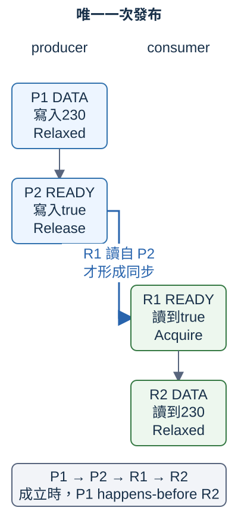
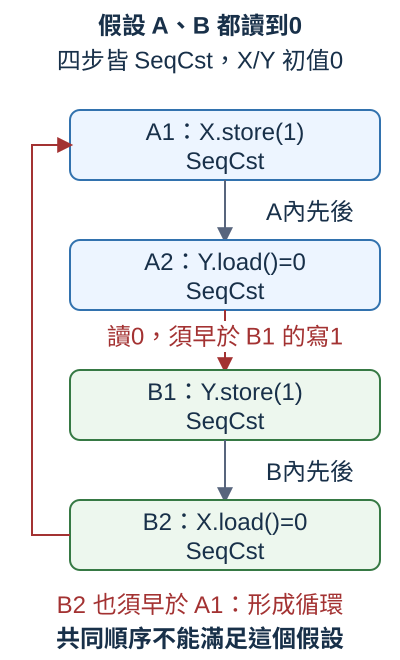

# 13.8 atomic 與 memory ordering：單次更新與跨操作同步

現在有兩份 worker，分別完成三件與兩件小工作，**每完成一件就把同一個計數加1；全部正常完成後應得到5**。13.6的 Mutex 能把「讀舊值、加1、寫回」放在同一份 guard 下。這裡先學標準庫直接提供的單次數值更新，再問另一個問題：若 worker 已算出總和230，**讀者看到「可讀」旗標時，是否也能讀到這份230？**

這兩個問題需要不同保證。單次 atomic 操作不會被拆開，但多個操作如何建立同步關係，要另外判斷。本節先寫出需要的關係，再看例子結果；跑通與效能、所有排程的正確性各有不同證據。

本節使用沒有 library 的 `concurrency-stages` package。完整 member 設定如下，沿第 12.1 節採用 repo 根 workspace 的共同欄位；命令都從 repo 根目錄執行。每份 example 的根程式與實際載入的 helper 都在當頁完整列出。

```toml
--8<-- "examples/concurrency-stages/Cargo.toml"
```

## AtomicUsize：同一個數值，一次完成更新

**atomic（原子操作）** 延續13.6／13.7的「不可拆開」意義：相對於同一位置的其他 atomic 操作，一次操作整體完成。**`std::sync::atomic::AtomicUsize`** 保存一個 usize，讓不同 thread 透過 atomic 方法讀取或更新；**`AtomicBool`** 則保存 bool，稍後用作旗標。

兩者都有 Send 和 Sync，更新方法用 shared receiver `&self`，沿11.9的 interior mutability。它們仍是 owned 值，沒有 Copy；要讓多份 worker 使用同一位置，可沿13.6用 Arc 保活並分發 ownership。Arc clone 保留同一個 atomic，沒有把它的內容複製成另一個獨立計數。

先只選 AtomicUsize 的四項操作：

- `AtomicUsize::new(value)` 建立初值為 value 的位置。
- `load(order)` 讀取一個 usize，交回普通的數值副本。
- `store(value, order)` 把位置改成 value，回傳 unit；不會把 value 加到原值上。
- `fetch_add(amount, order)` 把讀舊值、相加與更新合成 **read-modify-write（RMW，讀改寫）**，交回的是 **更新前的舊值**。它的 overflow 採 wrapping：超過 usize 最大值會繞回，不因 debug 模式自動檢查失敗；本節的小數值都不會 overflow。

這裡的 order 是 **`std::sync::atomic::Ordering`** enum，用來指定 **memory ordering（記憶體順序）**：這次 atomic 操作提供哪些同步／順序保證。第 9.7 節的 `std::cmp::Ordering` 是大小比較結果，這裡則從 atomic module 引入同步用的 Ordering。

先選 **`Ordering::Relaxed`**，前述 load、store、fetch_add 都接受它。Relaxed 仍保證各單步 atomic，且 **同一個 atomic 的所有修改有一份各 thread 一致的修改順序**；沒有因此把不同 atomic 的操作一起同步。它也不保證每次 load 都讀到最新修改，或立即通知另一份工作。

以下列出本節選用的 AtomicUsize 方法介面，沒有實作 body，不是獨立程式：

```rust
pub fn load(&self, order: Ordering) -> usize
pub fn store(&self, value: usize, order: Ordering)
pub fn fetch_add(&self, amount: usize, order: Ordering) -> usize
```

先在單一 thread 看清回傳值和更新對象：

```rust
--8<-- "examples/concurrency-stages/examples/atomic_values/main.rs"
```

執行 `cargo run -p concurrency-stages --example atomic_values --locked`，輸出 `fetch_add交回舊值80，更新後200；store後230`。old 是普通 usize，保留80；atomic 本身先變成200，再被 store 替換成230。這個結果驗證本例的值，不比較 Atomic 與 Mutex 的速度。

以下完整 compile-fail 收到 `E0382`：first 這份 AtomicUsize 被移給 second；它不像 load 交出的 usize 副本有 Copy，不能再透過 first 使用原值。

```rust
--8<-- "examples/concurrency-stages/fixtures/compile-fail/atomic_move.rs"
```

實測診斷比對字串：

```text
--8<-- "examples/concurrency-stages/fixtures/compile-fail/atomic_move.expected"
```

## 分開 load 與 store，仍會丟掉邏輯更新

原需求是兩份工作各增加一次，初值0應成為2。若兩條路徑都先讀到0，再各自寫入「舊值加1」，可能是：

| 操作先後 | 讀出或寫入 | counter當時的值 |
| --- | --- | --- |
| A讀舊值 | 得到0 | 0 |
| B讀舊值 | 也得到0 | 0 |
| A寫入自己的舊值加1 | 寫1 | 1 |
| B寫入自己的舊值加1 | 也寫1 | 1 |

每次讀寫都能是合法 atomic 操作，整份工作卻少一次增加。以下在同一個 thread 主動安排這四步，讓這份可能交錯可重現；first_seen／second_seen 對應兩條路徑的觀察，不是假裝量測了兩個 thread 的 race 頻率：

```rust
--8<-- "examples/concurrency-stages/examples/atomic_lost_update/main.rs"
```

執行 `cargo run -p concurrency-stages --example atomic_lost_update --locked`，輸出 `兩路徑各讀0再各存1，最後只剩1；沒有完成兩次增加`。

這是 **lost update（更新遺失）** 的邏輯問題。13.1的 data race 涉及未同步的衝突存取，且至少一方使用 non-atomic 的操作；這裡對共享位置的每次存取都是 atomic，並沒有靠普通讀寫產生 data race，但仍沒有完成「各加1」。fetch_add 將這個讀改寫合成一體，另一份 fetch_add 無法插在其中，能接著更新前一份的成果。

## 單一 counter：RMW 防丟更新，join 保證工作已完成

現在才讓兩份 worker 使用同一個 `Arc<AtomicUsize>`。每次 fetch_add 都在同一 atomic 的修改順序中讀到緊接它之前的值並加1；只有五次加1、沒有其他寫入與 overflow，所以全部完成後是5。誰先做哪次，不影響這個結果。

還要等待全部工作。13.2的 **join 除了等候，也建立同步邊界**：worker 完成之前的操作，在記憶體模型中先於 join 返回之後的操作。main 把兩份 handle 都 join，才讀 final count；這時沒有尚未完成或後續的寫入，Relaxed load 也必須讀到最後的5。這裡 fetch_add 解決「一次更新」，join 解決「何時已全部完成」，各負責一項保證。

`for _ in 0..3` 沿2.3的 range 迴圈；`_` 表示不保留每次的索引值。`_old` 也表示本例不需要使用 fetch_add 交回的舊值：

```rust
--8<-- "examples/concurrency-stages/examples/atomic_counter/main.rs"
```

執行 `cargo run -p concurrency-stages --example atomic_counter --locked`，輸出 `兩份worker都正常完成，三次加兩次得到5`。main 在兩份 join 都 Ok 時才判完整五件工作；panic 分支不把部分計數當成完成。計數5沒有順帶發布另一個資料模型，Relaxed 的保證也沒有因此擴大。

## 不同 atomic 之間，需要明確的同步關係

第二個原問題是：producer 算出總和230，先保存到 DATA，再將 READY 設為 true；consumer 看到 READY 為 true，才讀 DATA。**希望「已可讀」包含這次總和已發布的保證**，不是只看見一個獨立旗標。

程式碼把兩句列在前後，不足以讓另一個 thread 必然依這個順序觀察不同 atomic。Rust 的 **memory model（記憶體模型）** 定義可以依靠的關係；編譯器與硬體的執行細節必須守這些契約，不靠本機剛好常見的結果推規則。

其中 **happens-before** 是模型中可串接的先後保證：同一個 thread 內，前後的操作有這種關係；不同 thread 之間則要由 join、鎖等同步，或適合的 atomic ordering 建立。它不表示我們用時間量到了兩步相隔多少，也不替所有未同步操作排成一條共同時間軸。

要發布資料，選一對 ordering：

- **`Release`** 用在寫入，供另一份工作取得這次發布之前的操作。
- **`Acquire`** 用在讀取；**這次讀取必須讀自同一個 atomic 上那次 Release 寫入**，才能建立跨 thread 的同步關係。只有名稱湊成一對、讀到別的位置或別次更新，都不能直接套用本例理由。
- 一旦配對成立，producer 在 Release 前的操作，happens-before consumer 在這次 Acquire 後的操作。

先限定本節發布協定：DATA 用 AtomicUsize，初值0；READY 用 AtomicBool，初值false；**只有一個 producer，一次寫入230、一次發布true，不重設旗標，也不再更新 DATA**。因此 consumer 如果讀到true，只能來自那次唯一發布；讀到false時尚不能讀 DATA 作為本次成果。

把四步編號，先完成理由：

1. **P1：** producer `DATA.store(230, Relaxed)`。
2. **P2：** producer `READY.store(true, Release)`。P1在P2之前。
3. **R1：** consumer `READY.load(Acquire)` 真正讀到P2的true。P2同步到R1。
4. **R2：** consumer 在R1之後 `DATA.load(Relaxed)`。串成P1 → P2 → R1 → R2，因此P1 happens-before R2。

atomic 的讀取若已在某次寫入之後有 happens-before 關係，必須讀到那次寫入或同一位置更後面的修改。本例沒有更後的 DATA 寫入，所以 R2 必須得到230。DATA 的 load 雖用 Relaxed，所需的跨 thread 關係已由 READY 建立；不是把 Relaxed 本身改說成會發布其他資料。

圖中兩欄是兩個 thread，**灰箭頭是各自內部先後；藍箭頭只在R1讀自P2時成立**。它只畫輪詢中那次讀到true的R1，沒有替更早的false讀取畫同步。左欄的DATA／READY與右欄是同兩個共享位置，不是各欄自己的一份資料：



先追藍箭頭的來源：如果 READY 的寫入或讀取改成 Relaxed，就少了這份跨 thread 同步承諾；看到true後仍讀到DATA初值0是模型允許的結果。這裡 DATA 本身仍是 atomic，所以是發布規則缺保證，而非改用未同步的普通資料。即使在這台電腦反覆讀到230，也不能由此補回缺少的契約。

### 先學輪詢接口，再看完整發布例

本例讓 main 擔任 consumer，重複檢查 READY。**`thread::yield_now()`** 不接參數、回傳 unit，向作業系統表示目前 thread 願意交出剩餘的執行時段，讓它有機會安排其他工作；不保證哪份 thread 接著執行，也不保證公平順序。沒有其他可執行工作時，反覆 yield 仍可能是 **busy-wait（忙等）**，持續耗用 CPU。

這個有限例子只有 producer 的兩次合法 store，完成發布後不再寫 payload。輪詢的「讀到true就可用230」是值的保證，**不承諾 producer 必在某個時間內被安排、輪詢必在固定時間內停止**。若把 producer 換成可能失敗而未發布的工作，這個旗標沒有關閉／失敗協定，consumer 可能一直等；一般事件等待優先用13.5的 channel 或既有 join／鎖安排。本例用輪詢隔離 Release／Acquire 關係。

AtomicBool 的 new、load、store 行為沿上面的數值版本，只是輸入／輸出為 bool。此例 `report.0` 是 DATA、`report.1` 是 READY；Arc 的欄位存取沿11.4的 Deref：

```rust
--8<-- "examples/concurrency-stages/examples/atomic_publish/main.rs"
```

執行 `cargo run -p concurrency-stages --example atomic_publish --locked`，在producer完成發布並被讀到後，輸出 `Acquire讀到唯一發布的true，讀到總和230；producer已收尾`。

注意 main 是 **讀到230以後才 join producer**；所以不能把更晚的 join 拿來替先前讀取解釋。R1與R2的關係由旗標配對建立；join 另外收尾，並確認 producer 正常回傳。這次輸出驗證程式用法；跨操作保證由前面的契約與四步理由支持。

## 五種 Ordering，不能任選到每個方法

現在補齊另外兩種名稱：

- **`AcqRel`** 合併 Acquire 與 Release 的效果，用在 fetch_add 這種 RMW，讀取側 Acquire、寫入側 Release。若 RMW只選 Acquire，寫入側只有 Relaxed；只選 Release，讀取側只有 Relaxed。
- **`SeqCst`** 展開是 **Sequentially Consistent（循序一致）**。load帶Acquire效果、store帶Release效果、RMW帶AcqRel效果，另讓所有 SeqCst atomic 操作有一份跨 thread 共同遵守的順序。下一段用四步展示這個新增保證；它不把多個方法呼叫合成一次更新。

以下是本節三種方法的合法選擇；前面用的每一種都在其對應列：

| 方法 | 可用的 Ordering |
| --- | --- |
| load | Relaxed、Acquire、SeqCst |
| store | Relaxed、Release、SeqCst |
| fetch_add | Relaxed、Acquire、Release、AcqRel、SeqCst |

load 沒有寫入側，所以不能用 Release／AcqRel；store 沒有讀取側，所以不能用 Acquire／AcqRel。這些不合法組合會 panic。以下兩份完整 **runtime-fail** 先讓函式接手 Ordering，再故意傳不合法組合；預期能編譯、執行時非正常結束。第一份缺寫入卻選 Release load，第二份只有寫入卻選 AcqRel store：

```rust
--8<-- "examples/concurrency-stages/fixtures/runtime-fail/atomic_load_release.rs"
```

實測診斷比對字串：

```text
--8<-- "examples/concurrency-stages/fixtures/runtime-fail/atomic_load_release.expected"
```

```rust
--8<-- "examples/concurrency-stages/fixtures/runtime-fail/atomic_store_acqrel.rs"
```

實測診斷比對字串：

```text
--8<-- "examples/concurrency-stages/fixtures/runtime-fail/atomic_store_acqrel.expected"
```

比較時除了問「ordering夠不夠」，也先問這個方法是否接受它。不以更強的名稱替代方法契約。

## SeqCst：雙旗標的一份共同順序

現在要判另一個有限問題：X與Y初值0，A先把X寫1再讀Y，B先把Y寫1再讀X；只有這兩份寫入。**如果四步全用SeqCst，能否讓A、B都讀到0？**

把步驟叫 A1、A2、B1、B2。共同順序保留各thread內的先後：A1在A2前、B1在B2前；本例四次存取都是SeqCst，load在這份順序讀到該位置之前最後的修改。假設兩個load都讀到0，就必須讓A2在B1寫Y=1前，B2在A1寫X=1前，否則會讀到1。

於是要求 **A1 → A2 → B1 → B2 → A1**。一份共同順序不可能滿足這個循環，所以不能都讀0；允許的 `(A讀Y, B讀X)` 是 `(0, 1)`、`(1, 0)`、`(1, 1)`。

圖中的藍框是A的兩步、綠框是B的兩步；灰箭頭是各thread內先後，紅箭頭來自「兩個都讀0」這個假設在共同順序提出的要求。左側回頭的紅箭頭是矛盾所在，**不是實際程式的執行軌跡**：



完整程式中 `flags.0` 是X、`flags.1` 是Y，first closure做A1／A2，second closure做B1／B2。兩個load在各自 worker內完成；main先join全部，再檢查已交回的普通數值。join不會重新執行那兩份load：

```rust
--8<-- "examples/concurrency-stages/examples/atomic_seqcst/main.rs"
```

執行 `cargo run -p concurrency-stages --example atomic_seqcst --locked`，例如得到 `SeqCst本次觀察：A=0、B=1；不會同為0`。也可能得到另兩種允許結果，不指定哪份 worker先執行。

若四步改Relaxed，沒有同一份跨X／Y的共同順序承諾，模型允許 `(0, 0)`；本機不必真出現這個結果，重跑沒有遇到也不能證明不存在。SeqCst的保證針對這些SeqCst atomic 操作，不概括成所有普通操作都在一條直線上執行。

### 共同順序仍沒有把讀改寫合成一體

回到前面的「各自加1」問題，只把五次存取全改SeqCst：

```rust
--8<-- "examples/concurrency-stages/examples/atomic_seqcst_split/main.rs"
```

執行 `cargo run -p concurrency-stages --example atomic_seqcst_split --locked`，輸出 `即使五次存取都SeqCst，兩個分開的讀改寫仍只得到1`。兩次load0、兩次store1、最後load1就是合法共同順序。要讓增加成為一體，仍選fetch_add，或用Mutex保護整段；更強ordering沒有把這整段變成不可分開的一次更新。

## 練習：一次發布長度與總和

producer處理同一批 `[80, 120, 30]`，consumer要得到 **長度3與總和230這份已完成的成果**。沿本節的有限協定，只發布一次、不重設旗標、不在發布後修改payload。

1. main建立 `Arc<(AtomicUsize, AtomicUsize, AtomicBool)>`，依序代表長度、總和、READY；初值0、0、false。
2. producer用自己的普通usize array先算完長度與總和，才把兩個結果分別store到前兩欄，兩次用Relaxed；最後把READY存true，用Release。
3. consumer以Acquire讀READY，讀到這次true後，才以Relaxed讀長度與總和，確認3與230。保留producer handle，讀完後join並判結果。
4. 在發布圖上加入第二個payload的寫／讀，說明兩者為何都被同一個同步關係涵蓋。若producer發布後再改其中一欄，本節的「兩欄是同一份完成成果」理由還有哪些前提失去？

答案中的 `80_usize` 沿第 13.2 節的 literal 型別後綴，讓這份 array 的元素使用 usize；三項小數值的合計不溢位。

??? example "完整參考答案"

    ```rust
    --8<-- "examples/concurrency-stages/examples/atomic_answer/main.rs"
    ```

    執行 `cargo run -p concurrency-stages --example atomic_answer --locked`，在本次發布被讀到後，輸出 `一次發布後讀到長度3與總和230，producer也已收尾`。

    兩次payload寫都在Release前，各自在Acquire之後才讀；同一條跨thread同步關係把兩份寫入都接到後面的讀取。此後沒有新的payload寫入，所以長度與總和分別讀到3與230。若發布後繼續更新，後續新寫入沒有自動包含在這次發布之前，兩個獨立load也沒有取得共同鎖，不能直接保證仍讀同一批完整成果。

atomic沒有取代共享模型的整份管理：單一計數可用一次RMW；一次發布需清楚的payload與旗標關係；多欄反覆更新、需要共同判斷的完整狀態，13.6／13.7的guard仍容易表達存取範圍。若目標是送值、排空與關閉，13.5的channel直接提供那些協定。選方法先看工作要保證什麼，不從本節未量測的小例子宣稱誰更快。

第13章到此分清型別的Send／Sync、thread的啟動與等待、scope借用、channel移轉與收尾、共享ownership與鎖權限，以及atomic操作的同步理由。下一章會從這些完成與等待的概念，進入async工作如何被推進。

## 來源與延伸閱讀

- [Rust Atomics and Locks：Memory Ordering](https://mara.nl/atomics/memory-ordering.html)。
- [`std::sync::atomic`模型與可用平台](https://doc.rust-lang.org/std/sync/atomic/)、[`AtomicUsize`](https://doc.rust-lang.org/std/sync/atomic/type.AtomicUsize.html)、[`AtomicBool`](https://doc.rust-lang.org/std/sync/atomic/type.AtomicBool.html)、[`Ordering`](https://doc.rust-lang.org/std/sync/atomic/enum.Ordering.html)。
- [`join`的完成同步](https://doc.rust-lang.org/std/thread/struct.JoinHandle.html#method.join)、[`yield_now`](https://doc.rust-lang.org/std/thread/fn.yield_now.html)。
