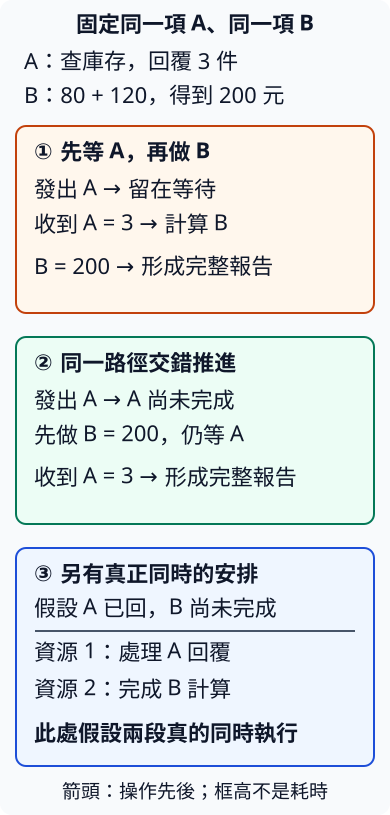

# 14.1 等待時還能做什麼：concurrency 與 parallelism

現在要產生一份訂單報告：它需要倉庫回覆庫存，也需要算出已知商品的合計。倉庫尚未回覆時，加總資料其實已經齊了。我們希望先把能做的部分做完，再取得外部結果；最後仍要確認兩份資料都到齊。

第 13 章已用 thread、channel 與 join 安排工作。本章將學另一種表達等待的方式：**async** 是 **asynchronous（非同步）** 的簡稱。這種程式可以保存尚未完成的工作，在等待條件未滿足時，讓執行機會用於其他能前進的工作。先用固定情境看清楚需要，再進入 Rust 語法。

## 先固定 A、B 與最後需要的答案

本節一直使用同一筆訂單、同一份查詢與同一組數字：

- **A 是庫存工作**：向倉庫發出查詢，等它回覆，再取出回覆中的庫存數量。本例最後收到 **3 件**；在回覆到達前，我們還不知道答案。
- **B 是加總工作**：已知兩項商品金額為 **80 元、120 元**，計算得到 **200 元**。B 不需要 A 的庫存數量。
- **完整報告**需要兩者：`庫存 3 件；商品合計 200 元`。只有 B 完成，還不能宣稱報告完成。

倉庫何時回覆，是外部條件；計算 B，則需要程式取得執行機會。把這兩種工作分開，才能問「等 A 時，這條執行路徑還能做什麼？」

## 先等完 A，也能得到正確答案

一種安排是：發出 A，留在原處等待；收到回覆才取出3，再做 B 得到200，最後組報告。答案正確，但 B 在等待期間尚未開始。

第 13.2 節的 blocking join 也有這項觀察方式：呼叫它的 thread 等待結果，該呼叫後面的工作先不執行。這裡描述等待的安排，沒有把庫存查詢當成一個已建立的 Rust thread。

## A 還不能前進時，先讓 B 前進

現在保持相同材料，只調整工作安排：

1. 發出 A，保存「這份庫存工作還沒有結果」的進度。
2. 回覆尚未到，A 暫時不能繼續取結果；先沿同一條執行路徑做 B，得到200。
3. B 完成，A 若仍沒回，就還不能形成完整報告。這時沒有其他可做的工作，仍需等待。
4. A 的回覆到達後，再處理它，取得3，組成相同報告。

第 13.1 節的 **concurrency（並行）** 可以用這段進度辨認：A 的進行期間包含等待，B 在這段期間取得進展。程式不必同一時刻執行兩段計算；同一條 thread 也能按條件交錯推進。

這項安排利用的是「B 不依賴 A」。若 B 改成計算庫存3件的價格，就必須先取得3，不能只靠切換順序消除資料依賴。

## 真正同時執行，還需要可用的執行資源

**parallelism（平行）** 則要求同一時刻真的有多份工作在執行。例如仍是 A、B，另假設 A 的回覆已到、B 尚未完成，而且有兩份可用的執行資源：一份處理 A 的回覆，另一份同時完成 B 的計算。

兩個 thread 若實際在不同 CPU 核心同時執行，就可能提供這種安排。只是把 A、B 畫在兩欄，或先建立兩個 thread，還不能證明當次真的同時執行。

下圖固定同一項 A、同一項 B。①、②的箭頭只表示操作先後；③**另外假設**兩份資源真的同時執行兩段程式。框高和留白不表示耗時，也不是效能測量：

②的 B=200 仍不能代替 A=3；③也沒有讓資料依賴消失，完整報告照樣需要兩份成果。倉庫自己在工作，和這份程式是否同時執行兩段 Rust，也要分開判斷。

## async 要處理的是等待與繼續的交接

要在程式中做到②，不只是把「正在等待」印出來。還需要保存 A 的進度、知道它何時能再前進，並在適當時候繼續處理；等待期間，也要有辦法安排 B 這類已能前進的工作。

接下來會學到的 Future 與執行工具，就是用來表達、推進這些尚未完成的工作。這裡先掌握用途：**等待某項條件時，不必因此停止同一條 thread 上所有其他可做的工作**。它不會讓倉庫更早回覆，也不會替80加120省掉加法；是否改善實際耗時，還取決於等待、工作量與工具成本。

本節是固定情境的手工追蹤，沒有執行 async 程式。下一節先用立即完成的小計計算，分清「取得一份工作」與「取得它的結果」；之後才建立真正受條件控制的等待。

## 練習與完整答案

沿用 A 回覆庫存3、B 計算80加120的規格，逐一判斷：

1. A 已發出、回覆尚未到，B 還沒做。可以先做什麼？
2. B 已得到200，A 還沒回。可以交出完整報告嗎？
3. A 回覆已到，B 還沒完成。現在有哪些可做的工作？只有一條執行路徑時，必須真的同時做嗎？
4. 同一條 thread 在 A 等待時先完成 B，是否已證明 parallelism？
5. 若 B 必須用到 A 的庫存數量，原來的第二種安排哪一步不能照做？

完整答案如下：

1. 先計算 B，得到200。材料80與120已齊，不依賴庫存回覆。
2. 不能。200是商品合計，還沒有庫存數量；A 仍是未完成的必要部分。
3. 可以處理 A 的回覆，也可以繼續 B。只有一條執行路徑時，依序安排即可；真正同時執行是另一項資源條件。
4. 沒有。它展示等待期間交錯推進，符合 concurrency；沒有證明同一時刻執行兩段計算。
5. A 未回時不能先完成依賴庫存的 B。必須先取得3，再進行那項計算；async 不會替缺少的輸入產生答案。

[下一節：Future 與 async／await](14-02-lesson.md)
