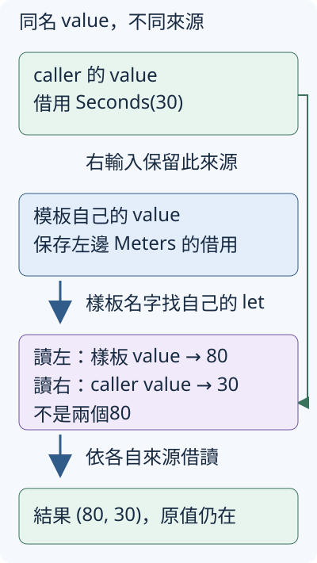

# 14.2 macro 的名字從哪裡來，錯誤又發生在哪裡？

14.1 的模板已能產生不同單位的 struct 與 Reading 實作。現在要把模板放到 library，讓其他 crate 使用；也想一次借讀路程與等待，交回 `(80, 30)`。兩個問題隨之出現：模板裡的名字應找 library 還是 caller？同名變數會不會讓第二份來源變成第一份？

本節沿用 `ch14-macros`，新增 `hygiene` module。以下指令從 repo 根目錄執行；前節的例子與完整答案維持原樣。

## 先用普通函式完成兩份借讀

兩個輸入可以是 Meters、Seconds，所以分別用 `T: Reading`、`U: Reading`；借讀後交回兩個 i32，仍不消耗原 wrapper。本節的公有 `read_pair_values` 先完成這份工作。

為了觀察稍後的可見性差別，library 把取值的一步放在私有 **read_internal**，再由公有函式呼叫它。read_internal 沒有 pub，外部 crate 不能直接使用；同一 module 的公有函式則可呼叫它、把結果交給 caller，延續 1.9 的分工：

```rust
--8<-- "examples/ch14-macros/src/hygiene.rs:ordinary-pair"
```

source 先以 `use crate::Reading;` 引入 trait，lib.rs 另以 `pub mod hygiene;` 公開 module。一般呼叫 `read_pair_values(&distance, &waiting)` 就能取得 `(80, 30)`。接下來的 macro 是用來觀察**生成的程式怎麼找名字**，不是因為普通函式無法借讀兩份資料。

## 本地前後順序，和跨 crate 路徑分開

前節的 `reading_type!` 是本地的 **textual scope（依文字順序的作用域）**：定義之後、同一包圍 scope 內的呼叫才找得到它。把呼叫放在定義前，以下 fixture 會包含 `cannot find macro`，還沒有進入模板匹配：

```rust
--8<-- "examples/ch14-macros/fixtures/compile-fail/macro_before_definition.rs"
```

現在要讓其他 crate 使用，選擇 **`#[macro_export]`**：它把這個 macro 以 public 形式提供在**定義 crate 的根路徑**，即使定義寫在 hygiene module 裡。caller 因而可以 `use ch14_macros::reading_type;`，或直接寫 `ch14_macros::reading_type!(Meters)`。這叫 **path-based scope（以路徑找名稱）**，沿用已教的 crate 路徑與 use。

export 只處理 macro 自身可從哪裡找到。下面先保留模板中的裸名稱 Reading，觀察它需要另一份名稱契約：

```rust
--8<-- "examples/ch14-macros/src/hygiene.rs:unqualified"
```

從外部 example 只引入這個 macro，卻沒有 Reading 名稱，產生的 impl 會找不到 trait，得到 **E0405**：

```rust
--8<-- "examples/ch14-macros/fixtures/cross-crate-fail/examples/macro_unqualified_trait.rs"
```

macro 名稱已經找到了，出問題的是它展開後那個裸 Reading。把 macro 放進 library，並沒有讓模板裡所有名字都自動使用 library 的來源。

## $crate 固定定義來源，仍保留可見性邊界

**`$crate`** 是 macro_rules 的特殊 metavariable，表示**定義這個 macro 的 crate**。它不是 caller 的 `crate` 起點，也不是這次呼叫的 runtime 參數。

把 Reading 寫成 `$crate::Reading`，就能固定要實作的 trait；caller 不必另引入這個名字，也不會因有自己的同名 Reading 就改成另一份契約。其他宣告與前節相同：

```rust
--8<-- "examples/ch14-macros/src/hygiene.rs:exported"
```

下面的 caller 故意定義另一個 Reading，它要求 unrelated method，與 library 的取值契約不同。這份公開 trait 是觀察名稱來源的對照：

```rust
--8<-- "examples/ch14-macros/examples/macro_export_consumer.rs:own-trait"
```

完整 example 用 `use ch14_macros::reading_type;`、`use ch14_macros::read_value;`，沒有引入 library 的 Reading。生成的型別仍能交給 library 的普通讀取函式：

```rust
--8<-- "examples/ch14-macros/examples/macro_export_consumer.rs:export-calls"
```

```bash
cargo run -p ch14-macros --example macro_export_consumer --locked
```

輸出 `library的Reading仍取得=80、30`。這份結果直接回答來源問題：生成的 impl 實作的是 `$crate::Reading`，不是 caller 那項 unrelated 介面。

但 `$crate` **不取消 private 限制**。本節的 read_internal 是 library 內部 helper；普通公有函式的 body 在 library 內可用它。若 export 的 macro 把它直接寫進 caller 的程式，caller 仍沒有存取權：

這份模式先使用 **`expr`**：它匹配已在1.5學過的 Rust expression；本例的 `&distance` 就是取得 shared reference 的 expression，不只是一個型別名字。

```rust
--8<-- "examples/ch14-macros/src/hygiene.rs:private-rule"
```

```rust
--8<-- "examples/ch14-macros/fixtures/cross-crate-fail/examples/macro_private_helper.rs"
```

這個失敗是 **E0603**。因此接下來的可用模板會呼叫公有的 `$crate::read_value`；若用到 module 裡的 item，還要寫完整的 module 路徑。macro 幫 caller 產生程式，沒有把 caller 變成 library 的私有實作區塊。

## hygiene：同一個拼法可以有不同的名字來源

現在回到兩份來源的借讀。新的 `read_pair!` 接收**兩個產生 shared reference 的 expression**，例如 `&distance` 與 `value`；輸出兩個 i32。輸入模式中的 **`expr`** 指匹配一個 Rust expression，而非前節的型別名字 ident。

模板先用局部變數 value 保存左邊的 reference，再讀右邊。caller 如果也有一個名叫 value 的變數，右邊輸入仍應找到 caller 的那份，不能被模板的 value 換掉。

**hygiene（名稱在展開時的隔離與解析規則）** 用來源上下文區分名字。macro_rules 採 **mixed-site hygiene**：本例模板的局部變數依定義處的上下文解析，插入的輸入片段保留 caller 的上下文；像前面裸 Reading 這類其他名稱則在呼叫處解析，所以需要時才用 `$crate` 固定來源。

在下面的規則，樣板寫的 value 對應自己的 let，`$right` 即使代入拼成 value，仍對應 caller。兩層大括號也有不同用途：外層是展開樣板，內層會生成普通 Rust 的 block expression，讓 let 與最後的 tuple 組成一個結果：

block 先執行 let，再建立 tuple；tuple 的兩個 expression 也依左、右順序求值。左項只讀剛保存的 reference，右項才求值 `$right`，所以兩個輸入仍按左、右取得。

```rust
--8<-- "examples/ch14-macros/src/hygiene.rs:pair-rule"
```

先把 distance、waiting 都建立好，再讓 caller 的 value 借用 waiting。圖中箭頭追蹤**名稱來源**，不是 move 或程式執行次序：綠框沿右側線連到讀右的30，藍框沿中間線連到讀左的80。上下兩個 value 拼法相同，來源不同：



下面同時呼叫剛才的普通函式與 macro。後半的每個 block 都只把 calls 加一，再交出既有來源的 reference，用來觀察輸入的實際求值次數：

```rust
--8<-- "examples/ch14-macros/examples/macro_hygiene.rs:hygiene-observe"
```

完整 source 先引入 `read_pair_values`、`read_pair`、`reading_type`，並用前面已教的 export 模板產生 Meters 與 Seconds。

```bash
cargo run -p ch14-macros --example macro_hygiene --locked
cargo test -p ch14-macros --example macro_hygiene --locked
```

```text
普通函式=(80, 30)，macro=(80, 30)
取得reference的工作執行次數=2，讀值=(80, 30)
```

第一行支持同名 value 的來源沒有混淆；第二行支持這份模板每個輸入只求值一次。**hygiene 本身不保證只求值一次**：這份規則只各插入一次 `$left`、`$right`，才有這項結果。若樣板把同一 expression 插入兩次，其中的計數工作也會執行兩次。測試另保存左先右後的 `[1, 2]`，不只看最終數字。

生成的 **item 名稱也不會自動唯一**。像 Meters 這種由 caller 傳入的 identifier，在同一 module 生成兩次仍是同名型別；hygiene 的局部變數規則沒有替它另取兩個型別名字。

## 給輸入自己的診斷，與 Rust 型別錯誤分開

如果要讓錯誤更直接指出這份模板需要什麼，可以加入另一條輸入規則。Rust 預先提供 **`compile_error!`**，接收文字訊息、在編譯時產生診斷並令建置失敗；它不是程式執行時的 panic，也沒有成功值供後續使用。

下面先匹配單一 ident；第二條是回報其他輸入的 **fallback rule**。其中 **`tt`（token tree）** 是一個 token，或由配對括號圈住的一組 tokens，`$($other:tt)*` 接住零或更多這些語法片段。先試上面的規則，成功後就使用那份展開；只有未匹配時才試下一條。

第一條的展開又有一個 `reading_type!` 呼叫：編譯器會接著展開它，仍使用已教的那份生成模板。

```rust
--8<-- "examples/ch14-macros/src/hygiene.rs:checked-rule"
```

```rust
--8<-- "examples/ch14-macros/fixtures/cross-crate-fail/examples/macro_custom_error.rs"
```

對80，第一條 ident 不匹配，第二條會給 `reading_type_checked! 需要一個型別名字`。對 Meters，第一條匹配；如果再次產生 Meters，會得到 **E0428** 的重複型別錯誤，**不會**因生成程式失敗就回退到第二條規則。

診斷可能同時顯示呼叫點與模板中的行。先按下面的問題找原因，不只看到指向 macro 就猜是哪條規則壞了：

| 本節失敗 | 已完成哪一步、應查什麼 |
| --- | --- |
| `cannot find macro` | macro 名稱尚未找到；查本地順序或匯入路徑 |
| E0405 的裸 Reading | macro 已找到並展開；查生成 item 的名稱來源 |
| E0603 的 private helper | `$crate` 路徑找到來源，但 caller 沒有存取權 |
| 自訂 compile_error 訊息 | 輸入由 fallback 接住；改成模板明說的輸入形狀 |
| E0428 的 Meters | ident 已匹配並展開；查同一 module 重複的宣告 |

完整跨 crate fixtures 在 `fixtures/cross-crate-fail`。這次不向 registry 下載 ch14-macros，而是在這份 fixture 的 Cargo.toml 指定本地 package：

```toml
[dependencies]
ch14-macros = { path = "../.." }

[workspace]
```

`path` 相對於**這份 Cargo.toml 所在目錄**，`../..` 往上兩層，找到提供 library 的 ch14-macros package；不是相對執行命令時的目錄。空的 `[workspace]` 讓這份 fixture 自成 workspace，隔離故意失敗的 example targets，不加入 repo 根工作區的普通 all-targets 檢查。其 Cargo.lock 固定本地依賴選擇，沿用已教的 `--locked`。

接下來的 **`--manifest-path`** 選用指定的 Cargo.toml；**`--example`** 則從那個 package 選擇同名 example target。重現其中一項，可從 repo 根目錄執行：

```bash
cargo check --manifest-path examples/ch14-macros/fixtures/cross-crate-fail/Cargo.toml --example macro_custom_error --locked
```

這個命令預期失敗；診斷應含上面的自訂訊息。其他 fixture 使用同名的 `--example`，各自核對 `.expected` 中的目標原因，不能拿「找不到外部 crate」當成成功拒絕輸入。

## 練習：先取得左、右，再反向交回結果

寫一個本地 `read_pair_reverse!`，依原順序各取得一次 reference，卻將讀值以 `(右, 左)` 交回。沿用 Meters(80)、Seconds(30)：結果應是 `(30, 80)`，取得兩份 reference 的記錄仍是 `[1, 2]`。

先用兩個 let 保存輸入，再組結果；若只是把兩份輸入連同副作用一起反過來展開，就會改變取得順序。原 owner 都應仍可使用。所需的 block、Vec/push、expr、普通讀取函式都已教，不需加入 closure 或新 trait。

??? example "完成後對照完整參考程式"

    ```rust
    --8<-- "examples/ch14-macros/examples/macro_hygiene_solution.rs"
    ```

    ```bash
    cargo run -p ch14-macros --example macro_hygiene_solution --locked
    ```

現在能分清 macro 名稱、生成 item 的路徑、局部變數的來源與輸入求值次數。下一節仍產生 Reading 的 impl，改由 procedural macro 讀取已有的 struct 宣告；在寫骨架前，會先教輸入語法、parser 與產生的結果。

延伸閱讀：[The Little Book of Rust Macros：Hygiene](https://lukaswirth.dev/tlborm/decl-macros/minutiae/hygiene.html)、[中文對應](https://zjp-cn.github.io/tlborm/decl-macros/minutiae/hygiene.html)、[Reference：Scope](https://doc.rust-lang.org/reference/macros-by-example.html#scoping-exporting-and-importing)、[Reference：Hygiene](https://doc.rust-lang.org/reference/macros-by-example.html#hygiene)。
