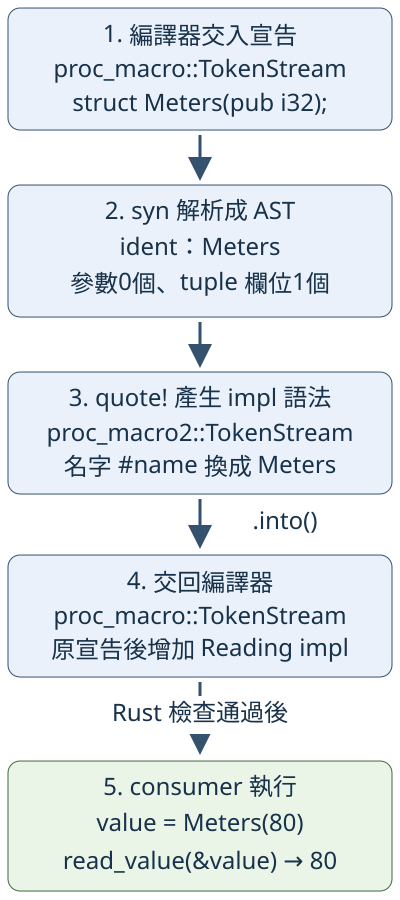

# 14.3 讓自訂 derive 讀宣告、增加 trait 實作

14.1 的模板接收 Meters 這個名字，產生 struct 和 Reading 的 impl。現在換一個分工：**struct 已由使用者寫好，工具只替它增加同一份 Reading 實作**。這讓使用者在自己的宣告旁選擇功能，仍自行決定型別名字、欄位可見性及其他 derive。

沿用原本的借讀工作：Meters(80)、Seconds(30) 交給 `read_value`，得到80、30，原值仍可使用。手寫 impl 或前兩節的模板都能完成；本節要學的是如何使用**已有的宣告資訊**產生 impl，而非讓普通函式在 runtime 動態建立型別。

## procedural macro 何時取得什麼？

**procedural macro（以 Rust 程式處理語法的 macro）** 在編譯時執行。它接收程式的語法片段、回傳新語法，編譯器再處理結果。和 macro_rules 的模式→模板相比，我們能用普通 Rust 的 struct、enum、if、match 檢查輸入，再決定產生什麼。

這次的自訂 derive 叫 **ReadingValue**。使用者將它放進 `#[derive(ReadingValue)]`，編譯器把該型別的宣告交給我們的程式；我們回傳 Reading 的 impl。derive **保留原宣告，將產生的 items 加在後面**，所以不能把原 struct 又回傳一次。ReadingValue 是工具的名字，Reading 是它會實作的 trait，兩者的角色不同。

三種 procedural macro 的差別在輸入及交付位置。本節只實作 derive；其他兩種先認清角色：

| 形式 | 輸入 | 輸出如何放回程式 |
| --- | --- | --- |
| derive，例如 ReadingValue | 要處理的型別宣告 | 保留原宣告，在後面增加 items |
| function-like，例如 `name!(...)` | 呼叫括號內的語法 | 取代這次呼叫 |
| attribute，例如 `#[name(...)]` | attribute 中的參數，以及被標記的 item | 取代被標記的 item |

這裡沒有呼叫任何 runtime 的 Meters 值。編譯器提供的 **`proc_macro::TokenStream`** 是一串 tokens 的型別：保存名字、標點、括號群組等語法，不是裝著 Meters 值的 Vec。macro entry 的輸入及回傳都使用它。

## 把編譯工具與使用者分成三個 package

procedural macro 必須放在特殊的 **proc-macro crate**，並由另一個 crate 使用；不能在定義它的同一個 crate 套用這份 derive。這份 library 的公開 macro entry 要放在 crate 根的 lib.rs，使用 `pub fn`，接受一份 compiler TokenStream、回傳一份 compiler TokenStream。

它會先被建置成能在 **host** 執行的編譯工具，再於 consumer 編譯時處理語法；這延續9.2區分 host 建置工作與最後成品的方式。consumer 最後執行時，用的是產生的 impl，並不再次執行 parser。

本例的分工如下。從 repo 根目錄操作，所有完整 source 都在 `examples/ch14-macros/`：

| package／目錄 | 保存的內容 | 誰使用它 |
| --- | --- | --- |
| ch14-macros／原目錄 | 原有 Reading trait、read_value 與前節模板 | consumer 的程式與產生的 impl |
| ch14-reading-derive／derive | 解析宣告、產生 impl 的編譯工具 | consumer 的編譯過程 |
| ch14-reading-consumer／derive-consumer | 自己寫的 Meters、Seconds 與呼叫程式 | 最後執行的例子 |

選用兩個第三方 library：**syn** 將 tokens 解析成可由 Rust 欄位與 enum 讀取的語法樹；**quote** 將帶有插入位置的 Rust 語法產生為 tokens。這裡固定 syn 2.0.119、quote 1.0.47，閱讀相同版本的 API，避免混用別版介面。

新的 **`[lib] proc-macro = true`** 把 derive package 的 library 設為 proc-macro crate。syn 的 `default-features = false` 沿用7.1的功能開關語法，本例只選：`derive` 提供型別宣告的語法樹、`parsing` 提供解析、`proc-macro` 接上編譯器的 TokenStream。quote 保留預設的 proc-macro 功能以支援最後的轉換，不需要開 syn 的 full 功能或把整份語法樹印出。

derive/Cargo.toml 的配置是：

```toml
--8<-- "examples/ch14-macros/derive/Cargo.toml"
```

`.workspace = true` 沿用9.1的根 workspace 共用值；版本字串前的等號沿用7.1的精確版本要求。consumer 同時依賴 trait library 與 derive 工具，`path` 相對這份 manifest，而非命令所在目錄：

```toml
--8<-- "examples/ch14-macros/derive-consumer/Cargo.toml"
```

proc_macro 是**編譯器提供的 crate**，不在 dependencies 向 registry 下載。syn 與 quote 則是上述第三方依賴。這幾種來源與角色要分清，才不會把 `proc-macro = true` 誤寫成一般 dependency。

## 先認清解析與生成之間的資料

syn 產生的 **AST（Abstract Syntax Tree，抽象語法樹）** 把宣告整理成有結構的資料。例如 Meters 的名字、是否有泛型參數、欄位採哪種形式，可以分別讀取，而不必自己把原碼切成文字。

tuple struct 的括號也能列出多個欄位型別，以逗號分開；本例只支援**沒有泛型參數、恰好一欄的 tuple struct**。產生的 reading body 固定為 `self.0`，回傳 i32。名字與外形由 macro 檢查；第0欄是否真能直接交出 i32，交給 Rust 型別檢查。因此原欄位寫 i32 的 type alias 也應可用，不依靠「欄位文字一定拼成 i32」這種不可靠的判定。

本例使用的 AST 型別是 **`syn::DeriveInput`**。先看最低欄位與方法，不需要先讀 syn 的完整資料結構：

| 本例讀取的部分 | 表示什麼／將用在哪裡 |
| --- | --- |
| `model.ident` | 宣告的名字，型別是 Ident；給 quote 插入，也給診斷定位 |
| `model.generics.params` | 泛型參數清單；`is_empty()` 為 true 才符合本例 |
| `model.data` | 宣告的種類；只接受 `Data::Struct(data)`，取出 struct 資訊 |
| `data.fields` | 欄位形式；只接受 `Fields::Unnamed(fields)`，即 tuple 的未命名欄位 |
| `fields.unnamed` | tuple 欄位清單；`len()` 必須等於1 |

params 和 unnamed 用的是 syn 的 **Punctuated**，保存一列語法節點與它們之間的分隔符。這裡只需 `is_empty()` 判是否有參數，及 `len()` 數欄位；len 計節點，不把逗號多算一欄。不是假定每個有 len 的型別都等於 Vec，也不在這裡修改 AST。

稍後會以 `match &model.data`、`match &data.fields` 借用這些資料。匹配 Struct／Unnamed 的分支取得裡面的 shared reference，其他分支提早 return 診斷，延續5章借用 pattern 的用法；不需要把整份 AST move 或 clone。

## 解析失敗與形狀拒絕，都交回編譯診斷

**`parse_macro_input!(input as DeriveInput)`** 是 syn 提供的解析 macro。`input` 必須是保存 compiler TokenStream 的變數；這裡的 `as DeriveInput` 是這份 macro 的輸入模式，表示用 DeriveInput 的解析規則，不是數字轉型。

解析成功，結果是 DeriveInput，保存為 model。解析失敗，這份 macro 會**提早從所在函式回傳 `compile_error!` 的 tokens**，讓 compiler 報語法診斷。所在函式因而必須回傳 proc_macro::TokenStream；不在普通回傳 i32 的函式呼叫它。這次採用 syn 已為 DeriveInput 提供的解析能力，呼叫現成規則。

語法能解析，不表示它符合 ReadingValue 的有限形狀。後者由我們檢查，再使用 **`syn::Error`** 產生自己的訊息。每個名字 token 有 **Span**，記錄原程式的位置資訊；`model.ident.span()` 取回型別名字的位置，讓錯誤指向使用者的宣告。

derive/src/lib.rs 先以 use 引入這些名稱：TokenStream 來自 compiler；Data、Fields 是上述 variant 的來源；DeriveInput 與 Error 保存解析資料及診斷；quote、parse_macro_input 是兩份工具 macro。短名稱因此有明確來源：

```rust
--8<-- "examples/ch14-macros/derive/src/lib.rs:imports"
```

這裡有兩種**名稱相同但不同**的 TokenStream：

- `proc_macro::TokenStream` 是 compiler entry 的輸入與回傳型別。
- `proc_macro2::TokenStream` 是 syn／quote 生態使用的語法型別；into_compile_error 及稍後 quote 都產生這一種。

proc_macro2 提供與 compiler 型別的 From 轉換，因此用5.4已教的 `.into()` 交回。由 syn、quote 的依賴提供這份語法型別及轉換，本例自己的 source 不需要直接使用 proc_macro2 路徑。

下面的 reject helper 借用 model、接收訊息，回傳 compiler TokenStream。`Error::new(span, message)` 建立帶位置的診斷；`into_compile_error()` 消耗它，產生 `compile_error!` 語法，最後 `.into()` 轉為 compiler 要的型別。訊息是已能以 Display 表示的 &str，不需要新的錯誤 trait 實作：

```rust
--8<-- "examples/ch14-macros/derive/src/lib.rs:reject"
```

## quote 用名字 token 填入 impl

**`quote!`** 接收一份將產生的 Rust 語法，`#name` 是插入位置：取目前 Rust 變數 name 的內容，按 **ToTokens trait** 的契約把它放入輸出。ToTokens 的角色是提供「怎麼交出語法 tokens」，Ident 已實作它，所以我們不用手寫這份 trait，也不用先把名字轉成 String。

這是 quote 自己的模板語法，與 macro_rules 的 `$name` 分開；`#name` 不是 runtime 字串格式化。模板以外的 `let name = &model.ident` 仍是普通 Rust，借用 AST 保存的名字。

還要延續14.2的名稱來源問題。procedural macro 的輸出會在使用者那邊解析名字，不能直接套用 macro_rules 的 `$crate`。本例生成 **`::ch14_macros::Reading`**：開頭 `::` 從外部 crate 名稱出發，固定找 consumer 依賴中的 ch14_macros，而不依靠 caller 匯入的裸 Reading。

這項設計有明確邊界：consumer 必須保留本例的 ch14-macros dependency 名稱，讓程式中的路徑叫 ch14_macros。這份有限 derive 沒有提供 dependency 改名的自動尋找機制；固定契約已足以完成本例，不把 `$crate` 當成 procedural macro 的捷徑。

下面是 entry 尾段將使用的生成工作。quote 的結果是 proc_macro2::TokenStream；最後一行依函式的回傳型別轉成 compiler TokenStream：

```rust
--8<-- "examples/ch14-macros/derive/src/lib.rs:generate"
```

對 Meters，#name 插入的是 Meters 這個 identifier，得到與前兩節相同的 `impl Reading for Meters` body，只是 trait 來源寫完整。不重新宣告 struct，也沒有產生 runtime 的 Meters(80)。

現在用流程圖把這幾份資料連起來。向下箭頭表示語法的解析、轉換與交付；藍框都發生在 consumer 的編譯過程。第4步交回的是 impl 的語法，原 struct 由 derive 規則保留；Rust 檢查通過後，才走到綠框建立 Meters 值並借讀：



## 把檢查與生成接成完整 entry

**`#[proc_macro_derive(ReadingValue)]`** 告訴編譯器，這支 pub 函式定義名叫 ReadingValue 的 derive。函式的 Rust 名稱 derive_reading 用於實作入口；consumer 會用 ReadingValue，不是呼叫 derive_reading。它接收一份宣告的 tokens，依序解析、拒絕泛型、確認 struct、確認單欄 tuple，再回傳 impl：

```rust
--8<-- "examples/ch14-macros/derive/src/lib.rs:derive-entry"
```

每個 return reject 都交出編譯診斷、結束這次生成；不是 runtime 的 Result::Err，也不要求先 panic。兩份 match 都只借用 AST，最後的 name 仍可借用同一個 model。

## 在另一個 crate 套用並借讀

consumer 的 library 先以 `use ch14_reading_derive::ReadingValue;` 取得 derive。Meters、Seconds 仍由使用者親自寫；Debug／PartialEq 沿用4.2觀察原值的需求，新增的 ReadingValue 只補 Reading 實作：

```rust
--8<-- "examples/ch14-macros/derive-consumer/src/lib.rs:consumer-models"
```

example 引入 consumer 的 Meters、Seconds，沿用原 library 的 read_value：

```rust
--8<-- "examples/ch14-macros/derive-consumer/examples/macro_derive_demo.rs"
```

```bash
cargo run -p ch14-reading-consumer --example macro_derive_demo --locked
```

```text
derive後仍借讀=80、30
```

這條命令先讓 compiler 執行 derive 工具，編譯出可借讀的型別，最後才執行 main。80、30 是 main 借讀的結果；只看到輸出不能說 parser 在 runtime 被呼叫了。assert_eq 同時核對兩個原 wrapper 仍存在。

測試另使用零與負數，確定 derive 沒有替本來的 i32 加入非負限制；再用 type alias 及私有欄位，確認沒有因欄位文字不同就拒絕，也沒有要求把欄位公開：

```rust
--8<-- "examples/ch14-macros/derive-consumer/src/lib.rs:consumer-tests"
```

PrivateReading 的欄位由同一 test module 存取，生成的 impl 也增加在該型別所在 module，符合原可見性。借讀從 i32 欄位 Copy 出數字，不表示整個 wrapper 自動有 Copy；本節都未替它們 derive Copy。

```bash
cargo test -p ch14-reading-consumer --locked
```

本節兩項測試核對實際展開後的借讀與型別邊界，不嘗試在普通 test 函式直接執行 compiler 的 macro entry。

## 拒絕輸入發生在哪個階段？

下面五份 fixture 都有合法的 Rust 宣告。語法能解析成 DeriveInput，再按有限形狀決定是否生成；最後一份 Flag 的形狀符合，交給 Rust 才發現 bool 不能當 i32：

| fixture | 宣告與預期原因 |
| --- | --- |
| macro_derive_generic | `Holder<T>(T)`：有泛型參數，自訂訊息「ReadingValue 不支援泛型參數」 |
| macro_derive_enum | 有 Ready(i32)、Empty 的 enum：不是 struct，自訂訊息「ReadingValue 需要 struct 宣告」 |
| macro_derive_named | `Meters { value: i32 }`：不是 tuple，自訂訊息「ReadingValue 需要 tuple struct」 |
| macro_derive_two_fields | `Meters(i32, i32)`：不是恰好一欄，自訂訊息「ReadingValue 需要恰好一個 tuple 欄位」 |
| macro_derive_bool | `Flag(bool)`：能生成，但 reading 的回傳不符合 i32，Rust 報 E0308 |

Flag 的完整失敗程式是：

```rust
--8<-- "examples/ch14-macros/derive-consumer/fixtures/cross-crate-fail/examples/macro_derive_bool.rs"
```

診斷可能指回 derive 的位置；要看「expected i32, found bool」及 E0308，辨認是生成的實作不符合 trait。parser 已能讀這份宣告，增加泛型支援也不會讓 bool 自動變成 i32。

這批 fixtures 使用14.2已教的隔離 workspace，dependencies 路徑都以這份 manifest 為基準，分別找到原 library 與 derive 工具：

```toml
--8<-- "examples/ch14-macros/derive-consumer/fixtures/cross-crate-fail/Cargo.toml"
```

重現 Flag 的型別失敗，或把 --example 改成表中其他同名 target：

```bash
cargo check --manifest-path examples/ch14-macros/derive-consumer/fixtures/cross-crate-fail/Cargo.toml --example macro_derive_bool --locked
```

此命令預期失敗。同名 `.expected` 記目標原因；缺 dependency 或 parser 工具自己無法編譯，不能當成成功驗證「拒絕 bool」。這份檢查也分開了我們主動回傳的 compile_error 診斷與 Rust 檢查產生的 E0308。

## 練習：不改 parser，讓第三個單位使用原函式

在 consumer 的新 example 建立 `type RawReading = i32;`，再由你自己宣告私有欄位的 `Millimeters(RawReading)`，替它 derive Debug、PartialEq、ReadingValue。用既有 Meters(80) 與 Millimeters(-5) 呼叫 read_value，取得 `(80, -5)`，原值都仍可使用。

不改 derive entry，也不把 Millimeters 欄位改 pub。先解釋：名字不同由哪份 AST 資料帶進 impl？alias 為何不需要 parser 辨識其文字？負數有沒有違反本節的契約？這三個答案分別來自名字插入、Rust 型別檢查與只借讀 i32 的需要。

??? example "完成後對照完整參考程式"

    ```rust
    --8<-- "examples/ch14-macros/derive-consumer/examples/macro_derive_solution.rs"
    ```

    ```bash
    cargo run -p ch14-reading-consumer --example macro_derive_solution --locked
    ```

現在 Reading 的取值工作仍由同一個普通函式使用；改變的是 impl 的來源：手寫、macro_rules 模板，或讀取已有宣告的 derive。可以分清 compiler 的輸入、AST 中被使用的資訊、產生的語法以及最後 runtime 的值，才算讀懂這份工具的分工與有限契約。

延伸閱讀：[Rust Book：Macros](https://doc.rust-lang.org/book/ch20-05-macros.html)、[中文對應](https://kaisery.github.io/trpl-zh-cn/ch20-05-macros.html)、[Reference：Procedural macros](https://doc.rust-lang.org/reference/procedural-macros.html)、[syn 2.0.119 parse_macro_input](https://docs.rs/syn/2.0.119/syn/macro.parse_macro_input.html)、[quote 1.0.47 quote!](https://docs.rs/quote/1.0.47/quote/macro.quote.html)。外部完整例子可能使用更多 AST 功能，本節所需的契約都已在主文介紹。
