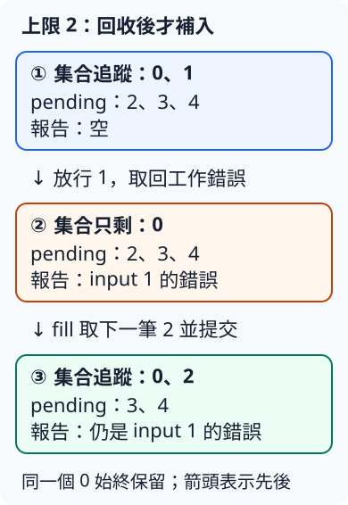

# 14.4 有上限的工作排程：完成一份，才補一份

上一節一次提交四份工作。若輸入是一大批，我們希望最多追蹤兩份已提交、尚未回收的 task；一份結果取回後，再提交下一筆。最後仍要知道每筆輸入成功、工作錯誤或 panic，不能因為某筆失敗就漏掉後面的材料。

本節用五筆 `(金額, 是否放行後panic)`：`[(80, false), (-1, false), (120, true), (200, false), (30, false)]`。原輸入索引仍是0到4；上限2是我們的排程規格，不是 channel 的容量。

## 先保存尚未提交的 Job

**Job** 包住一筆工作材料和它獨有的 release 接收端。**prepare_jobs** 為每筆建立容量1的放行 channel，回傳兩份 owned Vec：jobs 留給排程器，releases 留給 controller。它只準備材料，沒有 spawn，也沒有執行工作。

```rust
--8<-- "examples/ch11-async/bounded/src/lib.rs:jobs"
```

**controlled_job** 延續上一節 controlled_work 的規則，改成 started 傳入**輸入索引**，讓 controller 確認究竟哪份工作已開始。Job 由工作接手；mutable binding 允許借用它的 release 收端：

```rust
--8<-- "examples/ch11-async/bounded/src/lib.rs:controlled-job"
```

## Scheduler 保存哪一種進度？

**Scheduler（排程器）** 是本例自訂的 struct，決定何時提交下一筆。它仍把每份已提交工作交給 Tokio runtime 實際執行，不自己建立另一套 executor。

| 欄位 | 保存的內容與用途 |
| --- | --- |
| pending | 尚未提交的 Job，保存為 owned iterator `std::vec::IntoIter<Job>`；next 每次移出一筆 |
| tasks／inputs | JoinSet 與 Id→輸入索引對照，負責已提交 task 的回收 |
| limit | 允許同時追蹤的 task 數，上限必須大於0 |
| submitted | 至今提交過的總數，也是下一筆輸入的索引 |
| peak_tracked | 過程中 tasks.len() 的最大值 |

第9.4節已教 Vec 的 owned into_iter：Vec 的元素移交 iterator 保管，逐筆 next 取得 ownership。因此尚未提交的 Job 不必 clone 接收端。**ConfigError::ZeroLimit** 則把無法前進的上限0在提交任何工作前拒絕。

```rust
--8<-- "examples/ch11-async/bounded/src/lib.rs:scheduler-state"
```

這裡 **tracked** 計算「已提交、尚未從集合回收」的 task；已完成但未取回的結果仍占一格。它不等於此刻正在執行本體的數量，不保證全部資料只占兩筆記憶體：pending、放行 channel 與累積 reports 仍由程式保存。

## new 先填滿；next 回收後才補入

**new** 驗證正上限，建立空集合，再呼叫 **fill**。fill 的 while 條件只看 tasks.len 是否小於 limit：有空位才從 pending 取一筆、spawn、登記 Id、增加 submitted，並更新峰值；pending 已空就 break。

```rust
--8<-- "examples/ch11-async/bounded/src/lib.rs:new-and-fill"
```

**next** 先用上一節的 collect_one 等回並取出一份報告，釋放追蹤空位，之後才 fill 補工作。若集合已空，直接 None，不等待一個不存在的完成通知。三個查詢 method 只讀數量：

```rust
--8<-- "examples/ch11-async/bounded/src/lib.rs:next-and-counts"
```

這個順序使每次 fill 結束時都不會超過上限。即使取回的是工作錯誤或 panic，task 也已回收，可以補下一筆；報告分類不會阻止排程繼續。

## 同一批輸入，逐步追蹤空位

controller 先收到0、1兩份 started，順序不指定。接著只放行1並 next，讓2補入；再放行2、3，最後才處理0與4：

| 回收與補入 | 集合中尚未回收的輸入 | 累計提交 |
| --- | --- | --- |
| new 填入0、1 | 0、1 | 2 |
| 回收1的工作錯誤，補2 | 0、2 | 3 |
| 回收2的 panic，補3 | 0、3 | 4 |
| 回收3的 Value(200)，補4 | 0、4 | 5 |
| 回收0的 Value(80)，pending已空 | 4 | 5 |
| 回收4的 Value(30) | 空 | 5 |

下圖放大表中的第二步。框內是同一個集合在操作前後持有的輸入；箭頭表示先回收、再補入，不表示兩件事同時發生：



例如第二列的0始終沒有放行；空位來自**回收1**，不是0暫停就能額外提交。峰值為2，共提交5，最後得到5份報告。

started 原送端要留給後續 fill clone。不能在第一批後等 started_rx.recv 變 None 才補工作，因為排程器還需要這條通道；示範逐筆等預期索引，所有工作回收後才 drop 最後送端並檢查 None。

**Batch** 把報告、累計提交與峰值交回 main；它不借用已結束的 Scheduler：

```rust
--8<-- "examples/ch11-async/bounded/src/lib.rs:batch"
```

## 完整設定、全部 helper 與可執行程式

本節使用 `examples/ch11-async/bounded/` 的 `ch11-bounded`；所有命令從 repo 根目錄執行。完整設定仍只要求 rt／macros／sync：

```toml
--8<-- "examples/ch11-async/bounded/Cargo.toml"
```

`pub mod outcomes;` 依第2.6節檔案規則載入同層 `src/outcomes.rs`。該 module 保存上一節的錯誤、報告與 collect_one。完整檔案如下：

```rust
--8<-- "examples/ch11-async/bounded/src/outcomes.rs"
```

完整 `src/lib.rs`，包含 run_demo 的全部受控放行與三項 unit tests：

```rust
--8<-- "examples/ch11-async/bounded/src/lib.rs"
```

三項測試分別核對補位與每筆分類、上限0在提交前拒絕、空輸入不提交也不等 started。後兩種情況都結束送端後確認 None；拒絕時 owned jobs 已清理，對其 release send 也失敗。

完整 `src/main.rs`：

```rust
--8<-- "examples/ch11-async/bounded/src/main.rs"
```

```bash
cargo run -p ch11-bounded --locked
cargo test -p ch11-bounded --lib --locked
```

stdout 第一行為 `上限 2；追蹤峰值 2；共提交 5`，接著按1、2、3、0、4顯示報告，最後確認全部回收。stderr 有指定 task 的 panic 診斷，main 的正常退出不代表那筆工作成功。

完整 `tests/cli.rs` 透過真正 binary 保存這份精確輸出與診斷：

```rust
--8<-- "examples/ch11-async/bounded/tests/cli.rs"
```

```bash
cargo test -p ch11-bounded --test cli --locked
```

## 練習與完整答案：只留一個空位

改用上限1、材料80／−1／120，全部不指定 panic。依序確認 started，放行該筆，再 next；預測 submitted 與 tracked 的差別，並確認負數的工作錯誤也不會擋住下一筆。

完整 `examples/one_slot_solution.rs` 使用本頁已提供的完整 library：

```rust
--8<-- "examples/ch11-async/bounded/examples/one_slot_solution.rs"
```

```bash
cargo run -p ch11-bounded --example one_slot_solution --locked
```

報告依序為 Value(80)、WorkError(Negative(-1))、Value(120)。submitted 最後是3、峰值1、tracked 是0；累計數不會因回收減少。再 next 得到 None，最後 started 送端結束，沒有遺留下一份通知。

完整答案與測試都已提供，可一起驗證：

```bash
cargo test -p ch11-bounded --all-targets --locked
cargo clippy -p ch11-bounded --all-targets --locked -- -D warnings
```

上限控制的是在途工作數；它沒有替「等多久才放棄」訂規則。下一節替一段明確的等待範圍設定期限，再分清工作錯誤、逾時與已發生的副作用。

[下一節：timer、timeout 與測試時鐘](14-05-lesson.md)
