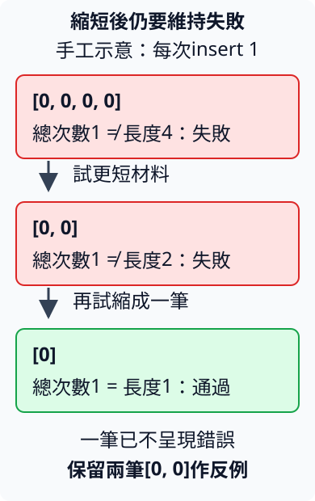

# 14.5 從明確性質產生材料，再把失敗縮成可理解的反例

4.3已按相等名稱累加出現次數，固定測試能檢查Rust兩次、Python一次。現在希望增加不同長度、重複情況與鍵組合的材料，同時保留一份**不依賴被測程式答案的判準**：沒有少算任何一筆，也沒有把次數算到別的鍵。

**property-based testing（以性質為基礎的測試）** 先寫出一類合法材料都應成立的性質，再讓工具產生許多材料逐份檢查。它仍需要我們定義正確答案與合法域；工具不會從實作自行知道需求，也不保證有限測試看過全部輸入。

本節使用 `ch14-property` package與proptest。沿4.3的HashMap分組工作，把名稱換成小i32數字，讓生成與縮減過程容易讀；**同一個鍵累加次數**的規則沒有改。

## 材料與判準先成立，才寫產生器

先看 `[0, 2, 0, -3]`：0出現2次，2與−3各1次，其餘鍵未收錄。所有次數加起來是4，等於輸入長度。沒有輸入資料時，map沒有群組，總次數0。

這些關係能分成不同檢查：

| 性質 | 可以抓到什麼，仍缺什麼 |
| --- | --- |
| 每個已保存群組次數大於0，所有次數的總和等於輸入長度 | 可抓丟失或多算次數、憑空插入零次群組；單看總和仍可能把次數分到錯鍵。 |
| 每個鍵的次數等於原輸入中與它相等的項目數 | 可抓把次數分到其他鍵，或某個重複數量錯誤。預期用原清單直接逐筆計數，不再建立另一個同算法HashMap。 |

這份測試的 **oracle（判定依據）** 是上述計數規則。若先呼叫frequencies，再把它的結果當預期值比較，就只是在檢查答案等於自己，無法發現同一錯誤。

frequencies沿4.3用get_mut累加、缺鍵才insert。i32已有Eq／Hash／Copy，查詢借同型別 `&i32`，保存鍵時複製數字。count_of只是報告用helper：借map查鍵，Some讀次數、None回0，不向map補入一筆零群組。

```rust
--8<-- "examples/ch14-property/src/lib.rs:frequencies"
```

加總再選一項標準API **`counts.values()`**：shared借用HashMap，交回巡訪所有value的iterator。對本節型別，它的Item是 `&usize`，仍借原map；順序未固定。total_count只借讀本節計數結果，複製數字相加，不依靠巡訪順序；這些次數的和不超過原清單可表示的長度。

```rust
--8<-- "examples/ch14-property/src/lib.rs:total-count"
```

```rust
--8<-- "examples/ch14-property/examples/counts.rs"
```

```bash
cargo run -p ch14-property --example counts --locked
```

```text
鍵0的次數=2
鍵2的次數=1
鍵-3的次數=1
鍵1的次數=0
總次數=4，原輸入長度=4
```

固定材料讓我們先確認工作與輸出意義。接下來的property tests檢查相同規則，只讓工具替我們選更多材料。

## Strategy同時描述如何生成與如何縮減

proptest把產生材料的規則叫 **strategy（策略）**。它描述生成值的型別與合法域，也知道如何把資料變得較簡單；不是已經生成的一份資料。

本節明選proptest版本要求1.12.0，實際解析版本由Cargo.lock保存。它只在測試使用，放7.1已教的dev-dependencies。關掉這項dependency的預設features，再只要求 **std**，取得一般標準函式庫環境的生成與測試能力；本節不用其fork／timeout等可選機制。9.1的feature合併規則仍適用，其他依賴者可能要求額外功能。

```toml
--8<-- "examples/ch14-property/Cargo.toml:proptest-dependency"
```

第一次使用前，先把必要名稱與操作分開：

數字 literal 可以接型別後綴，直接指定這份數字的型別：`3i32` 是 i32 的3，`0usize` 是 usize 的0；後綴前可加底線，所以 `3_i32` 也有效。下面用 i32 指定元素型別、usize 指定清單長度，range 的上界規則仍沿1.7。

| 選用介面 | 本次角色與契約 |
| --- | --- |
| `-3i32..4` | i32策略，值從−3到3，不含4；沿1.7的range上界規則。 |
| `proptest::collection::vec(element, size)` | 接元素strategy與長度規則，回傳VecStrategy生成描述。本例 `vec(-3i32..4, 0usize..32)` 每份資料是 `Vec<i32>`，長度0到31；不是直接建立一份Vec。 |
| `proptest! { ... }` | 接測試宣告，依strategy重複建立資料、執行body、在失敗時縮減，再形成可由Cargo執行的真正test。 |
| `fn test_name(values in strategy)` | `in` 是此macro的輸入形式，values每次取得一份strategy產生的值；不是普通函式參數的Rust型別宣告。 |
| `Config::with_cases(64)` | 建立測試設定，只將成功的新case目標改為64，其他沿標準設定。cases指輸入案例，不是Cargo列出的test數量。 |
| `#![proptest_config(config)]` | 放在proptest! block開頭，提供該block的Config；這是macro接受的設定語法，不是替整個crate任意定義Rust attribute。 |
| `prop_assert!(condition)`／`prop_assert_eq!(left, right)` | 檢查此case條件／相等，不成立就把case失敗交回runner，使它能繼續縮減；最後仍會使真正test失敗。 |

assert可在必要時加格式訊息，沿既有format規則。特別是prop_assert_eq會取得所選expressions的值；本節只傳Copy的usize，不靠它保留owned Vec或String。數值都很小，最多31筆，次數加總不會overflow。

這次explicit use只引入已選介面，不必把整個prelude所有API都當成已教：

```rust
--8<-- "examples/ch14-property/tests/properties.rs:property-imports"
```

## 總數守恆與逐鍵正確度各自運作

第一項property先確認每個保存次數大於0，再檢查total_count與輸入長度相等。它不重新計數每個鍵。

第二項對−3到3各鍵，直接掃原清單數相等項目，再與count_of比較。預期算法只讀原輸入與相等規則，沒有呼叫另一份HashMap更新法。七個鍵涵蓋本策略的全部鍵域；配合總數與positive groups，能檢查這批材料的分組結果。

```rust
--8<-- "examples/ch14-property/tests/properties.rs:properties"
```

```bash
cargo test -p ch14-property --test properties --locked
```

Cargo應顯示兩項property tests通過。每項正常會生成64份成功case，可能重複取得相同資料；「2 tests」不表示只有兩份輸入，「64 cases」也不表示64份彼此不同或已窮舉整個域。已保存的失敗重播與失敗後的縮減嘗試另有角色，不混成成功case數。

如果程序把0的次數加到1的鍵，總數可能仍正確，逐鍵檢查才看得到差別；如果每次insert 1覆寫重複值，總數檢查就能抓到資料被少算。多項性質分別回答需求的一部分，不把某一項通過當成整份規格完成。

## 讓錯誤版本只在隔離fixture失敗

4.3已說insert遇到相等鍵會取代值。下面刻意省略「已有鍵加一」，每筆都insert 1；例如兩筆0最後只保存1，違反兩筆資料應累加的規則。它放在獨立cargo-test-fail fixture，正常library仍使用前面的frequencies：

```rust
--8<-- "examples/ch14-property/fixtures/cargo-test-fail/tests/overwritten_count.rs:broken-counter"
```

下面新增的短名稱來源是 `proptest::strategy::Just` 與 `proptest::test_runner::RngSeed`；完整fixture分別以 `use proptest::strategy::Just;`、`use proptest::test_runner::RngSeed;` 引入它們。

為了把失敗與縮減集中在重複鍵，再選 **`Just(0i32)`**。Just是strategy型別的建構方式，要求值有Clone與Debug；它每次產生同一個0，不縮小這項值。外層 `vec(Just(0i32), 0usize..32)` 仍產生不同長度，縮減可以刪減項目。這是針對重複鍵的策略，不是前面完整的−3到3鍵域。

這份故意失敗例也選可重播的設定：

| 設定 | 本次意義 |
| --- | --- |
| `RngSeed::Fixed(20261014)` | RngSeed是seed選擇enum，Fixed接u64。RNG是random number generator（亂數產生器），seed是生成序列的起始資料；在相同版本、策略與設定下能重播，不保證改版本後序列仍相同。 |
| `config.rng_seed = ...` | 設定本次產生材料的起始選擇；一般正確tests保留工具預設隨機seed，這份負例才固定。 |
| `config.failure_persistence = None` | failure persistence是保存失敗以供重播的安排。這個Option欄位表示沒有安裝保存器；故意失敗例不生成新的記錄檔，一般tests仍保留預設保存行為。 |

本節不實作自訂保存器；這裡只用None關掉這份fixture的保存。設定函式其餘操作都是已教的mutable欄位指派與回傳：

```rust
--8<-- "examples/ch14-property/fixtures/cargo-test-fail/tests/overwritten_count.rs:replay-config"
```

```rust
--8<-- "examples/ch14-property/fixtures/cargo-test-fail/tests/overwritten_count.rs:failing-property"
```

沿14.4的隔離方式，這份fixture有自有空workspace，path dependency指向正常ch14-property，dev-dependency與本節相同。它的test目標沒有納進一般workspace檢查：

```toml
--8<-- "examples/ch14-property/fixtures/cargo-test-fail/Cargo.toml"
```

```bash
cargo test --manifest-path examples/ch14-property/fixtures/cargo-test-fail/Cargo.toml --test overwritten_count --locked
```

這條命令**預期失敗**。輸出會指出左邊總次數1、右邊輸入長度2，並包含本教材固定版實跑的縮減反例：

```text
minimal failing input: values = [
    0,
    0,
]
```

### shrinking只保留仍然失敗的較簡單材料

**shrinking（縮減）** 在找到失敗後，依strategy試更短或更小的材料，並重新檢查同一性質。候選若通過，就不能把它當成反例；也不能縮到策略允許的域之外。

對本例的覆寫錯誤，四筆0和兩筆0都少算；一筆0卻是正確的1次。下面是**手工示意**這項失敗判準，沒有聲稱工具實際逐步恰好走4→2→1。箭頭表示嘗試較短材料：



這個反例把理解焦點縮到「同一鍵第二次出現被覆寫」，不用先分析31筆資料。其他strategy的搜尋順序與簡化規則可能不同，工具的minimal failing input不是任意問題都得到唯一、數學上最小輸入的保證。

## 保存具體反例，也保留新的材料探索

找到錯誤後，修實作回到同一鍵累加；前面的正常frequencies就是這份修正。再把 `[0, 0]` 存成普通 **regression test（回歸測試）**，明確核對一組、兩次、總次數2，避免日後策略或工具版改動讓這份已知反例消失：

```rust
--8<-- "examples/ch14-property/tests/regressions.rs:zero-regression"
```

proptest的一般預設還會保存失敗的seed，通常在proptest-regressions目錄，之後先重播，再生成新材料。這些記錄適合與source一起保存；它們存的是重建材料所需的seed，不是一定與版本／策略無關的完整資料。策略變了，同seed可能產生不同合法材料，所以具體反例仍有用途。

目前−3到3、長0到31的property策略，沒有隨機檢查所有i32或任意長度。正常tests另外保存空清單、兩筆0、以及−1000與1000的固定材料。已知重要邊界用直接case保留；若程式有更大的輸入契約，下一步應按需要增加策略與性質，而非把這批綠燈當成域外證明。

```bash
cargo test -p ch14-property --test regressions --locked
cargo test -p ch14-property --locked
```

普通regressions有三項；一般全package再包含前面兩項property與下方完整練習的一項，共六項正常tests，全部應通過。負例只在指定隔離命令執行，不與修正後的回歸測試混在一起。

## 練習：合併清單後，每個鍵的次數也相加

生成left與right兩份同域Vec；用已教push把兩邊項目複製進新的joined，原兩份清單保留。分別取得三份frequencies，對−3到3每個鍵檢查：joined次數等於left次數加right次數。兩份各最多31筆，合計最多62筆，這次加法仍在可表示範圍。

先自己寫property test，再對照 [完整參考程式](https://github.com/birdhackor/learn_rust/blob/main/examples/ch14-property/tests/composition_solution.rs)，執行 `cargo test -p ch14-property --test composition_solution --locked`。

這項可加性檢查兩次工作如何組合，但「所有查詢都回0」的錯誤實作也會滿足0=0+0，所以它不能替代前面的守恆與精確計數。性質的價值來自它能攔下哪類需求違反，而不只是寫成等號就看起來完整。

延伸閱讀：[Proptest起步](https://proptest-rs.github.io/proptest/proptest/getting-started.html)、[策略](https://proptest-rs.github.io/proptest/proptest/tutorial/strategy-basics.html)、[縮減](https://proptest-rs.github.io/proptest/proptest/tutorial/shrinking-basics.html)、[保存失敗](https://proptest-rs.github.io/proptest/proptest/failure-persistence.html)、[英文Comprehensive Rust測試](https://google.github.io/comprehensive-rust/testing/unit-tests.html)、[中文對應](https://google.github.io/comprehensive-rust/zh-CN/testing/unit-tests.html)。
