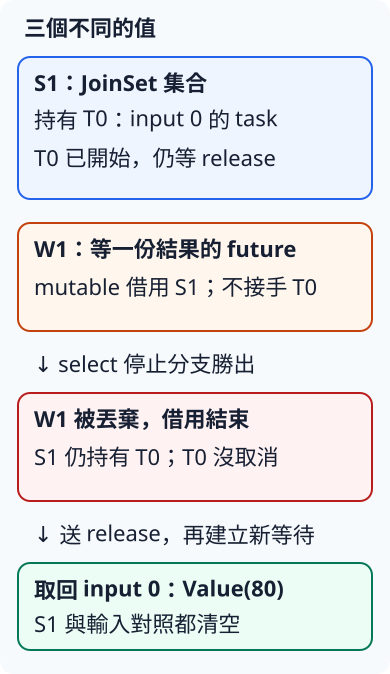

# 14.6 select!、取消與收尾：停止提交，也等到清理完成

上一節讓一份直接被 timeout 持有的工作結束。現在有一批已提交的 task，又有一個停止來源：要一面等結果，一面等停止。選中停止之後，還要決定哪些工作不再提交、哪些請求取消，以及怎樣知道清理已完成。

先拆開三個值，再組整批政策。這個區分也會用在後面的 HTTP client 與 server。

## select! 同時等待條件，選一條分支繼續

**`tokio::select!`** 是在 async 函式或 block 內使用的 macro。分支寫成 `pattern = 工作 => 處理式`；它推進各分支的等待，選到一份完成且符合 pattern 的結果，就執行那條處理式，丟棄其餘分支的等待 future。

它在目前 task 內交錯推進分支，沒有因此另建 task 或 thread；某一分支若同步阻塞這條 thread，其他分支也無法繼續。**`biased;`** 使檢查順序依程式由上而下；本例把停止放前面，兩者都就緒時優先處理停止。這是明確政策，不是讓下方分支永遠得不到機會的通用公平保證。

## 丟棄「等待結果」，是否也丟棄 task？

沿用14.3已完成的 controlled_work，金額80，只有一份 input0。以下程式的 tasks、已提交工作，以及 select 內的等待，分別命名成圖中的三個對象；S1／T0／W1 是追蹤標記，不是額外 Rust binding：

- **S1**：tasks 這份 JoinSet，持有已提交的工作。
- **T0**：input0 的 task，已送 started，但 release 尚未放行。
- **W1**：呼叫 tasks.join_next_with_id() 產生的等待 future，mutable 借用 S1，等一份結果，沒有接手整個集合或 T0。

停止分支勝出，丟棄的是 W1。這個 JoinSet method 有 **cancellation safety（取消安全性）** 契約：若等待分支沒選中，不會因此從集合移走一份 task。借用結束後可以再借用 S1，建立新等待。Tokio mpsc 的 recv 也有對應保證：未選中的等待不會偷取一筆訊息。不能據此假定每個 API 被丟棄後都保留相同進度，14.5已看過修改不會回復。



早期 no-lib package 的完整 manifest，只引用14.3已完成的 tasks，尚未加 signal：

```toml
--8<-- "examples/ch11-async/stages/cancellation-steps/Cargo.toml"
```

完整 `src/main.rs`：

```rust
--8<-- "examples/ch11-async/stages/cancellation-steps/src/main.rs"
```

完整 `examples/borrowed_join.rs`。controller 收到 started 才送 stop；select 選中停止後，確認集合與對照各有1份，再放行及回收。最後也 await controller，沒有留下控制 task：

```rust
--8<-- "examples/ch11-async/stages/cancellation-steps/examples/borrowed_join.rs"
```

以下命令從 repo 根目錄執行：

```bash
cargo run -p ch11-cancellation-steps --example borrowed_join --locked
```

結果仍是 `Value(80)`。本例只證明「停止等待」沒有取消集合中的工作；真正停止整批要另外對 S1 做事。

## guard 不要留到需要跨 await 的工作狀態

第13.6節的 std MutexGuard 代表目前持有鎖；它本身沒有 Send。若 spawn 的 future 必須保存 guard 跨過 await，這份 future 就不符合14.3的 Send 契約。外面改成 current_thread 不會免除 spawn 的要求。

先把需要鎖的修改放進短 block，取出 owned i32 快照；block 結束 guard 解鎖，等待時只保存快照。這不是宣稱 guard 解鎖會回復修改；total 已加80。

完整 `examples/short_guard.rs`：

```rust
--8<-- "examples/ch11-async/stages/cancellation-steps/examples/short_guard.rs"
```

```bash
cargo run -p ch11-cancellation-steps --example short_guard --locked
```

### 完整負例：guard 跨過 await

獨立 fixture 故意在 await 後繼續使用 guard，使它必須保存在工作狀態。依12.1的獨立 workspace 規則，fixture 自有 manifest／lock；不加入正常教材 members。

完整 `Cargo.toml`、固定解析版本的 `Cargo.lock`：

```toml
--8<-- "examples/ch11-async/cancellation/fixtures/cross-crate-fail/Cargo.toml"
```

```toml
--8<-- "examples/ch11-async/cancellation/fixtures/cross-crate-fail/Cargo.lock"
```

完整 `examples/held_guard.rs` 與實測穩定診斷 `.expected`：

```rust
--8<-- "examples/ch11-async/cancellation/fixtures/cross-crate-fail/examples/held_guard.rs"
```

```text
--8<-- "examples/ch11-async/cancellation/fixtures/cross-crate-fail/examples/held_guard.expected"
```

```bash
cargo check --manifest-path examples/ch11-async/cancellation/fixtures/cross-crate-fail/Cargo.toml --example held_guard --locked
```

這條命令**預期編譯失敗**，因為 future cannot be sent between threads safely；修法是前面的短 guard 範圍，不是忽略錯誤讓它通過。

## 整批停止要保留每筆輸入的交代

現在保留14.4的五筆材料與上限2，增加完整停止政策。**Outcome::Unstarted** 表示輸入尚未提交；它不是被取消的 task。**StopEvent** 是停止來源交付的訊息：Requested 或 SignalFailed(String)。**EndReason** 是批次最後的原因，另外分 Finished 與 StopSourceClosed；來源意外關閉，不能當作使用者已要求停止。

```rust
--8<-- "examples/ch11-async/cancellation/src/models.rs"
```

這次 Runner 的 outcomes 是 `Vec<Option<Outcome>>`，每個輸入先有一個 None 位置。classify 沿用 Id 對照分結果，record 把 Some(outcome) 放回**原輸入位置**；最後報表按輸入索引0到4輸出，與14.4的完成順序分開。組表時的 **`iterator.enumerate()`** 接手 iterator，逐筆交出 `(從0開始的usize索引, 原Item)`；這次便能同時取得原位置與 owned outcome。Vec 的 is_empty() 則回答長度是否為0。

**Runner::new** 只驗上限與保存材料，先不 fill。每輪在提交前檢查停止來源，才不會把已排入的停止訊息錯過：

1. **`stop.try_recv()`** mutable 操作收端，立即回 Result，不等待：Ok(event) 是取得訊息；TryRecvError::Empty 是現在沒訊息但仍可再來；Disconnected 是已斷線且沒有剩餘訊息。
2. 取得停止事件或 Disconnected，就進停止收尾；只有 Empty 才 fill。
3. 集合已空就 Finished；否則 select 同時等 stop.recv 與 join_next_with_id。
4. 停止分支排前面；結果分支選中就 record，下一輪再檢查停止、補位。

零上限仍先拒絕。空輸入直接 Finished，無工作要等，也不依賴停止來源是否有事件；這是本例為空批次訂的政策。

## abort_all 之後，逐筆 drain 才能說已收尾

**`tasks.abort_all()`** 請求取消集合中尚未完成的 task，沒有把它們移出集合，也沒有等待完成。**drain（逐筆取完）** 在這裡就是持續 join_next_with_id，將每份實際結束結果交給 record，直到 None。

stop_and_finish 依序做：不再 fill → abort_all → drain 所有已提交工作 → 逐筆 drop pending Job，記 Unstarted → 確認集合與 Id 對照為空，組成 Batch。Job 的 release 收端不論是否曾提交，最後都應清理，controller 再 send 會失敗。

已經完成、只是尚未回收的工作，不會被 abort_all 改寫成 Cancelled。測試用可選的 **returning** channel 建立這項證據：工作先算好 output，送 returning，之後沒有下一個 await，直接 return。**本例 current_thread** 保證 controller 取得執行機會、收到通知時，該工作已走完這段 return；這不是任意多 thread 程式只送訊息就能證明已結束的通則。

因此，完成但未取回的 input0 仍得到 Value(80)；還在等 release 的 input1 才是 Cancelled，未提交的 input2 是 Unstarted。

## 完整受控版：還不載入訊號 listener

`ch11-cancellation-basic` 的完整 manifest 只有 rt／macros／sync。`src/models.rs` 是前面同款模型，完整再次列出，供本 package 的 `pub mod models;` 載入：

```toml
--8<-- "examples/ch11-async/stages/cancellation-basic/Cargo.toml"
```

```rust
--8<-- "examples/ch11-async/stages/cancellation-basic/src/models.rs"
```

完整 `src/lib.rs` 包含 Job／returning、classify、Runner 全部 methods、stop_reason、run_batch、borrowed_join_demo、stop_demo，以及六項測試：

```rust
--8<-- "examples/ch11-async/stages/cancellation-basic/src/lib.rs"
```

stop_demo 先讓1回工作錯誤，2回 panic，看到3開始才送 Requested；controller 保留所有 release 送端，直到整批清理完再驗 send 失敗。完整 `src/main.rs`：

```rust
--8<-- "examples/ch11-async/stages/cancellation-basic/src/main.rs"
```

```bash
cargo run -p ch11-cancellation-basic --locked
cargo test -p ch11-cancellation-basic --lib --locked
```

共提交4、峰值2。按原輸入順序，結果為0 Cancelled、1 WorkError(Negative(-1))、2 Panic、3 Cancelled、4 Unstarted；停止沒有抹掉已收回的錯誤。完整 borrowed-join 選例也保留在本版：

```rust
--8<-- "examples/ch11-async/stages/cancellation-basic/examples/borrowed_join.rs"
```

### 練習與完整答案：停止已經排在前面

準備80／120／200，在呼叫 run_batch 前先送 Requested。預測提交數、峰值與三筆分類，並驗證沒有 started 訊息、所有 release 收端已清理。

完整 `examples/prequeued_stop_solution.rs`：

```rust
--8<-- "examples/ch11-async/stages/cancellation-basic/examples/prequeued_stop_solution.rs"
```

```bash
cargo run -p ch11-cancellation-basic --example prequeued_stop_solution --locked
```

答案是提交0、峰值0、三筆 Unstarted，沒有 task 需要 abort。這是先檢查再 fill 的用途。

## 把真正 Ctrl+C 轉成 StopEvent

接上 OS 訊號時才使用完成版 `ch11-cancellation`，完整 manifest 此時加 **`signal` feature**：

```toml
--8<-- "examples/ch11-async/cancellation/Cargo.toml"
```

**`tokio::signal::ctrl_c().await`** 嘗試建立 Ctrl+C listener，等待訊號，交回 `io::Result<()>`。Ok(()) 才轉成 Requested；監聽失敗轉成 SignalFailed，不當作成功停止。建立 async 函式的 future 不等於 listener 已註冊，它要先取得執行機會。

signal_controller 的 select 把 ctrl_c 放第一個分支；它先有機會進入註冊，若還在等待，第二支才送 **entered**。第二支送完後等待 pending，永不勝出。main 收到 entered，才知道 listener 已進入；**工作的 started 不代替 listener 的 entered**。若訊號或註冊失敗先到，controller 可直接送事件並結束，entered 收端則可能得到 None；main 仍要跑批次的停止收尾。

```rust
--8<-- "examples/ch11-async/cancellation/src/lib.rs:signal-controller"
```

finish_signal_controller 在整批結束後 abort 並 await controller；已完成的 Ok 或等待取消的 JoinError 都能收妥，其他 task 失敗則報錯。這也避免「工作都結束了，listener task 卻還掛著」。

Unix 上首次註冊會改變行程的 SIGINT 處理，**丟棄 listener 不會恢復原本的預設 SIGINT 行為**。本程式明確接手停止政策與退出狀態；不能指望 drop listener 就等於復原行程設定。

## 完整訊號程式與兩層控制收尾

完整 `src/lib.rs` 現在加入 controller helper 與第七項 unit test；該測試確認取消與已完成的 controller 都能回收。前面的六項 batch 測試仍完整存在：

```rust
--8<-- "examples/ch11-async/cancellation/src/lib.rs"
```

main 需要接受可選 `--signal`。本例選 **`std::env::args()`**，Item 是 String；與10.5的 args_os 相比，它要求 arguments 為 Unicode，遇非 Unicode 可能 panic。signal_mode 略過程式名稱，只接受零參數或這個精確選項；其他輸入回用法錯誤，不啟動 task。

real_signal 保留 releases，另有 observer 消費 started；listener 進入之後、且0和1已開始，才印 **READY** 並 flush。提早訊號或監聽失敗時，也依實際事件結束，不保證一定印 READY。批次完成後先回收 signal controller、await observer、確認 release 收端清理，再處理傳回的錯誤。

完整 `src/main.rs`：

```rust
--8<-- "examples/ch11-async/cancellation/src/main.rs"
```

退出政策：Finished 為0；Requested 正常返回130，表示已處理停止；SignalFailed／StopSourceClosed 為失敗；錯誤參數為2。130是程式主動回傳的數字，不是被 OS 強制終止才留下的結果。

```bash
cargo test -p ch11-cancellation --lib --locked
cargo run -p ch11-cancellation --locked
```

第二條預設跑受控 stop_demo，得到130，所以 shell 會把它視為非零結束；仍應看到完整五筆分類與清理完成。要親手送訊號，再執行：

```bash
cargo run -p ch11-cancellation --locked -- --signal
```

看到 READY 後按 Ctrl+C。這次0、1已開始但沒放行，應為 Cancelled；2、3尚未提交，應為 Unstarted，提交數2、峰值2。沒有用 sleep 猜 listener 或工作是否 ready。

本版其餘三份完整 example，以及真正 binary 的兩項 CLI tests，全部如下：

```rust
--8<-- "examples/ch11-async/cancellation/examples/borrowed_join.rs"
```

```rust
--8<-- "examples/ch11-async/cancellation/examples/short_guard.rs"
```

```rust
--8<-- "examples/ch11-async/cancellation/examples/prequeued_stop_solution.rs"
```

```rust
--8<-- "examples/ch11-async/cancellation/tests/cli.rs"
```

```bash
cargo test -p ch11-cancellation --test cli --locked
cargo test -p ch11-cancellation-steps -p ch11-cancellation-basic -p ch11-cancellation --all-targets --locked
cargo clippy -p ch11-cancellation-steps -p ch11-cancellation-basic -p ch11-cancellation --all-targets --locked -- -D warnings
```

現在能逐一回答：哪份等待被丟棄、哪份 task 仍在、哪些輸入未提交，以及哪一步證明全部已收回。下一節先以同步 HTTP 看清請求、回應與資料政策，再把等待改成 async。

[下一節：HTTP 基礎與 blocking client](14-07-lesson.md)
