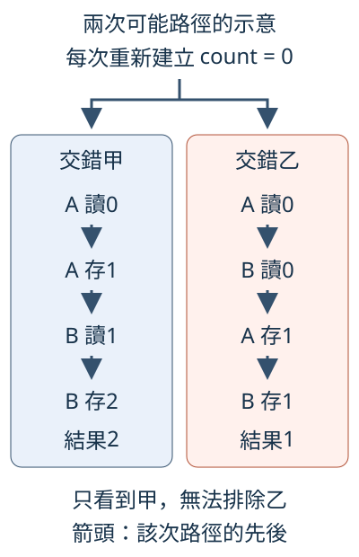
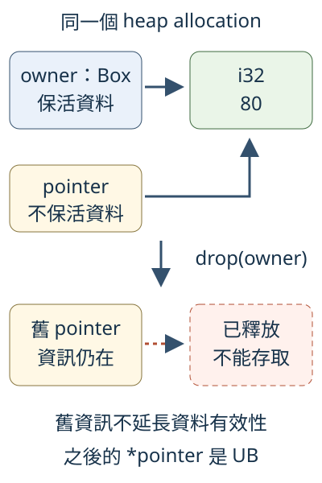

# 14.6 用 Loom 與 Miri 檢查普通 PASS 尚未涵蓋的責任

10.8 的兩份 worker 各增加一次，初值0應得到2；12.4 的 safe 切分介面則讓 caller 修改原數列的兩個區段。兩種工作都能用普通測試檢查結果，仍留下不同的問題：**這次沒有遺失更新，其他允許交錯呢？safe 呼叫正常完成，內部的 unsafe 存取是否也守住契約？**

本節分別使用 Loom 的小型並行模型與 Miri 的執行解譯。先明說要檢查的關係，再選工具與材料，最後保存成功或反例的界線；工具不能替這兩個問題彼此作答。

## 同一份計數工作，不同交錯可能有不同答案

先沿10.8的 lost update：A、B 都先 load，再把自己的舊值加1存回。一次 atomic load 或 store 不被拆開，不代表兩次呼叫合成一次不可分開的增加。A讀0、B讀0、A存1、B存1是合法的交錯，最後只剩1。

普通 thread 測試的一次執行，只看到作業系統與硬體這次讓我們觀察到的路徑。反覆重跑可能找到更多結果，沒有遇到1仍不足以排除它。下面畫的是**兩份可能路徑的手工示意**，不是本機觀察到的頻率，也不是工具的完整 trace：



兩欄各自從0開始；欄內箭頭只表示那次操作先後。甲讓A做完再輪B，乙讓兩份讀取都發生在寫入前。乙沒有使用 non-atomic 存取，這是**邏輯上的更新遺失，不是 data race 的 UB**。要排除這種錯誤，需要檢查工作可能交錯的關係。

## Loom 重跑模型，讓同步操作進入探索

**Loom** 是 Rust 並行測試工具。它用自己的同步型別與 thread API 記錄操作，由模型安排不同的允許執行，再重跑同一份測試。這不是靠加長 sleep 等待某個少見時間點；Loom 能主動探索操作的交錯與模型提供的 atomic 觀察。

選用 **`loom::model`**：它接收沒有引數、回傳 unit 的 closure，重複執行這份 body、每次換一條模型路徑。這份 closure 要有 `Fn() + Send + Sync + 'static` 能力，本例不捕捉外部狀態，在 body 裡重新建立資料。**count 必須每次從0新建**，不能把上一次探索的結果帶進下一次。

Loom 只追蹤接上它的操作。這次全部使用下列替代 API；名字相似不表示與 std 是相同型別：

| 所選 API | 本例需要的契約 |
| --- | --- |
| `loom::sync::Arc::new`、`Arc::clone` | 建立共同 owner、讓兩個 handle 保活同一份模型資料；clone 不複製內部 counter。 |
| `loom::sync::atomic::AtomicUsize` | new建初值；load讀usize副本；store替換數值；fetch_add一次讀改寫，交回舊值。 |
| `loom::sync::atomic::Ordering::Relaxed` | 沿10.8選同一 atomic 的操作規則，不額外發布其他資料。 |
| `loom::thread::spawn` | 接收 `FnOnce` 工作、建立模型內的另一份執行路徑，回傳 handle；工作與結果不能依賴短命外部借用。 |
| `handle.join()` | 消耗handle、等待對應模型工作完成，交回Result中的成果；本例兩份結果都取得後才檢查count。 |

這些 Loom 物件與操作都放在 model body 內。若把 AtomicUsize 或 thread 換回 std，對應的同步與排程就沒有完整進入 Loom 的追蹤，不能因為外面包了 model 就宣稱已探過它們。

本例保持有限：**兩個 worker、一個共享 atomic、各增加一次，沒有等待迴圈、隨機來源或外部 I/O**。加上執行 model body 的協調路徑，共三條模型 thread。這樣能集中觀察遺失更新；更多 thread、操作或迴圈會讓可能狀態大幅增加，不能直接把真實服務整個塞入小模型。

Loom 的型別與模型用於測試。本節另建 `ch14-model-checking`，Loom 固定0.7.2、放7.1已教的 dev-dependencies；預設features為空，本例不需要額外功能。一般dependency是12.4已教的 library，供後面的Miri測試使用：

```toml
--8<-- "examples/ch14-model-checking/Cargo.toml"
```

這裡直接寫獨立的 Loom integration target，沒有讓同一份 production library 在 std 與 Loom 之間切換。先學小模型的操作與範圍；它仍必須忠實保存要檢查的共享位置與增加規則。

## 保留會失敗的模型，讓反例可以重現

下面的 model 使用兩份 Arc clone，指向同一個 count。兩份 worker 分別 load、相加、store，已讓它們各自的兩步進入 Loom；model body 的最後 assertion 要求2。正常回傳的 worker 結果是 `Ok(())`，用已教的 `Ok(_)` pattern 檢查；若工作未正常完成，這份模型也應失敗，不能當成完整兩次更新。

```rust
--8<-- "examples/ch14-model-checking/fixtures/cargo-test-fail/tests/loom_lost_update.rs"
```

這份測試**預期失敗**，另放 `fixtures/cargo-test-fail`。它自成空 `[workspace]`、有自己的 Cargo.lock，不加入正常 workspace 的測試；空workspace與--manifest-path的定位沿14.2，`--test`選integration目標沿7.2：

```toml
--8<-- "examples/ch14-model-checking/fixtures/cargo-test-fail/Cargo.toml"
```

從 repo 根目錄重現：

```bash
cargo test --manifest-path examples/ch14-model-checking/fixtures/cargo-test-fail/Cargo.toml --test loom_lost_update --locked
```

診斷的關鍵部分是：

```text
assertion `left == right` failed
  left: 1
 right: 2
```

左邊是完成並join後實際讀到的1，右邊是「兩份各增加一次」需要的2。Loom找到了反駁這項要求的模型執行；前圖的乙是一種能解釋1的交錯，不把它冒稱為這次診斷中保存的全部操作trace。

這個結果足以否定「分開read/store總能各加1」，不代表量到了它在實際機器出現的機率。同名.expected保存`left: 1`作目標原因；下載失敗、找不到Loom或工具自身不能建置，都不是本例反例。

## 用一次 fetch_add 修正同一個工作

10.8已說明修法：fetch_add讓讀舊值、加1、寫回成為同一個RMW。另一份fetch_add在同一 atomic 的修改順序中接著增加，不會也根據先前獨立讀出的0覆蓋成果。兩份join都完成後再load，才有最後2的完整成果。

只改worker的增加方式，其餘共享來源、初值、兩份工作與最後assertion保持：

```rust
--8<-- "examples/ch14-model-checking/tests/loom_counter.rs"
```

```bash
cargo test -p ch14-model-checking --test loom_counter --locked
```

這項modeltest通過，表示**這份有限模型在此次探索範圍沒有找到違反最終2的路徑**。理由仍包括RMW及兩份join；不是PASS替Relaxed增加了發布其他資料的能力，也不是把load/store改成SeqCst就能代替這次修法。

`model`預設會探索其模型範圍，設定可受`LOOM_MAX_PERMUTATIONS`等環境值限制，縮小探索時就要連同限制保存。本節驗證沒有設定排列數、時間或搶占上限，使用這個小模型的預設配置。Loom本身也不是完整的Rust／C11記憶體模型，某些弱記憶體行為未涵蓋；因此不能由這一項PASS證明所有輸入、所有atomic演算法或全部硬體實作都正確。

## Miri 問的是這次執行有沒有違反記憶體契約

回到12.4。`split_i32_at_mut`是safe介面，caller不寫unsafe；body仍使用raw pointer、add與from_raw_parts_mut。正常assertion看到了元素修改，不能單靠這個結果確認內部的來源、alignment、有效範圍與aliasing要求都成立。

**Miri** 是Rust的執行解譯與UB偵測工具。它使用 **MIR（Mid-level Intermediate Representation，中階中間表示）**：編譯器把Rust程式整理成的執行步驟。Miri解譯這些步驟，追蹤記憶體配置與存取，遇到所支援的違約便報告，例如use-after-free、越界、未初始化或不符合alignment的存取。

Miri會進入所選測試呼叫到的Rust body，包含safe API內部的unsafe操作；不是看到caller沒有unsafe就略過它。它檢查的是實際解譯到的輸入與路徑，仍不能證明任意safe client都不會觸發UB。12.4的安全契約、範圍檢查及private不變條件仍需要審查。

### 固定專用 nightly，再準備工具

Miri緊貼編譯器內部介面，需要 **nightly工具鏈**及對應component。nightly是按日發布的Rust版本；本頁固定已驗證可安裝的 **nightly-2026-10-01**，不以會隨日期改變的`nightly`代稱。

以下指令中，`+nightly-2026-10-01`只為該次命令選工具鏈；主專案的rust-toolchain.toml繼續使用stable 1.99。`--profile minimal`選最小工具組，`--component miri`加入解譯工具；**rust-src**是同版本標準庫的原始碼，供Miri準備解譯用的標準庫：

```bash
rustup toolchain install nightly-2026-10-01 --profile minimal --component miri
rustup component add rust-src --toolchain nightly-2026-10-01
cargo +nightly-2026-10-01 miri setup
cargo +nightly-2026-10-01 miri --version
```

**`miri setup`**準備這份nightly解譯所需的標準庫環境，第一次可能下載與建置；完成setup並不代表教材測試已通過。這組工具的實際版本是rustc1.101.0-nightly、Miri0.1.0，commit `21b707e3f`，日期2026-09-30；工具鏈發布日期則是2026-10-01。

Miri提供 **`cargo miri test`**、**`cargo miri run`**，分別解譯測試或binary，使用Cargo原本的package與target選擇。以下只選pureRust的miri_contracts target，不要求它解譯Loom的模擬排程測試。

## 用既有安全切分介面，檢查所選正常路徑

下面的三項測試呼叫12.4同一個公開helper，沒有複製另一份unsafe實作。第一項借兩段修改原元素；第二項檢查0、len與空Vec；第三項檢查超長mid回None且原資料未變。

端點和空資料不是裝飾性的案例：12.4已說明，長度零仍需要合法non-null／aligned pointer，但不能把端點當成下一個元素讀取。本節在Miri中執行這些既有契約的具體路徑：

```rust
--8<-- "examples/ch14-model-checking/tests/miri_contracts.rs"
```

先核對普通測試，再用相同target交給Miri：

```bash
cargo test -p ch14-model-checking --test miri_contracts --locked
cargo +nightly-2026-10-01 miri test -p ch14-model-checking --test miri_contracts --locked
```

三項正常測試與Miri檢查通過，支持這批指定輸入的結果正確，且Miri在這些解譯路徑未找到所檢查的UB。它沒有增加新輸入、也沒有涵蓋所有unsafe用法；完整soundness仍要沿12.4核對全部前提。

## 只在 Miri 中重現一個明確禁止的存取

12.3已說明raw pointer不保活來源。現在由 `Box::new(80)`建立heap中的i32，用`&raw const *owner`取得指向**同一個i32**的pointer，再以8.2的drop接手並清理Box。到drop返回，原allocation已釋放，舊pointer資訊仍能保存，卻不能dereference。

圖的上半部兩條指向都連到同一份80；owner負責保活，本例的pointer沒有這項責任。向下箭頭表示drop前後；下半的虛線表示已失效的指向，不表示可用的讀取：



接下來是**故意違約、僅供Miri解譯的fixture**，不放普通test或normalexample。Miri會為被解譯的crate設定條件`cfg(miri)`；`#[cfg(not(miri))]`中的not表示條件反過來，在一般建置時保留compile_error，拒絕產生可執行的普通成品。這沿9.1的條件編譯及14.2的compile_error角色：

```rust
--8<-- "examples/ch14-model-checking/fixtures/miri-fail/src/main.rs"
```

這裡的unsafe block只有責任標記，沒有恢復已釋放的storage。WRONG註解明說違反哪項條件；最後println不應有正常結果，也不以「可能印出80」來支持任何結論。

fixture是獨立binary package，沒有第三方依賴；空workspace隔離它，自己的lock保存設定。它不加入根workspace的normal all-targets，只有下面的Miri命令：

```toml
--8<-- "examples/ch14-model-checking/fixtures/miri-fail/Cargo.toml"
```

```bash
cargo +nightly-2026-10-01 miri run --manifest-path examples/ch14-model-checking/fixtures/miri-fail/Cargo.toml --locked
```

此命令預期非零結束，關鍵診斷是：

```text
Undefined Behavior: memory access failed: ... has been freed, so this pointer is dangling
```

診斷指向`*pointer`，另外標出Box::new的配置點與drop的釋放點。allocation編號依工具執行而變；要追的是**同一份資料已釋放後仍被讀取**。這次Miri抓到的是storage有效性被破壞，不需先推導完整的實驗性aliasing模型。

## 工具報什麼，才能推出什麼？

Miri的 **`Undefined Behavior`** 表示所選路徑觸發了被檢查的違約；**`unsupported operation`** 則表示工具不支援那項操作，不能直接當作程式有UB。沒有報告也只代表這次解譯未找到；多數平臺API及外部C實作不在其一般解譯能力內，FFI的型別、ownership與釋放契約仍須另外核對。

本節只解譯pureRust操作，沒有要求Miri驗證外部C。它也不窮舉所有thread交錯：對並行模型探索使用Loom，對選定執行中的unsafe記憶體條件使用Miri，保存各自的設定、反例與範圍：

| 觀察 | 可支持的結論 |
| --- | --- |
| 普通thread測試通過 | 這次執行的結果符合assertion，尚未排除其他交錯。 |
| Loom分開load/store得到1 | 模型存在反例，不能保證各增加一次得到2。 |
| Loom fetch_add模型通過 | 此有限模型、此次探索未找到違反要求的路徑。 |
| Miri正常切分測試通過 | 指定輸入與解譯路徑未觸發工具檢查到的UB。 |
| Miri指出配置已釋放 | 這次讀取違反storage有效性；普通執行表象不能修復它。 |

## 練習：改變工作材料，保留驗證需要

1. Loom模型改成初值80，兩份worker分別增加20與5，全部join後應105。仍用fetch_add，不改成兩份read/store；說明為何不同增加數也能保留兩份成果。
2. 修正Miri fixture的工作順序：在owner仍有效時Copy出i32，再drop owner，只使用已取得的普通i32副本。把正確版本放**正常integration target**，用Miri確認；不要把故意UB留在普通target嘗試crash。

兩題只改已教的數值或順序，不需要新的工具flag。完整參考程式與驗證命令如下：

??? example "Loom：不同增加量"

    ```rust
    --8<-- "examples/ch14-model-checking/tests/loom_counter_solution.rs"
    ```

    ```bash
    cargo test -p ch14-model-checking --test loom_counter_solution --locked
    ```

??? example "Miri：先讀副本，再清理 owner"

    ```rust
    --8<-- "examples/ch14-model-checking/tests/miri_owner_solution.rs"
    ```

    ```bash
    cargo +nightly-2026-10-01 miri test -p ch14-model-checking --test miri_owner_solution --locked
    ```

第一題把一次更新與工作完成的理由帶到另一組材料；第二題把storage有效期間與讀出的Copy值分開。工具結果是契約審查的證據，不能取代對「共享的是什麼、資料何時有效、允許哪些存取」的解釋。

延伸閱讀：[Loom0.7.2官方guide與限制](https://docs.rs/loom/0.7.2/loom/)、[Miri固定工具源碼的README](https://github.com/rust-lang/rust/blob/21b707e3f/src/tools/miri/README.md)、[Too Many Lists：Miri](https://rust-unofficial.github.io/too-many-lists/fifth-miri.html)、[Rust語言聖經中文對應](https://github.com/sunface/rust-course/blob/main/src/too-many-lists/unsafe-queue/miri.md)。舊教材的nightly日期、xargo與借用檢查flag不直接搬入本頁，所選操作以本次固定工具核對。
