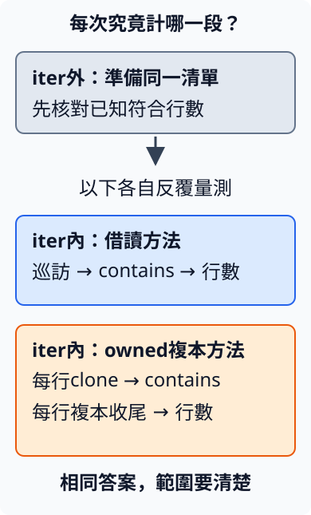

# 14.7 固定同一項工作，再判斷量測數字

7.9搜尋工具在區分大小寫的路徑也建立owned判斷複本，讓表示與保存的角色先清楚。現在有一項具體問題：**只需要借讀文字、計算符合行數時，每行先建立複本，會增加多少工作？**

11.4已用Instant分清設定跨度與實際經過時間。但執行一次讀到較小數字，還可能受其他程式、排程與當次資料影響。這次用 **benchmark（基準量測）**：固定工作與材料，重複執行，記下量測範圍與結果，才判斷差異。

本節使用 `ch14-performance` package，所有命令從repo根目錄執行。先核對答案，再引入Criterion；先讀主文即可理解實驗，延伸連結不是必要前置。

## 同一份材料，兩種方法都必須完成相同工作

沿用7.9的搜尋片段規則：區分大小寫，非空query，**一行符合就算1，不數出現幾次**。這裡已經有分好的owned行清單，工作只回符合行數；不讀檔、不保存Match、不產生JSON。這是 **microbenchmark（小範圍的基準量測）**，回答純計數成本，沒有涵蓋整份CLI。

先看五行材料：

```text
Rust Rust
rust
中有 Rust
Trust
（空行）
```

查 `Rust` 是2行，第一行出現兩次仍只算1；查 `rust` 也是2行，其中Trust包含小寫片段rust。查Python是0；沒有行資料也正常回0；空query仍先拒絕。

兩種實作都有 `Result<usize, String>`：成功交回行數，空query保存已定的錯誤文字。差別只有取得判斷文字的方式：

| 方法 | 每行做什麼 | 原輸入是否保留 |
| --- | --- | --- |
| count_borrowed | `as_str()`借讀，再contains | 保留 |
| count_cloned | 先clone成獨立owned String，再contains | 保留 |

對String，clone會建立自己的owned文字內容。candidate在該次迴圈結束時收尾，這份複本不需要保存到下一行。借讀方法則沒有這份新String；這是原始碼顯示的額外工作，**時間差仍須量測**，不能只從clone名稱給一個固定倍率。

```rust
--8<-- "examples/ch14-performance/src/lib.rs:counts"
```

## 固定工作量，也記下輸入分布

真實筆記可能有不同長度與符合比例。這裡先採可追蹤的**合成材料**：每4行第一行是 `Rust Rust notes`，另3行都是 `Python notes`。index從0開始，`index % 4 == 0`選0、4、8等位置。原文字只含ASCII，query固定Rust。

選64與256行，分別有16與64行符合；每份都有1/4符合，但一份要巡訪四倍行數。Rust行15 bytes，Python行12 bytes，因此內容共816與3264 bytes，另外還有Vec／String本身的資料結構。

```rust
--8<-- "examples/ch14-performance/src/lib.rs:workload"
```

```rust
--8<-- "examples/ch14-performance/examples/benchmark_inputs.rs"
```

```bash
cargo run -p ch14-performance --example benchmark_inputs --release --locked
```

```text
64行：借讀=16，owned複本=16
256行：借讀=64，owned複本=64
```

每個方法都收到同一份slice，沒有替某個方法減少行數或只給較短文字。這仍不是使用者筆記的代表分布；測完兩份材料，不等於知道所有文字、符合比例或超大檔案的結果。

先驗證片段、大小寫、空清單、空query與剛才的固定工作量；預期從剛才規則取得，不能只檢查兩份錯誤答案恰好相同：

```rust
--8<-- "examples/ch14-performance/tests/count_contracts.rs:contracts"
```

沿9.1的release建置驗證，結果同樣必須正確：

```bash
cargo test -p ch14-performance --locked
cargo test -p ch14-performance --release --locked
```

兩次各有3項integration tests。測試沒有「必須小於幾毫秒」的assertion；答案正確與時間是否改善，是不同檢查。

## Criterion替我們重複工作，計時邊界仍由我們決定

**Criterion** 是在stable Rust可用的benchmark程式庫。本節選版本要求0.8.2，實際解析版本由Cargo.lock固定。它重複呼叫我們提供的工作、收集耗時並分析，沒有替我們決定正確答案或代表輸入。預設量的是沿11.4的實際經過時間，排程暫停時仍會流逝；不是只把處理器執行指令的時間加總。

依賴只用於測試／bench，放dev-dependencies。關default features，只選 **cargo_bench_support**，取得直接由Cargo執行與文字報告所需的支援；本次不選平行分析、async或圖表功能。

Cargo的 **bench target** 是專供量測的可執行程式，預設來源在 `benches/名稱.rs`，和1.9的example target是不同角色。`[[bench]]`列出目標名稱；**`harness = false`**關掉Rust預設runner，讓下面Criterion的macro提供main。line_counts是本節比較，line_setup_solution是末尾練習的完整答案：

```toml
--8<-- "examples/ch14-performance/Cargo.toml:criterion"
```

先教必要API與兩層callback：

| 介面 | 本次角色與契約 |
| --- | --- |
| `Criterion::default()` | 建立量測管理者，稍後設定取樣數與時間；不是執行被測工作。 |
| `criterion.bench_function(id, callback)` | mutable借用管理者，以不重複的文字id識別工作，再交給callback一個mutable Bencher。 |
| `bencher.iter(routine)` | 接 `FnMut() -> O` 工作，反覆呼叫並計整批經過時間；輸出O的收尾也在計時內。這裡正常Output是Ok的行數。 |
| `std::hint::black_box(value)` | 泛型函式接手再交回同值，對編譯器提供盡力而為的提示，減少憑固定輸入移除／化簡工作。包輸入也觀察輸出，沒有關掉release最佳化。 |

沿6.3，外層 `|bencher|`接工具；內層 `||`才是每次要計時的工作。內層只shared借讀lines，能重複呼叫，不消耗唯一材料。black_box只交進slice reference與query reference，並處理這次Result；沒有clone整份輸入Vec。

make_workload與兩項正確性assert放在iter外。count_cloned函式**裡面**的candidate建立／contains／收尾都仍在iter內；count_borrowed的完整呼叫也在同一邊界內。iter還包含重複呼叫與少量迴圈成本，不是憑空得到沒有量測負擔的硬體指令時間。

圖中箭頭表示準備之後選一種工作反覆執行，框表示計時範圍；兩種方法使用相同已建置清單。不是把兩個方法同時並行跑：



```rust
--8<-- "examples/ch14-performance/benches/line_counts.rs:bench"
```

black_box可以減少基準程式的常數假設，但只是best effort，不能證明編譯器保留某一套機器指令。原函式仍必須正確；不把black_box加入需求邏輯，也不把少用了資料的錯誤版本當成最佳化。

## 暖身、取樣與runner各有自己的角色

Criterion先 **warm-up（暖身）**，重複執行同一工作，讓執行環境先承受這種負載，例如已讀的資料可能留在處理器較近的 **cache（快取）**。cache保存近期使用的資料，讓重複取得相同資料時可能不用再從較遠的記憶體取回；因此本次重用同一清單的結果，不能直接當作每次都初次讀入新檔案的成本。再 **collect samples（收集樣本）**：每份樣本通常包含多次routine呼叫，以整批耗時估每次成本。30份樣本不是只呼叫30次。

這裡設定的是方便練習的小型實驗，不是所有任務都適合的一組通用精度：

| 設定 | 本次意義與使用規則 |
| --- | --- |
| `sample_size(30)` | 目標30份量測樣本，值至少10。 |
| `warm_up_time(Duration::from_millis(500))` | 每項暖身500ms，Duration不可0。 |
| `measurement_time(Duration::from_secs(2))` | 每項收集約2秒的量測目標，可能因工作量自動延長；不可0。 |
| `without_plots()` | 不生成圖表，保留文字量測；不改routine的工作。 |

這幾個設定method接手管理者，再交回新設定，所以能串接。兩個macro也只使用選定的外部介面：**criterion_group!** 的name指定runner函式名，config是剛教的管理者設定，targets列出要收到 `&mut Criterion` 的函式。**criterion_main!** 提供main、處理Cargo交來的選擇，再執行runner；不是要自己補另一個main。

```rust
--8<-- "examples/ch14-performance/benches/line_counts.rs:runner"
```

新命令 **`cargo bench`**建置並執行bench target。預設bench profile繼承9.1的release，因此有最佳化；本repo仍保留overflow checks。`--bench line_counts`只選這個目標；`--no-run`只編譯，不算已量測：

```bash
cargo bench -p ch14-performance --bench line_counts --no-run --locked
cargo bench -p ch14-performance --bench line_counts --locked
```

## 先讀時間欄位，再判斷差異的範圍

`Warming up`是暖身；`Collecting 30 samples`是收集30份批次樣本；後面可能另列數十萬次iterations。一次iteration在本實驗是**巡訪完整64或256行並回傳Result**，不是只處理一行。

`time: [左 中 右]`中，中心是每次工作的時間估計，左右是該估計的 **confidence interval（信賴區間）** 界線。它根據這批樣本與工具的估計方法表達不確定性，不是最快／中位數／最慢的三次執行。

本節沿工具預設95%信賴水準：在方法前提成立、反覆重做整份取樣與估計程序時，這類區間長期約95%會涵蓋要估的時間值。這不表示「95%的個別呼叫一定落在此區間」，也不保證使用者下次等待多久。環境或輸入改變時，原區間更不能直接移用。

本教材在2026-10-14以相同source連續執行兩輪。環境是共享Linux x86_64、Intel Xeon Platinum 8573C、Rust／Cargo1.99.0、Criterion0.8.2；bench採opt-level 3與overflow checks。這是受資源配額限制的執行環境，不是獨占效能實驗機。

下面單位是 **µs（微秒）**，1ms等於1000µs。每格為「中心估計 [區間下界–上界]」，從實跑報告四捨五入到三位小數；一次工作仍是整份清單：

| id | 第一輪 | 第二輪 |
| --- | --- | --- |
| borrowed/64 | 1.188 [1.184–1.192] | 1.214 [1.207–1.222] |
| cloned/64 | 1.992 [1.984–2.002] | 2.151 [2.042–2.308] |
| borrowed/256 | 4.877 [4.733–5.078] | 4.852 [4.813–4.903] |
| cloned/256 | 7.953 [7.914–8.010] | 8.399 [8.177–8.647] |

在這兩輪與兩份材料中，借讀方法的中心估計都較小；但同一方法的讀值也會變，第二輪cloned/64的區間更寬。這批資料支持「此小型純計數可以減去owned複本工作」，仍沒有指出時間差中配置、複製bytes或釋放各占多少，也沒有驗證真實筆記的輸入分布。

完整 [第一輪報告](https://github.com/birdhackor/learn_rust/blob/main/examples/ch14-performance/measurements/run-1.txt)、[第二輪報告](https://github.com/birdhackor/learn_rust/blob/main/examples/ch14-performance/measurements/run-2.txt) 與 [環境／指令／source SHA](https://github.com/birdhackor/learn_rust/blob/main/examples/ch14-performance/measurements/reproduction.json) 都保存，不只挑較快的一輪。報告中的outlier表示偏離多數樣本的觀察；它提醒我們這批資料有變動，不能任意刪掉後只留下好看的時間。

`change`與`Performance has improved`若出現，是同一id和先前保存baseline的比較；baseline是前次量測資料，不是另一個id。borrowed/64與cloned/64各自有自己的紀錄，不能把其中一項change行讀成兩種方法之間的比較。本次第二輪在相同source上也出現regressed提示：它表示該id這輪樣本比前次較慢，不能據此判定某項程式修改造成退步，因為我們根本沒有改程式。

CPU是central processing unit（中央處理器），執行程式中的運算；其他程式同時使用它時，當次經過時間可能改變。工具通常把結果保存在 `target/criterion/`。記錄source版本、Rust／Criterion版本、profile、輸入分布、計時範圍與當時環境；重跑時若有其他編譯／CPU工作，保留這項限制，而不把干擾藏進「改善倍率」。

我們目前可以判斷的是兩份合成材料、這份程式與這次環境的計數成本；不能由此判整個CLI快多少、誰在所有輸入都更快，或加一條每次必須小於某數字的測試。

## 練習：如果需求包含素材準備，邊界要怎麼改？

新的問題是「建立行清單，再計數，最後讓這份臨時清單收尾，整段要多少時間？」這與前面已建立slice的純計數需求不同。

寫另一個bench target：64／256行規則不變，用新的 `setup_and_borrowed/行數` id，在iter內呼叫make_workload，再count_borrowed，函式block結束時本次清單收尾。在iter外另建一份已知材料核對答案；把rows交black_box，再生成本次輸入。仍使用相同runner設定。

先畫出新範圍，再對照完整答案；不要把「包含建置」和「只有計數」兩條時間直接稱成演算法勝負：

??? example "完整參考程式"

    ```rust
    --8<-- "examples/ch14-performance/benches/line_setup_solution.rs"
    ```

    ```bash
    cargo bench -p ch14-performance --bench line_setup_solution --locked
    ```

完整答案也實跑過；包含準備的中心估計約為64行2.401µs、256行8.911µs，原始 [練習報告](https://github.com/birdhackor/learn_rust/blob/main/examples/ch14-performance/measurements/exercise.txt) 另存。這次只有一輪，用途是確認新邊界確實能量測，不把它與前面純計數的差值解讀成精確的建置成本分解。

下一節會用profiling觀察時間或配置工作落在哪裡，再檢查改善前後是否仍完成相同工作。那一步需要實際profile證據，本節只由原始碼指出可能的額外工作，不以benchmark總時間猜每項配置的占比。

延伸閱讀：[英文Performance Book：Benchmarking](https://nnethercote.github.io/perf-book/benchmarking.html)、[中文RustCourse：benchmark](https://course.rs/test/benchmark.html)、[Criterion起步](https://criterion-rs.github.io/book/getting_started.html)、[時間欄位解讀](https://criterion-rs.github.io/book/user_guide/command_line_output.html)、[std black_box](https://doc.rust-lang.org/std/hint/fn.black_box.html)。
