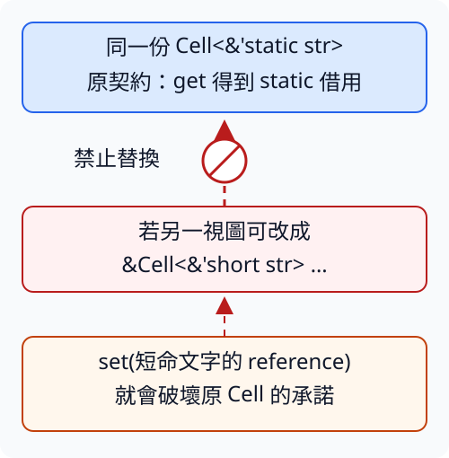

# 15.2 借用有效性放進型別後，哪些替換仍合法？

第11.5節 已看到：固定文字的 `&'static str` 能滿足較短的借用需要。但如果把 reference 放進 Cell，或者放進 function pointer 的參數，能不能仍然用同一方向替換？

這次要學的是**合法替換**。我們保持同一項需求：使用端需要某種型別時，交來的另一種型別能否滿足全部契約？合法替換不修改原資料的存活，也不是數值轉型；它改變的是使用端可以依靠哪些保證。

本節從repo根目錄操作，仍用no-lib package `ch15-unsafe-stages`。完整manifest與預設提示binary如下；每次明選example，不載完整舊library：

```toml
--8<-- "examples/ch12-unsafe/stages/Cargo.toml"
```

```rust
--8<-- "examples/ch12-unsafe/stages/src/main.rs"
```

## 長借用可以滿足較短的讀取需要

沿 第7.2節 與 第11.5節 使用 **`'long: 'short`**：`'long` 至少涵蓋 `'short`。若使用端只在 `'short` 需要讀文字，已有 `'long` 的有效性就足夠。

**subtyping（子型別關係）** 表示某個型別能用來滿足另一個型別的要求。這裡的例子是 `&'long str` 可以作為 `&'short str` 使用。它不是 Python 類別的繼承，也沒有把短命資料變長命。

外層 mutable reference 的借用期間也能縮短。例如持有可修改數字的長借用，交給只需要較短借用的使用端；內部的 i32 型別不變，原資料仍須維持有效。

以下兩個 helper 的 body 都只交回原 reference。泛型 lifetime 的宣告順序沿 第7.2節，`'long: 'short` 寫在 `'long` 後，限制兩者的關係：

```rust
--8<-- "examples/ch12-unsafe/stages/examples/variance_references/variance/mod.rs:references"
```

能編譯的 body 核對「對所有符合這項 bound 的 lifetime，這個方向成立」。回傳沒有 clone 文字或數值，也不額外配置記憶體。下面的輸出只是觀察如何使用回傳結果，不以數字相同當作 lifetime 規則的證明。

這一步只載兩個reference helper；完整variance/mod.rs及根程式如下，尚未載入後面的callback契約：

```rust
--8<-- "examples/ch12-unsafe/stages/examples/variance_references/variance/mod.rs"
```

```rust
--8<-- "examples/ch12-unsafe/stages/examples/variance_references/main.rs"
```

```bash
cargo run -p ch15-unsafe-stages --example variance_references --locked
```

```text
長資料可交給一般借用=Rust，局部文字=note
短暫mutable借用更新=100
借用結束後原值=100
```

這裡的 mutable reference 修改的是原 amount。借用結束後能讀 amount，和 第3.5節 的借用有效性一致；沒有產生第二份數字。

## variance 看的是包住參數後的替換方向

**variance（型變）** 描述：參數本來有合法替換關係，放進某個型別之後，關係如何改變。此處的參數可能是 lifetime，也可能是另一個型別；必須先指明正在看哪個參數。

假設 `'long: 'short`，先用三個名字描述不同方向：

| 名稱 | 原本能作長效到短效的替換，放進型別後如何變化 |
| --- | --- |
| covariance（協變） | 保留原方向。例：`&'long str` 可以滿足 `&'short str`。 |
| contravariance（逆變） | 方向反過來；下文用 function pointer 的輸入說明。 |
| invariance（不變） | 不能只靠原替換關係改換該參數；通常仍需相同參數。 |

不是「mutable 就全部 invariant」。`&'a mut T` 對自己的借用 lifetime `'a` 是 covariant，所以前面的 shorten_mutable 合法；它對被借型別 T 則是 invariant。接下來用兩層 reference 看清楚第二項限制。

## 為什麼 `&mut T` 不能任意改換 T

讓 `saved` 的型別是 `&'static str`。現在借用這個 **reference 變數**，target 是 `&mut T`，其中 T 是 `&'static str`；target 沒有直接借到文字的 mutable 內容。

replace 的工作是把另一個 T 寫進 target。這原本是合理的共用操作：把同一型別的值替換進去。但如果允許 `&mut &'static str` 被當成 `&mut &'short str`，函式就能寫進只借自內層 String 的 reference；外層 saved 卻還承諾 `'static`。

下面是完整 compile-fail fixture，會得到 `E0597`，指出 local 無法滿足 saved 中 reference 的要求：

```rust
--8<-- "examples/ch12-unsafe/stages/fixtures/compile-fail/variance_mutable_target.rs"
```

指定實測診斷字串：

```text
--8<-- "examples/ch12-unsafe/stages/fixtures/compile-fail/variance_mutable_target.expected"
```

編譯器拒絕這個替換，所以沒有執行後使用失效 reference 的步驟。原因是寫入能力可能破壞原 T 的契約，不是宣告 replace 的每個用途都不安全。若 saved 只需要依局部資料的有效範圍使用，就應如實設計它的型別；不能先承諾 `'static`，之後把短借用寫進去。

## Cell 的 shared 介面仍有寫入能力

第11.9節 的 Cell::set 可以從 `&self` 替換內部值。因此 `Cell<T>` 對 T 也是 invariant，不能因為操作時只有 shared reference 就當成只讀。

想像同一份 `Cell<&'static str>` 被兩處 shared 借用。一處保留原型別契約，另一處若能把它視為 `Cell<&'short str>`，就能 set 一份短命 String 的借用。原型別那一處再 get，卻會把新資料當成 `'static`。這正是型別替換必須擋住的關係。

下圖中箭頭只表示假設允許改換型別後，短借用會被寫回哪個共用容器；禁止符號表示這條型別替換不成立，沒有實際執行失效存取。



下面的 helper 即使按值接手 Cell，也不能直接把 `Cell<&'long str>` 改成 `Cell<&'short str>`。variance 是這個型別對參數的替換規則，不會因為本次 body 恰好只轉交值就改變：

```rust
--8<-- "examples/ch12-unsafe/stages/fixtures/compile-fail/variance_cell.rs"
```

指定實測診斷字串：

```text
--8<-- "examples/ch12-unsafe/stages/fixtures/compile-fail/variance_cell.expected"
```

訊息包含 `Cell<T> is invariant over the parameter T`，並指出僅有 `'long: 'short` 不足以完成回傳。這不禁止從 Cell 取出 shared reference 再作較短借用；禁止的是把原容器的 T 契約直接改換。

## function pointer 的輸入與輸出有不同方向

第9.2節 的 `fn(i32) -> i32` 描述可呼叫的 function pointer。現在把參數與回傳值換成已教的 reference。`fn(&'a str) -> usize` 接收符合 `'a` 的文字借用，回傳 byte 數；`fn() -> &'a str` 不接收參數，交回符合 `'a` 的文字借用。

先只想輸入。使用端承諾每次都給 `'long` 的文字，那麼一份只需要 `'short` 就能處理文字的函式也能完成工作。長效輸入已經滿足它的短效需要，因此：

- `fn(&'short str) -> usize` 可以滿足 `fn(&'long str) -> usize`。
- 反過來不能：只接受 `'long` 的函式，不能放在允許呼叫者交 `'short` 資料的位置。

輸入 reference 本來是長到短，包進函式參數後卻變成短需求的函式到長需求的位置，這就是 contravariance。它保護的是呼叫者依介面合法交來的所有輸入，不是這個函式目前剛好被哪個 literal 呼叫。

再看輸出。使用端只需要 `'short` 的結果，函式若承諾交回 `'long`，就已滿足需要；所以輸出保持 covariance。不能把只能提供短借用的函式，放進承諾交回長借用的位置。

下列 helper 接手 function pointer，原樣交回；回傳型別也以 fn 開頭，所以完整箭頭右邊是另一個「可呼叫型別」，不是本次立即呼叫取得的 usize 或 reference。

```rust
--8<-- "examples/ch12-unsafe/stages/examples/variance_callbacks/variance/mod.rs:callbacks"
```

adapt_input 的 `'long: 'short` 已足以使轉交成立，adapt_output 也保留輸出的原方向。若把第一項反過來，完整 fixture 會得到 `lifetime may not live long enough`：

```rust
--8<-- "examples/ch12-unsafe/stages/fixtures/compile-fail/variance_input_reverse.rs"
```

指定實測診斷字串：

```text
--8<-- "examples/ch12-unsafe/stages/fixtures/compile-fail/variance_input_reverse.expected"
```

不能只照提示新增反向 bound，卻仍聲稱函式接受同一組 lifetime：多加 `'short: 'long` 會要求兩者彼此涵蓋，改變原契約。要依呼叫者能提供的資料範圍選擇 callback。

把可用的兩項 adapter 跑起來：byte_len 只在呼叫中借讀文字；fixed_label 交回已知的 `'static` literal。這個執行例子使用 literal，泛型 helper 的 body 才核對更一般的兩個 lifetime 關係。

這一步的完整module保留前面兩個helper，再加入已教的兩個adapter；完整根程式只載它：

```rust
--8<-- "examples/ch12-unsafe/stages/examples/variance_callbacks/variance/mod.rs"
```

```rust
--8<-- "examples/ch12-unsafe/stages/examples/variance_callbacks/main.rs"
```

執行 `cargo run -p ch15-unsafe-stages --example variance_callbacks --locked`，得到 `給長效literal的callback=4` 與 `保證長效輸出可滿足一般借用=Rust`。沒有重建函式，也沒有呼叫方不知情的資料複製。

## 練習：讀出 reference，建立另一個 Cell

寫 copied_cell，收到 `&Cell<&'long str>`，在 `'long: 'short` 的條件下回傳新的 `Cell<&'short str>`。使用 第11.9節 的 get 取得 Copy 的 shared reference，再用 Cell::new 建立獨立容器；不要直接回傳原 Cell。

用 `Cell<&'static str>` 儲存 Rust。建立新 Cell，再把新 Cell 的內容改成借自局部 String 的 note，確認原 Cell 仍儲存 Rust。兩個 Cell 現在是不同的值；建立新容器不代表複製文字內容。

??? example "完整參考答案"

    ```rust
    --8<-- "examples/ch12-unsafe/stages/examples/variance_solution.rs"
    ```

    執行 `cargo run -p ch15-unsafe-stages --example variance_solution --locked`。新Cell顯示note，原Cell仍顯示Rust；答案保留原容器契約後另建容器，不能由此宣稱Cell變成covariant。

接下來讀 raw pointer 時，會把「型別提供哪些保證」和「存取記憶體時還必須滿足哪些條件」分開。這裡沒有執行不合法的記憶體存取來觀察 crash。

延伸閱讀：[Rustonomicon：Subtyping and Variance](https://doc.rust-lang.org/nomicon/subtyping.html)、[Rust Reference：Subtyping](https://doc.rust-lang.org/reference/subtyping.html)、[中文Rustonomicon對應章](https://nomicon.purewhite.io/subtyping.html)。本節保留reference、Cell與function pointer的替換關係，沒有提前使用thread_local!或UnsafeCell。

[下一節：raw pointer與合法存取](15-03-lesson.md)
