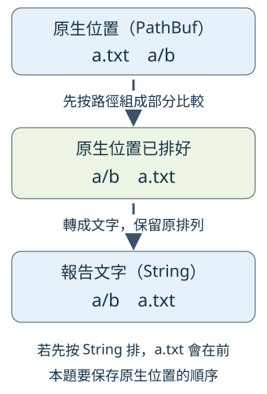

# 15.4 A3：自己做出穩定文字與 JSON 報告

A2 已取得真正重複群，也保留收集與內容判定的問題。現在要讓使用者看懂同一份結果：哪些群組相同、按路徑算有多少重複 bytes、工作是否完整，以及哪些項目沒有完成。文字和 JSON 都從同一份 Report 產生，避免兩套輸出各自算出不同答案。

沿用 15.1 的真實六檔材料：三份 5-byte 的 Rust LF 形成一群，兩份空檔形成另一群。前者的重複內容量是 `(3 − 1) × 5 = 10`，後者為 0，合計 10 bytes。沒有項目問題時 complete 為 true；有任一收集或內容問題，即使仍找到群組，也必須為 false。

## 先固定報告的資料與數字

這一步交出的答案包含五份資料：complete、duplicate_bytes、groups、scan_issues、file_issues。每群保存每份檔案的 len、所有不同路徑，以及本群的 duplicate_bytes。兩種 issues 都保存動作、原因與可辨認的位置。

9.4 已解釋 **hard link**：同一個實際檔案也能有兩個不同名字。本題的數字依路徑算，兩個 hard-link 路徑仍各占一項。因此 10 bytes 是重複內容指標，沒有承諾刪掉路徑能回收同量磁碟空間；工具只交報告。

計算沿用 9.4 的 duplicate_bytes／add_duplicate_bytes：usize 路徑數以 u64::try_from 轉換，乘法與累加都用 checked methods，超出範圍交回 MetricError。**建不出正確數字時，整份報告回 Err；不能略過那群、把不完整數字當成正常或部分成功。** A4 再把這種致命錯誤接到狀態 2。

## 排序時保留原生位置

我們要保存 9.3 的原生 Path 排列，而不是依檔案到達順序或顯示文字排列。考慮兩個相對位置 `a/b` 與 `a.txt`：前者是 a 目錄裡的 b，後者是一個檔名。Path 依組成部分比較，第一部分 a 在 a.txt 前，因此 a/b 在前。若先變成 String，文字比較遇到句點與斜線，則 a.txt 在前；兩種排序回答的是不同規則。



三個框是不同階段：上框仍是原生位置，中框已按 Path 排好，下框才是報告文字。相同名字讓你追蹤資料，框中的型別標籤則區分身分與表示。原生排序完才轉成文字，不能先丟掉 key 再請 String 替它排序。

本題採固定平台的 Path Ord，不承諾跨作業系統同一排列。A2 的群組已是不同路徑的真正內容群；A3 先排各群路徑，再以各群最小原生路徑排群。不同群沒有共同路徑，所以最小位置足以區分它們。

### 問題也要有完整順序

問題位置可能是 None，因為走訪失敗不保證提供路徑。本節選用標準 **`Option<T>: Ord`**：T 有 Ord 時，Option 也可用 cmp；None 在 Some 前，兩份 Some 再比較內部 T。Option 的相等則按相同 variant 與內容判斷。這些是型別提供的比較能力，不是把缺位置當成空字串。

問題排序依序比較原生位置、action、reason、path_debug；後三份 String 使用 6.7 的文字 Ord。前一欄 Equal 才看下一欄。所有顯示欄位都相等時，兩份診斷的輸出也相同，因此不用從原到達順序猜固定結果。只排位置並用 stable sort，不能保證同位置的不同動作每次一致。

為了做到這件事，IssueRow 暫時保存 `(Option<PathBuf>, Diagnostic)`：第一欄保留原生排序 key，第二欄是報告資料。排好後才移除第一欄，留下診斷。path_debug 是 Debug 文字，**只供辨認與顯示，不拿來去重、開檔或作原生排序 key**。

## 把 owned 報告模型接到 Serde

從 [A3 工作版目錄](https://github.com/birdhackor/learn_rust/tree/main/examples/ch15-projects/a3-starter) 保存完整 manifest 與 source，先保留自己的 A2 進度。collection／content／files／stream 是 A2 成果；新 metrics 回收 9.4 的已教計算，report 才是本階段的工作位置。完整起始檔包含 imports、模型與支援函式，下面的節錄只定位待做處。

manifest 新增 7.7 的 serde derive 與 serde_json，版本仍是相容範圍要求，確切版本由 lock 保存：

```toml
--8<-- "examples/ch15-projects/a3-starter/Cargo.toml"
```

這次的模型欄位比 Notebook 多，但仍使用 owned 值。先補足當下要用的 Serde 對應：u64 編成 JSON 整數、bool 編成 boolean、String 編成文字；`Vec<T>` 在 T 能編解碼時逐項形成 array，衍生的 struct 形成欄位 object。`Option<String>` 的 Some 編成內部文字，None 編成 **null**，這是 JSON 表達無值的固定形式；讀回對應的值時取得相同 variant。

Vec 的相等要求各位置相等，Option 的相等也核對 variant 與內容，所以 derive PartialEq 能讓我們比較整份 owned Report。模型沿用 7.7 的 Serialize／Deserialize／deny_unknown_fields；不用通用 Value、手寫 JSON escape 或 from_reader：

```rust
--8<-- "examples/ch15-projects/a3-starter/src/report.rs:models"
```

ReportError 保留 MetricError；From 與 `?` 沿用第 5 章。NonUnicode 則防守直接提供給 build_report 的異常群組資料：正常流程中，A1 已把不能表達為 Unicode 的檔案轉成 ScanIssue，沒有放進 A2 群組。那些真實項目問題仍可進診斷，沒有改成整個掃描致命失敗。

這裡再選一個借用能力：`Option::as_ref(&self)` 把借入的 `Option<T>` 轉成 `Option<&T>`；Some 借到內部值，None 仍為 None，原值沒有 move。這與 5.5 的 AsRef trait 是不同介面。接著用 9.3 已教的 Option::map，將有位置的 reference 轉成 Debug 文字；消耗的是含 reference 的暫時 Option，原生 PathBuf 還能移到排序 key。

已提供的 scan_rows／file_rows 依 A2 的兩種型別建立 IssueRow：先借路徑產生 Debug 文字，再 move 原生位置到第一欄；action 成為 owned String，reason 使用已有 Display。原生 key 保留到排序完成：

```rust
--8<-- "examples/ch15-projects/a3-starter/src/report.rs:issue-rows"
```

## 自己完成三份工作

- **order_issues：** 原生位置優先，相同才依 action／reason／debug 表示排完整順序，最後交出 Diagnostic 清單。
- **build_report：** 接手 ContentReport，先排序原生路徑，checked 計算單群與合計，再轉 Unicode 群組文字；兩種問題都轉換與排序，complete 由它們是否為空決定。
- **render_text：** 借用 Report，把完整性、指標、群與兩種問題都寫進一份 String。

起始版固定 Overflow、空診斷與空文字只是待做位置，沒有真正結果：

```rust
--8<-- "examples/ch15-projects/a3-starter/src/report.rs:build"
```

```rust
--8<-- "examples/ch15-projects/a3-starter/src/report.rs:order"
```

```rust
--8<-- "examples/ch15-projects/a3-starter/src/report.rs:text"
```

文字格式還要處理一項真實需求：Unicode 檔名可以包含換行與雙引號。這次把群組路徑以 Debug 表示，讓內容中的換行被辨認，而不多生出一行偽裝另一個檔案；診斷的 action／reason 也以 Debug 表示。path_debug 已是先前產生的 Debug 文字，直接放進診斷行。

JSON 則使用 7.7 的 to_string_pretty，把同一份 Report 編碼；讓格式實作處理字元。下列薄 wrapper 已提供，最後以 7.9 的 String::push 加 LF：

```rust
--8<-- "examples/ch15-projects/a3-starter/src/report.rs:json"
```

在自己的練習資料夾先解析依賴與驗證舊成果：

```bash
cargo +1.99.0 check
cargo +1.99.0 test --locked
```

此時 A1／A2 的既有測試應通過：Unix 20 項，其他平台不編入三項 Unix fixtures。A3 還沒有加入驗收，不能把舊成果當成報告已完成。

## 先加入驗收，再逐步寫

將工作版 `checks/report-tests.rs` 中整個含條件屬性的 tests module 加到自己的 report.rs 末尾，保留舊測試。checks 本身仍不是自動 test target。

這次 helper 直接建立 **A2 結果模型的受控材料**，不建立或讀取真檔案：group 接收長度與名字，建立原生路徑；content 建立沒有問題的 ContentReport。這只測報告接線與數字，不聲稱任意名字的磁碟檔案有這些內容：

```rust
--8<-- "examples/ch15-projects/a3-starter/checks/report-tests.rs:fixture"
```

第一項先固定 15.1 的 10 bytes，並把材料與成員順序打亂：

```rust
--8<-- "examples/ch15-projects/a3-starter/checks/report-tests.rs:metric-test"
```

再次執行 `cargo +1.99.0 test --locked`，起始版應在期待成功建報告處得到固定 Overflow。溢位測試可能碰巧通過，不能據此認定它真的算過單群或累加。

建議先完成 order_issues，再完成 build_report，最後寫 render_text。排序使用 6.7 的 Ordering／sort_by；比欄位 Equal 才進下一層，不需要新的排序框架。build_report 保留原生 key 到排好才轉表示，指標使用 metrics 的兩份 helper 與 `?`；render_text 則使用已有 format／push_str，格式中的 LF 沿用前文。

??? hint "提示 1：回到報告需要回答的問題"

    找到多少群、數字多少、哪些工作沒完成，是同一份結果的不同部分。complete 不能看 groups 是否為空；有任一問題就不能說完整。兩個 renderer 都借同一份 Report，避免各自重新計數或忽略一種問題。

??? hint "提示 2：把原生 key 留到適當時候"

    群先排自己的 PathBuf，再暫存 `(最小原生位置, ReportGroup)`。問題則已提供 IssueRow。兩種 rows 都是在原生 key 上排完，才 map 移出報告值；排顯示 String 會改變本題規則。

    大小與路徑數沒有相同型別，不能直接混乘；duplicate_bytes 已處理 TryFrom 與 checked_mul，合計也要經 add_duplicate_bytes。只要失敗，整份 build_report 就沒有正確 Report。

??? hint "提示 3：只拆開一筆沒有位置的問題"

    ScanIssue.path 是 None 時，IssueRow 第一欄仍是 None，Diagnostic.path_debug 也為 None；JSON 把它編成 null。文字顯示「未知位置」。不要臆造一份 PathBuf，也不要拿這個顯示標籤當排序 key。

    排序比較 None／Some 之後，仍需把 action、reason、debug 各欄的 Equal 接起來。兩份問題只要有不同顯示內容，就要有明確排列。

## 核對成功、部分結果與致命失敗

完成後，Unix 應有原 20 項加新 9 項，共 29 項；其他平台不編入五項 Unix fixtures。新增驗收會檢查這些不同需求：

| 材料 | 必須看到的結果 |
| --- | --- |
| 三份 5-byte 路徑與兩份空內容 | 合計 10，空群仍列出且指標為 0 |
| 空結果／單一路徑 | 沒有重複群也可以完整，指標為 0 |
| `a/b`／`a.txt`、倒置輸入與成員 | 使用原生位置順序；同資料的報告與兩種輸出相同 |
| None、同位置不同動作／原因／debug | 缺位置在前，全部顯示欄位的差異都能固定順序 |
| 收集與內容問題 | 都保留，complete=false，成功群仍在 |
| 名字含換行／雙引號 | 文字以可辨認表示維持一行一項；JSON 讀回原資料 |
| 單群乘法／合計加法溢位 | 以 u64::MAX 的小型模型控制，交致命 ReportError |
| Unix 的非 Unicode 問題／hard links | 原生問題先排序再顯示；不同 hard-link 路徑按路徑算 |

診斷排序的測試先製作同位置而其他欄位不同的 rows，再用 3.6 的 pop／push 組出逆序輸入，確認得到同一份排序結果。非 Unicode 材料使用 9.3 的 OsStringExt；hard-link 材料使用 9.4 的 fs::hard_link 與真實檔案工作。這兩項只在 Unix 編入。

文字與 JSON 的檢查比較整份 owned Report：from_str 借用編出的 String.as_str，讀回相同欄位、順序與字元；不只看是否包含某個數字。這支持本題資料往返，沒有承諾原生 Debug 診斷能反向還原成可開啟的路徑。

## 本階段快照與真實報告

[A3 完成快照](https://github.com/birdhackor/learn_rust/tree/main/examples/ch15-projects/a3-complete) 保存本階段 source 與同一份驗收。它仍沒有完整參數或 0／1／2；A4 再把資料模型與輸出失敗接到真正 CLI。

從教材 repo 根目錄執行驗收：

```bash
cargo test -p duplicate-a3 --locked
```

兩個 example 分別顯示同一份六檔結果，名稱是獨立的 a3_text／a3_json。它們的 root 是 `../materials/duplicate-demo`，所以先固定操作入口；示範也沿用修後 7.5，write_all 後明確 flush。expect 只依固定教材材料，沒有用它取代完整 CLI 的錯誤政策：

```bash
cd examples/ch15-projects/a3-complete
cargo run --example a3_text --locked
cargo run --example a3_json --locked
```

文字前三行應為：

```text
掃描完整=true
按路徑的重複內容=10 bytes
重複群組=2
```

後面列各群長度、不同路徑與本群指標。JSON 由同一份 Report 取得 complete=true、duplicate_bytes=10、兩群與空問題清單；沒有額外進度訊息混進 JSON。

??? note "只在需要時對照報告接線"

    完整排序與文字 renderer 也在上述 snapshot；先找仍失敗的責任再比對。以下來自真正可執行的答案：

    ```rust
    --8<-- "examples/ch15-projects/a3-complete/src/report.rs:build"
    ```

現在報告已能保存完整或部分結果，且兩種格式表達同一份資料。下一節接 root 參數、輸出出口、flush 與結束狀態，讓這份答案成為真正可以使用的工具。

延伸閱讀：[English Cookbook：Structured Data](https://rust-lang-nursery.github.io/rust-cookbook/encoding/complex.html)、[中文 Rusty Book 對應](https://rusty.course.rs/encoding/structured.html)、[Serde data model](https://serde.rs/data-model.html)、[serde_json::to_string_pretty](https://docs.rs/serde_json/latest/serde_json/fn.to_string_pretty.html)。本題使用固定 owned 模型，回收編解碼與回查資料的安排，另保存自己的原生排序與錯誤契約。
