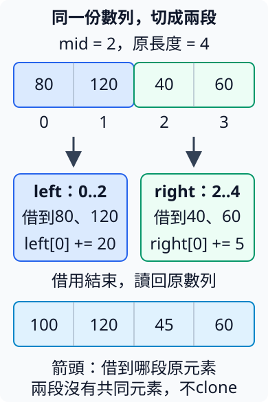

# 15.4 unsafe的責任：從呼叫契約到安全抽象

第15.3節在每一次raw存取前確認來源與權限。現在希望把操作整理成可重用的介面：哪些條件仍要由caller確認，哪些可以由函式的輸入型別與檢查接手？最後再讓一份只讀借用跨thread，分開核對有效性與Send／Sync。

本節保持有限的i32模型。一般讀取直接用reference即可；切分也已有標準safe API。這次手寫，是要看見安全責任如何放進介面與實作，練習審查它們。

本頁從repo根目錄操作，沿用no-lib package `ch15-unsafe-stages`。以下是完整manifest與預設提示binary；早期read、切分與晚段跨thread各有獨立contracts快照：

```toml
--8<-- "examples/ch12-unsafe/stages/Cargo.toml"
```

```rust
--8<-- "examples/ch12-unsafe/stages/src/main.rs"
```

## unsafe fn宣告呼叫者還要滿足哪些條件

**`unsafe fn`** 是有額外安全前置條件的函式；型別與編譯器不能單獨確認caller已滿足它們。caller在unsafe block中呼叫，表示自己已核對契約。函式作者則負責：在這些前置條件成立時，body的操作也必須合法。

先把第15.3節的i32讀取整理成read_i32。它收到 `*const i32`，回傳普通i32副本，不接手原資料或配置，也不交回reference。**呼叫前**必須確認：

| read_i32的安全條件 | 正常範例的依據 |
| --- | --- |
| pointer非null、對i32正確aligned，可讀完整一個i32 | 直接由局部amount建立，不用任意地址。 |
| 來源仍有效，資料已初始化且是有效i32 | amount已有80，呼叫期間未結束、未被移走或釋放。 |
| pointer保留來源的合法讀取資格 | 由該amount衍生，只對原位置讀取。 |
| 讀取符合aliasing限制，沒有衝突寫入 | 本次只有讀取，沒有其他reference或thread寫相同位置。 |

下面放在這份example的contracts module。`///` 是Rustdoc文件註解，放在item之前；`# Safety` 是文件中的小標，集中保存caller要遵守的契約。它與body前的SAFETY註解分工：前者說需要什麼，後者說這次操作如何滿足需要。

```rust
--8<-- "examples/ch12-unsafe/stages/examples/unsafe_read/contracts/mod.rs:read-i32"
```

兩處unsafe各有角色：fn上的unsafe宣告呼叫條件；body中的unsafe block標出raw dereference。專案採edition 2024，unsafe fn內若執行unsafe操作而省掉block，預設會有 `unsafe_op_in_unsafe_fn` 警告；不能把函式標成unsafe後就省略逐項理由。

正常caller先建立有明確來源的pointer，再依契約讀取：

這一步的完整contracts/mod.rs如下；根檔案的`pub mod contracts;`只載這份快照：

```rust
--8<-- "examples/ch12-unsafe/stages/examples/unsafe_read/contracts/mod.rs"
```

```rust
--8<-- "examples/ch12-unsafe/stages/examples/unsafe_read/main.rs"
```

```bash
cargo run -p ch15-unsafe-stages --example unsafe_read --locked
```

```text
unsafe函式讀到副本=80，原資料仍是=80
```

80是Copy副本，原amount仍存在。輸出只核對這次值的關係，存取資格由表中的理由支持。

若省掉**呼叫處**的unsafe block，即使這次pointer來自有效局部值，下面完整fixture也得到 `E0133`：

```rust
--8<-- "examples/ch12-unsafe/stages/fixtures/compile-fail/unsafe_call_without_block.rs"
```

指定實測診斷：

```text
--8<-- "examples/ch12-unsafe/stages/fixtures/compile-fail/unsafe_call_without_block.expected"
```

這次缺的是unsafe函式呼叫的責任標記，與第15.3節直接dereference缺block的fixture不同。加block後仍要履行read_i32契約，不是讓任何pointer都可讀。

## safe介面必須接手安全責任

**safe abstraction（安全抽象）** 是由實作管理unsafe條件、讓caller可以透過safe介面完成工作的安排。safe caller仍要遵守型別與borrow規則，但不必另外證明隱藏在body裡的raw操作。

**soundness（健全性）** 要求：合法的safe client使用這份介面，不能因此觸發UB。若safe client能把合法輸入交進去、導致實作違反記憶體契約，這份介面就是**unsound**。第15.3節已說明，UB不是普通的Err或固定會crash；測試剛好正常不能把它變合法。

因此，不能只移除read_i32簽名的unsafe，再要求safe caller「自行保證pointer有效」。一般raw pointer型別允許null與失效來源；如果沒有由實作接手其他保證，原來的安全條件仍在。接下來換成帶有有效性與獨佔借用保證的輸入，讓作者能逐項建立理由。

## 要把同一份mutable數列切成兩段

對 `[80, 120, 40, 60]`，希望在mid2切出前兩項與後兩項，兩段可各自修改，最後原數列保留修改。兩段都借原資料，不建立另一份Vec，也不把ownership移走。

第3.7節的range上界不包含終點，所以左段是 `0..mid`，右段是 `mid..len`。mid可以是0或len，表示其中一段為空；mid超過len時，本節介面回None，不能先形成越界pointer。

先試只寫兩份mutable索引借用，完整fixture如下：

```rust
--8<-- "examples/ch12-unsafe/stages/fixtures/compile-fail/split_two_index_borrows.rs"
```

指定實測診斷：

```text
--8<-- "examples/ch12-unsafe/stages/fixtures/compile-fail/split_two_index_borrows.expected"
```

它得到 `E0499`。即使人能由range看出不同元素，這個索引形式的借用檢查仍拒絕把兩份mutable借用一起交回。這不是說不同元素不能獨佔借用，而是需要一個已負責建立不重疊關係的介面。

標準slice已有 **`split_at_mut_checked(&mut self, mid)`**：mid不超過長度時回 `Some((左段, 右段))`，否則None；兩段借原slice。實際程式可使用這項safe方法。本節手寫同樣的有限工作，用來練習其背後的pointer與安全理由。

### 新操作：由pointer與長度建立mutable slice

**`std::slice::from_raw_parts_mut(data, len)`** 是unsafe函式，收到 `*mut T` 與usize元素數量，回傳 `&mut [T]`。它不配置、clone或驗證這份資料；**建立reference時**就要滿足以下條件：

| 必須成立的條件 | 本次切分如何取得 |
| --- | --- |
| data非null、正確aligned，非空範圍可合法讀寫 | 原輸入是有效的mutable i32 slice，data由as_mut_ptr衍生。 |
| 非空範圍只涵蓋同一allocation，元素連續且已初始化 | 兩段都保留在原slice的範圍，不拼接其他配置。 |
| 總byte範圍不超過isize::MAX，地址計算不overflow | 有效輸入slice已有這些範圍要求；兩段只縮小其範圍。 |
| 回傳borrow期間保持對該段的獨佔存取 | 兩段沒有共同元素；除從回傳reference衍生的路徑外，不再用其他pointer或原slice存取該段。 |
| 回傳reference的有效性連到真實來源 | safe函式簽名沿第7.1節連到唯一的mutable reference輸入，不回傳任意static借用。 |

**長度零仍需要non-null與alignment**，但不要求有一個可dereference的i32。空Vec能提供合法的空slice，其data pointer可能不對應已配置的元素；我們只用add(0)、形成零長度reference，不讀寫元素。非空slice切在len時，right則使用one-past pointer與長度0；也不dereference那個端點。

這回應第15.3節的區別：可以形成端點，不代表能把端點當成下一項讀取。from_raw_parts_mut讓pointer變成reference，還多了回傳borrow整段期間的責任。

### 檢查輸入，再建立兩個互不重疊的borrow

`split_i32_at_mut` 是本節定義的safe函式；輸入、兩個回傳reference的有效性連到同一來源。實作先用 `use std::slice;` 引入module名稱。當mid太大，先回None；合法時才取得data、使用第15.3節的add和新的from_raw_parts_mut：

```rust
--8<-- "examples/ch12-unsafe/stages/examples/safe_split/contracts/mod.rs:split"
```

**只有mid檢查並不足以證明全部安全。** 它解決範圍與len−mid的減法；alignment、初始化與有效storage來自原輸入reference，來源資格來自as_mut_ptr，獨佔責任來自輸入borrow與兩段不重疊。

圖中四格是同一份原數列的元素，下方0–3是原數列的索引。向下箭頭表示哪段原資料成為left／right的borrow；顏色輔助區分，range與元素位置才是對應。兩邊修改後，再回到原數列看到100與45：



這一步的完整contracts/mod.rs如下；根檔案的`pub mod contracts;`只載這份快照：

```rust
--8<-- "examples/ch12-unsafe/stages/examples/safe_split/contracts/mod.rs"
```

```rust
--8<-- "examples/ch12-unsafe/stages/examples/safe_split/main.rs"
```

```bash
cargo run -p ch15-unsafe-stages --example safe_split --locked
```

```text
兩段分別有2項與2項，各自第一項=80、40
借用結束後原數列=[100, 120, 45, 60]
mid超過長度，取得None；原數列未變
```

caller沒有unsafe。它仍要維持來源有效，並在兩段borrow用完後才以原values讀取；這是原本的borrow規則，沒有因為body用raw pointer而消失。None分支沒有建立回傳reference，也沒有修改原資料。

## 跨thread時，unsafe impl必須有自己的理由

第13.1節已教Send與Sync。現在補上它們的一項責任：它們是 **unsafe traits**，手寫實作時，作者必須維持編譯器不能完整核對的額外安全契約。**`unsafe impl`** 表示實作者承擔這份責任；它不替型別加入鎖、atomic更新或新的storage生命週期。

raw pointer自身沒有Send／Sync。只知道它指向i32，不能推來源有效、所有存取都只讀，或其他路徑不在寫入。先沿第13.1節的bound helper確認這項限制：

```rust
--8<-- "examples/ch12-unsafe/stages/fixtures/compile-fail/raw_pointer_not_send.rs"
```

指定實測診斷：

```text
--8<-- "examples/ch12-unsafe/stages/fixtures/compile-fail/raw_pointer_not_send.expected"
```

這份完整fixture得到 `E0277`，缺的是 `*const i32: Send`；它沒有執行跨thread存取，也沒有因這次只檢查is_null就略過型別契約。

第13.1節已認識data race。對本節的普通i32，跨thread未經同步安排的衝突存取、且至少一方寫入，就會形成data race，屬於UB。兩個thread都只讀同一個普通i32沒有這類寫入衝突。接下來只提供第二種有限介面，不讓它變成共享可寫容器。

### 用真實reference保存來源關係

要示範一份含raw pointer、但只允許讀取的借用wrapper，先列出它的**private不變條件**：

1. source是 `&'a i32`；pointer由這個source衍生，指同一份有效、已初始化且aligned的i32。
2. 所有公有操作只讀取；不能安全地替換pointer、延長'a或取得mutable存取。
3. wrapper只借資料，不擁有配置；移交或清理wrapper都不移動、釋放原i32。

ReadOnlyI32的new接收shared reference，建立這項關係；read沿read_i32取得Copy數值；original交回源自'a的shared reference，沿第7.4節已教的原來源回傳契約。兩個欄位都沒有pub，library外只能由new建立，不能自行配一個source與別份pointer。

`&raw const *source` 用第15.3節的raw borrow operator，place是source已借到的原i32。它沒有先拿到其他來源的地址，也不建立mutable reference：

```rust
--8<-- "examples/ch12-unsafe/stages/examples/readonly_threads/contracts/mod.rs:readonly-model"
```

這份wrapper刻意保存兩種表示，讓借用有效性與raw存取能一起追蹤；日常只讀i32直接保存reference便足夠。private本身不是安全證明，還要核對new、read及任何能改欄位的library內部程式，是否一直維持同一來源。

若source已結束，wrapper也不能留下來讀。下面完整fixture得到 `E0597`；它重現同一來源關係，read只用第15.3節已教的raw dereference，沒有繞過來源的reference欄位：

```rust
--8<-- "examples/ch12-unsafe/stages/fixtures/compile-fail/readonly_source_escape.rs"
```

指定實測診斷：

```text
--8<-- "examples/ch12-unsafe/stages/fixtures/compile-fail/readonly_source_escape.expected"
```

### 分別核對移交與共享

對**這一份i32型別與已列出的全部介面**，可以承擔以下兩項實作：

| 契約 | 本次理由 |
| --- | --- |
| Send：整份wrapper可以跨thread移交 | 移交的是source與pointer資訊，referent仍在原有效位置；真實reference保留'a限制。i32是Sync，從另一thread作shared讀取合法，也沒有thread專屬資源要在原thread清理。 |
| Sync：shared wrapper可以讓不同thread使用 | read只讀同一i32，original只交shared reference；i32沒有Cell那種interior mutability，wrapper也沒有修改管理狀態的method。並行讀取不產生寫入衝突。 |

沿第7.2節已教的placeholder lifetime，這裡在impl的型別位置寫`ReadOnlyI32<'_>`， 讓這份實作適用於其合法的借用lifetime，不要求來源變static。Send與Sync是沒有methods的marker traits，因而impl body是空的；安全責任由前面的型別性質及介面支持：

```rust
--8<-- "examples/ch12-unsafe/stages/examples/readonly_threads/contracts/mod.rs:readonly-traits"
```

不能只看到 `*const` 或型別名ReadOnly就套用這兩行：const pointer也可能來自其他正在寫入的來源。這裏的理由依靠constructor、不變條件與全部公有操作。若日後加入可寫method、可由caller自行填pointer的constructor或能改來源的操作，要重新核對整項契約。

用第13.4節的scoped thread保留局部來源：第一份工作以move接手moved，使用Send；第二份借用shared，使用Sync所提供的 `&ReadOnlyI32: Send`。兩份wrapper都由同一個amount建立，沒有複製另一份i32配置：

這一步的完整contracts/mod.rs如下；根檔案的`pub mod contracts;`只載這份快照：

```rust
--8<-- "examples/ch12-unsafe/stages/examples/readonly_threads/contracts/mod.rs"
```

```rust
--8<-- "examples/ch12-unsafe/stages/examples/readonly_threads/main.rs"
```

```bash
cargo run -p ch15-unsafe-stages --example readonly_threads --locked
```

```text
wrapper仍借原資料=80
移交wrapper讀到80，共享wrapper讀到80，合計=160
scope結束，原資料仍是=80
```

兩個join先完成，才判斷成果；scope仍維持來源borrow的有效區段。這份安全性不依賴哪個reader先讀：所有公開存取都是shared讀取，沒有要發布新的寫入。Send／Sync也沒有讓borrow變static或替Rc／Cell增加能力。

## 練習與驗證：結果檢查，不等於證明全部soundness

先寫出切分的理由，再用 `[80, 120, 40, 60]` 在mid3切分。確認left有三項、right一項；把left[2]與right[0]各加20，結束borrow後原數列應是 `[80, 120, 60, 80]`。

再切在len，確認right長度0，沒有試圖索引空段。完整答案與它實際載入的完整切分快照如下：

??? example "完整參考答案"

    ```rust
    --8<-- "examples/ch12-unsafe/stages/examples/unsafe_solution/contracts/mod.rs"
    ```

    ```rust
    --8<-- "examples/ch12-unsafe/stages/examples/unsafe_solution/main.rs"
    ```

    執行 `cargo run -p ch15-unsafe-stages --example unsafe_solution --locked`。應先顯示原數列變為`[80, 120, 60, 80]`，再顯示切在len時left四項、right零項。

最後的完整快照保留六項tests分別檢查raw read不接手來源、不同範圍修改原元素、0／len兩端、空Vec、拒絕mid後資料未變，以及wrapper移交／共享讀取。這些是有明確答案的案例，可用下面明選的example測試檢查；它們不能涵蓋所有輸入、來源狀態或排程，也不由六項PASS宣佈實作已獲完整安全證明。

這份晚段contracts_complete才合併本節全部介面與原六項測試；先前的unsafe_read與safe_split不會因此載入它。完整source如下：

```rust
--8<-- "examples/ch12-unsafe/stages/examples/contracts_complete/contracts/mod.rs"
```

```rust
--8<-- "examples/ch12-unsafe/stages/examples/contracts_complete/main.rs"
```

```bash
cargo test -p ch15-unsafe-stages --example contracts_complete --locked
```

審查時要追到**unsafe操作的全部前提**：哪些由輸入型別保證，哪些由檢查建立，哪些靠private介面的不變條件維持。也要看safe程式；如果constructor讓pointer與source不再指向同一資料，read裡的unsafe block即使一字未改，原理由也已失效。SAFETY註解記錄理由，不能代替真正成立的關係。

第17.6節會再教Miri與Loom的用途、操作及限制，補充可執行路徑或並行模型的查覈。本節先把契約寫足；接下來的C與外部函式介面，會再處理型別、配置與釋放責任。

延伸閱讀：[英文Book unsafe functions／safe abstraction](https://doc.rust-lang.org/book/ch20-01-unsafe-rust.html#calling-an-unsafe-function-or-method)、[中文對應章](https://rust-lang.tw/book-tw/ch19-01-unsafe-rust.html)、[from_raw_parts_mut契約](https://doc.rust-lang.org/std/slice/fn.from_raw_parts_mut.html)、[Rust Reference UB／soundness](https://doc.rust-lang.org/reference/behavior-considered-undefined.html)、[Send](https://doc.rust-lang.org/std/marker/trait.Send.html)／[Sync](https://doc.rust-lang.org/std/marker/trait.Sync.html)。必要理由已在正文，不靠開連結才知道如何合法存取。

[下一節：FFI所需的C基礎](15-05-lesson.md)
