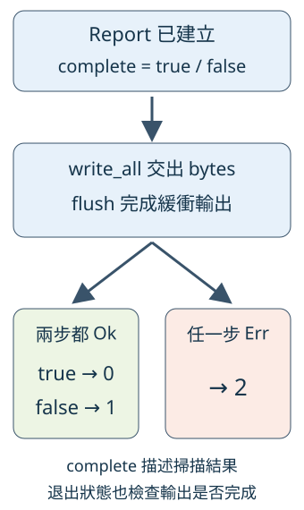

# 15.5 A4：自己接上參數、輸出與退出狀態

A3 已能建立正確報告，但示範固定 root，遇到失敗仍依教材材料使用 expect。現在讓使用者自己指定一個目錄，選文字或 JSON，並讓呼叫者從退出狀態知道工作是否完成。掃描與報告已經寫過，本階段只接這些成果；不用重寫前三階段。

## 先決定呼叫者能觀察什麼

工具接受一個 root，預設輸出文字；`--json` 選同一份資料的 JSON。root 可以有中文與空白，仍是一筆原生 argument。`--help`／`--version` 顯示資訊，不要求先掃描一個目錄。

先固定三種工作結果，而不是先把所有 Err 都變成一個數字：

| 發生的事 | stdout／stderr 與退出狀態 |
| --- | --- |
| 掃描完整，報告成功寫出 | stdout 是報告，stderr 空白，0 |
| 有項目問題，部分報告成功寫出 | stdout 仍是一份完整格式的報告，兩種 issues 保留，stderr 空白，1 |
| root 無法開始、數字溢位或編碼失敗 | 沒有報告；stderr 有致命診斷，2 |
| 寫入或 flush 失敗 | stderr 嘗試寫致命診斷，2；stdout 可能已有部分 bytes |
| 用法錯誤 | stdout 空白，stderr 有用法，2 |
| help／version 成功顯示 | stdout 是所要求的資訊，stderr 空白，0 |

報告裡的項目問題和無法交付報告的致命錯誤是不同角色。部分結果的問題留在報告內，JSON 的整份 stdout 才仍能直接解析；不用另外在資料出口印進度。空目錄沒有問題，也應交完整的零結果與 0，不能把「沒有重複群」當失敗。

### 掃描完成還要接上輸出完成

沿用修後 7.5：Stdout 有緩衝，write_all 回 Ok 只表示本次 bytes 已由 writer 接收；還要明確呼叫 flush，確認緩衝資料交到下一層。離開 scope 的自動收尾不能讓我們取得這次 flush 的錯誤。

所以不能先看 complete 回 0／1，再把輸出結果丟掉。**先寫出、再 flush；兩步都成功才選 0／1，任何一步 Err 都是 2。** complete 描述掃描，沒有宣稱出口成功；若已送出部分 JSON 後失敗，也不能撤回那些 bytes 或再補一份假完整報告。



箭頭表示先後與分支。左框只在兩步都 Ok 時進入，才讀上框的 complete；右框回 2，不被先前的 true／false 抵銷。

## 保存這次的工作版

從 [A4 工作版目錄](https://github.com/birdhackor/learn_rust/tree/main/examples/ch15-projects/a4-starter) 保存完整 manifest 與 source。collection／content／files／stream／metrics／report 都是 A3 成果，保留自己的完成版；app 與 main 是本節的接線位置。下面節錄只定位，不能代替完整起始檔。

clap 使用 7.6 已教的 derive feature；其餘依賴不變。版本仍是相容範圍，lock 保存真正版本：

```toml
--8<-- "examples/ch15-projects/a4-starter/Cargo.toml"
```

Settings 的 root 是必要 PathBuf positional，json 是省略為 false 的 long bool flag。沿用 7.6 的 Parser、command／arg attributes、try_parse_from；不用新增 enum 參數解析規則：

```rust
--8<-- "examples/ch15-projects/a4-starter/src/app.rs:settings"
```

## 把結果接到能辨認的錯誤與出口

RunError 以 enum 保存 RootError、ReportError、serde_json::Error 與輸出的 io::Error。每個 From 將原值放進自己的 variant，支援第 5 章的 `?`；Display 依分類給人看。RootError 原本只有 Debug，這裡直接配對它的三種情況，用 inner io::Error 的既有 Display 或已知的文字說明。

這些都是不能交出本次報告的致命錯誤。一般檔案失敗仍由 A1／A2 保存在 issues，沒有改成整個 run 的 Err：

```rust
--8<-- "examples/ch15-projects/a4-starter/src/app.rs:errors"
```

提供的 write_output 沿用 7.9 的 `W: Write`，借出文字和 mutable writer。它只處理一次完整文字的 write_all／flush，不計數、不挑格式、不自行印診斷；main 的 Stdout 和驗收的自訂 writer 都可接入：

```rust
--8<-- "examples/ch15-projects/a4-starter/src/app.rs:output"
```

自己完成兩份工作：

- **write_report：** 依 json 選 A3 renderer，真正用 write_output 完成輸出，再由 report.complete 交回 u8 的 0／1。編碼和輸出的 Err 以 RunError 向上交。
- **run：** 借 Settings，以原生 root 接 scan→analyze→build_report，再交 write_report。保留 fatal Result，不用 expect 取代使用者檔案的政策。

起始版的固定 0 和 Overflow 只是待做位置。前者甚至沒有寫入，不能說出口已成功：

```rust
--8<-- "examples/ch15-projects/a4-starter/src/app.rs:write-report"
```

```rust
--8<-- "examples/ch15-projects/a4-starter/src/app.rs:run"
```

### main 提供行程邊界

main 已提供：完整 args_os 交給 Parser，成功就呼叫 run，u8 狀態以已教的 ExitCode::from 正常返回。fatal 在 stderr 寫診斷；診斷自己也可能失敗，此時已是致命結果，仍回 2。這裡 `let _ = ...` 明確忽略診斷的 Result，沒有宣稱診斷必定可見，也不因此 panic。

參數 Err 沿用 7.6 的 use_stderr／exit_code，分清 help／version 與用法失敗。這次用其已教 Display 取得訊息，交同一個 write_output，所以顯示資訊的 flush 也被檢查。印成功才回該訊息的 0／2；印失敗回 2。沒有自行 process::exit 而跳過 scope 清理：

```rust
--8<-- "examples/ch15-projects/a4-starter/src/main.rs:main"
```

在自己的練習資料夾先解析依賴，再核對原成果：

```bash
cargo +1.99.0 check
cargo +1.99.0 test --locked
```

此時 Unix 原 29 項測試應通過，A4 兩份 checks 都還沒有自動加入。這只能確認 A3 仍在，不能當作 CLI 已完成。

## 先加入兩種驗收

把 `checks/app-tests.rs` 整個含條件屬性的 tests module 加到 app.rs 末尾。再建立工作資料夾的 `tests/cli.rs`，放入 `checks/cli-tests.rs` 全檔；checks 不是自動 target，這次只有後者在 tests 目錄後才會成為 integration test。

第一份沿用 7.4／7.9 的自訂 Write。ControlledWriter 的 write 在成功時逐 byte 接收並回已接收量；write_fails 開關讓它不接收而回 PermissionDenied。flushes 保存真正呼叫次數，flush_fails 可以讓 bytes 都已接收後仍報錯。它沒有真實中間 buffer，記錄和開關只是可控制的材料，讓這兩個邊界分開被測到：

```rust
--8<-- "examples/ch15-projects/a4-starter/checks/app-tests.rs:writer-fixture"
```

report helper 直接建立 A3 的報告模型：完整材料沒有 issues；部分材料保留一項受控 ScanIssue 的診斷表示。這只驗報告輸出責任，不聲稱那些模型名字就是被實讀的檔案。下面檢查 bytes 已接收卻 flush 失敗時，不能回 0 或 1：

```rust
--8<-- "examples/ch15-projects/a4-starter/checks/app-tests.rs:flush-test"
```

第二份真正啟動 child，沿用 7.8 的 TempDir／Command／Output。materials 建立六份已知 bytes，包含中文空白名與 hidden 檔；run_cli 設 child CWD，傳一筆原生 root，再視選擇加入 --json。它不把 shell 引號或重導向文字塞進 arguments：

```rust
--8<-- "examples/ch15-projects/a4-starter/checks/cli-tests.rs:child-fixture"
```

此工作版 binary 名稱是 duplicate-a4-starter，所以 checks 使用對應 CARGO_BIN_EXE 值；完成快照名稱是 duplicate-a4，其 integration 檔只調整 crate／binary 名稱，判準相同。若用自己的 package 名稱，依 7.8 改這兩處；不是拿 dependency 的 binary 猜位置。

先執行下面兩個命令，看到 A4 要求失敗，再寫自己的實作。一般 test 若遇到 library target 失敗就會先停，未必繼續到 CLI；因此再沿用 7.8 的 --test cli，直接選 child 驗收：

```bash
cargo +1.99.0 test --locked
cargo +1.99.0 test --test cli --locked
```

用法與 help 等現成接線，或只看狀態 2 的負面檢查，可能先通過；不能代表 run 真正做過掃描。建議先補 write_report，讓受控輸出成功／失敗與 0／1 都成立，再補 run 接線。原 29 項不需刪除或重寫。

??? hint "提示 1：把 complete 留到兩步輸出之後"

    先選 renderer，讓 JSON 的 Result 進 RunError；取得 String 後借 as_str 交給 write_output。`?` 若遇到 Output Err 就向上返回；只有已完成輸出的路徑才進 complete 的 0／1 選擇。

??? hint "提示 2：接既有函式，不重建另一套掃描"

    Settings 只被借用，root.as_path 是 scan 的輸入。取得 ScanReport 後交 analyze，再讓 build_report 的 Result 向上傳。別拿 groups 是否為空決定狀態；A3 已在 Report 裡保存真正完整性。

??? hint "提示 3：讀 child 的三項結果"

    Command::output 的 Ok 只表示 child 已啟動與完成。完整與部分報告都必須核對 stdout 是可解析資料、stderr 空白與 Some(0)／Some(1)；根失敗／用法錯誤則核對空 stdout、stderr 與 Some(2)。這和 library 的 controlled writer 證據互補。

## 核對接口真的成立

| 驗收材料 | 要看到的關係 |
| --- | --- |
| 完整／部分 Report，兩種格式 | 寫出同一模型且 flush 後才回 0／1 |
| 自訂 writer 拒絕寫入 | Output Err，有真正 write 呼叫，沒有完成狀態 |
| bytes 都接收後拒絕 flush | 仍是 Output Err，沒有假 0／1 |
| 缺 root 的 library 呼叫 | 保存 RootError::Io(NotFound)，未寫報告 |
| 真實六檔 child | text 與 JSON 同答案：兩群、10 bytes、完整、0 |
| 空目錄／缺 root／一般檔當 root | 分別是完整零結果0／fatal2／fatal2 |
| 沒有必要 root／未知開關／help／version | 用法2與資訊0各在正確出口 |
| Unix 非 Unicode 項目／root link | 成功群仍在的 partial1／拒絕根的 fatal2 |

Unix 的非 Unicode fixture 使用已教 OsStringExt，保存原生名字再用同 root 的 Debug 位置核對診斷；不依不可預測的權限失敗。root link 則使用 9.3 的 symlink。它們只是平台有條件材料，核心其他流程仍使用原生 PathBuf。

完成後，Unix 應有 29 項既有加 6 項 app 與 6 項 CLI，共 41 項；其他平台不編入共七項 Unix fixtures。外層真 child 的測試不是只看 run 回傳值，也沒有把 zero main tests 當沒有驗收。

## 跑自己的目錄，再按需要對照

[A4 完成快照](https://github.com/birdhackor/learn_rust/tree/main/examples/ch15-projects/a4-complete) 保存真正可執行的本階段答案。以下從教材 repo 根目錄操作，root 明確以此 CWD 解讀；這次不靠 --manifest-path 改工作目錄：

```bash
cargo test -p duplicate-a4 --locked
cargo run --quiet -p duplicate-a4 --locked -- examples/ch15-projects/materials/duplicate-demo
cargo run --quiet -p duplicate-a4 --locked -- examples/ch15-projects/materials/duplicate-demo --json
```

兩次都得到 10 bytes／兩群，狀態 0。改成自己的目錄即可；stdout 可沿用 7.5 的 shell 重導向保存，緊接著看退出狀態。文字與 JSON 的 root 表示取自自己交入的原生路徑，不在別處另找一份材料。

??? note "需要時對照兩份接線"

    答案只有本節要接的工作，完整 artifact 中的 core 仍是前面成果：

    ```rust
    --8<-- "examples/ch15-projects/a4-complete/src/app.rs:write-report"
    ```

    ```rust
    --8<-- "examples/ch15-projects/a4-complete/src/app.rs:run"
    ```

現在已有可用的工具：指定一個 root、取得穩定報告，且完整、部分與致命結果都能被呼叫者分辨。最後一節整合為完整參考版，收好 API 邊界與整份驗收，讓需要查答案的讀者有一份清楚入口。

延伸閱讀：[English Book：Modularity and Error Handling](https://doc.rust-lang.org/book/ch12-03-improving-error-handling-and-modularity.html)、[繁中對應](https://rust-lang.tw/book-tw/ch12-03-improving-error-handling-and-modularity.html)、[Book：stderr](https://doc.rust-lang.org/book/ch12-06-writing-to-stderr-instead-of-stdout.html)、[簡中對應](https://kaisery.github.io/trpl-zh-cn/ch12-06-writing-to-stderr-instead-of-stdout.html)、[clap Parser](https://docs.rs/clap/latest/clap/trait.Parser.html)。採用逐步拆責任與分流驗收的安排；本題的 partial 報告、0／1／2、原生位置與明確 flush 契約另外保留。
