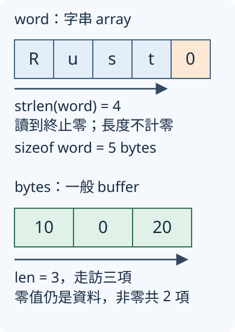
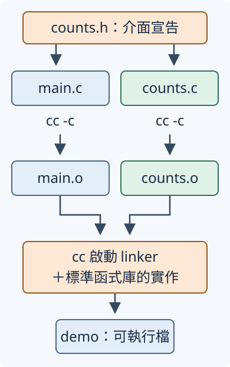

# 15.5 FFI 所需的 C 基礎

接下來要讓 Rust 呼叫 C 函式。**FFI（foreign function interface，外部函式介面）** 是跨程式語言呼叫函式的介面；要把它包成安全的 Rust API，就得讀懂對方的資料表示、存取條件與清理責任。第15.4節已練過這種契約分工，現在把來源換成 C。

本節先做一個獨立的 C 程式：修改一個數值、加總數列、區分字串與 buffer，最後配置一份數列副本並釋放。你不需要先學過 C；下節才加入 Rust 的呼叫程式。

範例選 **C11**，也就是 2011 年版本的 C 標準，使用一般作業系統上的 C compiler 與標準函式庫。下方指令適用於提供 `cc` 命令的 GCC／Clang 環境；作者在 Linux、GCC 14.2 驗證。所有範例都在單一 thread 執行。

## 先讀懂型別、變數與 array

C 的宣告把型別放在名稱前面。一般區域變數預設可以修改；初始化和指派用 `=`，敘述結尾用分號 `;`，一段程式用 `{ ... }` 包住。這裡不使用 Rust 的 `let`／`mut`。

先認識範例會用的型別：

| C 型別 | 本節的用途 |
| --- | --- |
| `int32_t` | 恰好 32 bits 的有號整數，用來存數值，範圍與 Rust i32 相同。 |
| `uint8_t` | 恰好 8 bits 的無號整數，值在 0–255，用來存 buffer 的元素。 |
| `size_t` | 無號整數，表示物件大小或元素數量；寬度由 C 平臺決定，不直接當成 unsigned int。 |
| `char` | 一個 C byte，用於本節的英文字元；不是 Rust 的 Unicode char。 |
| `int` | C 的基本有號整數型別，本節用於 main 的回傳狀態，不假定跨平臺一定是 32 bits。 |
| `void` | 放在函式回傳位置表示沒有回傳值；單獨放在參數列表表示沒有參數。 |

`int32_t`／`uint8_t` 是標準函式庫提供的型別名稱，C 實作有相符型別才提供；本節的 host 有提供。C 的 byte 是 `sizeof` 使用的大小單位，`sizeof(char)` 固定是 1；本節 host 的一個 byte 是 8 bits，不能把這件事概括到所有 C 平臺。

**header（標頭檔）** 保存型別名稱與函式宣告。`#include <stdint.h>` 讓本檔案能使用 int32_t／uint8_t；`#include <stddef.h>` 提供 size_t。開頭的 `#include` 由 **preprocessor（前置處理器）** 在編譯 C 程式前處理，把 header 的內容納入目前檔案；它不是 Rust 的 `use`。

例如 `int32_t amount = 80;` 建立並初始化 amount；`amount = 100;` 之後修改同一個變數。C 不會替一般未初始化區域變數填好可讀數值，讀取前必須初始化。

C 的固定 array 用 `型別 名稱[元素數量]` 宣告，`{ ... }` 依序初始化。`values[index]` 按從 0 開始的索引取元素。

**`sizeof`** 是 C 的大小查詢運算子，結果型別是 size_t。下面的 `sizeof values` 得到整個 array 的 byte 數，`sizeof values[0]` 得到一項的 byte 數；相除得到元素數量 3。這兩個數的單位都是 byte，商才是項數。在本節固定大小型別下，sizeof 不實際讀取 values[0] 的值。

以下兩行會放在後面的 main 裡；所需型別由 header 提供：

```c
--8<-- "examples/ch12-c-basics/main.c:local-array"
```

array 自己確實有固定長度。但在一般的函式參數傳遞中，array 表達式會轉成**指向第一項的 pointer**，不把整個 array 和長度一起傳入。接收端若只有 pointer，sizeof 查到的就只是 pointer 本身的大小，無法取回原 array 的項數。因此本節的數列介面另外傳長度。

## C 的函式與 pointer：修改的是哪一份資料？

C 函式定義的順序是「回傳型別、函式名、括號內的參數型別與名稱、body」。`return 值;` 結束呼叫並交回值；沒有結果的函式用 void 作回傳型別。本節程式入口是 `int main(void)`：沒有參數，回傳 int 狀態；main 回傳 0 表示成功。

普通整數參數取得數值副本，函式內改參數不會改 caller 的原變數。若要改 caller 的原資料，就傳 pointer；**pointer 值也會被複製，但仍指向同一個原物件**。

C 的 `int32_t *pointer` 宣告一個指向 int32_t 的 pointer；`&amount` 取得 amount 的位置，運算式 `*pointer` 才存取指向的數值。這個 `&` 建立的是 C pointer，沒有 Rust reference 的 borrow 檢查；型別也不自帶 lifetime 或 ownership。

沿用 第15.3節的有效性觀念：在 dereference 前，pointer 必須來自仍存活的正確物件、符合 alignment，並且這次操作有讀寫資格。**NULL** 是標準 header 提供的 null pointer 表示，表示沒有指向可存取的物件；宣告了 pointer，或值不是 NULL，都不會自動完成存取條件。

先定義本節自己的 `set_value`。**caller 必須提供仍有效、正確 aligned、可寫的一個 int32_t**，並保證這次寫入沒有衝突存取；本節直接用單一區域變數滿足。函式不保存 pointer，不配置或釋放來源，只把 value 寫到 target 指向的位置：

```c
--8<-- "examples/ch12-c-basics/counts.c:set-value"
```

以下片段中，amount 先是 80，pointer 由它建立；呼叫期間 amount 還存在且可以寫入。target 是 pointer 值的副本，因此 `*target = value` 改的就是原 amount，結果為 100：

```c
--8<-- "examples/ch12-c-basics/main.c:pointer"
```

離開 amount 所在的區塊後，它的儲存不再可用。C 沒有自動替 pointer 延長來源 lifetime，也沒有 Rust borrow checker 阻止你保存失效的 pointer；後面的範例都不讓 pointer 逃出來源的有效期間。

## pointer 加長度：讓函式知道讀幾項

接下來定義 `sum_values`，收到數列第一項的 pointer 與 size_t 項數，回傳 int32_t 加總。`const int32_t *values` 表示**不能透過這份 pointer 修改元素**；它不是原資料永遠 immutable 的保證，也不替來源提供 lifetime、長度驗證或同步。

在給 body 前，先把 caller 契約列清楚：

| 條件 | 本節如何滿足 |
| --- | --- |
| len 大於 0 時，values 指向同一 array 內連續、有效、正確 aligned、已初始化的 len 項 | 原 array 有三項，len 由原 array 的大小查詢取得。 |
| 呼叫期間來源仍存在，讀取沒有衝突寫入 | 單 thread、同步呼叫，函式不保存 pointer。 |
| 從 0 開始，每次累加的中間結果都在 int32_t 範圍內 | 三項 80／120／40，中間結果 80／200／240。 |
| len 為 0 時不存取元素，也不做 pointer arithmetic | 下面迴圈一次都不進入；這份特定介面因而允許 NULL。 |

NULL 不是空 array 裡的一項。上表的空輸入規則屬於本節 helper，不能概括成所有 C API 都接受 NULL，也不同於 第15.4節零長度 Rust slice 仍須 non-null／aligned 的條件。

C 的 `for (起始; 條件; 更新)` 先執行起始，條件成立才跑 body，每輪結束後更新，再檢查條件。`<` 是比較；`+=` 把右側加到原值。下面從 index0 開始，每輪加一，只有 index 小於 len 時才讀 values[index]：

```c
--8<-- "examples/ch12-c-basics/counts.c:sum"
```

對 `[80, 120, 40]`，它按順序得到 240；傳相同 pointer 與 len2，只讀前兩項得到 200。若 len0，直接回傳初始 total0，連第一項都不讀。

C 的 `values[index]` 相當於 `*(values + index)`，位移單位是 int32_t 元素；pointer arithmetic 要留在同一 array 的元素或 one-past 端點內，只有真正元素可 dereference。C 不會像 Rust slice 索引那樣自動替這個 pointer 做長度檢查，caller 不能把三項 array 配上 len4。

此 helper 沒有一般 overflow 處理：C 的 signed integer overflow 是 UB，不能拿 Python 無限精度整數或 Rust debug 的 panic 規則解讀它。本節只使用上表能證明每次中間結果合法的數值；不執行違約輸入作示範。

## 字串的終止零，與 buffer 的零值

C 的 **string（字串）** 是 char 的連續序列，以數值零的 char 結尾；常稱這個結尾為 **NUL**，寫成 `\0`。`'\0'` 的值是 0，與字元 `'0'` 不同；它也不是 NULL pointer。字串掃描需要來源仍有效，並且在可讀範圍內找到這個終止零。

雙引號的 string literal 末尾會有零。用 `char word[] = "Rust";` 初始化 array 時，省略項數讓 compiler 推得五項，依序是 R／u／s／t／零。這是區域 array 的副本，可以修改其中的字元；literal 本身的儲存不能拿來寫入。這裡保留終止零，也不用中文或多 byte 編碼混淆項數。

**buffer（緩衝區）** 則是一段供處理的儲存空間，零可以是普通資料。下面的 uint8_t array 有三項，第二項雖是零，第三項 20 仍在範圍內：

```c
--8<-- "examples/ch12-c-basics/main.c:string-buffer"
```

標準 header `<string.h>` 提供 **`strlen`**：收到指向有效、NUL 結尾 char 序列的 pointer，回傳第一個零之前的 byte 數，型別是 size_t；它不包含終止零，也不是 Unicode 字數或 array 容量。`strlen(word)` 因而是 4，而 `sizeof word` 是包含終止零的 5。沒有合法終止零的資料不能交給 strlen。

上方箭頭標出 word 計入回傳長度的四項；判斷字串在哪裡結束，仍須讀到有效的終止零，長度不計入它。下方箭頭則是 bytes 由 len3 指定的三項走訪範圍，圖中的零仍是一項：



這次想計算 buffer 裡有幾個非零元素，所以定義 `count_nonzero`。它與 sum_values 一樣，非空輸入須指向同一 array 內有效、aligned、已初始化的 len 項，呼叫期間沒有衝突寫入；空輸入 len0 允許 NULL。它不保存或釋放來源，回傳 size_t 計數。

C 的 `if (條件) { ... }` 在條件成立時執行區塊；`!=` 表示不相等。比較結果是 0 或 1，條件為零視為不成立、非零視為成立。下面每輪都往下一項，不因元素為零而結束：

```c
--8<-- "examples/ch12-c-basics/counts.c:buffer"
```

對 `{10, 0, 20}`，index0 與 index2 各加一次，結果為 2。這個結果只依 len 指定範圍，不能把 byte_len 換成 strlen；一般 buffer 根本沒有字串的終止約定。

## malloc 與 free：清理責任不隨 pointer 副本增加

前面 array 的儲存由所在區塊管理，區塊結束後就不能再用。現在希望練習另一種責任：向 C allocator 取得一塊儲存，由程式明確釋放。`<stdlib.h>` 提供 **`malloc(byte 數)`** 與 **`free(pointer)`**：

| API／規則 | 呼叫前後的責任 |
| --- | --- |
| malloc | 成功回傳新配置起點，對本節 int32_t 的 alignment 足夠；失敗回 NULL。成功儲存尚未初始化，不能直接讀元素。 |
| `void *` 回傳型別 | void * 是沒有指定元素型別的 object pointer；C 允許它與 int32_t * 互相轉換：接收 malloc 結果時轉成 int32_t *，交給 free 時轉回 void *。轉換不代表配置已含可讀的 int32_t 值。 |
| free | 交回先前 malloc 的原始起點，且該配置尚未釋放；本節由唯一負責者呼叫一次。free(NULL) 可以，但不能 free 區域 array 或某個內部元素的 pointer。 |
| 配置的有效期間 | 從 malloc 成功到 free；一般 pointer 變數離開 scope 不會自動 free。free 後不再讀取原 pointer 或其副本，更不能再存取來源。 |

本節只配置原 array 的三項。`len * sizeof *owned` 計算所需 byte 數：len 為 3，單項大小由 pointed-to 型別 int32_t 決定；在這個固定大小型別下，sizeof 不實際 dereference owned。因此這行可以同時宣告 owned、計算大小與接收 malloc 結果。這個固定非零乘法可表示；一般任意大小配置還要先檢查乘法是否 overflow。

**在任何存取前先檢查 NULL。** `==` 比較相等；`EXIT_FAILURE`／`EXIT_SUCCESS` 是 stdlib header 提供的整數常數，用於 main 的失敗／成功狀態。本節的 malloc 失敗分支立即結束，不假裝還有可用數列。

```c
--8<-- "examples/ch12-c-basics/main.c:allocated-array"
```

迴圈把三項逐一寫到新儲存，完成初始化後才交給 sum_values。算得的 owned_total 是整數副本，free 之後仍可使用；原 owned 所指的資料則已結束有效期間。

這裡真的逐項複製到**另一份配置**。只把 owned 指派給另一個 pointer，得到的仍是同一配置的別名，沒有新增資料副本或一份可另行 free 的 ownership。函式接收 pointer 也不自動取得清理責任；上面兩個讀取 helper 都明訂不保存、也不釋放。

下一節會讓這種配置越過語言邊界。先記住目前契約：誰配置、誰負責呼叫對應的釋放函式、借用者何時必須停止存取；不能憑 pointer 的型別猜測清理規則。

## 把結果印出來，再整理完整程式

`<stdio.h>` 提供 **`printf`**，第一個參數是格式字串，後面的參數按佔位符順序填入。格式字串與 `%s` 的資料都必須是有效的 NUL 結尾 char 序列；`\n` 表示換行。

| 這次格式 | 對應參數 |
| --- | --- |
| `%s` | 指向有效 C string 的 char pointer；不含終止零的內容會被印出。 |
| `%zu` | size_t 無號整數，例如 sizeof／strlen／count_nonzero 的結果。 |
| `%` 接 `PRId32` | int32_t 有號十進位數值，使用 `<inttypes.h>` 提供的格式片段。 |

**`PRId32` 是 C macro（巨集）**：preprocessor 把這個名稱替換成適合 int32_t 的 string literal 格式片段，例如某個平臺的 `"d"`。C 會把相鄰的 string literals 合成一份，所以 `"amount=%" PRId32 "\n"` 得到完整格式。這只是展開字串片段，不是 Rust 的 `format!`，也不用假定 int32_t 一定就是 int。

printf 是函式，並不像 Rust 格式 macro 一樣由語言保證所有參數吻合；格式或型別不匹配可能是 UB。本節固定用表中對應型別。printf 回傳 int：非負表示此次寫出的字元數，負值表示輸出錯誤；本節 demo 用輸出觀察資料關係，沒有完整處理輸出失敗或完成最終 flush 的驗證。

把檔案放在 `examples/ch12-c-basics/`：

- **counts.h** 保存三個函式的 prototype（原型）：回傳與參數型別後面直接接分號，沒有 body；讓 compiler 在呼叫前知道型別。註解 `//` 到行尾不執行。
- **counts.c** 提供前面已讀過的三個 body。
- **main.c** 使用介面、建立資料並印結果。

完整 header 如下；本例每個 C source 都只納入它一次。`#include "counts.h"` 的雙引號寫法會先在目前 source 所在目錄找這個專案 header；前面的角括號寫法用於標準 headers：

```c
--8<-- "examples/ch12-c-basics/counts.h"
```

counts.c開頭納入同一份header，再放前面三個定義，讓compiler也核對實作與prototype的型別一致。這是完整counts.c，不只前面的region：

```c
--8<-- "examples/ch12-c-basics/counts.c"
```

完整driver如下；它先釋放owned，再使用已算好的整數結果印出：

```c
--8<-- "examples/ch12-c-basics/main.c"
```

## 從 source 到 object file，再連結成可執行檔

第12.2節已分清 host 上的建置工作與最後程式的執行。這次用 **host C compiler** 編譯一個在同一臺 host 執行的 C 程式，還沒有 Rust 的跨語言建置步驟。

`cc` 是此環境的 C compiler driver：協調前置處理、編譯、組譯與連結。前置處理納入 headers；編譯把 C 轉成機器指令的表示；組譯產生 **object file（目的檔，.o）**。object file 仍可能需要其他檔案的函式實作，還不是最後可執行檔。

**linker（連結器）** 再把 object files 與所需函式實作組合起來，補上彼此的呼叫連結，得到可執行檔。main.c 看過 prototype，知道如何呼叫 sum_values；它的 body 則來自 counts.o。本節 cc 的一般 hosted 連結也帶入 printf／malloc 等標準函式庫所需實作。

圖的上方兩個箭頭表示兩份 source 都納入 counts.h 的宣告；中間向下是各自編譯；兩個 object files 最後都交給 linker。圖中的 `cc -c` 表示只編譯成 object file、不連結。header 宣告沒有代替 counts.c 的 body：



先看這次指令的選項：

| 選項 | 意義 |
| --- | --- |
| `--version` | 查看目前 cc 的實作與版本。 |
| `-std=c11` | 選擇本節 C11 語言版本，不依賴 compiler 的預設版本。 |
| `-Wall -Wextra` | 啟用兩組常用警告；不是所有可能的警告或錯誤。 |
| `-Werror` | 把啟用的警告視為錯誤，避免帶著它們繼續。 |
| `-pedantic` | 對所選標準要求診斷的部分非標準寫法提出診斷；不能證明沒有 UB。 |
| `-c` | 產生 object file，這次不做連結。 |
| `-o 路徑` | 指定輸出檔名。 |

在 repo 根目錄執行。`mkdir -p` 建立存放產物的目錄，目錄已存在也可繼續；`./` 開頭的最後一行才是執行程式。如果環境沒有 cc，先安裝 host 的 GCC 或 Clang 與 C 標準函式庫開發檔案，再回到這一步；Windows 可在 WSL 的 Linux 環境使用同樣流程。

```bash
cc --version
mkdir -p target/ch12-c-basics
cc -std=c11 -Wall -Wextra -Werror -pedantic -c examples/ch12-c-basics/counts.c -o target/ch12-c-basics/counts.o
cc -std=c11 -Wall -Wextra -Werror -pedantic -c examples/ch12-c-basics/main.c -o target/ch12-c-basics/main.o
cc target/ch12-c-basics/main.o target/ch12-c-basics/counts.o -o target/ch12-c-basics/demo
./target/ch12-c-basics/demo
```

```text
amount=100
local total=240; empty total=0
text=Rust; text bytes=4; storage bytes=5
buffer length=3; nonzero=2
owned total=240
```

這五行各核對已說明的關係：pointer 寫到原 amount、明確長度決定讀幾項、終止零與儲存大小不同、buffer 的零不結束掃描、另一份配置初始化後得到相同加總。它們不能替任意 caller 的 pointer 有效性作證明。

若連結指令只給 main.o，compiler 已看過 prototype，個別編譯可以成功，但 linker 找不到三個 helper 的實作。這是缺少 body 的問題；補上 counts.o，而不是把 function prototype 當成 implementation。

### prototype 能檢查什麼？

下面的完整故意失敗程式，只少傳 sum_values 所需的 len：

```c
--8<-- "examples/ch12-c-basics/fixtures/compile-fail/missing_length.c"
```

本教材實測保存的完整診斷比對字串：

```text
--8<-- "examples/ch12-c-basics/fixtures/compile-fail/missing_length.expected"
```

header 的 `../../` 表示由這個 fixture 所在目錄往上兩層找到 counts.h。只編譯，不執行：

```bash
cc -std=c11 -Wall -Wextra -Werror -pedantic -c examples/ch12-c-basics/fixtures/compile-fail/missing_length.c -o target/ch12-c-basics/missing_length.o
```

GCC 的指定診斷包含 `too few arguments to function`。prototype 能指出缺少參數，卻不會替你確認傳來的 pointer 有幾項有效元素，或釋放後有沒有繼續存取。C 這裡也沒有 Rust 的 unsafe block 關卡；合法編譯不等於完成記憶體契約。

## 有限檢查與練習：真的複製資料後再修改

檢查程式用已教的 if／!= 比對結果，失敗回 EXIT_FAILURE，成功回 EXIT_SUCCESS。這次選空輸入、正負抵消、同一 array 只讀前段、buffer 內零值，以及 pointer 修改原值；每個案例都有前面契約可用，沒有越界或 overflow：

```c
--8<-- "examples/ch12-c-basics/checks.c"
```

cc 也可以一次接收兩份 C source，依序完成編譯與連結；下面沒有 `-c`，所以 `-o` 指定的是可執行檔。正常執行沒有輸出，回成功狀態：

```bash
cc -std=c11 -Wall -Wextra -Werror -pedantic examples/ch12-c-basics/checks.c examples/ch12-c-basics/counts.c -o target/ch12-c-basics/checks
./target/ch12-c-basics/checks
```

這些檢查支持所選案例的行為，沒有證明所有可能輸入都符合契約，也沒有實際模擬 malloc 失敗。

現在另寫 main，仍以原 array `[80, 120, 40]` 開始：

1. 配置三項的 int32_t 儲存，失敗立即回 EXIT_FAILURE；逐項複製原 array。
2. 用 set_value 把新配置的第一項改成 100，原 array 保持不變。
3. 各自加總，把兩個整數結果保存下來，free 新配置一次。
4. 用 if 檢查原加總是 240、新加總是 260；失敗回 EXIT_FAILURE，成功印出結果並回 EXIT_SUCCESS。

先寫清楚每次存取的來源和有效期間。若只複製 pointer 值，兩邊會指同一份資料；這題要求的是逐項複製到 malloc 取得的另一份配置。free 之後只使用已保存的整數副本。

??? note "參考答案：另一份資料可獨立修改"

    答案的 solution.c 使用同一份 counts.h／counts.c，沒有新增介面：

    ```c
    --8<-- "examples/ch12-c-basics/solution.c"
    ```

    ```bash
    cc -std=c11 -Wall -Wextra -Werror -pedantic examples/ch12-c-basics/solution.c examples/ch12-c-basics/counts.c -o target/ch12-c-basics/solution
    ./target/ch12-c-basics/solution
    ```

    ```text
    original=240; updated=260
    ```

    第一個結果核對原資料保留，第二個核對新配置被修改；這個差別來自逐項複製到新儲存，並不是 pointer assignment 自動複製數列。

讀完這節，應能說明 C 函式讀寫哪些資料、長度從哪裡來、來源可以用到何時，以及誰負責釋放。第15.6節才把這些明確的條件帶入 Rust 呼叫與安全 wrapper。

[下一節：把C契約接成安全Rust介面](15-06-lesson.md)

延伸閱讀：[Beej’s C：Pointers](https://beej.us/guide/bgc/html/split/pointers.html)、[Manual Memory Allocation](https://beej.us/guide/bgc/html/split/manual-memory-allocation.html)、[中文C教程：pointer](https://github.com/wangdoc/clang-tutorial/blob/master/docs/pointer.md)、[memory](https://github.com/wangdoc/clang-tutorial/blob/master/docs/memory.md)。本節保留明確的array、長度與配置契約，不把pointer等同任意整數或把UB當必定crash。
