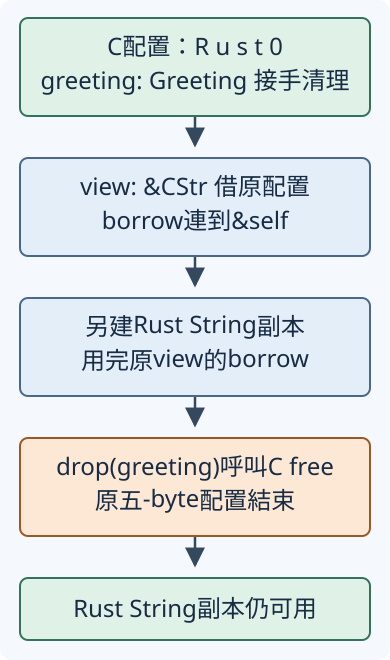

# 15.6 FFI：把 C 契約接成安全的 Rust 介面

第15.5節 已知道 C 函式如何收 pointer、如何決定處理範圍，以及 malloc 配置必須交回對應的 free。現在要讓 Rust 使用這些能力，同時讓普通 caller 不必自行處理 raw pointer。

本節建立小型本地 C 函式庫，先確認版本函式能連結，再處理三種資料關係：借用一般 byte buffer、借用 Rust-owned C string，以及接手 C 配置的固定字串。這些工作都可用純 Rust 完成；選它們是為了讓跨語言的型別、呼叫、borrow 與 cleanup 可逐項核對，不是宣稱必須使用 C 或會更快。

沿用 Linux x86_64、GCC14.2、Rust1.99／edition2024 的驗證環境，C 採 C11。C source 隨 package 提供，不需另外下載大型 C library；host C compiler 與標準函式庫的準備沿第15.5節。例子同步執行，C 不保存輸入 pointer，也不回頭呼叫 Rust。

## 先對齊一個沒有 pointer 的函式

從repo根目錄執行。本節保留三份獨立階段package：`ch15-ffi-scalar`、`ch15-ffi-buffer`、`ch15-ffi-label`，分別在`examples/ch12-ffi/stages/`下的scalar、buffer、label。最後才使用永久完整的`ch12-ffi`。每份stage有自己的C/header/build/library，早期版本不載後段介面。先讓C提供版本號1。

第15.5節 已用過 uint8_t／int32_t。這次的 **`uint32_t`** 是 `<stdint.h>` 提供的恰好32 bits無號整數，對應 Rust u32；範圍是0到u32::MAX。這個 C 型別與前節 exact-width 型別一樣，需要 C 實作有提供；本節 target 有提供。

C header 先宣告 `tutorial_version(void)`；void 表示沒有參數，回傳 uint32_t。c/tutorial.h 的這一項 prototype 是：

```c
--8<-- "examples/ch12-ffi/stages/scalar/c/tutorial.h:version"
```

c/tutorial.c 納入同一份 header，提供完整 body：

```c
--8<-- "examples/ch12-ffi/stages/scalar/c/tutorial.c:version"
```

接下來要告訴 Rust：這份 body 在 C object 裡，如何呼叫它？**ABI（application binary interface，應用程式二進位介面）** 是已編譯程式彼此配合的約定，例如參數如何傳遞、回傳值如何交接；跨語言的資料佈局也必須一致。名稱一樣、兩邊程式各自能編譯，仍不足以保證型別或呼叫約定相合。

**`extern "C"`** 選擇目前 Rust target 的 C ABI。它不是把 C source 直接貼進 Rust，也不表示所有平臺都使用完全相同的 ABI。

**`unsafe extern "C" { ... }`** 宣告外部函式的名稱與 Rust 簽名，沒有提供 body。edition2024 要求 block 前的 unsafe，因為作者要負責宣告確實符合另一邊。Rust 不會替我們讀 C header 並核對 uint32_t；這裡由作者逐項確認。

把 raw declarations 放在 library 的 private `sys` module，src/lib.rs 以 `mod sys;` 載入src/sys.rs。sys 裡的函式標pub供父層wrapper呼叫，但sys本身沒有公開，library外的caller只能使用下方公有wrapper：

```rust
--8<-- "examples/ch12-ffi/stages/scalar/src/sys.rs:version"
```

block 中沒有另外標safe的函式**預設是unsafe呼叫**。block前的unsafe承擔宣告正確性；呼叫時的unsafe block則承擔當次操作契約。版本函式沒有額外輸入、同步回固定u32，wrapper可以接手這項責任，交回普通數值：

```rust
--8<-- "examples/ch12-ffi/stages/scalar/src/lib.rs:version"
```

這個wrapper的安全理由包含 C 的實作、正確宣告與相同target，而不只是「Rust body 放了unsafe」。下面的caller只使用safe API，執行前先完成下一段的建置設定：

```rust
--8<-- "examples/ch12-ffi/stages/scalar/examples/scalar_call.rs"
```

## 用 build.rs 編譯 C，再連結到 Rust

第15.5節 已分開 C 的個別編譯與連結；第12.2節 已教 build.rs 在host執行，並透過輸出指令與Cargo合作。現在把這兩件事接起來。

各份manifest的共同欄位沿第12.1節，`build = "build.rs"`明寫第12.2節已教的script入口。本節加入 **cc crate**，它是供build script使用的Rust函式庫，幫忙呼叫適合target的C compiler與建立archive；不是另一個C compiler，也不是執行example的工具。依第12.2節把它放在 `[build-dependencies]`，版本固定為本節驗證的1.8.0：

```toml
--8<-- "examples/ch12-ffi/stages/scalar/Cargo.toml"
```

**static library（靜態函式庫）** 把編好的object files裝成archive，連結時取所需的C機器碼放進最終程式。這裡要得到名為tutorial_c的archive，供Rust library呼叫上述C symbol。**symbol（符號）** 是object／linker辨識的函式名稱等入口；tutorial_version的body必須真的出現在被連結的C程式碼裡。

Rust的private sys module管理Rust路徑，沒有替C symbol建立Rust module的命名空間。各快照與完整版分別編譯、連結；每個example只連到所選package的一份C實作，沒有將三份同名tutorial_version同時放進一個binary。

先介紹build.rs要使用的cc API：

- `cc::Build::new()`：建立尚未執行的建置設定。
- `.file("c/tutorial.c")`：加入要編譯的C source；相對路徑以package根目錄為準。
- `.std("c11")`：選C11。
- `.warnings(true)`：啟用compiler的常用警告，本節GCC包含Wall／Wextra。
- `.warnings_into_errors(true)`：本教材開發時讓警告中止建置；不同compiler版本的警告可能不同。
- `.compile("tutorial_c")`：執行C編譯與archive建立，並輸出所需Cargo連結資訊；失敗會讓build script不能成功完成。名稱不帶路徑或lib／.a前後綴。

前五項組態操作可以依序串接；先前已學過的mutable設定與method呼叫在這裡連續使用。build.rs如下：

```rust
--8<-- "examples/ch12-ffi/stages/scalar/build.rs"
```

兩個rerun-if-changed沿第12.2節：C body或header變動後重做。cc把object／archive放在Cargo提供的OUT_DIR；在本節GCC環境，archive檔名會是libtutorial_c.a。它也提供 **rustc-link-search** 讓linker知道搜尋目錄，以及 **rustc-link-lib=static=tutorial_c** 表示需要連結哪個archive。這些是build script給Cargo／rustc的資訊，不是宣告C函式簽名。

因此這份專案由cc的metadata安排連結，不需另外手寫`#[link]`；extern宣告、C實作與連結設定各自有工作。**build.rs跑在host，C object卻必須符合Rust target**；同host編譯時兩者相同，cross compilation時還要準備target C toolchain，不能只拿host的object硬配。

在repo根目錄執行：

這份scalar快照的完整七個檔案如下。C只含版本函式，Rust library也只含api_version；此時不會編譯未知的結果struct、CString或C-owned owner。

??? example "scalar完整source與建置設定"

    `Cargo.toml`：

    ```toml
    --8<-- "examples/ch12-ffi/stages/scalar/Cargo.toml"
    ```

    `build.rs`：

    ```rust
    --8<-- "examples/ch12-ffi/stages/scalar/build.rs"
    ```

    `c/tutorial.h`：

    ```c
    --8<-- "examples/ch12-ffi/stages/scalar/c/tutorial.h"
    ```

    `c/tutorial.c`：

    ```c
    --8<-- "examples/ch12-ffi/stages/scalar/c/tutorial.c"
    ```

    `src/sys.rs`：

    ```rust
    --8<-- "examples/ch12-ffi/stages/scalar/src/sys.rs"
    ```

    `src/lib.rs`：

    ```rust
    --8<-- "examples/ch12-ffi/stages/scalar/src/lib.rs"
    ```

    `examples/scalar_call.rs`：

    ```rust
    --8<-- "examples/ch12-ffi/stages/scalar/examples/scalar_call.rs"
    ```

```bash
cargo run -p ch15-ffi-scalar --example scalar_call --locked
```

```text
本地C版本=1
```

1來自已連結的C body，不是Rust wrapper自行回傳的literal。若只有extern宣告、沒有連結C實作，仍會像第15.5節缺少counts.o那樣遇到找不到symbol的連結失敗。若C本身有語法錯誤，則在build script的C編譯階段就失敗；兩種問題都不能靠給Rust呼叫加unsafe解決。

## buffer傳pointer與長度，結果struct傳佈局約定

沿第15.5節的byte buffer `[10, 0, 20]`，這次想同時得到「零值1項、非零2項」。輸入零仍是資料，長度由caller明示，不當字串掃描。

先教C的新 **`struct`**：用具名欄位組合一份值。`struct Counts { uint32_t zeros; uint32_t nonzero; };` 定義兩個欄位；型別位置要寫struct Counts，定義末尾也有分號。`struct Counts result = {0, 0};` 依宣告順序初始化兩項；`result.zeros` 用點取欄位。C 的 `else` 接在if後面，在條件不成立時執行。

header中的結果型別與函式契約如下：

```c
--8<-- "examples/ch12-ffi/stages/buffer/c/tutorial.h:counts"
```

非空輸入必須提供同一array內連續、有效、已初始化的len個uint8_t，呼叫期間沒有衝突寫入。C只讀、不保存或釋放來源；len0完全不存取pointer。len本身是u32範圍，所以每個counter最多加到len，不overflow：

```c
--8<-- "examples/ch12-ffi/stages/buffer/c/tutorial.c:counts"
```

Rust需要同樣兩個欄位的結果。**`#[repr(C)]`** 選擇C相容的struct表示：欄位按宣告順序排列，各自符合alignment；需要時會加 **padding（填補空間）**，讓下一欄位或整份struct的大小符合對齊。本節同target的兩個u32對應兩個uint32_t，次序zeros／nonzero也相同。

普通Rust struct的預設佈局沒有保證這項C欄位排列約定；只把兩邊欄位取相同名字不夠。repr(C)亦不會讓String／Vec等Rust型別自動變成C可理解的欄位，它只安排這份struct的表示，欄位本身仍要各自相合。

這份結果是按值交回的兩個計數，不帶輸入borrow，也沒有任何heap釋放責任。CountError則是**只在Rust端使用**的enum，這次只有TooLong，用於無法把完整長度交進C的情況；它不跨ABI：

```rust
--8<-- "examples/ch12-ffi/stages/buffer/src/lib.rs:counts-model"
```

依header宣告外部函式；sys.rs以`use crate::Counts;`使用已定義的結果型別：

```rust
--8<-- "examples/ch12-ffi/stages/buffer/src/sys.rs:counts"
```

safe wrapper不能要求caller自己保證「slice不太長」。slice的len是usize，C介面明選uint32_t；wrapper先用第8.4節的TryFrom檢查。這裡標準u32提供 `try_from(usize)`：可表示才回Ok，否則Err；不先截斷再傳。private helper checked_len把這項失敗映成CountError::TooLong，?在失敗時立即回去，不呼叫C：

```rust
--8<-- "examples/ch12-ffi/stages/buffer/src/lib.rs:count-wrapper"
```

bytes的shared borrow提供有效範圍、初始化與呼叫期間的來源；as_ptr沿第15.3節取得pointer，不接手原buffer。C只處理這份完整長度且不寫入、不保存，故呼叫返回後borrow工作就完成。空slice也有可形成的data pointer，但C的len0分支完全不讀它，不製造空資料元素。

即使len等於u32::MAX，C最後一輪的index是MAX−1，更新到MAX後條件不成立；單一counter最大到MAX，不再多加一次。這是契約與迴圈的範圍理由，並非本次真的配置了數十億項測試。

```rust
--8<-- "examples/ch12-ffi/stages/buffer/examples/buffer_count.rs"
```

這一步改選buffer快照。它保留已教version，再加入Counts與count_bytes；以下完整C/Rust/build設定沒有CString或配置工廠。

??? example "buffer階段完整source與建置設定"

    `Cargo.toml`：

    ```toml
    --8<-- "examples/ch12-ffi/stages/buffer/Cargo.toml"
    ```

    `build.rs`：

    ```rust
    --8<-- "examples/ch12-ffi/stages/buffer/build.rs"
    ```

    `c/tutorial.h`：

    ```c
    --8<-- "examples/ch12-ffi/stages/buffer/c/tutorial.h"
    ```

    `c/tutorial.c`：

    ```c
    --8<-- "examples/ch12-ffi/stages/buffer/c/tutorial.c"
    ```

    `src/sys.rs`：

    ```rust
    --8<-- "examples/ch12-ffi/stages/buffer/src/sys.rs"
    ```

    `src/lib.rs`：

    ```rust
    --8<-- "examples/ch12-ffi/stages/buffer/src/lib.rs"
    ```

    `examples/buffer_count.rs`：

    ```rust
    --8<-- "examples/ch12-ffi/stages/buffer/examples/buffer_count.rs"
    ```

```bash
cargo run -p ch15-ffi-buffer --example buffer_count --locked
```

```text
buffer：零=1，非零=2
空buffer：零=0，非零=0
呼叫後原buffer仍有三項=3
```

兩個計數核對包括中間零的三項資料，空輸入核對不讀元素的分支；原buffer仍由Rust caller持有。正常輸出不替任何任意raw pointer完成C契約，public safe介面只接受本身帶有有效性的slice。

## Rust-owned CString：只把字串借給C

第15.5節的C string需要末尾零，但Rust str保存長度且保證UTF-8，沒有承諾末尾零。這回讓C判定輸入是否完全等於Rust四個字元；不能直接把普通str pointer當成C string。

先介紹本節使用的標準型別與API，名稱由 `std::ffi` 引入：

- **`CString`／`CString::new(text)`**：Rust-owned的C字串。本次接&str建立自己的byte儲存，拒絕輸入任何零byte，成功補上末尾零，回`Result<CString, NulError>`；原str仍由caller持有。
- **`NulError`**：保存new拒絕零byte的錯誤，有Debug／PartialEq供本節顯示與測試。它不是C函式失敗。
- **`CStr`／`&CStr`**：C字串的借用表示，不接手配置，也不保證內容是UTF-8。
- **`CString::as_c_str(&self)`**：借原CString得到&CStr，view有效性接到owner。
- **`CStr::as_ptr(&self)`**：回*const c_char，指向原NUL結尾資料。pointer本身不保存lifetime，來源必須繼續有效，C也不得寫入。
- **`c_char`／`c_int`**：Rust對C char／int的target型別alias；不是Rust Unicode char，也不把所有C int直接假定成i32。

C function使用新的 `<string.h>` API **`strcmp(left, right)`**，借兩個有效NUL結尾的char序列，比較byte內容；相同回0，不同回負或正int。本次只使用「是否等於0」這項判定，不修改、保存或釋放任一輸入：

```c
--8<-- "examples/ch12-ffi/stages/label/c/tutorial.c:label"
```

C的比較結果為int0／1；Rust宣告回c_int，不直接宣告bool。sys.rs以`use std::ffi::c_char;`與c_int取得名稱：

```rust
--8<-- "examples/ch12-ffi/stages/label/src/sys.rs:label"
```

lib.rs先引入CString與NulError。wrapper建立具名owner word，讓它活到同步C呼叫返回，再把int1轉成Rust bool：

```rust
--8<-- "examples/ch12-ffi/stages/label/src/lib.rs:label-wrapper"
```

CString只有shared借給C，呼叫完仍由Rust負責清理。這份C body只讀，不能把輸入改成會保存或free word的實作，卻繼續宣稱wrapper安全。一般raw pointer也不會把一個temporary CString自動保活；owner必須像這裡保存為變數。

Rust字串中的 `\0` 表示零byte。因此Ru\0st雖是合法Rust str，CString::new仍會拒絕，?在建立字串階段就回Err，不會讓C把它誤當只有Ru的短字串：

```rust
--8<-- "examples/ch12-ffi/stages/label/examples/borrowed_label.rs"
```

這一步改選label快照，完整source保留前兩步，加入剛教的字串比較。所有呼叫材料都在example裡，不由helper偷偷造C字串。

??? example "CString階段完整source與建置設定"

    `Cargo.toml`：

    ```toml
    --8<-- "examples/ch12-ffi/stages/label/Cargo.toml"
    ```

    `build.rs`：

    ```rust
    --8<-- "examples/ch12-ffi/stages/label/build.rs"
    ```

    `c/tutorial.h`：

    ```c
    --8<-- "examples/ch12-ffi/stages/label/c/tutorial.h"
    ```

    `c/tutorial.c`：

    ```c
    --8<-- "examples/ch12-ffi/stages/label/c/tutorial.c"
    ```

    `src/sys.rs`：

    ```rust
    --8<-- "examples/ch12-ffi/stages/label/src/sys.rs"
    ```

    `src/lib.rs`：

    ```rust
    --8<-- "examples/ch12-ffi/stages/label/src/lib.rs"
    ```

    `examples/borrowed_label.rs`：

    ```rust
    --8<-- "examples/ch12-ffi/stages/label/examples/borrowed_label.rs"
    ```

```bash
cargo run -p ch15-ffi-label --example borrowed_label --locked
```

```text
Rust完全相符=true
Python完全相符=false
內部零被Rust拒絕，尚未呼叫C
```

前兩項是C比較的結果；第三項是Rust端格式檢查。若需求本來就是含零的一般資料，應用上一段pointer＋len介面，而不是強迫它符合C string。

## C-owned配置：由專用owner管理對應的free

前一段C借Rust的字串，現在反過來：C配置五個char，內容為Rust加末尾零，交給Rust使用，最後仍須呼叫這個C函式庫的釋放函式。

header契約先給出ownership交接與失敗規則：

```c
--8<-- "examples/ch12-ffi/c/tutorial.h:greeting"
```

C先用第15.5節相同的char array初始化，再malloc五bytes、檢查NULL；迴圈連末尾零一起複製，**完成全部初始化後**才return配置pointer。這裡交回的是data指向的malloc儲存，不是局部word的pointer；word離開scope不會使已複製的新配置結束。

```c
--8<-- "examples/ch12-ffi/c/tutorial.c:greeting"
```

每次成功malloc取得另一份配置，C沒有另外保存它；caller承接唯一cleanup責任。tutorial_free_greeting把原始成功pointer交回free；不能交內部元素、另一個allocator的pointer或已經釋放的來源。

Rust的兩個宣告分別取得pointer、交回pointer；C的void回傳在Rust就是沒有結果，函式簽名不寫`->`：

```rust
--8<-- "examples/ch12-ffi/src/sys.rs:greeting"
```

這時不能只用Box接手pointer，因為「看起來都指向heap」沒有證明Rust allocator與這個C釋放契約相符。本節也不把C malloc當作CString自己的配置。選一個專用 **Greeting owner**，私有欄位只保存這份原始pointer，由第11.3節的Drop呼叫指定C函式。

先說明要公開的操作與不變條件：

| Greeting介面／不變條件 | 它接手的責任 |
| --- | --- |
| `try_new()` | 回`Option<Greeting>`；呼叫無輸入的C工廠，NULL回None，成功才建立owner。保存原始起點，沒有任意raw pointer的public constructor。 |
| private pointer | 只來自本地工廠的新成功配置；五個char已初始化、包含末尾零，沒有公開寫入、重設pointer或另行free介面。 |
| `as_c_str` | 借&self，回&CStr。只借原內容，回傳有效性依第7.4節連到self；不是static，也不延長owner。 |
| `Drop` | 正常清理時交回對應C函式一次。整份Greeting可以move，但沒有Copy／Clone，不複製一份可另行free的owner。 |

getter的新操作 **`CStr::from_ptr(pointer)`** 接收`*const c_char`，是unsafe：pointer必須non-null，直到包含終止零的整段資料都已初始化、可讀、位於單一allocation，總長小於isize::MAX；回傳borrow期間不可修改或釋放。Rust允許在需要`*const T`的位置，把`*mut T`隱式轉成只讀pointer型別，來源仍是同一份資料，不增加存取資格或延長有效期間。

from_ptr不接手配置，也不自己查明其真正owner。這裡由固定五-byte工廠、private欄位、無寫入API與`&self`回傳契約一起滿足，不只靠NULL檢查。

lib.rs用 `use std::ffi::CStr;`與c_char引入名稱，完整owner如下：

```rust
--8<-- "examples/ch12-ffi/src/lib.rs:greeting-wrapper"
```

**CStr格式正確仍不等於UTF-8。** 顯示成Rust文字前，用 **`CStr::to_str(&self)`** 檢查，回 `Result<&str, std::str::Utf8Error>`；成功view仍借原資料，不複製。Utf8Error有Debug供expect使用；本地C固定提供ASCII Rust，例子才有理由expect成功。另一個C API若只承諾任意byte字串，必須處理Err。

正常流程如下：箭頭表示這次操作的順序。&CStr借的仍是第一步C配置；第三步另建的Rust String才是一份可在free後繼續用的內容副本：



```rust
--8<-- "examples/ch12-ffi/examples/owned_greeting.rs"
```

現在改選永久完整版`ch12-ffi`，目錄就是`examples/ch12-ffi/`；它提供前面全部safe API與這個Greeting owner。

本節library另外有六項正常測試：已連結版本、byte計數與子slice／空段、長度不能截斷、字串內零拒絕、move後複製文字再Drop、兩份獨立C配置先清一份。長度helper不用先配置巨大buffer；測試用 **`usize::BITS`** 取得這個整數型別的bit寬度、**`usize::MAX`** 取得最大值，在寬度大於32時確認helper回TooLong。這兩個是型別的標準associated constants，不是測量資料或改平臺。

字串測試用第15.1節已教的Result::is_err判斷格式失敗；expect所需的Debug由本節CountError／標準錯誤型別提供。所有helpers／tests都沿上方介面，不需要未知callback、allocator框架或跨thread實作：

??? example "永久完整版的完整C／Rust／build設定"

    `Cargo.toml`：

    ```toml
    --8<-- "examples/ch12-ffi/Cargo.toml"
    ```

    `build.rs`：

    ```rust
    --8<-- "examples/ch12-ffi/build.rs"
    ```

    `c/tutorial.h`：

    ```c
    --8<-- "examples/ch12-ffi/c/tutorial.h"
    ```

    `c/tutorial.c`：

    ```c
    --8<-- "examples/ch12-ffi/c/tutorial.c"
    ```

    `src/sys.rs`：

    ```rust
    --8<-- "examples/ch12-ffi/src/sys.rs"
    ```

    `src/lib.rs`：

    ```rust
    --8<-- "examples/ch12-ffi/src/lib.rs"
    ```

```bash
cargo run -p ch12-ffi --example owned_greeting --locked
```

```text
借讀C配置=Rust
之後只用Rust副本=Rust
```

第一行仍借C配置；to_owned沿第8.5節建立獨立Rust String。drop(greeting)沿第11.3節接手owner、執行對應cleanup，之後只讀saved。輸出核對內容關係，配對釋放與borrow安全則由上面C body／Rust介面契約支持。

## 檢查宣告、borrow與所選正常案例

下列fixture只確認指定編譯規則，不執行ABI錯配、失效pointer或double-free作示範。

先省略edition2024 extern block所需的unsafe，指定診斷是extern blocks must be unsafe：

```rust
--8<-- "examples/ch12-ffi/fixtures/compile-fail/extern_block_without_unsafe.rs"
```

指定實測診斷：

```text
--8<-- "examples/ch12-ffi/fixtures/compile-fail/extern_block_without_unsafe.expected"
```

block有unsafe卻在caller省略unsafe block，則是外部呼叫的E0133：

```rust
--8<-- "examples/ch12-ffi/fixtures/compile-fail/foreign_call_without_unsafe.rs"
```

指定實測診斷：

```text
--8<-- "examples/ch12-ffi/fixtures/compile-fail/foreign_call_without_unsafe.expected"
```

兩個fixture都在連結前被拒絕，不靠真的執行未連結的C函數。即使版本函式這次沒有額外輸入，宣告預設unsafe的規則仍在；日常caller用前面的safe api_version。

缺少repr(C)的預設struct會有 **improper_ctypes lint**，這是對外部宣告型別的品質診斷。為了讓該fixture一定以錯誤結束，檔案開頭用 **`#![deny(improper_ctypes)]`** 把這項警告升成錯誤；它不是在執行時試出layout有沒有剛好相同：

```rust
--8<-- "examples/ch12-ffi/fixtures/compile-fail/struct_without_repr_c.rs"
```

指定實測診斷：

```text
--8<-- "examples/ch12-ffi/fixtures/compile-fail/struct_without_repr_c.expected"
```

再用剛學的Rust-owned CString，單獨確認借用CStr不能超過owner。saved想在內層word清理後讀取，得到E0597；Greeting的getter也依相同的`&self`借用關係限制caller：

```rust
--8<-- "examples/ch12-ffi/fixtures/compile-fail/cstr_owner_too_short.rs"
```

指定實測診斷：

```text
--8<-- "examples/ch12-ffi/fixtures/compile-fail/cstr_owner_too_short.expected"
```

這個負例沒有建立C配置，驗的是普通owner／borrow的編譯關係，不能拿它當已測C allocator配對的證據。

```bash
cargo test -p ch12-ffi --lib --locked
```

測試支持所選正常案例，沒有真的配置u32::MAX項，也沒有模擬malloc失敗；兩個分支的安全責任仍須由實作核對。C與Rust的compiler都不能替所有caller證明extern宣告、佈局、NUL、有效期間與釋放約定；測試成功不能改成完整soundness證明。

## 練習：同一份 C 文字，兩種介面各做各的工作

先補一個標準CStr API：**`to_bytes(&self)`** 借出不含終止零的 `&[u8]`，仍借原owner；`to_bytes_with_nul(&self)` 則把終止零保留在byte slice裡。兩者沒有取得ownership。

寫一個新的example，按下列步驟連起前面的safe APIs：

1. try_new取得Greeting；配置失敗時明確結束這次工作。
2. 借as_c_str，用to_bytes把四個文字bytes交給count_bytes，預期零0、非零4。
3. to_str檢查文字，再用is_rust_label驗證相同標籤，預期true。
4. to_owned保存獨立Rust String，drop Greeting，最後只印計數、bool和Rust String。

若第二步改用to_bytes_with_nul，預期零1、非零4；一般buffer的len會把終止零也當成資料。兩種計數都合法，只是處理範圍不同；C string比較仍用自己的末尾零約定。

??? note "參考答案：borrow期間完成工作，再交回C配置"

    ```rust
    --8<-- "examples/ch12-ffi/examples/ffi_solution.rs"
    ```

    ```bash
    cargo run -p ch12-ffi --example ffi_solution --locked
    ```

    ```text
    不含終止零：零=0，非零=4
    相同標籤=true，獨立Rust文字=Rust
    ```

    counts只保存數字，same只保存bool，saved擁有Rust文字；它們都不再借Greeting。這是最後能先free原C配置、仍使用結果的依據，不是以成功輸出推pointer可以任意延長lifetime。

這份有限介面完成單向Rust呼叫本地C。實際更換C library時，要重新核對宣告、target ABI、佈局與每個API的ownership規則；不能把此工廠的五-byte不變條件搬到任意pointer。這裡沒有C→Rust callback或外部異常穿越呼叫，避免把未教的回呼／unwind協定藏進wrapper。

永久package也保留三份呼叫端供回顧；它們只使用上面已教的API，library路徑現在是ch12_ffi。完整來源如下：

??? example "永久package的scalar／buffer／borrowed-label呼叫端"

    `examples/scalar_call.rs`：

    ```rust
    --8<-- "examples/ch12-ffi/examples/scalar_call.rs"
    ```

    `examples/buffer_count.rs`：

    ```rust
    --8<-- "examples/ch12-ffi/examples/buffer_count.rs"
    ```

    `examples/borrowed_label.rs`：

    ```rust
    --8<-- "examples/ch12-ffi/examples/borrowed_label.rs"
    ```

此時全部source與答案都已介紹，才一起檢查本package targets：

```bash
cargo clippy -p ch12-ffi --all-targets --locked -- -D warnings
```

延伸閱讀：[EN Rustonomicon：FFI](https://doc.rust-lang.org/nomicon/ffi.html)、[中文對應章](https://nomicon.purewhite.io/ffi.html)、[cc 1.8.0 Build](https://docs.rs/cc/1.8.0/cc/struct.Build.html)、[CStr](https://doc.rust-lang.org/std/ffi/struct.CStr.html)、[CString](https://doc.rust-lang.org/std/ffi/struct.CString.html)。外書較複雜的compression、callbacks與外部系統library不放入本節，所有安全前提均由當頁具體C實作與Rust介面核對。

[下一章：self-reference與地址穩定](16-01-lesson.md)
