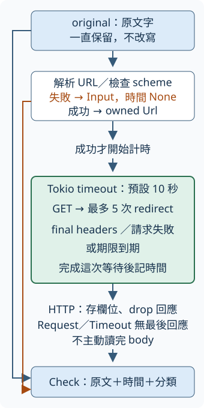

# 15.7 B1：把一份 URL 變成一份檢查結果

第 11 章已能送出 async HTTP 請求，也能用本機服務控制結果。現在開始專案 B：網址檢查器。工具要回答的第一個問題很小：給一份原始網址文字，最後是否得到 2xx？若失敗，究竟是輸入不合法、請求失敗，還是等待逾時？

這一步只完成一筆。先有可信的單筆結果，下一節才有材料安排多筆輸入。必要前文是 [11.4 的 timeout 與時間](11-04-time-and-timeout.md)、[11.7 的單一 async HTTP](11-07-single-async-http.md)、[11.8 的受控本機服務](11-08-local-service-and-tests.md)，以及 [15.1 的練功方式](15-01-practice-guide.md)。沿用小步自行實作、分層提示與完成快照；這些快照是同一工具逐步成長的版本，練習負擔不把每份副本累加。

## 一筆結果必須回答什麼

沿用 11.8 的 `Fixture`，每次由作業系統選擇本機 port。以下 `/ok` 等名稱都指它提供的路徑；真正送出的網址形如 `http://127.0.0.1:本次port/ok`。

**scheme** 是 URL 中冒號前的部分，例如 `http`、`https` 或 `file`；本工具只接受前兩種。

| 輸入或服務行為 | 一筆檢查應保存的答案 |
| --- | --- |
| `/notes` 這份原文字 | 缺少完整 URL，在送請求前拒絕 |
| `file:///tmp/notes.txt` | URL 能解析，但 scheme 不是 `http` 或 `https` |
| 本機 `/ok`、`/missing`、`/error` | 保存最後的 200、404、500；只有 200 通過 |
| 本機 `/redirect` | 原網址仍是 `/redirect`，最後網址是 `/ok`，HTTP 200 通過 |
| 本機 `/loop` | 最多跟隨五次 redirect；下一次遭政策拒絕，保存請求失敗 |
| 本機 `/held/0` 一直沒有放行 | 整份等待 headers 的工作到期，保存逾時 |

本題固定送 GET，最多跟隨五次 redirect，最後狀態是 2xx 才通過。404 與 500 仍是收到 HTTP 回應，不能跟「沒有得到最後回應」混成同一種錯誤。這個檢查只判定上述政策：200 並不證明網站內容符合你的需求。

我們只需要最後的 URL 與狀態，收到 final headers 就完成；不呼叫 `text()` 或 `bytes()` 主動讀完 body。伺服器可能已經送來一些 body bytes，這不影響工作界線；我們沒有承諾網路完全沒收到 body。

原始文字也要保留。解析後的 `Url` 是送請求用的位置，這個型別短名由 `use url::Url;` 引入；redirect 後的 URL 是最後回應的位置。這兩者不能取代呼叫者交來的原文字。此時只有一筆，下一節再加入輸入編號與重複網址的對應。

## 用 owned 資料保存分類與時間

把答案表示成 `Check`：`original` 擁有原文字，`outcome` 保存本次分類。`Outcome::Http` 擁有最後 URL，另存 `u16` 狀態碼與 `bool` 通過判定；其他情況各有自己的 variant。

輸入問題再分成 `InputIssue::Url` 與 `InputIssue::Scheme`。前者保留 `Url::parse` 的 `url::ParseError`，後者保留已解析但不支援的 scheme。請求問題保存實際的 `reqwest::Error`，不先壓成一段無法再分類的文字。

`elapsed_ms` 使用 `Option<u128>`，單位是毫秒，來源仍是 `std::time::Instant` 的 `elapsed().as_millis()`。輸入在解析處拒絕時是 `None`，表示尚未開始請求。已開始嘗試後是 `Some(...)`：HTTP 結果量到最後 headers；請求失敗或逾時量到該失敗結束。這不表示失敗也有 headers。client 準備、URL 解析及最後報告都在量測外，`Some(0)` 則仍是已嘗試，只是整毫秒顯示為零。

下列型別只 derive 已教的 `Debug`，方便測試印出分類。內含的錯誤型別不需要可用 `==` 比較；測試以 `match` 取出要驗的欄位。對 `Option<u128>` 比較 `None` 則可使用標準型別已提供的 `PartialEq`：`u128` 可比較，因此這份 `Option` 也可比較。

```rust
--8<-- "examples/ch15-projects/b1-starter/src/lib.rs:models"
```



圖中 `original` 沿左邊藍線保留到最後，不被解析或 redirect 改寫。橘線是解析失敗直接交回 `Input` 與 `None` 的早退支線，不經過 timer；只有解析成功才沿中間路線開始計時。綠框中的期限包住整份 headers 工作，包括 redirect。只有 HTTP 結果取得回應並保存欄位、drop 回應；請求失敗或逾時沒有最後的 `Response` 可讀。最後各路都把結果與原文字合成 `Check`。

## 準備起始版與已知工具

起始 artifact 在 [`examples/ch15-projects/b1-starter`](https://github.com/birdhackor/learn_rust/tree/main/examples/ch15-projects/b1-starter)。請把其中完整的 `Cargo.toml` 與 `src/lib.rs` 保存到自己的 `url-b1-work` 目錄，另保存 `checks/single-tests.rs`，稍後才加入測試。以下 source 節錄用於定位與說明，不是完整檔案的替代品。

manifest 沿 7.1 的版本要求寫法，`0.13.5` 等仍是相容版本要求；repo 的 `Cargo.lock` 記錄本教材實際使用的版本。這份快照核對 reqwest 0.13.5、Tokio 1.53.3、url 2.5.8。直接使用的 reqwest `rustls`、Tokio `rt`／`macros`／`net`／`time` 都在 11.7 教過；測試另開 11.4 的 `test-util`。

`[dev-dependencies]` 可供測試與 example targets 使用，普通 library 不依賴 `Fixture`。測試重用 11.8 的 `ch11-local-service`，以已教的 path dependency 指向它的 package。artifact 的相對路徑適用於原 repo 位置；**複製到 repo 外後，先把那一行 `path` 換成你電腦上教材 `examples/ch11-async/local-service` 的實際絕對路徑，再執行 Cargo**。例如教材在 `/work/learn_rust`，就填 `/work/learn_rust/examples/ch11-async/local-service`。這只是選定既有測試材料，不必再寫一份 server。

```toml
--8<-- "examples/ch15-projects/b1-starter/Cargo.toml"
```

repo 外沿 15.1 指定固定 toolchain。在自己的起始目錄執行：

```bash
cargo +1.99.0 check --all-targets
cargo +1.99.0 test --lib
```

此時編譯應成功，測試是零項。這只確認起始版能編譯，尚未證明它能檢查網址。在教材 repo 根目錄可改用 `cargo check -p url-b1-starter --all-targets --locked`。

起始版已提供三個小工具，使用方式都沿已讀的 API：

| 函式 | 取得什麼、交回什麼與本步用途 |
| --- | --- |
| `default_limit()` | 交回 `Duration::from_secs(10)`，是每筆 headers 工作的預設期限 |
| `build_client(direct)` | 設定五次 redirect 後建立 `Client`；`true` 為受控 loopback 材料停用代理，`false` 保留一般代理設定；建立失敗是準備失敗 |
| `parse_http_url(input)` | 借用文字，解析並檢查 scheme；成功交回 owned `Url`，失敗交回本節的 `InputIssue` |

這份 client 保留 11.7 的建立與重用方式，但**不設定 reqwest 的請求期限**。本題把預算放在 11.4 的 `tokio::time::timeout`：之後整份單筆工作由 caller 提供同一個 `Duration`，現在先包住 GET 到 final headers。不是另外再設定一個互相競爭的十秒預算。

```rust
--8<-- "examples/ch15-projects/b1-starter/src/lib.rs:helpers"
```

`check` 的介面借用共用的 `Client`，取得 `original: String` 的 ownership 與本次 `limit: Duration`，async Output 固定是 `Check`。每筆輸入或網路問題都應進入結果，client 初始化失敗則已在呼叫前處理。

現在 body 只回固定的「尚未實作」標記，不代表網址真的有 scheme 問題。名稱前的 `_` 用於這份暫時未使用的參數，避免未使用警告；正式實作時換回 `client` 與 `limit`。

```rust
--8<-- "examples/ch15-projects/b1-starter/src/lib.rs:stub"
```

## 先讓驗收有明確的失敗

驗收重用 `Fixture::start` 的 ready 確認與動態 port、`url` 的固定路徑、`next_started` 的 handler 通知、`release` 的一次使用 gate，最後用 `shutdown` 收尾。這些介面與 server／client 各自等待的規則都來自 11.8。本節不靠公共網站的固定輸出，也不用 sleep 猜測請求已進入。

完整 checks 有六項測試。它們依序驗輸入分類、共用 client 的 200／404／500、成功 redirect、redirect 上限、放行前後的等待，以及整份工作逾時。`assert_http` helper 借用 `Check`，驗指定 URL／狀態／通過判定，另確認已開始嘗試有 `Some` 耗時；它不要求某次真毫秒數。

held 測試還需要 `held_request(limit)`。它建立一份 gate、把 client 與網址 move 進 request task，再等待 handler 回報已進入第零份 gate。沿 11.2／11.8 的 `spawn` 要求，task 擁有 client 與文字；`Check` 的欄位使用可 `Send` 的 `String`、數值、`Option` 與這些具體錯誤型別，因此 Output 可交回 task 的等待者，沒有借用 fixture 的資料。成功交回 `(Fixture, JoinHandle<Check>)`，交回時尚未放行。起始版根本不送網路，因此通知也不會出現；加一個五秒的**觀察 guard** 才能指出這種錯碼，然後 abort／await request task，再 shutdown server。測試用 `expect` 或 `panic!` 報材料、契約不符；這不是正式網址檢查器對一般輸入的處理方式。

```rust
--8<-- "examples/ch15-projects/b1-starter/checks/single-tests.rs:observation-helper"
```

逾時測試另有一個需要先說清的等待形式：具體的 `&mut JoinHandle<Check>` 也可作為等待 task 的 Future，Output 和直接 `request.await` 一樣是 `Result<Check, JoinError>`。借用等待保留 handle 的 owner，適合把等待放進測試的 timeout。若這個 timeout 到期，丟掉的是借用的等待，**task 還在跑**；仍需用原 handle abort，再 await 收尾。若已取得成功等待的 Output，就使用那份結果，不從同一把 handle 再取一次。

於是三個期限各負責不同工作：

| 期限 | 建立時點與範圍 | 到期代表什麼 |
| --- | --- | --- |
| 工作 10 秒 | `check` 開始 GET 前建立，包住整份 headers 工作 | 正常單筆 <code style="white-space: nowrap">Timeout</code> |
| 觀察 entered 5 秒 | task 送出後，用真正在運作的 Tokio clock 等 handler 通知 | 測試未看到請求進入，收尾後失敗 |
| 觀察結果 20 秒 | 已收到 handler 通知，pause 後包住借用 handle 的等待 | 讀者可能漏寫工作期限；測試 resume 後收尾並失敗 |

在真 handler 已進入後才 pause，網路材料先成立，再由 runtime 推進受控 timer。成功答案的十秒工作期限應先交回 `Timeout`；若漏寫期限，二十秒觀察 guard 仍能有限結束。`std::time::Instant` 沒有因此變成 Tokio 的虛擬 clock，所以不拿 `elapsed_ms` 判定虛擬十秒。所有路線都在收尾前 resume。

```rust
--8<-- "examples/ch15-projects/b1-starter/checks/single-tests.rs:timeout-test"
```

現在把完整 [`checks/single-tests.rs`](https://github.com/birdhackor/learn_rust/blob/main/examples/ch15-projects/b1-starter/checks/single-tests.rs) 追加到工作副本的 `src/lib.rs` 末尾。它自帶 `#[cfg(test)] mod tests`，不要再包一層。`malformed.elapsed_ms == None` 使用前面說明的具體 `Option<u128>` 比較能力；其他資料以 `match` 驗指定 variant。

```bash
cargo +1.99.0 test --lib
```

起始版六項應失敗：輸入被錯誤地當成固定 scheme，合法網址也沒有送出請求。held 的兩項會各由五秒觀察 guard 失敗並收尾；失敗時間是測試邊界，不是起始版已經有正確的工作期限。先讀診斷，再開始修改 `check`。

## 自己完成三個小步

第一步只處理輸入。用 `parse_http_url(original.as_str())`，失敗立即組合 `Check`：保留 `original`、`None` 耗時、真正的 `Outcome::Input(issue)`。成功先保留 `Url`，其餘仍可用尚未完成的標記。重跑測試，應先讓輸入那一項通過。

第二步讓合法 URL 得到 HTTP 或請求問題。記錄 `Instant::now()` 後開始 GET，等待 `send()`，保存 `elapsed().as_millis()`。成功回應先讀 `status()` 與 `url()`：把 URL 轉成 owned `String`，再 `drop(response)`，用狀態的 `as_u16()`、`is_success()` 建立 `Outcome::Http`。這樣收到 headers 便完成，沒有下一次讀 body 的 await。請求失敗保存 `Outcome::Request(error)`；沿 11.7 的 `error.is_timeout()` 若辨認到 timeout，就歸入 `Outcome::Timeout`。本 client 沒設定 reqwest 請求預算，但分類仍不假設依賴永遠不會回報自己的 timeout。

此時固定 HTTP／redirect／放行測試可以成立，逾時測試仍應失敗：handler 未放行，單純 `send().await` 不會自行實作本題的十秒期限。二十秒觀察 guard 會指出缺少這一步。

第三步把整份 GET 等待放進 `work = async { ... }`，再 `timeout(limit, work).await`。沿 11.7，`send()` 是普通方法呼叫形成 Future；放在 async block 內，GET 建立與 send 呼叫也在 wrapper 的工作內。本步 `work` 的 Output 是 `Result<Response, reqwest::Error>`，wrapper 因而形成兩層 `Result`：

| 等待結果 | 應組合的分類 |
| --- | --- |
| `Ok(Ok(response))` | 有最後 headers，讀出欄位並建立 `Http` |
| `Ok(Err(error))` | 工作已結束但請求失敗，依上述規則分類 |
| `Err(_)` | wrapper 逾時，建立 `Timeout` |

這裡用 `match` 收攏結果，而不是用 `?` 提早離開：函式承諾一筆總有一份 `Check`。wrapper 的合作式限制仍沿 11.4；期限不搶占阻塞的同步工作，也不撤銷伺服器已做的事。此處包住的是可等待的網路工作。

每步都重跑 checks。完成後六項應全部通過；每筆錯誤也保留輸入，下一節才能把所有結果放回清單中。

??? tip "提示 1：先畫資料流，不急著寫所有分支"

    `original` 一直保留。解析失敗沒有請求，所以先交回 `Input` 與 `None`；解析成功取得 `url` 才開始計時。無論網路結果是哪一種，最後都用同一份原文字與 `Some` 時間組合 `Check`。

??? tip "提示 2：先分 wrapper 與工作"

    `Err(_)` 是外層期限；`Ok(Err(error))` 是 request 本身；只有 `Ok(Ok(response))` 能讀 HTTP 狀態。404 不會自動進入請求錯誤分支，這是本題保留 HTTP 分類的原因。

??? tip "提示 3：先保存再結束 response"

    `response.url()` 借用回應內的 URL；用 `as_str().to_owned()` 保存獨立文字。`status()` 的 `StatusCode` 是已教的具體 `Copy` 型別，保存它後可先 `drop(response)`，再組合整數狀態與判定。

??? success "完成快照：完整 check 與可執行驗收"

    ```rust
    --8<-- "examples/ch15-projects/b1-complete/src/lib.rs:solution"
    ```

    完整 artifact 是 [`b1-complete`](https://github.com/birdhackor/learn_rust/tree/main/examples/ch15-projects/b1-complete)。它已包含完整六項 checks 與小型本機 example。教材 repo 根目錄可執行：

    ```bash
    cargo test -p url-b1 --lib --locked
    cargo run -p url-b1 --example b1_single_demo --locked
    ```

## 實際跑一筆，再解讀答案

`b1_single_demo` 使用已教的 `#[tokio::main(flavor = "current_thread")]` 建立 runtime。先 ready、建立 loopback client、取得 `/redirect` 網址，再呼叫 `check`。完成後先 shutdown server，確認它處理初始網址與最後 `/ok` 兩份請求，才印出結果；ready 不計入這兩次。

demo 借用 `record.outcome` 做 `match`，取出的 `status`／`passed` 是 reference，驗數值時明確 `*`；字串以 `as_str()` 借用。`elapsed_ms` 用既有 `Debug` 印出 `Option`，不把它當固定預期值。

```rust
--8<-- "examples/ch15-projects/b1-complete/examples/b1_single_demo.rs"
```

輸出會有原始 `/redirect` 網址、最後 `/ok` 網址、`HTTP 200，passed=true` 與 `Some(...) ms`。port 與真毫秒數每次可變，分類、對應與 server 已收尾才是驗收重點。

現在一筆 owned `Check` 已把輸入、最後 HTTP 或失敗、嘗試時間連在一起。下一步才把逐行輸入與這個單筆核心接起來，保留每行的原位置。
