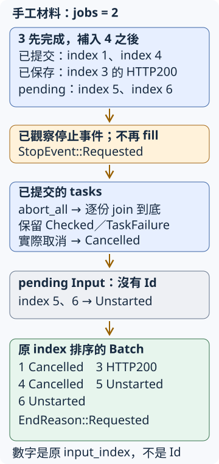

# 15.10 B4：停止新提交，收妥工作，再交回完整清單

B3 已能在有限名額內檢查清單。現在使用者按 Ctrl+C，不再需要剩餘工作；我們仍要回答**每份原輸入留下什麼：已完成、已取消，或根本沒有提交？** 直接退出會丟掉這份對應，也無法確認 client 與測試服務的收尾。

沿 [15.9 的 owned Scheduler](15-09-bounded-url-checks.md) 與 [11.5 的停止、取消與等待](11-05-cancellation-and-finish.md)，本步完成 typed Batch、可控制停止來源及真 Ctrl+C demo。正式 CLI 參數、文字／JSON報告與完整退出優先序在下一節接上；最終功能仍維持原規劃。先把停止流程驗清楚，再包成工具入口。

## 停止後，每份原行要留下什麼？

沿本機 Fixture，先用以下五份輸入、jobs2。空白行略過後保有的原索引是1、3、4、5、6；`U` 指這次本機 `/ok` 的同一份 URL，表格是手工材料對應，測試會使用真動態 port：

| 原 input_index | original 的材料 | 觀察停止時的狀態 |
| --- | --- | --- |
| 1 | 本機 `/held/0` URL | 已進入 handler，尚未放行 |
| 3 | U | 已取得 HTTP200 並收取 |
| 4 | 本機 `/held/1` URL | 收取3後才補入，尚未放行 |
| 5 | `/notes` | 仍在 pending，尚未解析或提交 |
| 6 | U，另一份相同 URL | 仍在 pending；不能與3合併 |

**Fixture 的 gate 編號0／1，分別控制原輸入1／4。** 它們是兩種不同編號：handler通知的0／1指出哪個gate已進入，工具報告的1／4指出哪個原行。第二份held進入，便證明3已收取、名額已補入4；沒有用sleep猜HTTP進度。

這時觀察到停止，應保留3的HTTP200、取消1與4，5與6標為未提交。`/notes` 若真的交給single會得到Input問題；本例還沒提交它，所以答案是未開始。取消已提交task與未提交資料都不是transport failure，也不改寫成Timeout。

停止不會撤銷已送出的GET或server已增加的計數。client task全收回後，Fixture還要解除gate並shutdown，才能確認server完成；沿11.5與11.8分開處理兩方的owner。

## 把整批理由與每筆分類分開保存

`Completion` 沿B3的Checked／TaskFailure，新增 **Cancelled** 與 **Unstarted**，兩者各保存original。Cancelled來自JoinError的is_cancelled；Unstarted直接來自pending Input，沒有Tokio Id。兩者沒有Check，因此不捏造HTTP狀態或elapsed_ms。

`Entry` 仍有原索引；`original()` 增加借讀兩種新variant。單筆core不改：GET、最多五次redirect、final2xx、只等finalheaders與每筆十秒預設，仍由B1的Check保存。

停止來源沿11.5：容量1 channel送 **StopEvent**，Requested表示明確要求停止，SignalFailed保留監聽錯誤。**EndReason** 另加Finished與StopSourceClosed；channel關閉沒有事件，不能解讀成使用者按了Ctrl+C。**Batch** 把整批理由與所有Entry放在一起；Finished只表示清單做完，不保證每筆通過。

```rust
--8<-- "examples/ch15-projects/b4-starter/src/lib.rs:models"
```



藍框追蹤已提交與已保存的工作；橘框是**已觀察**的停止事件；灰框是只有Input的pending；綠框是最後Batch。向下箭頭表示處理步驟。圖中的HTTP200是`Checked`內的HTTP結果；停止沒有把它覆寫為Cancelled。最後的EndReason是整批理由，與每個Entry的分類不同。

## 補工前先查停止，必須改哪兩個時點？

B3的new會立刻fill，next收取後也立刻fill。現在沿11.5改成：**new只準備資料；收取只record；每輪先查停止，再決定fill。** 這讓提前排入的事件能阻止第一批，也讓收取後不會先補工作、才看到已排入的停止。

Scheduler仍保存pending、JoinSet、Id→完整Input、共享pool的Client複本及每筆Duration；新增`entries`保存已收成果。所有TaskFailure／Cancelled仍從Id表取得原文，String複本的成本與jobs不能限制整張清單記憶體的範圍，沿B3。

起始版沿B3暫用`#[allow(dead_code)]`，這次分別放在Scheduler、其impl及尚未接上的stop_reason helper，只允許各自範圍的未使用提醒；完成版不用它。這份lint設定不會替stub實作功能。

```rust
--8<-- "examples/ch15-projects/b4-starter/src/lib.rs:state"
```

```rust
--8<-- "examples/ch15-projects/b4-starter/src/lib.rs:constructor"
```

new保留零jobs／Empty拒絕與原優先順序，沒有spawn。真正提交在run的fill，示範與tests仍放在Tokio runtime內。caller沿B3交`prepare_inputs`得到的清單，或具有相同唯一、遞增原行索引的Input；同一Scheduler呼叫一次run，等它回理由後，再以into_batch接手owner並排序。

## 先記真正結果，再收妥剩餘兩種來源

要自行完成的`record(&mut self, Result<(Id, Check), JoinError>)`不等待：從成功Id或error.id找到Input、移除登記；成功保Check，is_cancelled保存Cancelled，其他JoinError仍保存TaskFailure。把Entry推進entries，**這裡不fill**。登記的expect沿B3檢查作者自己的不變條件，不把漏登記當正常HTTP問題。

`stop_and_finish(&mut self)`沿11.5先abort_all，再逐份join與record到None，保留真正收回的成果。已完成但尚未收取的task仍可能交Check或task故障；不能把集合內每份都覆寫為Cancelled。接著才把pending每份Input取出、保存Unstarted；沒有task可以對它abort。

這裡局部新增 **`Iterator::by_ref()`**：mutable借原iterator，交回同一iterator的mutable reference。`for input in self.pending.by_ref()`可以走訪並取得owned Input，同時保留Scheduler對pending欄位的ownership；不是建立一份獨立iterator副本。走到末尾後，原pending也已耗盡。這是此處需要的借用介面，不必先看標準library內部泛型實作。

停止收尾後，`into_batch(self, reason)`接手Scheduler，確認集合與Id登記皆空，再沿6.7用sort_by_key按input_index排列entries。索引的空洞與original保持不變。其assert只檢查實作契約；使用者輸入問題仍用已教的typed結果。

runner的等待沿11.5：每輪try_recv先取已排入事件，Empty繼續、Disconnected保存來源失去；再fill。集合空便Finished；否則biased select把停止放在join之前。join分支只record，回圈頂端再查停止。**不再提交從觀察到停止起算**，不是對OS訊號抵達的某個瞬間提供原子性的禁止。

起始版提供`stop_reason`，將事件或來源關閉轉成整批理由；也提供`run_batch`入口。它借Client、取得Input Vec與停止收端，在自己本體內建立Scheduler；設定錯誤用`?`傳回，成功await run，再接手owner形成Batch。普通caller應以停止channel要求中止並await入口到結果；測試另直接持有Scheduler，以便觀察失敗後仍能收尾。

```rust
--8<-- "examples/ch15-projects/b4-starter/src/lib.rs:runner"
```

## 保存起點，再讓 checks 指出缺少的動作

從[`b4-starter`](https://github.com/birdhackor/learn_rust/tree/main/examples/ch15-projects/b4-starter)保存Cargo.toml、整個src與checks/stop-tests.rs到自己的url-b4-work。完整Input／single與fill沿B3；record／stop_and_finish／run三份body尚未完成。source snippet用於定位，不能只複製節錄代替整份起點。

普通library現在使用停止channel與ctrl_c，將11.5已教的 **sync／signal**放在普通Tokio dependency；其餘features沿前文。version要求與lock沿7.1。repo外**先把Fixture path換成你電腦上教材examples/ch11-async/local-service的實際絕對路徑**，才跑Cargo：

```toml
--8<-- "examples/ch15-projects/b4-starter/Cargo.toml"
```

在自己的工作目錄沿15.1：

```bash
cargo +1.99.0 check --all-targets
cargo +1.99.0 test --lib
```

此時可編譯，零項test。固定Finished沒有提交、收取或觀察停止。

## 觀察失敗時，也要保留所有資源 owner

checks沿B3由test直接持有Scheduler與Fixture。`drain`是測試的後備清理：對原JoinSet abort_all、逐份join；不使用會補工的方法。`finish`先保存集合／登記數，再後備drain與shutdown，全部收尾後才檢查原快照與理由。如此**測試自己的清理不會把產品忘記等待的錯碼補成通過**。它接收的是`Result<EndReason, Elapsed>`，Err代表觀察期限，不是整批理由。

```rust
--8<-- "examples/ch15-projects/b4-starter/checks/stop-tests.rs:cleanup"
```

`make_scheduler`替固定正設定準備Scheduler；若設定未成立，先shutdown自己仍持有的Fixture再報錯。`two_entered` mutable借Fixture，逐份以五秒觀察兩個gate通知，成功回Vec，失敗保存String診斷，不在資源仍活著時斷言。

`controlled_stop`在**同一份test task**用select推進兩份借用工作：一份是Scheduler.run，另一份是Fixture的有限控制。控制支路保存觀察、送Requested，然後等待已教、永不完成的pending；讓run交回EndReason，才結束這次select。它沒有另外spawn持有Fixture的controller。

整份select有十五秒觀察guard。它取消的是這些借用等待；Scheduler／Fixture的owner仍在helper中，能逐份收回children與server。已記成果放在Scheduler欄位，不靠被丟棄future的區域Vec保留。這是具體helper的安排，不宣稱任意Future可如此清理；同步panic或不讓出runtime的無限圈仍不在這些guard的保證內。

```rust
--8<-- "examples/ch15-projects/b4-starter/checks/stop-tests.rs:control"
```

五秒entered與十五秒結果都只守測試觀察；每筆十秒headers工作仍是自己的期限，沒有加正式整批deadline。handler的0／1通知可先後不同，最後驗它們各出現一次。

另有合成task材料沿B3：兩份task送完容量2的完成通知後立即回Check或panic，中間沒有其他await。在本份current-thread安排中，owner取得通知時body已返回，但還沒有join。第三份task仍等channel，另有一份pending；停止應保留Check、TaskFailure、Cancelled、Unstarted四種，並確認放行收端已清理。合成Check不是HTTP證據，panic hook文字也不是test失敗。

```rust
--8<-- "examples/ch15-projects/b4-starter/checks/stop-tests.rs:completed-test"
```

現在把完整[`checks/stop-tests.rs`](https://github.com/birdhackor/learn_rust/blob/main/examples/ch15-projects/b4-starter/checks/stop-tests.rs)追加到src/lib.rs。它自帶cfg與tests module，不再包一層。起始版應**一項通過、六項失敗**：設定檢查已提供；停止、分類與工作圈仍欠缺。

## 自己完成兩步，對照同一份停止材料

先完成record與stop_and_finish。Id表一次移除、保存真正Output、等待全部已提交tasks，再以by_ref走訪pending。合成完成待收的檢查應成立，於是**兩項通過、五項失敗**；run仍固定Finished，沒有觀察停止或實際提交。

第二步完成run。在檔案imports加入本節沿11.5使用的`use tokio::sync::mpsc::error::TryRecvError;`。每輪先try_recv，停止／來源失去便await stop_and_finish再回理由；Empty才fill。集合空回Finished；其他情況biased select先停止，或收取並record。回圈頂端再次查停止，不能在join handler直接補工。

提前Requested這項應沒有任何GET，原index1／3／4皆Unstarted，包含重複網址與尚未解析的`/notes`：

```rust
--8<-- "examples/ch15-projects/b4-starter/checks/stop-tests.rs:prequeued-test"
```

最初五份材料用兩個held通知確定3已收取並補入4，再送停止。全部client與server收尾後，核對1／4取消、3保留HTTP200、5／6未開始，以及原文與索引：

```rust
--8<-- "examples/ch15-projects/b4-starter/checks/stop-tests.rs:refill-test"
```

完成後七項應通過。其餘checks驗來源SignalFailed／Closed不等Requested、正常混合清單依然回Finished並保存HTTP／Input／Request與原順序。完成時移除起始版三處限定的dead_code allow；不以lint設定代替功能。

??? tip "提示 1：查停止與補工是兩個時點"

    new不fill，record不fill。只有回圈查到目前沒有事件、來源仍存，才允許補名額。提前已排入的Requested不需要先建立兩份task再取消。

??? tip "提示 2：取消要求不是最後分類"

    abort_all沒有移除或等完tasks；逐份join才能知道Check、task故障或實際取消。pending沒有Id，直接保Input為Unstarted。

??? tip "提示 3：沿原行排序，不重編號"

    本例留下1、3、4、5、6；Fixture gate0／1對應1／4。Entry仍保存原索引，最後排序不把它們改成0到4。

??? success "完成快照：保存每筆結果與整批理由"

    ```rust
    --8<-- "examples/ch15-projects/b4-complete/src/lib.rs:classify"
    ```

    ```rust
    --8<-- "examples/ch15-projects/b4-complete/src/lib.rs:stop"
    ```

    ```rust
    --8<-- "examples/ch15-projects/b4-complete/src/lib.rs:run"
    ```

    完整[`b4-complete`](https://github.com/birdhackor/learn_rust/tree/main/examples/ch15-projects/b4-complete)有相同七項checks；教材repo根目錄執行：

    ```bash
    cargo test -p url-b4 --lib --locked
    ```

## 把已驗收的停止來源換成真正 Ctrl+C

沿11.5，`signal_controller(stop, entered)`擁有兩份送端；biased select先實際執行ctrl_c，註冊listener後才送entered，另一支路pending不會結束等待。收到通知送Requested；監聽失敗送SignalFailed。Output bool只表示事件是否送入channel，不能替代整批理由。

`finish_signal_controller`接手handle、abort後await；已完成或已取消都能收尾。Unix的SIGINT處理不會因drop listener恢復預設，因此正常完成與取消路線都要明確結束這份等待。

```rust
--8<-- "examples/ch15-projects/b4-complete/src/lib.rs:signal"
```

這份`b4_signal_demo`改用四筆：原index1為`/held/0`、3為`/held/1`，4再放相同`/held/0`，5為`/notes`。因此這份demo的gate0／1對應原index1／3。省去前面已完成的`/ok`，是為了在READY時保有兩份等待中的task，讓真Ctrl+C操作有固定的取消材料；保留成果的那條路已由前面的受控測試驗收，原索引、duplicates與未提交invalid仍保留。

`ready`借Fixture觀察兩個gate，先核對0／1，再寫READY並flush；這時listener已進入，而且真HTTP已開始。`close`先await Scheduler的停止收尾，再保存listener與server的收尾結果，兩者皆等完才使用`?`。`print_batch`在資源完成後寫結果，最後flush確認輸出，沿7.9。entered收端保留到controller收尾，符合這份helper的caller契約。

demo對listener入口等五秒，對run／ready的借用工作等十五秒；觀察失敗也先close才回String診斷。早期事件讓entered回None時，run從同一channel取得真正Requested或來源失敗，不把None當ready成功。`observed`則保存ready的Result：若有Err，收尾後保留其診斷；若仍None，表示run先結束，並不宣稱已印READY。這些是有限demo觀察，正式工具只保每項工作期限。

```rust
--8<-- "examples/ch15-projects/b4-complete/examples/b4_signal_demo.rs"
```

教材repo根目錄執行，**看到READY後立即按Ctrl+C**：

```bash
cargo run -p url-b4 --example b4_signal_demo --locked
```

應得到Requested、原index1／3兩份Cancelled、index4／5兩份Unstarted，工作GET=2，全部client／listener／server完成，退出130。port與Debug內容可變。報告輸出或基礎失敗回2；不按時，單筆十秒期限讓這份demo自行完成，因包含`/notes`問題而退出1。它不是永遠等待的服務。

一般caller使用provided run_batch並await到結果，以停止channel要求中止。不要drop整份run_batch future來替代這套收尾：它在本體內擁有Scheduler，drop仍只有JoinSet的abort要求。測試直接持有owner與借用run，才有觀察失敗後另await清理的能力。

現在停止仍能保有原行對應與實際成果；下一節把這份已驗收的Batch接到真正CLI、穩定文字／JSON與完整錯誤政策，提供獨立可用版本。階段快照不累加成讀者反覆作業。

延伸閱讀：[Tokio Graceful Shutdown](https://tokio.rs/tokio/topics/shutdown)、[RustCourse優雅關閉](https://course.rs/advance-practice/graceful-shutdown.html)、[Tokio1.53.3 ctrl_c](https://docs.rs/tokio/1.53.3/tokio/signal/fn.ctrl_c.html)、[Iterator::by_ref](https://doc.rust-lang.org/1.99.0/std/iter/trait.Iterator.html#method.by_ref)。
