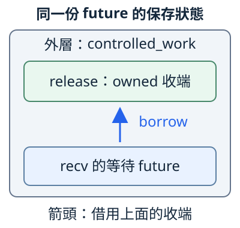

# 16.1 self-reference：資料還活著，地址也可能對不上

第14.3節的 `controlled_work` 接手 owned `release` 收端，之後停在 `release.recv().await` 等放行。外層工作必須保存收端；這份 recv 等待又 mutable 借用它。等待尚未結束時，光說「收端還活著」並不夠：**裡面保存的借用，稍後還要找到同一份資料。**

本節先用兩份數字資料觀察地址關係。要看的是「之前記錄的位置，是否仍對上目前欄位」，不比較電腦印出的十六進位數字；例子也不透過失配的 raw pointer 讀資料。

## 同一份工作裡，可能有指向內部的借用

**self-reference（自我參照）** 指一個值保存的位置資訊，指向同一個值內的另一部分。例如外層 future 保存 release 收端，等待中的 recv 借用那份收端。

async 工作暫停時，要保存之後仍會用到的資料與進度。若一份借用指向這些資料，稍後使用它時也需要原來的位置關係。不是每份 future 都實際自我參照，但使用端不能把所有 future 都當成沒有這種關係。

下圖接回14.3的工作。兩個框都在同一份外層 future 中，向上的箭頭表示借用收端；這是資料關係，**不是編譯器承諾的 struct 欄位布局**：



若整份狀態換了位置，內部保存的地址不會只因「變數還叫 release」就自動更新。下面暫時移除 channel，只保留 i32 和地址記錄，逐項看發生了什麼。

## lifetime、move 與位置，各回答一件事

第7章的 lifetime 描述借用來源與可用範圍，不會延長原值存活；第3.2節的 move 轉交 ownership，第11.3節也看過 move 不等於當場 Drop。這些規則仍成立，卻不會替我們重寫值裡的 raw pointer。

這裡的**地址穩定性**，是某份資料在需要它的期間保留原位置。move 是 ownership 語意；是否真的搬動我們在意的資料，要看交接的是哪一層。稍後交換 Box owner，就會與交換 Box 裡的資料有不同結果。

### reference 會擋住衝突的交換

先認識 **`std::mem::swap(left, right)`**：它接收兩個指向同型別 T 的 mutable reference，交換兩個位置中的完整 T，回傳 `()`。交換後兩邊仍各有完整的值；swap 不會為我們呼叫「修正內部地址」的方法，也不在交換時 Drop 兩份 T。

用 `use std::mem;` 引入 module，便能寫 `mem::swap(&mut left, &mut right)`。如果欄位真的保存 reference，之後還要使用這份借用，borrow checker 會拒絕下面的整值交換。`BorrowedNote<'a>` 沿第7.3節保存 borrowed 資料：

```rust
--8<-- "examples/ch13-futures/stages/fixtures/compile-fail/reference_blocks_swap.rs"
```

編譯診斷的比對字串為：

```text
--8<-- "examples/ch13-futures/stages/fixtures/compile-fail/reference_blocks_swap.expected"
```

`left.saved`／`right.saved` 還要借用原欄位，swap 卻要求 mutable 借用整份 left／right，因此得到 `E0502`。拒絕發生在編譯時，失敗程式不執行。這不表示 reference 只能指向外部；衝突的是保存借用後，又想交換它仍指向的整份資料。

## 改成地址記錄，先觀察整份值交換

本章早期例子位於沒有 library 的 **`ch16-future-stages`**。完整 member 設定沿第12.1節繼承根 workspace 已教的共同欄位；不需要第三方依賴：

```toml
--8<-- "examples/ch13-futures/stages/Cargo.toml"
```

完整預設入口只提示選例；下方命令都從 repo 根目錄執行，明確選定當下的 example：

```rust
--8<-- "examples/ch13-futures/stages/src/main.rs"
```

**AddressNote** 保存 `value: i32` 和 `saved: *const i32`。i32 直接放在 struct 裡，避免把 String 自己管理的 heap 空間也混進第一個實驗。型別沒有 Copy，整份交換時，數字與 saved 記錄一起交接。

沿第15.3、15.4節，`ptr::null()` 先建立「尚未記錄」的 null pointer，`&raw const self.value` 取得當下欄位的 raw pointer；這裡都不解參考它。

新增的 **`ptr::eq(first, second)`** 接收兩個 pointer、回傳 bool，這次比較兩個 `*const i32` 的地址是否相同。它沒有讀取兩個 i32，也沒有檢查來源資格、存活或存取權限。true 不能單獨證明可 dereference；false 足以看出記錄與目前欄位位置不一致。

完整 `addresses/mod.rs` 如下。`new` 先不記自己的地址，因為回傳後還要交給 caller；`remember` 才記下目前位置；`address_matches` 只比較，不修復 saved：

```rust
--8<-- "examples/ch13-futures/stages/examples/inline_swap/addresses/mod.rs"
```

把兩份資料先放進 left／right，再 remember，然後交換**整份 AddressNote**。完整 `main.rs`：

```rust
--8<-- "examples/ch13-futures/stages/examples/inline_swap/main.rs"
```

```bash
cargo run -p ch16-future-stages --example inline_swap --locked
```

```text
交換前：left 記錄地址與目前欄位相同=true，right=true
交換後：left 值=120，right 值=80
交換後：left 記錄地址與目前欄位相同=false，right=false
```

兩個變數仍持有完整資料，透過正常欄位也能讀到數字。但原 right 的 saved 隨整份值來到 left，仍記錄原 right 那處的地址；owner 還存在，沒有替記錄重新定位。

圖中 A／B 是原 left.value／right.value 的欄位位置標號，交換前後保留它們。灰色向下箭頭表示交換步驟，藍箭頭只表示 saved 記錄的地址，**不保證可透過它存取資料**：


即使兩個初始數字都改為80，交換後仍有兩個 false；內容相等不能代答位置相同。這份有限模型可以再次 remember，明確重記地址，但普通 move／swap 不會替任意型別找出並修正所有內部 pointer。

## 換 Box owner，裡面的資料留在哪裡？

第11.2節的 Box 把 owned T 放在 heap 配置中；轉交 Box owner，不需要連那份配置一起搬走。現在先用 `Box::new` 放好 AddressNote，再記 heap 中 value 欄位的位置。

這次 swap 的 T 是 **`Box<AddressNote>`**，交換的是兩個 Box owner。`(*left).remember()` 先找到 Box 的內容再呼叫方法；`&*left` 借出內容，都是11.2已用的操作。這份 target 的完整本地 module 與入口為：

```rust
--8<-- "examples/ch13-futures/stages/examples/box_handles/addresses/mod.rs"
```

```rust
--8<-- "examples/ch13-futures/stages/examples/box_handles/main.rs"
```

```bash
cargo run -p ch16-future-stages --example box_handles --locked
```

```text
交換 Box owner 後：left 值=120，right 值=80
記錄地址與目前欄位相同：left=true，right=true
```

兩份 heap 中的 AddressNote 留在原位置，只換了哪個 owner 找到它們。這次數字也互換，地址關係卻保留了。要問的是**哪份資料的位置**，不能只看外層 owner 有沒有 move。

這只支持本次 owner 交換。普通 Box 仍允許移出內容，或透過 mutable 存取替換資料；它沒有「之後禁止移出原值」的介面契約。

## 練習：只交換數字，地址記錄會失配嗎？

回到 inline 的80／120，先各自 remember。只對 `&mut left.value`／`&mut right.value` 呼叫 swap，保留外層 saved。

1. 預測兩個數字和 address_matches 的結果。
2. 執行後解釋「欄位內容改變」與「欄位位置改變」的差別。
3. 對照整份 AddressNote、Box owner、單一 value 三種交換：這次交接的 T 是什麼？saved 有沒有跟著離開原欄位位置？

??? example "完整可執行答案"

    完整本地 module：

    ```rust
    --8<-- "examples/ch13-futures/stages/examples/field_swap_solution/addresses/mod.rs"
    ```

    完整入口：

    ```rust
    --8<-- "examples/ch13-futures/stages/examples/field_swap_solution/main.rs"
    ```

    ```bash
    cargo run -p ch16-future-stages --example field_swap_solution --locked
    ```

    left=120、right=80，兩份地址記錄仍是 true。交換的是 i32 內容，欄位位置與外層 saved 沒有互換。

## 完整測試：內容與位置分開驗

本節完整測試快照含四項 tests：整值交換與明確重記、相同數字仍有不同位置、交換 Box owner，以及只換欄位數字。下面列全 module 與 root；它們沒有透過 saved 讀取資料：

```rust
--8<-- "examples/ch13-futures/stages/examples/addresses_complete/addresses/mod.rs"
```

```rust
--8<-- "examples/ch13-futures/stages/examples/addresses_complete/main.rs"
```

```bash
cargo test -p ch16-future-stages --example addresses_complete --locked
```

回到 async，合法的內部借用除了來源活著，還需要保存它依賴的位置關係。日常 await 已由語言與 runtime 的介面配合，不要求 caller 自行建立 raw pointer。下一節認識 Pin／Unpin，看看怎樣把這份共同約定放進型別介面，也把 Drop 收尾納入責任。

延伸閱讀：[Async Book：Pinning](https://rust-lang.github.io/async-book/part-reference/pinning.html)、[中文 Async Book：固定](https://huangjj27.github.io/async-book/04_pinning/01_chapter.html)、[std Pin 的地址敏感狀態](https://doc.rust-lang.org/std/pin/index.html)。中文舊例含 raw 解參考與下一節 API；本頁用數字及地址比較建立動機。

[下一節：Pin 與 Unpin](16-02-lesson.md)
