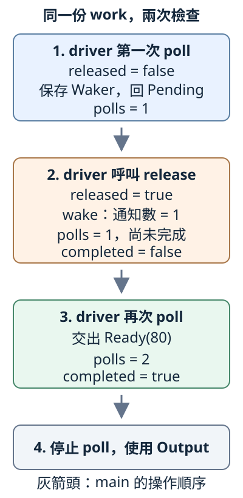

# 16.3 Poll、Context 與 Waker：通知之後，誰再次檢查？

第14.2節先取得 future，await 才取得它的 Output；上一節建立 `Pin<&mut T>` 的介面約定。現在把兩者接起來：一次檢查還不能交出答案時，怎樣留下通知位置？通知之後，又由誰真正再執行？

仍用數字80。這份工作先保存80，等我們明確授權才交出；程式分開觀察 **已授權、已通知、已 poll、已交出 Output**，不把四件事混成「完成」。

## 一次 poll，回答現在能不能交出結果

**poll** 是 Future 的一次檢查：借用工作，觀察或推進目前狀態，交回這次結果。沒有答案時應先交還控制權，不能在裡面等到外部條件成立才返回。

**`std::task::Poll<T>`** 是 enum，T 是工作完成時的結果型別。**`Poll::Pending`** 不帶 T，表示當下還不能交出 Output；**`Poll::Ready(value)`** 帶著完成的結果。沿4.1、4.2的 enum／match，使用端分別安排下一步。

Pending 不是 Option 的 None，也不是業務錯誤。沿14.2，若 Output 是 Result，`Ready(Err(...))` 仍表示工作完成，只是結果失敗；本節 Output 選 i32。

呼叫 poll、接住結果並安排何時再檢查的使用端，稱為 **driver**。一般 runtime／executor 負責安排，本節 main 明寫每次 poll。Pending 後，future 還要安排條件改變時的通知；driver 不能把它當成「立刻一直重試」。忙等占用執行機會，條件卻可能沒變。

## Context 借出通知 handle，Waker 可以保存

**`std::task::Waker`** 是通知 handle，一般用來通知 executor：對應 task 應再次取得執行機會。wake 不代替 poll，也不交出 Output。**`Context<'a>`** 則提供這次檢查使用的 Waker；`'a` 連到原 Waker 的借用來源，不是 future 的存活期或工作耗時。

先固定建立與借用的操作：

- **`Context::from_waker(&waker)`** 借原 Waker 建立 Context，沒有接手 Waker。
- **`cx.waker()`** shared 借用 Context，交回它保存的 `&Waker`。
- **`waker.clone()`** 建立另一份 owned Waker handle，通知同一對象；沒有 clone 那份 future。

Pending 之後要保存的是 owned clone，不能把短借用當成可以延長到任意時間的來源。這份 clone 有自己的通知權限，即使原 Context 結束，仍可保留。

現在讀標準 Future trait 的 poll 介面；下面只有宣告，完整實作稍後提供：

```rust
fn poll(self: Pin<&mut Self>, cx: &mut Context<'_>) -> Poll<Self::Output>;
```

`self` 接手上一節已教的 mutable Pin 借用 wrapper，沒有接手整份 future。`cx` mutable 借用本次 Context；`'_` 請編譯器推導其中 Waker 的借用來源，不表示 static。外層 mutable 借用與 Context 內部來源，是兩項關係。

`Self::Output` 沿6.4與14.2，是實作選定的 associated type，不是值欄位；回傳的 Poll 描述這次檢查結果。`use std::future::Future;` 引入 trait，便能依6.1以點號呼叫它的 method。

## 先做一個只觀察通知的回呼

**WakeCounter** 只計通知次數，不排程、不呼叫 future、不開背景工作。先把「收到通知」做成看得見的資料，再接工作。

**`std::task::Wake`** 是通知回呼 trait，required method 是 **`fn wake(self: Arc<Self>)`**。這次接手的是保活回呼物件的一份 Arc，回傳 unit；body 決定通知時做什麼。

安全的 **`Waker::from(arc)`** 接手 `Arc<W>`，交回 owned Waker。這份 From 實作要求 **`W: Wake + Send + Sync + 'static`**：回呼能通知、可跨 thread 使用、沒有不夠有效的短借用。這是轉換的 bounds，不能當成 Wake trait 自己的全部宣告。

沿13.6，WakeCounter 用 `Mutex<usize>` 保護短暫讀改寫，Arc 保活同一份計數。`new(initial_count)` 建觀察器；`notifications()` shared 借用後短暫 lock、讀副本、解鎖；wake 也只在短 lock 內加一。本節從0開始，只做有限幾次通知，不拿它作任意大次數的計數器。poison 的 expect 仍會 panic，不會修好資料。

本節沿用無 library 的 `ch16-future-stages`。完整設定與預設入口：

```toml
--8<-- "examples/ch13-futures/stages/Cargo.toml"
```

```rust
--8<-- "examples/ch13-futures/stages/src/main.rs"
```

先看 polling module 裡的完整觀察器部分；它用到的名稱來自剛才的 Arc、Mutex 與 Wake，整份 module 稍後列全：

```rust
--8<-- "examples/ch13-futures/stages/examples/manual_poll/polling/mod.rs:observer"
```

main 保留一份 Arc，再把 `Arc::clone(&counter)` 交給 Waker::from；兩份 handle 保活同一個觀察器，不是兩份計數。主程式也不持著觀察器 guard 去呼叫 wake。

## 手動授權工作，保留最近的通知位置

**ManualAmount** 保存五項狀態：數字 value；是否獲准的 released；是否已交出結果的 completed；最近通知的 `Option<Waker>` waiting；已 poll 次數 polls。constructor 立即建立 owned 工作，沒有執行 poll。

這些欄位沒有指回自己的 pointer。i32、bool、usize 及標準 Waker 都有 Unpin，Option 保存 Waker 也保留這項能力，所以本模型可用 `self.get_mut()`，不需要 unsafe getter。這是本型別的性質，不能推成所有 Future 都有 Unpin。

### 先取走 handle，再通知

這裡新增 **`option.take()`**：mutable 借用 `Option<T>`，交回原來的 owned `Option<T>`，原槽改成 None。原本 Some(waker)，就能取走那份 Waker；原本 None，仍交回 None。它沒有 clone T，也沒有產生工作結果。

**`waker.wake()`** 接手 owned Waker，執行通知回呼、回傳 unit。**`waker.wake_by_ref()`** 則 shared 借用 handle 通知，不消耗它；本章稍後會直接使用。兩者都沒有自己呼叫 Future::poll。Wake 的 default wake_by_ref 會 clone Arc，再呼叫 required wake，實作只提供 wake 也可以使用。

本模型的 **`release()`** 先設 released=true，再 take waiting、呼叫 wake。這樣通知後再檢查，才看得到已授權狀態。`is_released()`、`is_completed()`、`poll_count()` 分別 shared 借用並回傳 bool／usize 快照；沒有等待或再 poll。

### Pending 每次保存目前 Context

poll 尚未授權時，保存 `Some(cx.waker().clone())` 再回 Pending。**每次 Pending 都保存本次 Context 的 Waker**，取代舊 handle：同一份工作可能改由另一個通知位置負責，不能永遠只記第一次。

先 release、才首次 poll 時，waiting 原本 None，不用通知，首次就能 Ready。反之，通知後還要 driver 再 poll；通知表示該重新檢查，不保證下一次一定 Ready。

Ready 後，driver 應停止 poll。safe poll 不能因 caller 再次呼叫就造成 UB；標準契約也不要求此時仍給可用結果。本模型選擇明確 panic，讓不正確的重試可辨認。

下面是完整 polling module，含 imports、觀察器、普通 methods 與 Future 實作：

```rust
--8<-- "examples/ch13-futures/stages/examples/manual_poll/polling/mod.rs"
```

poll 只檢查、保存 handle 或交回答案，沒有阻塞等 release，也沒有忙等迴圈。release 和兩次 poll 目前都在同一個 main 依序進行；跨 thread 的狀態同步留給下一節。

## 兩次 poll 中間，只發通知

完整 main 建 Waker／Context，以 `Pin::new(&mut work)` 取得 mutable wrapper，交給 poll。每次借用結束，才用普通 method 觀察 work：

```rust
--8<-- "examples/ch13-futures/stages/examples/manual_poll/main.rs"
```

```bash
cargo run -p ch16-future-stages --example manual_poll --locked
```

```text
建立工作：poll次數=0，通知=0
第1次poll：Pending，已保存目前通知handle
release後：已授權=true，通知=1，poll次數仍=1，已完成=false
driver第2次poll：Ready(80)
完成後：poll次數=2，停止poll
```

第三行資料已授權，通知也到達，poll 次數卻仍是1；下一次 main 真正呼叫 poll，才交出80。觀察器沒有藏一個 executor。

圖中的框是同一份工作的步驟快照，灰箭頭只表示 main 操作順序。released／completed／polls 屬於 work，通知數屬於 counter；第三框明確由 driver 再 poll：



Ready 移交 Output，沒有移交 future 自身的 ownership。main 仍能讀 completed／polls，之後讓 work 正常 Drop；停止 poll 與資料收尾是兩件事。

### 事件先到，可以直接 Ready

下面完整對照把數字改120，先 release 再首次 poll。相同模型的本地 module 和入口一併列出：

??? example "完整 already_ready 程式"

    ```rust
    --8<-- "examples/ch13-futures/stages/examples/already_ready/polling/mod.rs"
    ```

    ```rust
    --8<-- "examples/ch13-futures/stages/examples/already_ready/main.rs"
    ```

```bash
cargo run -p ch16-future-stages --example already_ready --locked
```

輸出 `第1次poll前已授權：Ready(120)`，接著 `poll次數=1，通知=0，停止poll`。不需要每份工作先 Pending、先通知一次，才能完成。

## 練習：第二次 Pending，該通知哪裡？

建立兩個從0開始的 WakeCounter 及各自 Waker／Context，保留同一份80工作。

1. 用第一份 Context poll，得到 Pending。
2. 還沒 release，改用第二份 Context poll，仍是 Pending。
3. release 後預測兩份通知數、poll 次數與 completed；再用第二份 Context poll 取得80並停止。

多做一次受控 Pending，是觀察通知位置更新，不是在寫忙等 driver。兩個觀察器是不同物件；更換 Context 沒有授權資料。

??? example "完整可執行答案"

    完整本地 module 與入口：

    ```rust
    --8<-- "examples/ch13-futures/stages/examples/polling_solution/polling/mod.rs"
    ```

    ```rust
    --8<-- "examples/ch13-futures/stages/examples/polling_solution/main.rs"
    ```

    ```bash
    cargo run -p ch16-future-stages --example polling_solution --locked
    ```

    release 後第一份通知0、第二份1，poll 次數仍2；driver 第3次 poll 才交出 Ready(80)。只保留第一次 Waker，就會通知舊位置。

## 完整測試與完成後的界線

四項 tests 核對通知不等於 poll、首次檢查前授權、最新 Waker，以及 owned clone 在原 Context 結束後仍能通知。完整 module 和 root 如下，沒有 executor helper：

??? example "完整四項測試快照"

    ```rust
    --8<-- "examples/ch13-futures/stages/examples/polling_complete/polling/mod.rs"
    ```

    ```rust
    --8<-- "examples/ch13-futures/stages/examples/polling_complete/main.rs"
    ```

```bash
cargo test -p ch16-future-stages --example polling_complete --locked
```

最後這份獨立 runtime-fail 程式，故意對已 Ready 的工作再 poll。它包含全部當節模型，沒有 library 依賴；先確認能編譯，執行時才預期 panic：

??? example "完整故意失敗程式與診斷字串"

    ```rust
    --8<-- "examples/ch13-futures/stages/fixtures/runtime-fail/poll_after_ready.rs"
    ```

    ```text
    --8<-- "examples/ch13-futures/stages/fixtures/runtime-fail/poll_after_ready.expected"
    ```

診斷含 `ManualAmount 已完成，不應再次 poll`。這驗的是本型別的完成後政策，不宣稱每個 Future 在此時都做相同事。

一般 await 把這項介面串進外層工作；driver 推進 future，future 交回當次狀態，通知提示需要再檢查。第14.3節已提交的 task 又可能在尚未 await JoinHandle 時繼續進展，不能把「handle 尚未 await」當作所有底層工作都沒動。下一節把手動 release 換成受控外部事件，處理登記與通知之間的同步。

延伸閱讀：[Async Book：Task Wakeups](https://rust-lang.github.io/async-book/02_execution/03_wakeups.html)、[中文對應章](https://huangjj27.github.io/async-book/02_execution/03_wakeups.html)、[Future](https://doc.rust-lang.org/std/future/trait.Future.html)、[Waker](https://doc.rust-lang.org/std/task/struct.Waker.html)。外書 timer 的時序不取代本頁的明確控制步驟。

[下一節：外部事件 Future](16-04-lesson.md)
