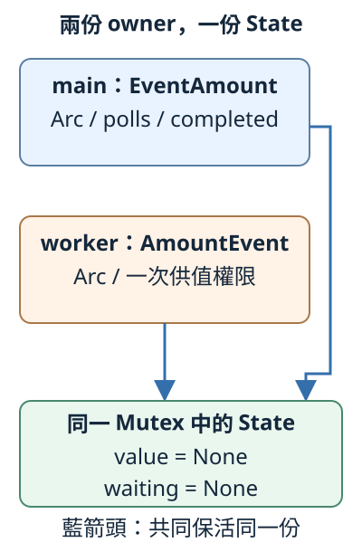
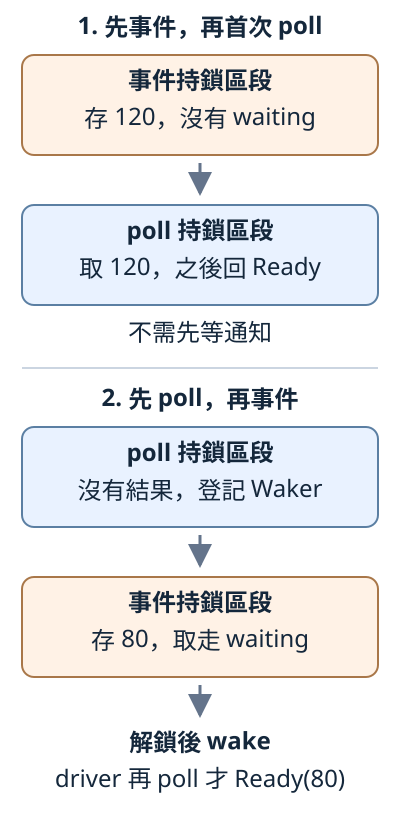

# 16.4 外部事件 Future：檢查與登記之間，不能漏掉通知

上一節 main 直接 release，再自行 poll。現在仍取得80，數值卻由另一個 worker 供應。main 保有 future，worker 保有一次供值 handle；不論誰先執行，main 都應拿到結果。

新問題是：**main 已看到「還沒結果」，事件卻在登記通知前到達，之後還有人叫它再檢查嗎？** 本節用 channel 與 join 控制兩種先後，不用 sleep 猜排程；通知怎樣接到 executor，下一節才處理。

## 兩份 owner，共同保留一份狀態

worker 不持有 future，也不取得它的 mutable reference。沿13.6，兩者以 **`Arc<Mutex<State>>`** 共同保活同一份 State，再用 guard 操作。

**EventAmount** 由 main 持有，保存一份 Arc，以及 completed、polls；後兩項只屬於這份 future。**AmountEvent** 交給 worker，保存另一份 Arc 及一次供值權限。

共同 State 保存 `value: Option<i32>` 與 `waiting: Option<Waker>`。兩者起始 None；Some 數字表示已有待取答案，Some Waker 表示最近一次 Pending 的通知位置。poll 取走數字後 value 又成 None，但 completed 已 true，不能把這份完成的工作當成重新開始。

下圖藍箭頭表示兩份 Arc 共同保活**同一個 Mutex**，沒有複製兩份 State；polls／completed 留在 main，不是共享欄位：



本節仍用無 library 的 `ch16-future-stages`。完整 manifest 與預設入口：

```toml
--8<-- "examples/ch13-futures/stages/Cargo.toml"
```

```rust
--8<-- "examples/ch13-futures/stages/src/main.rs"
```

先看 readiness module 的 imports 與完整狀態宣告；名稱都來自已教的 Future、Pin、Arc／Mutex、Context／Poll／Waker：

```rust
--8<-- "examples/ch13-futures/stages/examples/event_after_poll/readiness/mod.rs:imports"
--8<-- "examples/ch13-futures/stages/examples/event_after_poll/readiness/mod.rs:state"
```

## 建立一對權限，只供值一次

普通函式 **`amount_pair()`** 建一個 State，交回 owned tuple **`(EventAmount, AmountEvent)`**。`let (mut work, event) = amount_pair();` 各接手一份；這個函式沒有開 thread，也沒有 poll。Arc::clone 只增保活權限，不 clone State。

EventAmount 的 `is_completed()`／`poll_count()` 延續上一節，shared 借用後回傳 bool／usize 快照，不等待或取得 State 鎖：

```rust
--8<-- "examples/ch13-futures/stages/examples/event_after_poll/readiness/mod.rs:pair"
```

自訂 **`event.send(value)`** 接收 i32、交回 unit，**取得整份 AmountEvent ownership**，所以同一 handle 只能供一次。它與 std channel 的 Sender::send 不同：前者把答案存進 State，後者稍後只用來把控制數值交給 worker。

AmountEvent 沒有 Clone，也不公開 State 供 caller 任改。send 返回時，該 Arc 正常清理，future 的 Arc 繼續保活 State。**若直接丟棄事件 handle，不供值，不會自動產生 Ready、Err 或通知**。正常例會確定供值並 join；需要辨認供應端提前停止的應用，還要另設結束狀態與結果政策。

## 每次存取都加鎖，仍可能漏通知

假設錯誤做法把「檢查結果」與「登記 Waker」拆成兩段持鎖：

1. main 取得 guard，看到 value=None，解鎖；尚未登記。
2. worker 取得 guard，存80；waiting 仍 None，沒有可通知的 handle，然後解鎖。
3. main 再取得 guard，只登記 Waker，沒有重查結果，就回 Pending。
4. driver 等通知；答案早已到達，卻沒有第二次事件替它通知。

每次讀寫都互斥，工作仍可能永遠等待。**漏通知** 是狀態變化和登記沒有接成可繼續的關係；不執行這個永久等待版本。

正確 poll 在**同一份 guard** 內完成「取到答案，或在沒有答案時登記這次 Waker」。事件端也在同鎖內「存答案、取通知」。其他 thread 無法插進各段中間，因此只有兩種關鍵先後：

- 事件先取得鎖：之後 poll 取 Some，直接 Ready；不必先有通知。
- poll 先取得鎖：看到 None 就在解鎖前登記；事件端之後能取到它，先供值再通知。

圖中一個彩色框就是一次持鎖區段；灰箭頭表示這種鎖先後，不是時間長短。最後的 wake 已在事件持鎖框外：



## 先更新，離鎖後才 wake

沿上一節的 Option::take，事件端從 waiting 取出 owned handle，原槽成 None。內層 block 以這份 Option 作末尾值，交給外面的 waiting；guard 自己留在 block 裡，結尾 Drop 解鎖，之後才 wake：

```rust
--8<-- "examples/ch13-futures/stages/examples/event_after_poll/readiness/mod.rs:event"
```

通知回呼由 driver 提供，可能再取得 State 鎖。若持同一鎖去叫它，就可能回到13.6的等待循環：回呼等解鎖，持鎖端卻等回呼返回。先存值、取 handle、解鎖，再通知，接到通知的使用端也才能取得鎖觀察狀態。

### poll 取走結果，或保存最新 handle

EventAmount 的欄位只有 Arc handle、bool、usize，都有 Unpin。**Arc handle 的 Unpin 不要求 State 有 Unpin**，要和它指向的資料分開；這個 future 可用 get_mut。

這裡的 **`option.is_none()`** shared 借用 Option，回 bool：None 為 true，Some 為 false，不取走或修改值。本例檢查的是已從 State 取出的 answer，不是解鎖後再偷讀 State。

poll 在鎖外 clone 本次 Waker；在同一 guard 裡 take 答案、take 舊通知，沒有答案才登記新 handle。block 交出 `(answer, previous_waiting)`，兩項都是 owned 值，沒有 guard。舊 handle 的 Drop 也在解鎖後，避免把回呼物件清理混進 State 持鎖區段。每次 Pending 都保存本次通知位置。

完整 Future 實作如下；Ready 後再次 poll 仍採上一節的明確 panic 政策，safe 呼叫不能因此允許 UB：

```rust
--8<-- "examples/ch13-futures/stages/examples/event_after_poll/readiness/mod.rs:future"
```

Mutex 競爭仍可能讓呼叫 thread 等鎖，不能把這份模型稱為 lock-free 或完全不 blocking。持鎖區段只有短狀態操作，沒有 recv、join、等待事件、I/O 或通知回呼；expect 檢查有限正常條件，poison 仍會 panic。

## 先 poll，再允許 worker 供80

main 建立 std **控制 channel**：`mpsc::channel::<i32>()`，自己保留 Sender，worker 接手 Receiver 及 AmountEvent。worker recv 到80才 event.send(80)。buffer 保存已送控制值，不用猜它是不是先跑到 recv。

work 留在 main；State 的 i32／Waker 有 Send，Mutex 因而有 Send／Sync，Arc 能交給 worker。這些 owned 資料沒有短局部借用，符合普通 spawn 的 static bound。main 仍用上一節 WakeCounter，通知只計數，不安排 poll。

以下是這份 target 實際載入的完整觀察器與完整 readiness module：

??? example "完整本地 helpers"

    ```rust
    --8<-- "examples/ch13-futures/stages/examples/event_after_poll/polling/mod.rs"
    ```

    ```rust
    --8<-- "examples/ch13-futures/stages/examples/event_after_poll/readiness/mod.rs"
    ```

main 先得到 Pending，才送控制值、join worker，最後明確再 poll。recv 等待在 worker，join 等待在 main 的 driver 流程，都不放進 Future::poll：

```rust
--8<-- "examples/ch13-futures/stages/examples/event_after_poll/main.rs"
```

```bash
cargo run -p ch16-future-stages --example event_after_poll --locked
```

```text
先poll：Pending，已登記通知位置
worker已供值並收尾：通知=1，poll次數仍=1，已完成=false
driver第2次poll：Ready(80)，停止poll
```

第二行已通知、worker 也收尾，但 future 尚未再 poll。join 確認 worker 及回呼返回，沒有替 future 交出80；是 main 下一次 poll 才取得結果。

### 先供120，再首次 poll

反過來，先 spawn 供120並 join，然後首次 poll。此時事件必已完成，先前沒有 Pending，waiting 還是 None，通知數為0。完整 helpers 與入口：

??? example "完整 event_before_poll 程式"

    ```rust
    --8<-- "examples/ch13-futures/stages/examples/event_before_poll/polling/mod.rs"
    ```

    ```rust
    --8<-- "examples/ch13-futures/stages/examples/event_before_poll/readiness/mod.rs"
    ```

    ```rust
    --8<-- "examples/ch13-futures/stages/examples/event_before_poll/main.rs"
    ```

```bash
cargo run -p ch16-future-stages --example event_before_poll --locked
```

輸出 `先事件：已供120，worker已收尾，通知=0，poll次數=0`，再印 `driver首次poll：Ready(120)，停止poll`。數字不同是兩份獨立工作；不用先有 wake 才能第一次檢查。

## 練習：外部事件通知最近的使用端

建立兩份 WakeCounter、各自 Context，以及同一份80工作與控制 channel。送控制值之前，依序用兩份 Context poll，都是 Pending；再供80、join。預測兩份通知數與 work 狀態，最後用第二份 Context poll 取得80。

??? example "完整可執行答案"

    ```rust
    --8<-- "examples/ch13-futures/stages/examples/event_solution/polling/mod.rs"
    ```

    ```rust
    --8<-- "examples/ch13-futures/stages/examples/event_solution/readiness/mod.rs"
    ```

    ```rust
    --8<-- "examples/ch13-futures/stages/examples/event_solution/main.rs"
    ```

    ```bash
    cargo run -p ch16-future-stages --example event_solution --locked
    ```

    worker 收尾後，第一份通知0、第二份1，poll 次數仍2、completed=false。第3次 poll 才交出80。事件取的是 State 最後保存的 owned Waker；更換 Context 沒有供值。

## 完整測試：回呼能再次取得 State 鎖

四項 tests 核對先 poll／先事件、最新 Waker，以及離鎖回呼。前三項只用已教公開介面；第四項的 **ReadinessObserver** 連到同一 State，另用 Mutex 保存觀察的 `Option<i32>`。

回呼先鎖 State、讀答案副本、解鎖，再鎖自己的觀察欄位存副本，不呼叫 poll。沿6.3，i32 有 Copy，`Option<i32>` 也有 Copy，所以讀取沒有取走 future 的答案。測試子 module 可讀父 module 私有 State；沒有把它公開給一般 caller。

下面是完整快照，包含全部 imports、helper、四 tests 及 root：

??? example "完整事件測試快照"

    ```rust
    --8<-- "examples/ch13-futures/stages/examples/readiness_complete/polling/mod.rs"
    ```

    ```rust
    --8<-- "examples/ch13-futures/stages/examples/readiness_complete/readiness/mod.rs"
    ```

    ```rust
    --8<-- "examples/ch13-futures/stages/examples/readiness_complete/main.rs"
    ```

```bash
cargo test -p ch16-future-stages --example readiness_complete --locked
```

回呼實際讀到0，worker join 後，main 再 poll 仍取得0。這驗本實作的關係，沒有用一次通過推得所有同步都安全；一般理由仍是前面的同 guard 操作與鎖外回呼。

最後這份完整 compile-fail 含同樣的 readiness module，只想供值兩次：

??? example "完整一次供值負例與診斷字串"

    ```rust
    --8<-- "examples/ch13-futures/stages/fixtures/compile-fail/event_send_once.rs"
    ```

    ```text
    --8<-- "examples/ch13-futures/stages/fixtures/compile-fail/event_send_once.expected"
    ```

得到 `E0382`：第一次 send 接手 event，第二次不能再使用。這是自訂按值介面的政策，不是 std Sender 的限制；13.5 的 Sender::send 借用傳送端，仍可送下一筆。

本節 main 仍自行安排 join 與再 poll。丟棄 future 不會強制停止外部 thread，因此我們保留 handle 並 join；下一節把通知接到有限 executor 的再次檢查。

延伸閱讀：[Async Book 的共享狀態通知](https://rust-lang.github.io/async-book/02_execution/03_wakeups.html)、[中文對應章](https://huangjj27.github.io/async-book/02_execution/03_wakeups.html)、[Mutex::lock](https://doc.rust-lang.org/std/sync/struct.Mutex.html#method.lock)。本頁的同鎖登記與鎖外回呼，仍須依各自的持鎖範圍理解。

[下一節：小型 executor](16-05-lesson.md)
