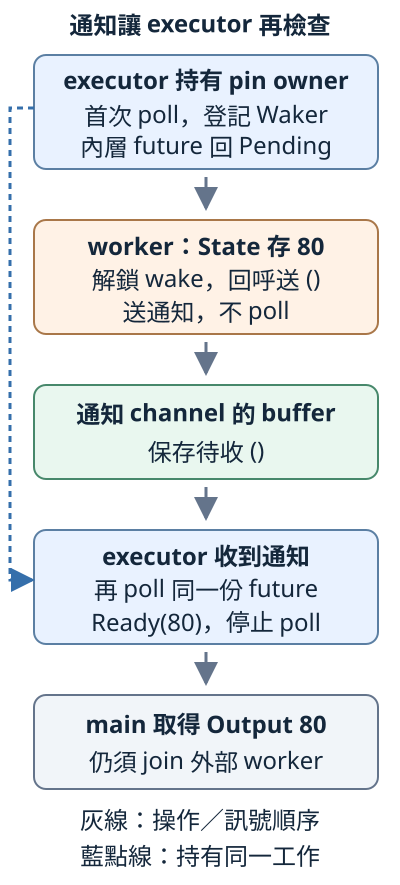

# 16.5 小型 executor：收到通知，再安排下一次 poll

上一節已有外部事件 Future，main 卻仍先 join，再自行 poll。現在把「何時重新檢查」交給一個小型 **executor（執行器）**：它接手一份工作，先 poll；Pending 時等通知，收到後再 poll；Ready 時交回答案並停止。

事件仍供80，同鎖登記規則不變。這次改的是 driver 的安排，不是 State 如何保存結果。第14.2節頂層 future 需要被推進的責任，現在由這個有限同步流程承擔。

## 只有一份工作，通知不必攜帶 future

executor 已知道自己要檢查哪一份工作，通知 channel 只傳 **unit `()`**，意義是「請再檢查」。它不是數字80，也不是另一份 future ownership。

沿13.5，**`mpsc::channel::<()>()`** 回傳 `Sender<()>`／`Receiver<()>`，buffer 保留尚未取走的訊息。wake 就算先於 recv，通知也能留待收取；空 buffer 且 Sender 仍存在時，recv 會 blocking 等訊息，不是一直重新 poll。

**ChannelWake** 回呼持有一份 `Sender<()>`，wake 只送 unit，不持有 future、不 poll。unit 有 Send，`Sender<()>` 有 Send／Sync，也沒有短局部借用，因此滿足16.3的 Waker::from 所需 bounds；不是要求 future 也移給 worker。

send 不為 buffer 空位等待，也不等接收方取走訊息。Receiver 已清理時會 Err；這份回呼選擇保留在不再使用的 `_delivery`，忽略失敗，因為 driver 已結束就不需再安排它。沒有 panic、重試或強制取消外部 worker。這不是聲稱 channel 內部 lock-free。

早期仍用無 library 的 `ch16-future-stages`，完整設定與預設入口如下：

```toml
--8<-- "examples/ch13-futures/stages/Cargo.toml"
```

```rust
--8<-- "examples/ch13-futures/stages/src/main.rs"
```

## 接手 owned 工作，保留位置，再等待通知

自訂 **`run_one<F: Future>(work: F) -> F::Output`** 沿5.1的泛型及6.4的 associated type：F 是這次呼叫的具體工作型別，bound 讓 driver 能呼叫 poll；`F::Output` 是該實作選定的結果型別。它接手 owned F，正常完成時交回 Output。

work 只留在呼叫 thread，沒有移交到 thread::spawn，**不另外要求 `F: Send` 或 `'static`**。通知回呼可以跨 thread，與 future 本身在哪裡被 poll，是兩項不同責任。

`Box::pin(work)` 取得 `Pin<Box<F>>` owner；每次 `as_mut()` 借出 `Pin<&mut F>`，交給 poll。這條 safe 路徑**不要求 F 有 Unpin**，也不取得可能移出 F 的普通 mutable reference。

Pending 後的 recv 在 **driver 裡、poll 返回以後**才執行，沒有塞進 Future::poll。收到通知回到 loop，再借用同一工作、再 poll。Ready 分支直接 return Output，不再等通知或 poll；局部 owner／Context／Receiver 依正常流程清理。

### 先讓內層登記，再啟動事件

若一開始就讓 worker 供值，第一次 poll 可能直接 Ready；這合法，卻看不到通知循環。因此用具體 **StartAmount** wrapper 建立受控先後。

`StartAmount::new(work, start, value)` 接手已教的 EventAmount、控制 `Sender<i32>` 及數字。它只保存資料，不啟動 worker 或傳送。poll 先用同一 Context 檢查內層工作；首次 Pending 表示已完成16.4的通知登記，這時才 take 控制 Sender、send 數字，再回 Pending。start 成 None，後續不重送；內層 Ready 就交回相同數字。

EventAmount、Sender handle、Option 及 i32 有 Unpin，所以此 wrapper 能用 get_mut；內層 EventAmount 也有 Unpin，才能用 `Pin::new(&mut inner.work)`。這不是任意地址敏感內部 future 都能照抄的 projection。

控制 send 不等 worker 完成；worker recv 後再 event.send。**控制 channel 傳 i32，通知 channel 傳 unit，是兩份不同 channel。** poll 裡沒有 recv 或 join。

下面是第一份 target 的完整本地 helpers。runner 只有通知回呼、run_one 與 StartAmount，尚未載後面的對照型別：

??? example "完整事件與driver helpers"

    ```rust
    --8<-- "examples/ch13-futures/stages/examples/executor_event/readiness/mod.rs"
    ```

    ```rust
    --8<-- "examples/ch13-futures/stages/examples/executor_event/runner/mod.rs"
    ```

完整 main 建立事件與控制 channel，worker 接手事件 handle／控制收端；main 把工作與控制送端交給 run_one。取得 Output 後，仍另外 join 外部 worker：

```rust
--8<-- "examples/ch13-futures/stages/examples/executor_event/main.rs"
```

```bash
cargo run -p ch16-future-stages --example executor_event --locked
```

```text
executor：poll
executor：Pending，等待通知
executor：收到通知，安排再poll
executor：poll
executor：Ready，停止poll
main收到答案=80
worker已收尾
```

首次 Pending 必定發生，因為控制值在內層登記後才送。worker wake 可以早於或晚於 driver 開始 recv，buffer 都能保留訊息；輸出沒有量測哪種排程。Ready 讓 main 取得80，worker 卻可能還在離開 send 的收尾，所以仍須 join 才說它已結束。

圖中橘框是事件／回呼，綠框是通知 buffer，藍框是 executor 操作。灰箭頭表示操作或訊號順序；藍點線表示 executor 一直持有同一份工作。unit 通知沒有帶走 future，也沒有帶80：



## 通知早於 recv，仍然能再檢查

**Recheck** 只有 i32 與 bool，具備 Unpin。`new(value)` 保存數字，requested 起始 false；第一次 poll 先設 true，呼叫16.3的 **`cx.waker().wake_by_ref()`**，再回 Pending；下一次才 Ready。

這個通知在 poll 返回前已送入 channel，driver 之後 recv 仍能取得。Wake 的 default wake_by_ref clone Arc、再呼叫 ChannelWake::wake，仍只送 unit，沒有在回呼內再次執行 Recheck。

完整 target 的 runner 只需通知、driver、Recheck；沒有 EventAmount 或外部 thread：

??? example "完整先通知對照"

    ```rust
    --8<-- "examples/ch13-futures/stages/examples/executor_early_notice/runner/mod.rs"
    ```

    ```rust
    --8<-- "examples/ch13-futures/stages/examples/executor_early_notice/main.rs"
    ```

```bash
cargo run -p ch16-future-stages --example executor_early_notice --locked
```

同樣有兩次 poll 循環，最後印 `poll內先通知，main仍收到答案=120`。這是 buffer 關係，不靠 sleep 或猜測訊號已到。

## driver 不需要 F 有 Unpin

**PinnedAnswer** 保存 i32 與 PhantomPinned，沒有 Unpin 實作；marker 在這裡只驗介面能力，不表示數字模型真的自引用。new 建普通 owned 值，尚未 pin 時仍能交接。

poll 由 `self.as_ref().get_ref()` 取得 shared reference，讀 i32 副本、直接 Ready；不需 mutable getter 或 unsafe，也不需通知。完整 runner 與入口：

??? example "完整沒有Unpin的對照"

    ```rust
    --8<-- "examples/ch13-futures/stages/examples/executor_pinned/runner/mod.rs"
    ```

    ```rust
    --8<-- "examples/ch13-futures/stages/examples/executor_pinned/main.rs"
    ```

```bash
cargo run -p ch16-future-stages --example executor_pinned --locked
```

只印一次 poll 與 Ready，最後 `沒有Unpin的future，main收到答案=0`，沒有進入 recv。Box::pin 提供共用介面，不是讓每份工作都必須先等待，也沒有使內部 F 取得 Unpin。

## 練習：同一分工，改供120

沿第一個外部事件程式，只把 StartAmount 控制數值改120。預測兩個 channel 各傳什麼、誰再次 poll，以及 run_one 返回後為何仍要 join；不改 EventAmount 或 AmountEvent。

??? example "完整可執行答案"

    ```rust
    --8<-- "examples/ch13-futures/stages/examples/executor_solution/readiness/mod.rs"
    ```

    ```rust
    --8<-- "examples/ch13-futures/stages/examples/executor_solution/runner/mod.rs"
    ```

    ```rust
    --8<-- "examples/ch13-futures/stages/examples/executor_solution/main.rs"
    ```

    ```bash
    cargo run -p ch16-future-stages --example executor_solution --locked
    ```

    控制 channel 交120給 worker，通知 channel 仍只送 unit。兩次 poll 後 main 取得120，再 join；誰供值、誰通知、誰執行的責任不變。

## 能完成什麼，也要說清不能繼續的條件

run_one 的 Waker 保活 ChannelWake 及 Sender。**供值端消失，不代表通知 channel 已關閉**：若 AmountEvent 被丟棄而未供值，future 可能仍 Pending，通知 Sender 卻還活著，因此 recv 可以繼續等待。expect 沒有製造訊息、業務錯誤或逾時；不執行永遠 Pending 的工作來等待它自行結束。

收到通知再 poll，也可能仍 Pending；future 要繼續安排之後的通知，driver 則繼續等待。Ready 時即使還有舊通知，也立刻停止，不為清空佇列而重 poll 已完成工作。

標準 Waker 允許多次通知被合併成一次後續檢查，wake 不是一通知必交一份答案，也不保證別的 task 一定先取得執行機會。這份 driver **只有一份工作，沒有多工作公平排程承諾**。原 State 的短 Mutex 仍可能等鎖；這不是通用效能或完成保證。

它沒有一般取消／逾時、Tokio I/O 或 timer 支援，也沒有 thread pool。第14章選用 Tokio 的程式，仍需要相應 runtime 環境，不能任意換成這份 std-only driver。

## 接回完整 library，保留所有原測試

現在地址模型、Pin、通知、事件與 driver 都已教完，可以使用原 **`ch13-futures`** package。前面的 stage 快照永久保留；下面改由完整 library 提供相同介面，名稱中的 ch13 是既有 package 名，不是本章號。

完整 manifest 與 library root 如下。root 一次宣告五個 module，因此到這裡才讓它參與編譯，不能只靠選早期 example 或篩測試名略過後段：

```toml
--8<-- "examples/ch13-futures/Cargo.toml"
```

```rust
--8<-- "examples/ch13-futures/src/lib.rs"
```

五份完整 module 含原有18 tests：地址4、Pin3、通知4、事件4、executor3。最後三項分別核對登記後的外部通知、poll 內通知不丟失、沒有 Unpin 的工作；全部 helpers 與其 imports 都在下方，worker 仍 join。

??? example "完整五個library modules與18 tests"

    ```rust
    --8<-- "examples/ch13-futures/src/addresses.rs"
    ```

    ```rust
    --8<-- "examples/ch13-futures/src/pinning.rs"
    ```

    ```rust
    --8<-- "examples/ch13-futures/src/polling.rs"
    ```

    ```rust
    --8<-- "examples/ch13-futures/src/readiness.rs"
    ```

    ```rust
    --8<-- "examples/ch13-futures/src/runner.rs"
    ```

```bash
cargo test -p ch13-futures --lib --locked
```

### 完整 library 的四個 executor 入口

這些是前面三個對照與完整答案使用 library 的版本，沒有額外 helper：

??? example "完整四個入口"

    ```rust
    --8<-- "examples/ch13-futures/examples/executor_event.rs"
    ```

    ```rust
    --8<-- "examples/ch13-futures/examples/executor_early_notice.rs"
    ```

    ```rust
    --8<-- "examples/ch13-futures/examples/executor_pinned.rs"
    ```

    ```rust
    --8<-- "examples/ch13-futures/examples/executor_solution.rs"
    ```

```bash
cargo run -p ch13-futures --example executor_event --locked
cargo run -p ch13-futures --example executor_early_notice --locked
cargo run -p ch13-futures --example executor_pinned --locked
cargo run -p ch13-futures --example executor_solution --locked
```

結果仍分別為80、120、0與練習120。其餘12個原入口也保留，行為對應前四節快照；以下收完整檔案，切換 package 時可核對實際路徑：

??? example "完整地址、Pin、poll與事件的library入口"

    ```rust
    --8<-- "examples/ch13-futures/examples/inline_swap.rs"
    ```

    ```rust
    --8<-- "examples/ch13-futures/examples/box_handles.rs"
    ```

    ```rust
    --8<-- "examples/ch13-futures/examples/field_swap_solution.rs"
    ```

    ```rust
    --8<-- "examples/ch13-futures/examples/unpin_access.rs"
    ```

    ```rust
    --8<-- "examples/ch13-futures/examples/pinned_owner_swap.rs"
    ```

    ```rust
    --8<-- "examples/ch13-futures/examples/pinning_solution.rs"
    ```

    ```rust
    --8<-- "examples/ch13-futures/examples/manual_poll.rs"
    ```

    ```rust
    --8<-- "examples/ch13-futures/examples/already_ready.rs"
    ```

    ```rust
    --8<-- "examples/ch13-futures/examples/polling_solution.rs"
    ```

    ```rust
    --8<-- "examples/ch13-futures/examples/event_after_poll.rs"
    ```

    ```rust
    --8<-- "examples/ch13-futures/examples/event_before_poll.rs"
    ```

    ```rust
    --8<-- "examples/ch13-futures/examples/event_solution.rs"
    ```

### 真正跨 crate 的失敗界線

下面獨立 fixture manifest 以 path dependency 連完整 library，`[workspace]` 表示自己的 workspace 根；第12.1節的設定分工不變。它只放故意不能編譯的 examples，與正常 package 分開。完整設定、兩個程式及 sidecars：

??? example "完整cross-crate fixtures"

    ```toml
    --8<-- "examples/ch13-futures/fixtures/cross-crate-fail/Cargo.toml"
    ```

    ```rust
    --8<-- "examples/ch13-futures/fixtures/cross-crate-fail/examples/pinned_get_mut.rs"
    ```

    ```text
    --8<-- "examples/ch13-futures/fixtures/cross-crate-fail/examples/pinned_get_mut.expected"
    ```

    ```rust
    --8<-- "examples/ch13-futures/fixtures/cross-crate-fail/examples/event_send_once.rs"
    ```

    ```text
    --8<-- "examples/ch13-futures/fixtures/cross-crate-fail/examples/event_send_once.expected"
    ```

```bash
cargo check --manifest-path examples/ch13-futures/fixtures/cross-crate-fail/Cargo.toml --example pinned_get_mut --locked
cargo check --manifest-path examples/ch13-futures/fixtures/cross-crate-fail/Cargo.toml --example event_send_once --locked
```

兩條預期失敗，分別含 E0277、E0382。它們使用真正 library 的 public 介面，驗16.2的 mutable 取得限制及16.4的一次供值 ownership，沒有執行錯誤交換。

原本不需 library 的兩份負例與 sidecars 也完整保留：

??? example "完整reference與Unpin負例"

    ```rust
    --8<-- "examples/ch13-futures/fixtures/compile-fail/reference_blocks_swap.rs"
    ```

    ```text
    --8<-- "examples/ch13-futures/fixtures/compile-fail/reference_blocks_swap.expected"
    ```

    ```rust
    --8<-- "examples/ch13-futures/fixtures/compile-fail/pin_new_requires_unpin.rs"
    ```

    ```text
    --8<-- "examples/ch13-futures/fixtures/compile-fail/pin_new_requires_unpin.expected"
    ```

### 完成後再次 poll 的 integration fixture

最後保留同一 library 的故意失敗 integration test。完整 manifest、測試與診斷字串如下，政策仍是16.3已教的 panic：

??? example "完整cargo-test-fail fixture"

    ```toml
    --8<-- "examples/ch13-futures/fixtures/cargo-test-fail/Cargo.toml"
    ```

    ```rust
    --8<-- "examples/ch13-futures/fixtures/cargo-test-fail/tests/poll_after_ready.rs"
    ```

    ```text
    --8<-- "examples/ch13-futures/fixtures/cargo-test-fail/tests/poll_after_ready.expected"
    ```

這兩份獨立 fixture workspace 的 Cargo.lock 都由 Cargo 生成，保存解析結果；沿1.3／12.1的角色，不手動編輯。完整生成檔供對照：

??? example "完整fixture lockfiles"

    ```toml
    --8<-- "examples/ch13-futures/fixtures/cross-crate-fail/Cargo.lock"
    ```

    ```toml
    --8<-- "examples/ch13-futures/fixtures/cargo-test-fail/Cargo.lock"
    ```

**`--no-run`** 讓 cargo test 只編譯、不執行。先以它確認不是編譯失敗，再執行同一個 `--test poll_after_ready` integration target：

```bash
cargo test --manifest-path examples/ch13-futures/fixtures/cargo-test-fail/Cargo.toml --test poll_after_ready --locked --no-run
cargo test --manifest-path examples/ch13-futures/fixtures/cargo-test-fail/Cargo.toml --test poll_after_ready --locked
```

第一條成功，第二條預期失敗、診斷含 `ManualAmount 已完成，不應再次 poll`。Cargo 的測試 harness 可能把 panic 診斷放在測試輸出中；確認的是指定原因，不是任意非零退出。

本章接回同一條分工：future 保存狀態及提供 Output，事件端更新資料並通知，executor 保有工作、接收通知、安排再次 poll。Pin 保留需要的位置關係；Waker 保活通知位置，沒有替 future 執行、延長任意借用或修正地址。應用使用 runtime 時，仍須依它提供的環境與收尾契約安排工作。

延伸閱讀：[Async Book：Build an Executor](https://rust-lang.github.io/async-book/02_execution/04_executor.html)、[中文對應章](https://huangjj27.github.io/async-book/02_execution/04_executor.html)、[Waker::wake 的重新執行與公平性界線](https://doc.rust-lang.org/std/task/struct.Waker.html#method.wake)。外書的多工作排程與第三方 helper 超過本章這份單工作模型。
