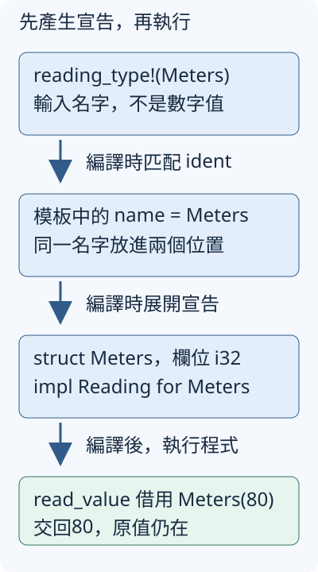

# 17.1 用 macro_rules! 產生已看懂的 Rust 宣告

10.9 已把程式分成可重用的型別與函式，11.10 又用 Meters、Seconds 保護單位。接下來有更多單位，每個型別都包一個 i32，也都需要「借讀數字，不接手原值」的介面。我們想保留各自的型別身分，同時少維護幾份相同的 struct／impl 樣板。

本節先把普通 Rust 答案寫清楚，再用 **declarative macro（宣告式 macro）** 依輸入的語法產生相同宣告。`println!`、`vec!` 已讓我們使用過 macro；這次開始定義自己的規則。使用 `examples/macro-basics`，package 名稱為 `macro-basics`，library 路徑沿 2.6 寫成 `macro_basics`。以下指令從 repo 根目錄執行。

## 先固定要保留的資料與介面

Meters(80) 是路程，Seconds(30) 是等待。它們仍是兩個不同 newtype；共用的 **Reading** 只承諾借讀一個 i32，沒有承諾能把不同單位相加或互傳。`read_value` 沿 6.1 的泛型 bound，只接收提供這項能力的型別。

本頁使用的完整 manifest 沿第 12.1 節採用教材根的共同欄位，沒有 dependency：

```toml
--8<-- "examples/macro-basics/Cargo.toml"
```

這份 library 的完整 `src/lib.rs` 只有 Reading 與普通讀取函式，不會載入下一節的 export 或 hygiene 規則：

```rust
--8<-- "examples/macro-basics/src/lib.rs"
```

先在 example 手寫兩份實作。`Reading` 由 `use macro_basics::Reading;` 引入；型別定義在 example 自己的 crate，所以能為它們實作這個 trait，符合 11.10 的本地型別規則。Debug／PartialEq 沿 6.2 讓我們觀察原值；沒有選 Copy：

```rust
--8<-- "examples/macro-basics/examples/manual_readings.rs:manual-types"
```

`&self` 保留 wrapper 的 ownership，`.0` 讀出 Copy 的 i32。下面的 main 另以 `use macro_basics::read_value;` 引入共用函式。先讀數字，再觀察原型別仍在：

```rust
--8<-- "examples/macro-basics/examples/manual_readings.rs:observe"
```

這個階段的完整 `examples/manual_readings.rs` 如下，包含已說明的 use、宣告與 main：

??? example "展開完整程式"

    ```rust
    --8<-- "examples/macro-basics/examples/manual_readings.rs"
    ```

```bash
cargo run -p macro-basics --example manual_readings --locked
```

```text
路程數字=80，等待數字=30
借讀後原值仍在：Meters(80)、Seconds(30)
```

普通函式已能處理這份工作，泛型也能重用讀取邏輯。重複的是上面的**型別與實作宣告**：若下一個單位也有同樣的 i32 欄位，每次都要再次寫出這份樣板。我們要改變的是宣告的來源，保留原本的型別邊界與借讀行為。

## 一條規則：接收型別名字，產生 struct 與 impl

**macro expansion（展開）** 是編譯時依 macro 規則產生 Rust 語法的步驟；產生的 Rust 仍要通過型別與 ownership 檢查。它不是程式啟動後用字串決定新型別。

`macro_rules!` 定義一組規則。這裡將 macro 取名 `reading_type`，定義時名字後不加 `!`，呼叫時才寫 `reading_type!(...)`。一條規則由輸入模式、`=>`、展開樣板組成；規則後的分號結束這一條規則。

本次只接受一個型別名字：

| 規則中的部分 | 本次意義 |
| --- | --- |
| `($name:ident)` | 輸入是一個 identifier（識別字），例如 Meters；`ident` 指定匹配的語法種類 |
| `$name` | 保存匹配到的語法片段的名稱，稱為 metavariable；不是 `let` 建立的 runtime 變數 |
| `=> { ... }` | 匹配成功後，使用這份樣板產生 Rust 宣告 |
| 樣板中的 `$name` | 放入剛取得的名字；這裡 struct 與 impl 使用同一個名字 |

identifier、標點與 literal 都是編譯器辨認的 **token（語法記號）**。macro 匹配的是這些語法，不是先執行輸入、再像普通 match 一樣比較結果值。

現在才定義規則。下面的 example 已先引入 Reading，產生的 impl 使用相同 trait：

```rust
--8<-- "examples/macro-basics/examples/reading_single.rs:single-rule"
```

把定義放在呼叫之前。本節在同一個 example 內使用，先依這個前後順序找 macro；下一節再教跨 crate 的名稱來源：

```rust
--8<-- "examples/macro-basics/examples/reading_single.rs:single-call"
```

第一個呼叫讓 `$name` 是 Meters，產生手寫版第一組 struct／impl；第二個讓它是 Seconds，產生第二組。圖中的前兩條箭頭都發生在編譯時；最後才是讀者執行程式、借讀數字的工作：



使用與手寫版相同的 main，原需求沒有改：

```rust
--8<-- "examples/macro-basics/examples/reading_single.rs:observe"
```

這個階段的完整 `examples/reading_single.rs` 如下，包含已說明的 use、宣告與 main：

??? example "展開完整程式"

    ```rust
    --8<-- "examples/macro-basics/examples/reading_single.rs"
    ```

```bash
cargo run -p macro-basics --example reading_single --locked
```

輸出仍是上面的兩行。模板省去第二份手寫 body，沒有讓 Meters 與 Seconds 變成同型別，也沒有替它們增加 Copy 或單位換算。

普通函式可以接收 slice 或 Vec，處理數量不同的資料；這不是非用 macro 不可的理由。本例要重用的是**輸入名字對應的 Rust 宣告**。macro 能把同一份語法樣板用在不同名字上，代價則是讀者還要追蹤輸入與展開，定義通常比普通函式難讀。

## 一份清單：重複匹配與重複展開

再增加已熟悉的 Millimeters，同樣包一個 i32、提供 Reading。此時想在一次呼叫中列出三個名字，仍為每個名字產生獨立型別。

**repetition（重複）** 用 `$(...)` 圈出一組待重複的語法，再以操作符指定次數：`+` 是至少一次，`*` 是零次或更多，`?` 是零次或一次。它們在 macro 規則中控制語法匹配與展開，不是 Rust 的數值加法或 8.6 的錯誤傳遞。

本例採至少一個名字、逗號分隔，並接受一個可選尾逗號：

| 輸入部分 | 接受什麼 |
| --- | --- |
| `$($name:ident),+` | 一個以上 identifier，以逗號分隔，例如 `Meters, Seconds` |
| `$(,)?` | 最後再接受零或一個逗號；這裡的逗號就是被匹配的內容 |

樣板也用 `$(...)+` 包住 struct／impl。每次匹配得到一個 `$name`，就展開一組；輸入與樣板保持相同的重複層次與 `+`。這次只重複一層，不引入巢狀清單：

```rust
--8<-- "examples/macro-basics/examples/reading_many.rs:repeat-rule"
```

```rust
--8<-- "examples/macro-basics/examples/reading_many.rs:repeat-call"
```

展開後是 Meters、Seconds、Millimeters 的三組宣告。沒有把這三個名字放進 runtime Vec，清單的用途是決定要產生哪幾組原始碼：

```rust
--8<-- "examples/macro-basics/examples/reading_many.rs:observe"
```

這個階段的完整 `examples/reading_many.rs` 如下，包含已說明的 use、宣告與 main：

??? example "展開完整程式"

    ```rust
    --8<-- "examples/macro-basics/examples/reading_many.rs"
    ```

下面的 `run` 執行這個 example 的 `main`；`test --example reading_many` 則用測試執行器跑該目標的單元測試，不執行它原本的 `main`。

```bash
cargo run -p macro-basics --example reading_many --locked
cargo test -p macro-basics --example reading_many --locked
```

前兩個數字仍是80、30，新增一行 `毫米數字=500`。測試另外借讀零與負數，再使用原 wrapper：這個模板只產生型別與取值介面，不做非負驗證，也不消耗原值。11.10 已區分型別身分與數值驗證，不能因生成了 newtype 就假定兩項都完成。

## 分清楚輸入不匹配與展開後型別不符

如果把80當成型別名字，`ident` 不接受這個數字 literal。下面的失敗範例只保留產生 struct 的樣板，隔離輸入匹配問題：

```rust
--8<-- "examples/macro-basics/fixtures/compile-fail/reading_bad_name.rs"
```

```text
--8<-- "examples/macro-basics/fixtures/compile-fail/reading_bad_name.expected"
```

診斷包含 `no rules expected`，此時沒有匹配到那條規則。repetition 的 `+` 也不接受空呼叫 `reading_types!()`，對應完整 fixture 如下，訊息包含 `unexpected end of macro invocation`：

```rust
--8<-- "examples/macro-basics/fixtures/compile-fail/reading_empty.rs"
```

```text
--8<-- "examples/macro-basics/fixtures/compile-fail/reading_empty.expected"
```

若兩個名字都合法，卻把等待時間交給需要路程的函式，macro 可以成功展開，生成的普通 Rust 仍會得到 11.10 熟悉的 `E0308`：

```rust
--8<-- "examples/macro-basics/fixtures/compile-fail/reading_wrong_unit.rs"
```

```text
--8<-- "examples/macro-basics/fixtures/compile-fail/reading_wrong_unit.expected"
```

三份負例都是獨立檔，可沿第 12.1 節用 `rustc --edition=2024 檔案路徑 -o target/失敗範例` 單獨編譯；預期失敗，不放進正常的 Cargo example targets。

兩種失敗回答不同問題：前者是呼叫語法能否匹配，後者是產生的程式能否滿足型別契約。Reading 的共用取值能力沒有取消 distance_value 對 Meters 的要求。

## 練習：讓空清單也能成立

修改本節 repetition macro，允許零個名字：把輸入與樣板兩處的 `+` 改成已教的 `*`。保留可選尾逗號。先執行空呼叫，再產生原本的 Meters、Seconds，確認共用讀取仍得到80、30。

空呼叫應不產生任何 struct／impl，不能額外建立一個假型別，也不能產生只剩下部分語法的 impl。這份規則也會接受單獨一個逗號：名字重複零次、可選逗號出現一次，仍是空清單。

??? example "完成後對照完整參考程式"

    ```rust
    --8<-- "examples/macro-basics/examples/reading_empty_solution.rs"
    ```

    ```bash
    cargo run -p macro-basics --example reading_empty_solution --locked
    ```

現在已能從呼叫的名字追到展開的 struct／impl，再追到程式執行時的值。下一節沿用 Reading 與這份模板，處理 macro 的作用域、與 caller 名稱的關係，以及如何讀錯誤位置。

延伸閱讀：[英文 Rust Book：Macros](https://doc.rust-lang.org/book/ch20-05-macros.html)、[簡體對應章](https://kaisery.github.io/trpl-zh-cn/ch20-05-macros.html)、[Reference：Macros by Example](https://doc.rust-lang.org/reference/macros-by-example.html)。本節只教自己的有限型別模板，不重寫完整 vec!，也不把普通函式描述成無法處理多筆同型資料。

[下一節：macro 的名稱來源與錯誤](17-02-lesson.md)
