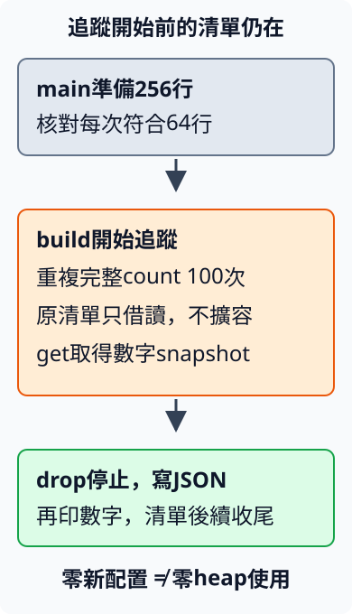
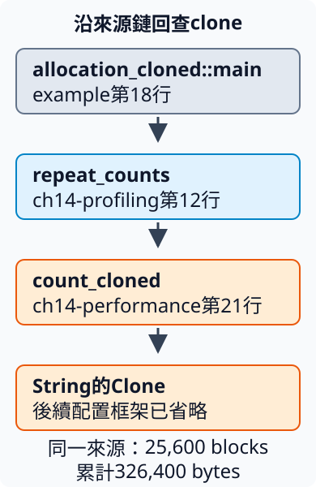

# 17.8 找到配置來源，再核對改善仍完成相同工作

17.7的兩輪量測中，借讀方法的時間估計較小，但總時間沒有告訴我們clone、複製文字與釋放各占多少。現在先回答其中一項可驗證的問題：**count_cloned真的在每行建立新的heap配置嗎？改成只借讀，這項配置工作是否消失，而答案仍相同？**

**profiling（剖析）** 是在執行程式時收集所選資源或工作的位置與用量。這一節選 **allocation profile（配置剖析）**，記錄heap配置的數量、大小與來源呼叫鏈。它回答「記錄到哪些配置」，不回答哪個函式占了最多CPU時間；找CPU熱點需要對應的CPU profile資料。

本節沿用同一行數規則，不讀新資料、不改query、不把較少完成工作當成改善。使用獨立 `ch14-profiling` package，所有命令從repo根目錄執行。

## 先固定被追蹤的工作與答案

仍用17.7的256行，query是Rust，每4行一行符合；一行Rust Rust仍只算1。因此每次得到64，重複100次要完成相同256行巡訪100次，**累計符合行數6400**。

我們用repeat_counts安排有限重複工作。cloned為true呼叫count_cloned實作，false呼叫count_borrowed實作。兩者收到相同slice與query；black_box沿17.7減少對固定輸入的假設。每次Result完成後才累加行數，沒有只執行一次卻把答案乘100冒充做了100次工作。

```rust
--8<-- "examples/ch14-profiling/src/lib.rs:repeat"
```

這份helper先以不同材料驗證：四行 `Rust Rust`、Python、rust、`中有 Rust`有2行符合，重複3次是6；0次工作是0，空清單重複也仍是0。這些是工作契約，不設執行時間或配置數量的測試門檻：

```rust
--8<-- "examples/ch14-profiling/tests/repeated_results.rs"
```

library透過已教的path dependency使用17.7真實函式。新的 **dhat** dependency只給後面的profile examples使用，放dev-dependencies，版本要求0.3.3由Cargo.lock固定：

```toml
--8<-- "examples/ch14-profiling/Cargo.toml"
```

完整library root及它使用的前節dependency都在這裡，尚未載入任何profile example：

```rust
--8<-- "examples/ch14-profiling/src/lib.rs"
```

??? example "展開同頁完整計數dependency"

    ```toml
    --8<-- "examples/ch14-performance/Cargo.toml"
    ```

    ```rust
    --8<-- "examples/ch14-performance/src/lib.rs"
    ```

下面只選repeated_results integration target；profile examples在配置器與追蹤起訖教完後才編譯：

```bash
cargo test -p ch14-profiling --test repeated_results --locked
cargo test -p ch14-profiling --test repeated_results --release --locked
```

兩次各有2項integration tests。此時只核對重複工作的答案；真正的profile在獨立example行程中執行。

## 用工具提供的配置器，記錄選定範圍

**allocator（配置器）** 負責取得及釋放heap儲存空間。dhat提供的 **`dhat::Alloc`** 包住系統配置器，在配置發生時加入追蹤；它沒有替我們改搜尋規則。這項工具是固定版的實驗性profile程式庫，本教材只驗證下面小型範圍，不讓它成為一般程式的必要配置器。

Rust的新attribute **`#[global_allocator]`** 指定這個可執行程式使用哪個全域配置器；同一份程式只能有一個這項選擇。下面的 **`static` item** 宣告整份程式可使用的值，格式是名稱、型別、初始值與分號；不同於main內每次執行才建立的let binding。

這裡不用static mut。static的型別須提供已教的Sync能力，dhat的型別滿足要求；它也不在程式退出時靠scope的Drop收尾。下面控制追蹤起訖的是局部Profiler，與這個static各有角色。

`dhat::Alloc`是一個不帶欄位的struct：左邊用它作型別，右邊同名表示它提供的值，不加括號或new。工具已提供配置介面，本節直接使用它：

```rust
--8<-- "examples/ch14-profiling/examples/allocation_cloned.rs:allocator"
```

每個example都是自己的可執行crate，因此各自只有這一個配置器。這個設定不會讓另一份17.7的bench binary自動裝上dhat；正常時間量測仍沿用原本程式。

### Profiler的存活範圍，決定哪些配置會被記錄

11.3使用的 `std::mem::drop` 也由5.2已教的標準prelude提供，因此本例可以直接寫 `drop`，不必另加use。先把所選API及當下限制教清楚：

| 操作 | 本次角色與使用契約 |
| --- | --- |
| `dhat::Profiler::builder()` | 建立ProfilerBuilder設定，預設選heap模式，尚未開始追蹤。 |
| `builder.file_name(path)` | 接可提供Path view的資料，本節用已知字串路徑；保存一份路徑設定，再交回builder。 |
| `builder.build()` | 接手設定並開始追蹤，交回局部Profiler。已經有活躍Profiler時會panic。 |
| `dhat::HeapStats::get()` | 取得目前統計的owned數字snapshot；必須有活躍的heap Profiler，否則panic，不是回Result。 |
| `drop(profiler)` | 沿11.3主動結束這份值；停止追蹤，將報告寫成JSON並在stderr顯示摘要。 |

材料在build之前建立，整段profile只借讀它，不realloc或延長這份Vec。dhat會忽略範圍外建立、期間只借讀的配置；材料**仍然在heap上**，但不算本次新增配置。因此報告的零不能解讀成整個程式沒有用記憶體。

snapshot在停止追蹤前取得，自己保存數字，所以之後可以在drop之後印出。stdout顯示、正確性assert與清單最後的收尾都放在追蹤範圍外；工具本身的記錄活動也不納入它的使用者配置統計。

圖中向下箭頭表示同一行程依序執行；橘框是本次追蹤範圍，灰框清單在這段期間仍由main持有：



snapshot型別HeapStats有公有數字欄位，本節只選四項：

| 欄位 | 意義 |
| --- | --- |
| `total_blocks: u64` | 整段累計的配置數量，block在此表示一次被記錄的配置。 |
| `total_bytes: u64` | 整段累計的配置bytes；同一空間釋放後又取得也重新累加。 |
| `max_bytes: usize` | 受追蹤配置同時活著的bytes峰值。 |
| `curr_bytes: usize` | 讀snapshot時仍活著的受追蹤bytes。 |

bytes是工具記下的配置要求大小，不包含所有系統配置器管理成本，也不是整個行程的記憶體占用。總量、同時峰值與目前存量回答不同問題：大量短命複本可以讓總量很高，卻每次都很快釋放。

## 先profile count_cloned，再用同一範圍profile count_borrowed

`allocation_cloned`先建立256行，核對每次64行符合，然後只追蹤100次count_cloned。下方的 `target/dhat-cloned.json` 是以目前工作目錄為起點的相對路徑；本教材從repo根目錄執行，target目錄由Cargo建置建立。這份main完整包含準備、追蹤、snapshot與停止：

```rust
--8<-- "examples/ch14-profiling/examples/allocation_cloned.rs:profile"
```

為了讓profile能指出來源位置，本次在release中保留 **debug information（除錯資訊）**：編譯器另外保存來源位置給工具使用。它不把opt-level改成dev的0。

新設定 **`CARGO_PROFILE_RELEASE_DEBUG=1`** 對應release profile的debug=1。放在一條shell命令前，表示只替該命令提供這個環境變數；不修改root Cargo.toml。仍明確使用--release：

兩份完整example如下。imports、全域配置器、main及輸出都沒有省略；第二份只改工作選擇與輸出路徑，兩份都是獨立binary crate：

??? example "展開兩個計數實作的完整程式"

    ```rust
    --8<-- "examples/ch14-profiling/examples/allocation_cloned.rs"
    ```

    ```rust
    --8<-- "examples/ch14-profiling/examples/allocation_borrowed.rs"
    ```

```bash
CARGO_PROFILE_RELEASE_DEBUG=1 cargo run -p ch14-profiling --example allocation_cloned --release --locked
CARGO_PROFILE_RELEASE_DEBUG=1 cargo run -p ch14-profiling --example allocation_borrowed --release --locked
```

上面同頁的第二份完整example使用相同256行／100次與同樣Profiler範圍，只改為cloned=false、保存 `target/dhat-borrowed.json`。它呼叫17.7的count_borrowed，以shared str判斷，不保留每行candidate。

Profiler drop的寫檔失敗會在stderr診斷，並不從drop交回io::Result。因此行數輸出正確，不等於JSON檔案已完整保存；要確認摘要的檔案路徑，並實際載入本次檔案。若缺檔或無法解析，先核對工作目錄與stderr，不能拿舊檔當這次的成功結果。

### 把總量、峰值與答案放在同一份比較

下方保留既有2026-10-14的三份profile，不宣稱本次章節重排重新執行量測。兩個package的Rust及manifest與原記錄source SHA仍吻合；根lock因新增其他教學快照而改變，其舊指紋保留作當時版本證據。本次另從保存的JSON在viewer核對欄位與來源鏈，與產生新profile是兩件事。

以下是在2026-10-14、Linux x86-64、Rust 1.99.0、dhat 0.3.3、release／debug=1的實際紀錄；輸入仍是256行／同一Rust query，兩者各做100次。原始JSON、stdout／stderr、命令與source SHA保存於 [profile紀錄](https://github.com/birdhackor/learn_rust/tree/main/examples/ch14-profiling/profiles)。這些是這份程式的觀察，不是所有版本都必須產生的配置次數。

| 觀察項目 | count_cloned：clone | count_borrowed：借讀 |
| --- | ---: | ---: |
| 累計符合行數 | 6400 | 6400 |
| 累計配置blocks | 25,600 | 0 |
| 累計配置bytes | 326,400 | 0 |
| 同時活著的bytes峰值 | 15 | 0 |
| snapshot時仍活著的bytes | 0 | 0 |

先核對6400相同，再解讀配置。17.7材料有64行15 bytes的 `Rust Rust notes`、192行12 bytes的 `Python notes`；clone每份文字一遍的bytes是 `64×15 + 192×12 = 3264`。這次100遍的累計326,400 bytes、256×100份配置，與每行建立candidate相符。峰值只有15，則和每次只保留當前那行複本、換下一行前釋放的行為相符；這份scope沒有同時保留25,600個String。

Rust編譯器可以省去或合併某些配置，工具版本與建置設定也會影響可觀察紀錄，所以我們實際profile，再回查source，不把上述數字放進普通測試當語意保證。借讀的零亦只表示選定範圍沒有新配置：先前建立的256份原文與Vec在這段期間都還存在。

### 載入報告，沿呼叫鏈找到負責的source

配置的數量回答「多少」，**backtrace（呼叫鏈紀錄）** 回答「從哪些函式呼叫到了這份配置」。同一配置來源的記錄會聚合成 **PP（program point，程式位置）**；來源相同的25,600次配置可以放在同一PP，不是每一份配置都列一個新節點。

開啟 [DHAT viewer](https://nnethercote.github.io/dh_view/dh_view.html)，按 **Load…** 選本次 `target/dhat-cloned.json`，把 **Sort metric** 改選 **Total (bytes)**。這個選項按來源的累計配置bytes排序。下面解釋我們要讀的欄位，不需要把工具提供的每種排序都當成已教：

- **Total** 沿前表的累計bytes與blocks；旁邊100%的分母是這段profile記錄到的總配置量，沒有表示100%的CPU時間。
- **At t-gmax** 是本段受追蹤bytes達到全域峰值時的存量，這次15 bytes／1 block。global在此合併受追蹤來源，沒有把追蹤前清單算回來。
- **At t-end** 是本報告停止追蹤時的存量，這次0；因為我們主動drop，main之後仍會印數字。不能把這裡的end讀成原材料早已不存在。
- **Allocated at** 列來源鏈的函式、source路徑與行數。此報告靠近配置的標準函式庫框架在前，呼叫它的main在後；先從main向前找repeat_counts、count_cloned與String的Clone，就能連回熟悉的source。不要把每個框架各列的同一筆量加總成多份配置。

這次viewer有一份非空配置來源。下圖節錄該來源中和我們source直接相連的四層，省略更靠近配置器的標準函式庫框架；箭頭表示呼叫到下一層，和前面scope圖的時間順序分開讀：



回到 `ch14-performance/src/lib.rs` 第21行，正是 `let candidate: String = line.clone();`。來源鏈因此把「每行clone」的推測連到真正記錄到的配置位置；我們去掉這份只用於contains的複本，而不是猜測哪個名稱看起來很慢。

再Load本次 `target/dhat-borrowed.json`，總量是0，只有空的root，不會憑空得到一個count_borrowed配置熱點。這份零結果有count_cloned的非零追蹤作對照，且兩邊都通過相同答案核對。viewer也顯示經過時間、平均存活時間等其他欄位，本節不拿它們做CPU耗時分配；追蹤器的工作本身就在影響時間。


## 配置資料與正常時間量測各自支持一部分判斷

count_cloned只為了contains建立candidate，沒有把它交出或在下一行使用。count_borrowed改為as_str借讀，仍按同一query／相同case規則巡訪完整清單。這項改動去掉的是判斷用複本，不是省略不符合的行、降低結果需求或不再做100次計數。

17.7的正常bench沒有dhat，觀察每次完整計數的經過時間；這一節裝上追蹤器且另外保留debug位置，觀察100次工作的配置。追蹤需要自己的記錄與呼叫鏈工作，會干擾執行時間；不把profile這次「花多久」和17.7相減來分配clone占比，也不從allocation tree猜CPU占比。

兩份證據接起來，能回答目前問題：相同計數工作有一項可移除的配置，前節兩輪正常量測亦有較小時間估計。它們仍只覆蓋這種合成短行分布與這份程式；不能宣稱所有clone都不好，或整個CLI一定快某個倍率。

若需求改成10.9保存owned報告，輸入結束後仍要保留原行文字，那份owned資料有工作責任，不能為了少配置而悄悄換成可能失效的借用。改善要保留輸入、答案、ownership與失敗規則，才有比較的意義。

## 練習：少一份材料，累計與峰值會一起縮小嗎？

保留同一count_cloned／Rustquery／100次，只把清單換成64行。先依17.7分布預測：每次16行符合，累計1600；配置次數與累計bytes應隨巡訪行數變少。最長行仍15 bytes，所以「每次一份短命candidate」的峰值未必跟著變小。

用新的target/dhat-solution.json保存，scope仍先準備後開始、get之前不drop、輸出在結束後。先自己寫，再對照完整答案：

??? example "完整參考答案"

    ```rust
    --8<-- "examples/ch14-profiling/examples/allocation_solution.rs"
    ```

    ```bash
    CARGO_PROFILE_RELEASE_DEBUG=1 cargo run -p ch14-profiling --example allocation_solution --release --locked
    ```

實際參考答案得到累計1600行、6,400 blocks／81,600 bytes，峰值仍15、snapshot存量0；完整JSON亦在上述profile紀錄。這符合「少了巡訪總量，但每次最長複本沒有變短」的關係。

三份執行的原始stdout與stderr也同頁保存，便於核對行數、統計及檔案是否成功保存：

??? example "展開原始執行輸出"

    `cloned.stdout.txt`：

    ```text
    --8<-- "examples/ch14-profiling/profiles/cloned.stdout.txt"
    ```

    `cloned.stderr.txt`：

    ```text
    --8<-- "examples/ch14-profiling/profiles/cloned.stderr.txt"
    ```

    `borrowed.stdout.txt`：

    ```text
    --8<-- "examples/ch14-profiling/profiles/borrowed.stdout.txt"
    ```

    `borrowed.stderr.txt`：

    ```text
    --8<-- "examples/ch14-profiling/profiles/borrowed.stderr.txt"
    ```

    `solution.stdout.txt`：

    ```text
    --8<-- "examples/ch14-profiling/profiles/solution.stdout.txt"
    ```

    `solution.stderr.txt`：

    ```text
    --8<-- "examples/ch14-profiling/profiles/solution.stderr.txt"
    ```

此題讓累計量與同時存量分開，不把「少用了幾bytes」當成沒有說清範圍的單一數字。若改輸入或工具版本，重新執行、保存實際報告，再說明這次證據支持到哪裡。

延伸閱讀：[英文Performance Book：Heap Allocations](https://nnethercote.github.io/perf-book/heap-allocations.html)、[中英文Bencher配置範例](https://bencher.dev/zh/learn/benchmarking/rust/custom-harness/)、[dhat0.3.3正式文件](https://docs.rs/dhat/0.3.3/dhat/)、[DHAT viewer](https://nnethercote.github.io/dh_view/dh_view.html)。

[下一章：兩個最終練功專案](18-01-lesson.md)
