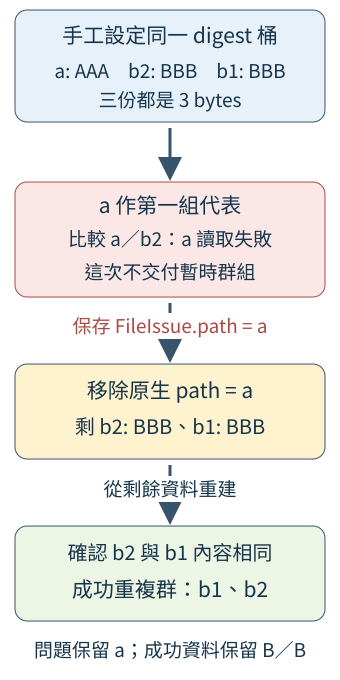

# 18.3 A2：自己確認真正相同的內容

A1 已交出一般檔案與收集問題。現在要把 18.1 的六份材料分成真正重複群：三份 Rust LF 同組，兩份空檔同組，different 的 rust LF 不加入前一組。這一步仍保留所有問題，讓下一階段有足夠資料製作報告。

這次回收 12.4 的大小、BLAKE3 摘要與 bytes 比較。新的組合工作是**一份候選失敗後，仍能確認剩餘檔案**。你會自行完成三個函式；短讀取與前後觀察的低層工作沿用已教版本，完整 CLI 留到 A4。

## 每一步只回答自己的問題

對六份材料，先寫下這三步的預期，不先寫演算法：

1. 按大小得到四份 5-byte、兩份 0-byte 候選。這裡不能刪掉空檔；大小相同還不足以合併。
2. 為候選計算 BLAKE3 digest。Rust LF 的三份會同桶，rust LF 會另成一桶，兩份空內容會同桶。
3. 同桶仍要直接比較完整 bytes。Rust 三份與空檔兩份各成重複群；只剩一份的桶沒有第二個路徑可配對。

這份安排利用 A1 已取得的長度，避免對只有一份的大小做 hash；再用 digest 縮小直接比較的候選。它沒有承諾特定速度倍數，也沒有因摘要相同省略最後的判準。大小單筆者不需要讀完整內容，因此不能把「沒有內容錯誤」解讀成每個檔案都做過完整讀取。

12.4 已示範同一摘要桶中的 A／B／B：第一份 AAA 與兩份 BBB。真正分組要檢查 **各組代表**，得到一份 A 與兩份 B；最後的重複群才只保留 B。測試會刻意給三份同一 digest，這是固定候選的安排，不是找到 BLAKE3 真實碰撞。

## 失敗後為什麼要重建剩餘桶

12.4 的單次分組遇到第一個 FileIssue 就回 Err，沒有交出完整群組。若把這個 Err 當成「不同內容」，會錯把不能確認當成正常差異；若整桶放棄，就可能漏掉裡面的 B／B。

這次採以下政策：保存問題，按原生 PathBuf 移除確切失敗者，再對剩餘資料重新分組。重建能把之前已處理的有效記錄與後面尚未處理的記錄接回同一判準；代價是可能重讀部分有效檔案。

看一份可控制的材料：手工把 a 的 AAA、b2 的 BBB、b1 的 BBB 放入同桶。第一次比較 a／b2 時，把**左來源 a** 換成 12.4 的 failing_reader：先 Interrupted，再交一個 R，最後 PermissionDenied。這次必須指出 a 失敗，才能讓 b2 留在候選中。圖用 fixture 目錄內的檔名標示 a／b1／b2；實際移除仍比較完整原生 PathBuf。



箭頭表示工作順序。上方是刻意設定的候選；紅框的單次分組沒有完整結果。中間只移除問題中的原生 a，b2／b1 留下；綠框才是重建成功的群組。**問題清單保留 a，成功清單保留 B／B，兩份資訊都需要。**

每次失敗必須移除至少一筆仍在桶內的記錄，候選數就嚴格減少，重試次數才有限。原生路徑不是 display 文字，也不能只移除「剛加入的那份」。後面 helper 的 callback 必須保存本次輸入中確切失敗者；若回一個不在桶內的位置，移除沒有進展，這屬程式違反介面契約，完成版會 panic 阻止無限重試。一般檔案失敗仍是 FileIssue，保存後繼續。

## 承接自己的 A1 工作版

先保存 A1 進度，本頁先定位介面與待做處，再列出 A2 的完整起始 source。保留自己的 collection.rs；目錄也提供已完成 A1 的副本，方便核對模型與八項驗收。

本階段只新增 `blake3 = "1.8"`，沿用 10.1 的相容版本範圍與 Cargo.lock。walkdir／tempfile 角色不變，沒有加新的 BLAKE3 features：

```toml
--8<-- "examples/ch15-projects/a2-starter/Cargo.toml"
```

lib.rs 新增三個 module，仍是 2.6 的檔案分工：

```rust
--8<-- "examples/ch15-projects/a2-starter/src/lib.rs"
```

- **collection.rs：** 保留 A1 的型別、收集與原驗收。
- **stream.rs：** 12.4 的 hash_reader、fill_chunk、equal_readers。只算有效前段，重試 Interrupted；比較先各自填滿或到 EOF，保留左／右讀取失敗。
- **files.rs：** 12.4 的 FileIssue、hash_file、equal_files 與前後觀察。路徑與已打開 handle 都和原 Snapshot 比較，成功才交摘要／比較結果。
- **content.rs：** 本次要寫的大小／digest 候選、各真內容群、失敗後重建與整體接線。

這些檔案都使用本 package 的 `crate::collection::FileRecord`。**同名的 struct 若由另一個 crate 定義，仍不是同一個型別。** 因此沒有同時引入 ch09_files 的另一份 FileRecord，再為它增加轉換。你只是把已教能力接到自己已有的模型。

### 先看 ownership 與結果模型

ContentGroup 暫時借用桶裡的 FileRecord，和 12.4 一樣；借用連到輸入 slice，不能在桶銷毀後繼續使用。成功確認後，DuplicateGroup 持有 owned 路徑副本與長度，才能交出而不依賴那個局部桶。這裡複製的是路徑資料，沒有把整份檔案內容存進群組。

ContentReport 持有這些重複群，另外保存 A1 scan_issues 與新 file_issues。不同階段的問題沒有互相覆蓋，也不靠群組數推定完整：

```rust
--8<-- "examples/ch15-projects/a2-starter/src/content.rs:models"
```

### 三個待做函式的分工

1. **digest_candidates：** 接手 owned 記錄，先依大小篩候選，再逐份 hash；成功 move 到 `(len, digest)` 桶，失敗 push 到借來的 issues，繼續其他記錄。
2. **refine_bucket：** 借用一個候選 slice，確認所有真正內容群；相同原生路徑只算一次。完整成功才回 groups，失敗回確切 FileIssue。
3. **confirm_bucket：** 接手這份桶，呼叫單次分組；保存失敗、移除確切位置後重建。成功才把至少兩路徑的群轉成 owned DuplicateGroup。

為了使用可控制的驗收來源，前兩種工作接收 **callback**，沿用 9.2 的 FnMut：hash 每次收到一份 `&FileRecord`，回 `Result<Hash, FileIssue>`；compare 每次收到兩份記錄，回 `Result<bool, FileIssue>`。它們可以重複呼叫。正式接線交入 hash_file／equal_files；測試則能改用固定 digest 或會讀取失敗的來源。

compare 的 Ok(true) 是完整 bytes 相同，Ok(false) 是正常不同，Err 是不能完成，失敗 path 必須指這兩份輸入裡的確切一份。digest callback 的失敗位置則必須指目前那份記錄。這些資料流與路徑契約先固定，才有剛才的有限重建。

起始檔的三份 body 尚未實作；空 map／空 groups 與固定 Changed 沒有觀察結果的意義。它們只用已有 Result／enum／Vec，沒有藏完整答案：

```rust
--8<-- "examples/ch15-projects/a2-starter/src/content.rs:digest"
```

```rust
--8<-- "examples/ch15-projects/a2-starter/src/content.rs:refine"
```

```rust
--8<-- "examples/ch15-projects/a2-starter/src/content.rs:recover"
```

analyze 已接好這三份工作：接手 A1 files，累積內容問題，確認各桶，最後交出群組與原先 issues。它沒有實作文字／JSON、bytes 指標或 CLI。

??? example "完整 A2 起始 source；本頁 manifest 與 lib.rs 已全檔列出"

    `examples/ch15-projects/a2-starter/src/collection.rs`：

    ```rust
    --8<-- "examples/ch15-projects/a2-starter/src/collection.rs"
    ```

    `examples/ch15-projects/a2-starter/src/stream.rs`：

    ```rust
    --8<-- "examples/ch15-projects/a2-starter/src/stream.rs"
    ```

    `examples/ch15-projects/a2-starter/src/files.rs`：

    ```rust
    --8<-- "examples/ch15-projects/a2-starter/src/files.rs"
    ```

    `examples/ch15-projects/a2-starter/src/content.rs`：

    ```rust
    --8<-- "examples/ch15-projects/a2-starter/src/content.rs"
    ```

從自己的練習資料夾先解析新依賴、檢查 source：

```bash
cargo +1.99.0 check
cargo +1.99.0 test --locked
```

此時 A1 的原有驗收應仍通過：Unix 八項，其他平台五項；A2 的需求還沒有加入，它們不能證明已找到重複群。

## 加入新驗收，先看預期失敗

從工作版取得 `checks/content-tests.rs`，沿用 A1 的手動加入方式：把整個含條件屬性的 tests module 加到自己的 content.rs 末尾。checks 本身不是自動 test target，既有 collection.rs 的驗收保留。

驗收材料裡的 record／fixture 是可見的建立工作。record 保存 owned 路徑與這次觀察；fixture 只建一層裡的指定檔案，交回 **TempDir owner 與記錄清單**。caller 保留 owner 到確認結束；`_directory` 這類有名稱的底線前綴 binding 仍持有它，不能換成直接丟掉回傳 owner：

```rust
--8<-- "examples/ch15-projects/a2-starter/checks/content-tests.rs:fixture"
```

第一個內容測試沿用六份 bytes，檔名暫改平面 a／b／c，專注在內容；隱藏與子目錄仍由 A1 的原驗收與最後真實 demo 覆蓋。預期是兩群、路徑數 3／2，而不是把所有同大小的檔案合併：

```rust
--8<-- "examples/ch15-projects/a2-starter/checks/content-tests.rs:material-test"
```

完整驗收另外提供兩份可控制來源：ShortReader 擁有輸入 bytes 的副本，每次最多交出指定的正數筆；InterruptedThenFailure 先回 Interrupted，再交一個 byte 82，最後回 PermissionDenied。這使重試、短讀與左右失敗都有固定答案。它們只實作第 10.4、12.4 節已用過的 Read 介面。

??? example "完整 A2 驗收：所有材料、reader helpers 與十二項測試"

    `examples/ch15-projects/a2-starter/checks/content-tests.rs`：

    ```rust
    --8<-- "examples/ch15-projects/a2-starter/checks/content-tests.rs"
    ```

再次執行：

```bash
cargo +1.99.0 test --locked
```

起始版應出現新增行為的失敗：material_bytes 的實際群組數還是 0，而預期為 2；大小篩選也沒有呼叫 hash。支援來源與舊 A1 的部分測試仍會通過，通過這些不代表三個待做函式完成。

## 依三個工作逐步實作

先完成 digest_candidates，重跑同一組驗收；再完成 refine_bucket，最後完成 confirm_bucket。每次看失敗是否移到下一個尚未完成的責任，不改需求去迎合 stub。

- 大小與 digest 分組都使用已教的 HashMap／get_mut／insert。沒有同大小伙伴的記錄不用 hash；每個 hash Err 保存後 continue。
- 單次分組沿用 12.4：每個候選依次和各組代表比較；正常不同才繼續試下一組，Err 立刻交回。沒有匹配才建立新組；新組也以 hash_file 驗可讀性與前後觀察。同一路徑先略過，最後按原生路徑排序。
- 重建時先保存 before 數量。Err 分支以 filter／collect 取得不含 failure.path 的新 remaining；確認數量減少，再保存問題並從這份 remaining 重跑。舊的暫時群沒有作完整答案交出。

成功後先借組員取得 len，再用 to_path_buf 保存 owned 路徑；這些是 10.8／12.4 已教的能力。重建需要 FnMut 多次可呼叫，轉交下一層時提供一份 closure，借用同一個 compare；不是每次把唯一的 callback move 掉。

??? hint "提示 1：先分清哪些資料必須留下"

    成功群、收集問題、內容問題是三份結果。不要用「已有重複」抵銷問題，也不要用 Err 代表正常不同。

    單次分組只要失敗，就沒有完整 groups 可用。問題指哪個原生位置，重建就排除那個位置；其餘已處理與未處理的記錄都留在剩餘桶。

??? hint "提示 2：回收分組與借用能力"

    DigestBuckets 的 tuple key 需要長度和摘要都相等。HashMap 自身順序沒有保證。ContentGroup 的 references 都來自 candidates，因此只有單次成功時才把它們轉成 owned DuplicateGroup。

    各組代表用 members[0]；每一組建立時至少有一位，所以這個索引才合法。路徑去重可以用 `HashMap<PathBuf, ()>`；不要把同一路徑重複輸入算成兩份檔案。

??? hint "提示 3：只拆開重建的一次失敗"

    假設 failure.path 是 a，原桶有 a、b2、b1。filter 接收到 &FileRecord，只用 path 比較決定留下；collect 接手留下的記錄，形成 b2／b1 的新 Vec。failure 沒有被 filter 消耗，仍能 push 到 issues。

    下一輪要從新 Vec 開始，不延續一份未知是否完整的舊 groups。剩一筆或零筆也由單次元件按契約完成；最後只有至少兩個不同路徑的群能成為重複群。

## 驗收反例，不只測正常相同

完整新增驗收分別測以下關係：

| 材料 | 必須分辨的結果 |
| --- | --- |
| 六份內容、空檔、大小單筆 | 正確兩群；單筆大小沒有 hash 呼叫 |
| 同桶 A／B／B、同原生路徑重複輸入 | 各真內容群都找到；一路徑不能形成一對 |
| 左代表 reader 失敗／hash reader 失敗 | 保存確切原因與原生位置，B／B 仍可確認 |
| 新記錄取得後改長度；讀完後改長度 | before／after 的觀察保留 Changed，沒有 sleep 或時間精度猜測 |
| 左右不同正數短讀上限、9001 bytes、改尾 byte／少尾 byte | 完整相等與真正不同各有自己的答案，不能拿短讀長短當差異 |
| 空／非 UTF-8 bytes、右 reader 失敗 | bytes 不必解碼；讀取失敗不能變 Ok(false) |
| 人工提供的既有 ScanIssue | 新內容工作沒有丟失上階段問題 |

ShortReader／failing_reader 完整實作放在可見的驗收檔，沿用 12.4 的事件與正數上限；不靠未知框架產生失敗。既有 ScanIssue 的材料只檢查接線是否保留資料，不聲稱某個真檔案會產生那筆人工問題。改長度的 after 測試也只驗那份觀察能揭露變動，不假裝在每次 read 中同步改檔。

重建的關鍵測試直接呼叫 confirm_bucket，把 A／B／B 當一份受控候選。比較 callback 把左 a 對應到 failing_reader；錯誤依 Left 映回 a 的 PathBuf，其他比較仍使用真實 equal_files。若錯移新候選 b2，最後就找不到正確 B／B：

```rust
--8<-- "examples/ch15-projects/a2-starter/checks/content-tests.rs:recovery-test"
```

完成版在 Unix 上共有 20 項：八項 A1、十二項 A2。其他平台不編入 A1 的三個 Unix fixtures；未跑的項目不能算該平台驗過。這些材料支持本步判準與可觀察錯誤，沒有取得一致快照；讀取前後的時間／長度相同仍不保證內容從未改動。再跑 2.7 的 fmt／Clippy，保存自己的完成版。

## 本階段快照與真實六檔執行

[A2 完成快照](https://github.com/birdhackor/learn_rust/tree/main/examples/ch15-projects/a2-complete) 保存上述成果與同一份驗收。它仍只有截至這一步的 library 與示範，沒有最終報告或完整 CLI。

??? example "A2 全部可執行答案：全部 source、二十項驗收與 example"

    `examples/ch15-projects/a2-complete/Cargo.toml`：

    ```toml
    --8<-- "examples/ch15-projects/a2-complete/Cargo.toml"
    ```

    `examples/ch15-projects/a2-complete/src/lib.rs`：

    ```rust
    --8<-- "examples/ch15-projects/a2-complete/src/lib.rs"
    ```

    `examples/ch15-projects/a2-complete/src/collection.rs`：

    ```rust
    --8<-- "examples/ch15-projects/a2-complete/src/collection.rs"
    ```

    `examples/ch15-projects/a2-complete/src/stream.rs`：

    ```rust
    --8<-- "examples/ch15-projects/a2-complete/src/stream.rs"
    ```

    `examples/ch15-projects/a2-complete/src/files.rs`：

    ```rust
    --8<-- "examples/ch15-projects/a2-complete/src/files.rs"
    ```

    `examples/ch15-projects/a2-complete/src/content.rs`：

    ```rust
    --8<-- "examples/ch15-projects/a2-complete/src/content.rs"
    ```

    `examples/ch15-projects/a2-complete/examples/a2_groups.rs`：

    ```rust
    --8<-- "examples/ch15-projects/a2-complete/examples/a2_groups.rs"
    ```

collection.rs 與 content.rs 末尾已含各自的驗收，不再重複追加。以下每組快照命令都重新從教材 repo 根目錄開始：

```bash
cargo test -p duplicate-a2 --locked
```

示範 example 是獨立名稱 a2_groups。和 A1 一樣，root 相對於目前工作目錄；從 repo 根目錄先切到本 package，才能讀到 `../materials/duplicate-demo`：

```bash
cd examples/ch15-projects/a2-complete
cargo run --example a2_groups --locked
```

第一行應為：

```text
A2：2 個重複群組，0 個收集問題，0 個內容問題
```

一群列三個 5-byte 路徑，包含 notes-a／sub/notes-b／.saved/notes-c；另一群列兩個 0-byte 路徑。different 不出現在重複群裡。這個 demo 使用固定教材 root，不代表 A4 的參數與 0／1／2 已完成。

??? note "只在需要時對照重建函式"

    完整大小／digest 與單次分組也在上述 snapshot；先對照仍失敗的工作，不覆蓋自己的整份版本。以下來自可執行答案：

    ```rust
    --8<-- "examples/ch15-projects/a2-complete/src/content.rs:recover"
    ```

現在已把真正重複群、既有收集問題與新內容問題保存下來。下一步讓它們表達成穩定、完整性清楚的文字與 JSON，並計算 18.1 那份按路徑的 bytes 指標。

延伸閱讀：[English Cookbook：Hashing](https://rust-lang-nursery.github.io/rust-cookbook/cryptography/hashing.html)、[中文 Rusty Book 對應](https://rusty.course.rs/algos/cryptography/hashing.html)、[BLAKE3 Hasher](https://docs.rs/blake3/1.8.7/blake3/struct.Hasher.html)、[File::metadata](https://doc.rust-lang.org/std/fs/struct.File.html#method.metadata)。前兩份示範分批摘要；本題再以真 bytes 確認、保存失敗並重建剩餘桶。
