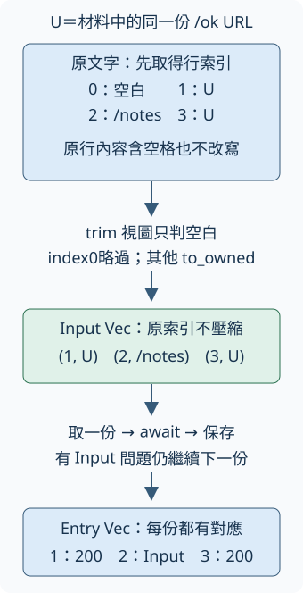

# 18.8 原行身分與依序批次：每份輸入都有結果

上一節已有一份網址變成一份 owned `Check` 的能力。現在要處理多行文字：有空白行、重複網址，也有無法解析的行。要先回答「每份結果屬於哪一行」，再把單筆能力接成批次。

本步沿 [18.7 的單筆模型與期限](18-07-lesson.md)、[9.6 的 lines 與 owned 文字](09-06-lesson.md)，以及前面已實作的 `Fixture`。先完成依序版本，之後才改工作排程；本步的結果對應也要能沿用。

## 同一份文字，哪些行成為工作？

假設本次本機服務的 port 是41000，材料如下。這是手工示意；真正測試仍由 `Fixture` 取得動態 port。第一列的「空白行」是說明標記，實際該行沒有文字：

```text
（空白行）
http://127.0.0.1:41000/ok
/notes
http://127.0.0.1:41000/ok
```

`input_index` 選原始行的 **0-based 索引**：一般說的第一行是index0，第二行是index1。它不等於略過空白後在新清單中的位置。

| 原始索引 | 原行內容 | 本步應得到的對應 |
| --- | --- | --- |
| 0 | 空白 | 略過，不送入單筆檢查 |
| 1 | 第一份 `/ok` URL | index1，HTTP200通過 |
| 2 | `/notes` | index2，Input問題，仍有一份結果 |
| 3 | 第二份相同 `/ok` URL | index3，另一份HTTP200結果 |

不能用網址作為唯一key：index1和index3是不同輸入，必須各保留與檢查。也不能先略行再重新編號，否則回報index0會讓人找錯原行。`/notes` 非空白，應留給B1分類，不能在讀行時消失。

## 先編號，只用空白視圖決定略行

沿9.6，`text.lines()` 借用文字、逐行交回 `&str`。LF與CRLF分隔符不在行內容中；尾端換行不多產生一行，單獨CR沒有跟LF時仍是內容。這裡保存的「原行」指這份內容，不含已由lines取走的分隔符。

回用第10.9、14.6節的 **`Iterator::enumerate()`**：它取得原iterator，交回新的iterator，每筆Item是 `(usize索引, 原Item)`，索引由0開始。用在lines時，就是 `(input_index, line)`；原行即使稍後略過，也已經占過自己的索引。先取得這個對應，再判斷行是否空白。

新增 **`str::trim()`**：它 shared 借用文字，交回去除兩端空白的 `&str` 視圖，不修改原文字。空白依Unicode的 `White_Space` 字元集合判定，包括一般空格與全形空白。若整行只有這些字元，trim後的視圖就為空；用9.6的 `str::is_empty()` 判斷即可。

本題**只用trim視圖判空**。保留下來與送進B1的仍是原 `line.to_owned()`；例如 `" first "` 的兩端空格仍在original中。讀行不先判URL是否有效，也沒有新增註解行或拆字詞規則。

## 保存 owned 輸入，再包住單筆結果

本步新增 `Input`：保存 `input_index: usize` 與 owned `original: String`。因此讀行時借用的整份文字結束後，清單仍可使用；不需要讓批次一直借用來源。

`Entry` 保存同一份索引與B1的 `Check`。快照把已驗收的單筆core保存為 `src/single.rs`，沿2.6的 `pub mod single;` 公開module；`single::Check` 是這個module內的型別，沒有跨另一個crate的同名型別轉換。本步不改這份core，只改新的讀行與依序函式。

`InputError::Empty` 表示清單沒有任何非空白行，是整份工作不能開始的設定問題。兩行無效URL仍是非空清單，應有兩份 `Outcome::Input`；不能把「沒有成功URL」混成Empty。型別只derive已教的Debug，方便checks診斷。

```rust
--8<-- "examples/ch15-projects/b2-starter/src/lib.rs:models"
```

選 **`Vec::is_empty()`** 作零項檢查：它 shared 借用Vec，沒有元素時回true。`prepare_inputs(&str)` 交回 `Result<Vec<Input>, InputError>`，保留後零項就回Empty。`run_sequential` 取得 `Vec<Input>` ownership，也拒絕caller直接交來的零項清單；成功Output是 `Vec<Entry>`，依輸入Vec順序保存每份結果。

runner借用同一份Client，取得每筆期限Duration。Duration 是 14.5 已教的時間跨度；這個標準型別具備 Copy，可以把相同跨度交給每次B1 `check`；**每筆開始時各建立自己的期限**，不是整批只共用一個十秒倒數。client建立失敗仍在開始批次前處理。



圖中U指最初材料中的同一份 `/ok` URL。index0在判空白後略過，index1與index3的U各有自己的位置。中間 `/notes` 得到 `Outcome::Input` 後，仍繼續index3；Input Vec保存原索引與原文，Entry Vec保存原索引與Check，不把索引壓成0、1、2。

## 保存起始檔，再讓 checks 指出缺少的工作

完整起始版在 `b2-starter`。把 `Cargo.toml`、整個 `src` 與 `checks/batch-tests.rs` 保存到自己的 `url-b2-work`。以下同頁列出全部起始檔；`single.rs` 已是B1答案，兩個新函式目前都只回空Ok。

manifest的直接依賴與features沿B1固定版本契約。本步checks不暫停clock，所以沒有另開test-util。dev-dependency重用14.9 Fixture；複製到repo外後，**先將path換成你電腦上教材 `examples/ch11-async/local-service` 的實際絕對路徑**，再執行Cargo，和B1相同。

```toml
--8<-- "examples/ch15-projects/b2-starter/Cargo.toml"
```

??? example "展開本節完整起始 library 與已完成的 single"

    `examples/ch15-projects/b2-starter/src/lib.rs`：

    ```rust
    --8<-- "examples/ch15-projects/b2-starter/src/lib.rs"
    ```

    `examples/ch15-projects/b2-starter/src/single.rs`：

    ```rust
    --8<-- "examples/ch15-projects/b2-starter/src/single.rs"
    ```

## 本頁測試真正載入的本機服務來源

以下沿用第14.8–14.9節已完成的服務。`ch11-local-service` 的 normal library 依賴 `ch11-http-single`，後者的 root 會載入 config／error／reply；所以這些設定與完整來源一起列在下面。這些 module 仍只是編譯進 library，不表示測試會啟動 HTTP CLI 或解碼 JSON。測試準備的 `/ready` 會讀完約定的小 body，產品 `check` 的工作則只到 final headers。

本節命令不選兩個依賴 package 的 binary、examples 或 integration tests。它們自己的 dev-dependencies 也不是這份依賴的 normal source。共同 package 欄位依第12.1節的 repo root workspace 繼承；在 repo 外做工作副本時，服務依賴仍指向教材內原位置，沒有把單一繼承式 manifest 孤立複製出去。

??? example "展開 Fixture 與其 HTTP 依賴的全部 normal library 來源"

    `examples/ch11-async/local-service/Cargo.toml`：

    ```toml
    --8<-- "examples/ch11-async/local-service/Cargo.toml"
    ```

    `examples/ch11-async/local-service/src/lib.rs`：

    ```rust
    --8<-- "examples/ch11-async/local-service/src/lib.rs"
    ```

    `examples/ch11-async/http-single/Cargo.toml`：

    ```toml
    --8<-- "examples/ch11-async/http-single/Cargo.toml"
    ```

    `examples/ch11-async/http-single/src/lib.rs`：

    ```rust
    --8<-- "examples/ch11-async/http-single/src/lib.rs"
    ```

    `examples/ch11-async/http-single/src/config.rs`：

    ```rust
    --8<-- "examples/ch11-async/http-single/src/config.rs"
    ```

    `examples/ch11-async/http-single/src/error.rs`：

    ```rust
    --8<-- "examples/ch11-async/http-single/src/error.rs"
    ```

    `examples/ch11-async/http-single/src/reply.rs`：

    ```rust
    --8<-- "examples/ch11-async/http-single/src/reply.rs"
    ```

自己的工作目錄沿18.1選toolchain。先確認起始library可編譯；尚未追加checks時應零項測試，空Ok沒有完成讀行與Empty規則：

```bash
cargo +1.99.0 check --lib
cargo +1.99.0 test --lib
```

六項checks驗：owned行與索引／空白與重複、零有效行、runner直接收到零項、全invalid、混合結果與繼續處理、held兩筆等待與對應。第一項只驗讀行，所以first／second是任意非空文字，不要求是URL；把來源String放在內層scope，取得Input後來源已結束，接著仍能檢查其owned內容。CRLF與單獨CR沿前面規則；空白材料中的 `　` 是U+3000全形空白。

```rust
--8<-- "examples/ch15-projects/b2-starter/checks/batch-tests.rs:input-test"
```

`assert_http(&Entry, status, passed)` 沿B1借用結果做match，驗狀態與判定，對數值reference明確使用 `*`。混合測試用已教的iter／map／collect取得索引Vec，再比預期順序；它會確認兩份相同URL都真的送出。`/loop` 六份請求加兩份 `/ok`、一份 `/missing` 共九份，Input問題沒有送請求。

held材料用兩份gate，沿B1的有限觀察期限。`BatchTask` 是8.2的type alias，指 `JoinHandle<Result<Vec<Entry>, InputError>>`；task擁有Client和Input Vec，Output也為owned。Input／Entry的具體欄位沿已教Send能力，標準Vec在元素可Send時也可交給task，不借用來源文字。

`observe_started` 等指定held通知，成功交回Fixture與原task handle，還沒有放行；五秒觀察不符就abort／await task、shutdown server，再使test失敗。`finish_batch` 在放行後以五秒觀察期限等待借用handle，取得Output後另shutdown，再交回rows與hits。借用handle的Future／到期不自動取消task／成功不再取得第二次Output，都沿B1已教契約。這些觀察期限是測試觀察範圍，沒有加整批正式期限。

```rust
--8<-- "examples/ch15-projects/b2-starter/checks/batch-tests.rs:gate-helpers"
```

??? example "展開六項完整 checks 與所有有限觀察 helper"

    `examples/ch15-projects/b2-starter/checks/batch-tests.rs`：

    ```rust
    --8<-- "examples/ch15-projects/b2-starter/checks/batch-tests.rs"
    ```

現在把完整 `checks/batch-tests.rs` 追加到 `src/lib.rs`，它自帶 `#[cfg(test)] mod tests`，不要再包一層。再執行 `cargo +1.99.0 test --lib`：六項應失敗。固定空清單沒有保留行，也沒送出held請求；最後一項由觀察期限有限收尾。

## 自己完成兩個變化

第一步只改 `prepare_inputs`。建立mutable Vec，遍歷 `text.lines().enumerate()`，每份先有索引與原行；trim後不空才push owned Input。走完再以Vec的is_empty判Empty或Ok。不要在push之前解析URL，否則invalid行會被錯誤抹掉。

此時行處理與零有效行兩項應通過；runner三種批次情況與直接零項仍失敗。核對第一項的index1／3／4：略過的是原index0與2，不是把留下的項目重編號。

第二步改 `run_sequential`。先拒絕零項，建立結果Vec；`for input in inputs` 沿9.4取得每份Input ownership。先保存可Copy的usize索引，再把String move進 `single::check(client, input.original, limit).await`，最後push包著同一索引的Entry。

這個圈的順序是「取一份→await完成→保存→取下一份」。B1的單筆錯誤已經是Check資料，因此照樣push；runner不需要因Input、Request或Timeout提早返回。混合清單中間出現 `/notes` 後，後面的重複URL與404／redirect問題也都應留下。

```rust
--8<-- "examples/ch15-projects/b2-starter/checks/batch-tests.rs:mixed-test"
```

held測試先看到input0進入，保存當下hits與batch是否未完成，放行0後再等1、放行1。它核對gate等待、兩筆結果與雙方收尾；依序安排由圈內await完成後才取得下一份的程式結構建立。

```rust
--8<-- "examples/ch15-projects/b2-starter/checks/batch-tests.rs:gate-test"
```

完成後六項應通過。空清單是typed錯誤，混合清單各筆仍有結果，重複網址仍各處理一次。

??? tip "提示 1：保留的順序不是新的身分"

    先enumerate，再在圈內判空。對照最初四行材料：原index1與3成為結果Vec的第0與第2份，結果仍保存1與3。相同original也不能合併。

??? tip "提示 2：borrowed行只用到建立Input為止"

    trim的視圖只負責bool判斷，真正保存的是 `line.to_owned()`。Input Vec擁有各份String，來源文字不必跟runner一起活著。

??? tip "提示 3：每次只等一份，照樣保存失敗"

    不必match各種Outcome決定要不要push。B1已把分類包進Check；runner保存它與索引，再繼續。每圈都把同一Duration跨度交給新一次check。

??? success "完成快照：完整設定、單筆核心、批次與六項測試"

    本階段全部來源如下，沒有加入後面的JoinSet或停止機制：

    `examples/ch15-projects/b2-complete/Cargo.toml`：

    ```toml
    --8<-- "examples/ch15-projects/b2-complete/Cargo.toml"
    ```

    `examples/ch15-projects/b2-complete/src/single.rs`：

    ```rust
    --8<-- "examples/ch15-projects/b2-complete/src/single.rs"
    ```

    `examples/ch15-projects/b2-complete/src/lib.rs`：

    ```rust
    --8<-- "examples/ch15-projects/b2-complete/src/lib.rs"
    ```

    教材repo根目錄可執行：

    ```bash
    cargo test -p url-b2 --lib --locked
    ```

## 實際得到一份混合批次

`b2_batch_demo` 以已教runtime／Fixture建立真本機材料，原index0空行、index1／3相同 `/ok`、index2是 `/notes`、index4是 `/missing`。先shutdown確認三份工作請求，再印四份結果。格式化參數沿前文借讀，直接填 `entry.check.outcome` 不搬走它，以既有Debug檢視分類；port與opaque錯誤的Debug字樣不作固定輸出契約。

```rust
--8<-- "examples/ch15-projects/b2-complete/examples/b2_batch_demo.rs"
```

```bash
cargo run --quiet -p url-b2 --example b2_batch_demo --locked
```

結果索引是1、2、3、4；兩份HTTP200、一份Input、一份HTTP404。批次成功交回結果並不表示每筆都通過，之後接CLI時才把這份分類回收成工具的退出狀態。

現在輸入位置、原文與單筆結果已連起來。下一節改排程時，要繼續保留這份對應，再讓多份工作同時等待。

[下一節：有上限的 URL 工作](18-09-lesson.md)
