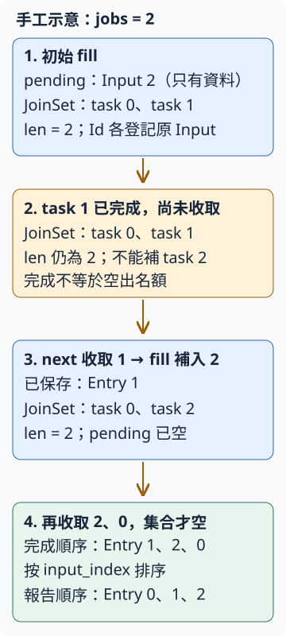

# 18.9 有上限的 URL 排程：先回收，再補工作

B2 每次先等一份網址完成，才取下一份。若前一份正在等伺服器的 headers，後面幾份還沒有機會送出。本步希望**允許幾份工作同時等待，仍保有每筆原文與原行位置，而且不一次提交整張清單**。

沿 [18.8 的輸入與依序版本](18-08-lesson.md)、[14.4 的有限 JoinSet 排程](14-04-lesson.md) 與14.3的Id／JoinError。本節把已學的排程接到真HTTP；沒有增加CLI或使用者取消功能。jobs選正整數，本專案的預設值是8；先用2份名額與3份held材料看清狀態。

## 哪些工作可以開始，何時才空出名額？

三份網址分別送往本機 `/held/0`、`/held/1`、`/held/2`。每個handler通知「已進入」後，等我們放行才回headers；沿14.9的 `Fixture`，不靠sleep猜測請求進度。這三份沒有空白行，原 `input_index` 就是0、1、2。

jobs2時，最初只提交0、1，2仍是owned `Input` 資料，沒有task。若先放行1，收取1的結果後才能提交2。再放行2、最後放行0，完成順序便是1、2、0；最後報告仍依原行位置排列0、1、2。

沿14.4，`JoinSet::len()` 算**已提交、尚未收取**的task，包含已完成但結果還在集合裡的task。因此「1完成」還沒有空位；是 `join_next_with_id()` 取走1，才讓len少一份。用這個數字判名額，可以把正在等待與完成待收的工作一起控制在jobs內。

jobs不限制整張輸入Vec或結果Vec的記憶體。待辦與已收結果仍隨清單長度增加；我們目前限制的是已提交尚未收取的task數。也不由這份安排推論所有網路情況都更快。

沿第14.6節，暫將本例 `tasks` 這份JoinSet標為 **S1**。圖中的task0／1指原輸入0／1所建立的工作，不是Tokio印出的Id值。每次spawn回的opaque Id，另外登記到完整Input；只有對照表能找回原文與原索引。下圖的框與數字一直追同一份S1的內容，不是每步另建集合。

## 保留單筆分類，也保留沒有 Check 的 task 故障

起始檔沿用B2的 `src/single.rs`，單筆core不變：GET最多五次redirect、final2xx通過、只等finalheaders、不主動讀body、每筆Tokio deadline預設十秒。`Duration` 是每次工作的新跨度，不是整批共同的十秒倒數。

B2的 `Input`／`prepare_inputs` 移到 `src/input.rs`，以已教的 `pub mod input;` 公開，型別與讀行規則不改。空白行略過，invalid行與duplicates都保留，索引仍是略行前的0-based原行位置。公開runner與Scheduler的caller契約是：交入 `prepare_inputs` 產生的清單，或同樣具有**唯一、遞增原行索引**的Input；不自行用相同index指兩份輸入。

task正常交回的仍是typed `single::Check`，其中Input／Request／Timeout都是單筆結果。但task若panic或被abort，就沒有Check，收取層交回 `JoinError`。這兩層沿14.3：網路問題不必被改寫成task panic，task故障也不能捏造一份HTTP狀態。

因此新增 `Completion::Checked(Check)` 與 `TaskFailure { original, error: JoinError }`。本節的 `Entry` 保存原 `input_index` 與Completion，取代B2直接包Check的Entry；`original()` 借讀兩個variant中的原文，供同一份報告對應使用。

`ConfigError::ZeroJobs`／`Empty` 是開始前拒絕設定。正jobs與非空清單才可以建立排程；兩份invalidURL仍是非空清單。若同時零jobs與零項，這份介面先回ZeroJobs。`default_jobs()` 回8，後續工具入口可使用同一個預設值。

```rust
--8<-- "examples/ch15-projects/b3-starter/src/lib.rs:models"
```



藍框是保有的待辦／tasks，橘框指出「已完成尚未收取」的邊界，向下箭頭是本例發生的步驟，綠框把Entry的兩種順序連起來。數字是原input_index，不是Tokio的opaque Id；圖是機制示意，真正的事件順序由後面的held測試控制。

## 把可提交資料與已提交工作分開保存

沿14.4，把待辦放進 `std::vec::IntoIter<Input>`，只在有名額時取下一份資料。`JoinSet<single::Check>` 保存tasks；`HashMap<Id, Input>` 登記每份task對應的完整Input。立即登記的目的，是panic／abort沒有Check時也找得到原行與原文；Id只是回收時的查找key，不是報告順序。

每份task需要owned Client。這裡選reqwest0.13.5的 **`Client::clone()`**：Client具備Clone，複本共享原Client的連線池。把複本move進task，便不再借用排程外的Client，也不需要每筆重新builder。沿ownership規則，clone不是所有型別一律深層複製；此處依Client自己的契約解讀。

原Input留在Id表，task另取得 `input.original.as_str().to_owned()`。這份String複本的空間，是為了task失敗仍有原文可報；jobs不會消除整份輸入、登記資料與報告的成本。每次也複製可Copy的Duration跨度。

起始版的欄位尚未全部使用，會遇到編譯器 `dead_code` lint：提醒有未使用的程式項目。`#[allow(dead_code)]` 是attribute，只允許其下方Scheduler內的這項提醒，讓未完成快照能專注在功能checks。完整快照刪掉它；它不會讓stub變正確，也不以公開mutable欄位繞過設計。

```rust
--8<-- "examples/ch15-projects/b3-starter/src/lib.rs:state"
```

`Scheduler::new(&Client, Vec<Input>, jobs, limit)` 先檢查設定，再把Input移進pending、建立空JoinSet／Id表、保存Client複本。之後呼叫 `fill` 補初始名額。它可能spawn，因此和14.4相同，必須在正在執行的Tokio runtime內呼叫；本節demo與async tests都用已教的current-thread runtime。

```rust
--8<-- "examples/ch15-projects/b3-starter/src/lib.rs:constructor"
```

## 保存完整起點，先讓 checks 顯示缺少的機制

從 `b3-starter` 保存 `Cargo.toml`、整個 `src` 與 `checks/bounded-tests.rs` 到自己的 `url-b3-work`。下面列出本節完整起始來源，片段只協助定位。Input與single已完成，`fill`／`next`／`run_bounded` 的三個body尚未完成。

直接依賴與runtime features沿B2。checks另用14.3的mpsc控制合成task，因此dev-dependency開Tokio的 `sync`，不用test-util。Fixture仍是已教的path dependency；repo外先換成你電腦上 `examples/ch11-async/local-service` 的實際絕對路徑，才執行Cargo。

```toml
--8<-- "examples/ch15-projects/b3-starter/Cargo.toml"
```

??? example "展開完整起始 library、input 與單筆核心"

    `examples/ch15-projects/b3-starter/src/lib.rs`：

    ```rust
    --8<-- "examples/ch15-projects/b3-starter/src/lib.rs"
    ```

    `examples/ch15-projects/b3-starter/src/input.rs`：

    ```rust
    --8<-- "examples/ch15-projects/b3-starter/src/input.rs"
    ```

    `examples/ch15-projects/b3-starter/src/single.rs`：

    ```rust
    --8<-- "examples/ch15-projects/b3-starter/src/single.rs"
    ```

## 本頁測試真正載入的本機服務來源

以下沿用第14.8–14.9節已完成的服務。`ch11-local-service` 的 normal library 依賴 `ch11-http-single`，後者的 root 會載入 config／error／reply；所以這些設定與完整來源一起列在下面。這些 module 仍只是編譯進 library，不表示測試會啟動 HTTP CLI 或解碼 JSON。測試準備的 `/ready` 會讀完約定的小 body，產品 `check` 的工作則只到 final headers。

本節命令不選兩個依賴 package 的 binary、examples 或 integration tests。它們自己的 dev-dependencies 也不是這份依賴的 normal source。共同 package 欄位依第12.1節的 repo root workspace 繼承；在 repo 外做工作副本時，服務依賴仍指向教材內原位置，沒有把單一繼承式 manifest 孤立複製出去。

??? example "展開 Fixture 與其 HTTP 依賴的全部 normal library 來源"

    `examples/ch11-async/local-service/Cargo.toml`：

    ```toml
    --8<-- "examples/ch11-async/local-service/Cargo.toml"
    ```

    `examples/ch11-async/local-service/src/lib.rs`：

    ```rust
    --8<-- "examples/ch11-async/local-service/src/lib.rs"
    ```

    `examples/ch11-async/http-single/Cargo.toml`：

    ```toml
    --8<-- "examples/ch11-async/http-single/Cargo.toml"
    ```

    `examples/ch11-async/http-single/src/lib.rs`：

    ```rust
    --8<-- "examples/ch11-async/http-single/src/lib.rs"
    ```

    `examples/ch11-async/http-single/src/config.rs`：

    ```rust
    --8<-- "examples/ch11-async/http-single/src/config.rs"
    ```

    `examples/ch11-async/http-single/src/error.rs`：

    ```rust
    --8<-- "examples/ch11-async/http-single/src/error.rs"
    ```

    `examples/ch11-async/http-single/src/reply.rs`：

    ```rust
    --8<-- "examples/ch11-async/http-single/src/reply.rs"
    ```

沿18.1選toolchain，在自己的工作目錄先確認起始library：

```bash
cargo +1.99.0 check --lib
cargo +1.99.0 test --lib
```

此時測試零項；固定None與空Ok都沒有完成排程或設定驗證。

## 有限觀察與收尾，先於斷言

七項checks分別驗零jobs／空清單拒絕、全invalid、混合與duplicates、收取後補工與兩種順序、panic／abort對應、完成未收取仍占名額。Input處理與單筆能力已在前兩步驗過，本步不重寫它們。

test owner直接保有Scheduler。沿Rust的module可見性，內部 `tests` 子module能存取父module的private欄位；這讓測試看Id表並控制合成tasks，外部caller仍只用公開介面。

已提供的 `Scheduler::tracked(&self) -> usize` 只讀取 `tasks.len()`，交回已提交且尚未收取的 task 數；已完成但尚未收取的 task 也在其中。checks 用它觀察名額是否被過早釋放。

收尾新增 **`JoinSet::abort_all()`**：向集合中所有tasks要求abort，但沒有移除它們，也沒有等它們結束。接著逐次await `join_next_with_id()`，直到None，才表示集合全被收取；收尾不呼叫會補工的Scheduler.next。最後shutdown Fixture再panic或做assert。沿14.3，Drop JoinSet只要求abort，不能當作已await每份child。

```rust
--8<-- "examples/ch15-projects/b3-starter/checks/bounded-tests.rs:drain"
```

`entered` 等一份handler通知，交回原Fixture與通知索引；前兩份可能是0／1或1／0。`release` 消耗一份gate，確認放行成功；`take` 等一份Entry並確認是哪份原index。每個觀察最多五秒，條件不符也先收妥tasks與server再panic。這是測試觀察上限，與每筆十秒工作期限不同。

這裡timeout等待 `scheduler.next()` 的Future，借用owner而沒有拿走Scheduler。Tokio1.53.3的 `join_next_with_id` 有cancel-safe契約：尚未取到結果就取消這次等待，不會移除集合內task。next在取得結果後只做同步的分類／移除登記／fill／return，中間不再await；因此觀察到期時，owner仍能對集合abort並逐份收取。這是本段具體方法的契約，不推廣成任意Future都可如此收尾。

```rust
--8<-- "examples/ch15-projects/b3-starter/checks/bounded-tests.rs:guards"
```

合成task實驗不用HTTP。`task_lab` 直接建立已教的同一份排程狀態，讓test放入兩份mpsc控制的task並立即登記Input；`lab_check` 只給合成完成材料一份Check，不代表真HTTP請求。`signal` 等有限通知、`lab_take` 等有限收取，失敗先drain。panic材料與abort材料沒有Check，必須各回TaskFailure並保留原文；合成panic的hook訊息可能印出來，test以JoinError分類判結果。

```rust
--8<-- "examples/ch15-projects/b3-starter/checks/bounded-tests.rs:task-lab"
```

另有一份完成通知實驗：容量1、最初為空的mpsc可接這一份訊息，task送完後立即return，中間沒有其他await。在current-thread runtime中，owner收到訊息時這份task已在同一次poll完成；仍未呼叫JoinSet的收取。此時再fill不應提交pending，才真正驗到「完成未收取仍占名額」，不是只驗正在等待的tasks。

```rust
--8<-- "examples/ch15-projects/b3-starter/checks/bounded-tests.rs:completed-test"
```

??? example "展開七項 checks、HTTP 與合成 task 的完整 helpers"

    `examples/ch15-projects/b3-starter/checks/bounded-tests.rs`：

    ```rust
    --8<-- "examples/ch15-projects/b3-starter/checks/bounded-tests.rs"
    ```

現在把完整 `checks/bounded-tests.rs` 追加到 `src/lib.rs`，它自帶cfg與tests module，不再包一層。`cargo +1.99.0 test --lib` 應一項通過、六項失敗：完成未收取實驗已有一份task，空fill沒有補工所以符合那項上限檢查；其他結果與收取都缺少。單項綠燈不代表排程已完成。

## 自己接上三個 body

第一步改 `fill`。只要tasks.len小於jobs，從pending取一份Input；沒有資料就break。複製Client與original、保存Duration，spawn owned async工作；**spawn後立刻用AbortHandle.id登記完整Input**。這裡的AbortHandle只是取得Id／必要時要求abort的能力，不是可await的結果handle。

不要在清單外圈先spawn全部，再等名額；pending目前只保存資料。也不要把「已完成」當空位：判準仍是集合len。新task能在runtime之後被排程，但fill沒有await；在本方法內登記是接續的同步動作，收取不能跳過它。

第二步改 `next`。先等 `join_next_with_id()`；集合空回None。成功有 `(Id, Check)`，JoinError則用error.id取得同一份查找key。移除Id表Input，保存索引，再將Check包成Checked，或用Input.original與JoinError形成TaskFailure。**記好這份Entry之後才fill**，最後交回它。

和14.3相同，移除登記的expect只檢查作者自己的不變條件：「每份spawn的task立即登記，並且只移除一次」。漏登記是程式錯誤，不是正常HTTP問題；不以這份panic取代Input／Request／Timeout的逐項回報。觀察期限能處理上述等待到期與條件不符，不承諾捕捉任意錯碼的同步panic或不讓出runtime的無限圈。

held測試讓0／1先進入，再放行1、收取1、確認2此時才進入。接著放行2與0，得到完成順序1／2／0；每次都有可追蹤的通知、名額與原index。

```rust
--8<-- "examples/ch15-projects/b3-starter/checks/bounded-tests.rs:held-test"
```

fill與next完成後，應三項通過、四項失敗：held、合成故障、完成待收已通過，runner仍固定空Ok。

第三步改 `run_bounded`。還原四個參數名稱，建立Scheduler（設定錯誤用已教的?傳回），用 `while let Some(entry) = scheduler.next().await` 保存每份結果。最後以既有 `order_entries(entries.as_mut_slice())` 排序並回Ok；它沿9.7用 `sort_by_key` 取input_index，排序修改slice排列，沒有更改索引或original。

混合測試沿B2：兩份 `/ok`、一份 `/missing` 與redirect loop六份請求共九份；invalid沒有送出GET。即使中間有Input或Request問題，仍回五份按原索引1／3／4／5／6排列的Entry。整批取得結果不等於每筆通過。

```rust
--8<-- "examples/ch15-projects/b3-starter/checks/bounded-tests.rs:mixed-test"
```

完成後七項應通過。相同URL仍各是自己的Input；有task故障也仍有原文可報。

??? tip "提示 1：名額看集合，不看完成旗標"

    初始fill只取到jobs份資料。task完成但還在JoinSet內，len仍占一份；next收取後才能補資料。

??? tip "提示 2：保留Input，不只保留index"

    Checked有Check.original；TaskFailure沒有Check。Id表的完整Input就是這一條失敗路線的原文來源，task需要的String另做複本。

??? tip "提示 3：完成順序是收取順序，報告另排序"

    next一次交回一份，不能期待index0先完成。全部收取後按input_index排，再交回報告；原index有空洞仍保持不變。

??? success "完成快照：完整排程、input、single、七項測試與示範"

    `examples/ch15-projects/b3-complete/Cargo.toml`：

    ```toml
    --8<-- "examples/ch15-projects/b3-complete/Cargo.toml"
    ```

    `examples/ch15-projects/b3-complete/src/input.rs`：

    ```rust
    --8<-- "examples/ch15-projects/b3-complete/src/input.rs"
    ```

    `examples/ch15-projects/b3-complete/src/single.rs`：

    ```rust
    --8<-- "examples/ch15-projects/b3-complete/src/single.rs"
    ```

    `examples/ch15-projects/b3-complete/src/lib.rs`：

    ```rust
    --8<-- "examples/ch15-projects/b3-complete/src/lib.rs"
    ```

    `examples/ch15-projects/b3-complete/examples/b3_bounded_demo.rs`：

    ```rust
    --8<-- "examples/ch15-projects/b3-complete/examples/b3_bounded_demo.rs"
    ```

    `b3_bounded_demo`沿B2用真本機混合材料：兩份相同/ok、一份/notes與一份/missing。先shutdown確認三份工作GET，再印原index1／2／3／4的HTTP200／Input／HTTP200／HTTP404；固定完成順序與slots補工另外由held與合成tests驗證。

    ```bash
    cargo test -p url-b3 --lib --locked
    cargo run --quiet -p url-b3 --example b3_bounded_demo --locked
    ```

## 看一份真正可回報的混合結果

Demo沿B2建立本機材料，使用正預設jobs8。先收妥Fixture，確認三份工作GET，再印四份Entry；索引1／2／3／4，分類HTTP200／Input／HTTP200／HTTP404。Debug與動態port不作固定字樣；這裡看的是輸入對應與逐項分類，不是速度比較。

```rust
--8<-- "examples/ch15-projects/b3-complete/examples/b3_bounded_demo.rs"
```

本步已把依序等待換成有限提交與逐份收取，保留前兩步的單筆政策與原行身分。下一節先讓使用者要求中止並收妥工作；正式CLI參數與輸出形式在第18.11節整合。本節的測試收尾還不是產品停止功能。

[下一節：停止提交與完整收尾](18-10-lesson.md)
