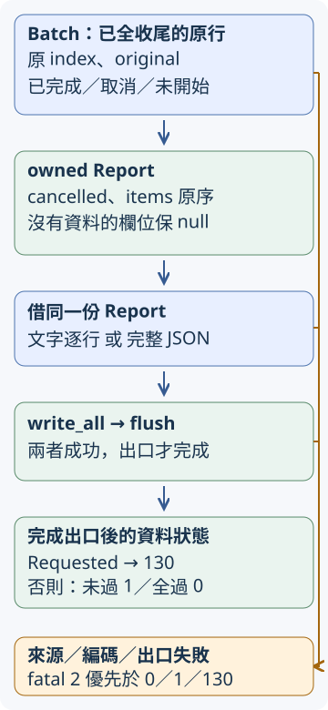

# 18.11 報告與 CLI 整合：完成映射、狀態與輸出三步

B4 已在停止後收妥所有已提交工作，也能指出哪些原行尚未開始。現在讓別人真的拿它檢查一份網址清單：指定檔案、選名額與期限，取得依原行排列的文字或JSON；呼叫者還要從退出碼分辨全過、項目未通過、取消及致命錯誤。

本節沿[18.10 的停止流程](18-10-lesson.md)，只新增報告映射、CLI邊界與輸出完成責任。本節先做下方三個小步；第18.12節另提供整份可用工具的全部檔案與使用方式。各階段是同一工具的快照，不是把B1–4重寫一次。

## 先固定工具真正交出的答案

每個非空白原行仍是一份輸入，索引從0開始，空行留下空洞；相同網址不合併。只接受http／https、GET、最多五次redirect，最終2xx通過；每筆預設十秒，最多八份已提交工作。工作只等最終headers，沒有主動讀完整body；失敗的elapsed_ms量到該失敗結束，並不聲稱已取得headers。

退出政策先整份列清楚，後面的函式只實作這個約定：

| 已完成的工作／遇到的問題 | 對外結果 |
| --- | --- |
| 正常做完，全部項目passed | 報告成功寫出及flush後回0 |
| 正常做完，有HTTP未通過、Input、Request、Timeout或task故障 | 同樣交完整報告，寫出及flush後回1 |
| 已觀察使用者Requested | 全收尾，保已完成／Cancelled／Unstarted，報告成功後回130；優先於一般項目失敗 |
| 設定、讀檔、client準備、訊號來源或controller收尾失敗 | fatal2；不是使用者取消 |
| 報告編碼、write或flush失敗 | fatal2，優先於原本資料的0／1／130 |
| help／version | 顯示成功回0；顯示本身失敗仍回2 |

資料只進stdout，診斷只進stderr。輸出失敗可能已有部分bytes送出，不能把那份stdout當完整JSON；這沿10.4／10.9的Write邊界。取消要求也不會撤銷已送出的GET。

## 同一份Batch如何變成可交換的資料？

沿B4把整批理由與每筆分類分開。這次的 **Report** 保存cancelled與依原index排列的items；只有Requested令cancelled為true，不由某一列是否Cancelled猜整批理由。SignalFailed或StopSourceClosed則交typed RunError，沒有冒充取消報告。

一筆 **Row** 保存原index、original與固定kind。HTTP仍用status／passed分辨通過與未通過；其餘kind是input、request、timeout、task_failure、cancelled、unstarted。final_url只有HTTP取得；elapsed_ms沿單筆Check，未開始量測、task未交Check或尚未提交時保None。detail供人讀原因，不是用來解析分類的固定錯誤格式。

10.7／10.9已教Serde的String、bool、usize與Vec。這裡補本模型需要的能力：**u16／u128**編解碼成JSON整數；**`Option<T>`**在T有相應能力時也可編解碼，Some保存其值，None成為 **null**。本模型不略過None欄位；null不是數字0，也不是一個空字串。`Vec<Row>`的順序沿原清單，沒有引入HashMap的任意順序。

derive與deny_unknown_fields沿10.7；Deserialize用於讀回驗收，不會令網路錯誤型別自動可以序列化。我們先把typed結果轉成這份只含資料的owned模型，報告不再借用Batch或原錯誤：

```rust
--8<-- "examples/ch15-projects/b-final-starter/src/report.rs:model"
```

為了先驗每種欄位，映射checks改用**六份手工結果**。它不是一次實測HTTP清單；沿相同的原index／original責任，刻意涵蓋以下變化：

| 原index | 原結果 | Row應保存什麼 |
| --- | --- | --- |
| 1 | HTTP200，12ms | http、passed=true、status200、最終網址、elapsed12 |
| 3 | ftp的Input問題 | input、原文、detail；status／final_url／elapsed皆null |
| 4 | 與1相同原網址，另一次HTTP404，12ms | 另一筆http、passed=false、status404；不能合併為1 |
| 6 | Timeout，1000ms | timeout、elapsed1000，沒有HTTP status |
| 8 | Cancelled | cancelled、原文；不捏造量測或HTTP |
| 9 | `/notes`尚未提交 | unstarted；還沒解析，不能先改成input |

整批理由用Requested，因此資料狀態是130；改成Finished且保有未通過項目，則是1。相同網址的不同輸入本來就可能有不同結果，本表只用手工值驗映射，不聲稱量到這些毫秒數。



圖的藍色向下箭頭是資料交接；右側橘線把Batch來源理由、編碼或write／flush的失敗交fatal2。下方0／1／130是**已成功完成出口**才可交出的狀態，不是render得到String就已完成工具。兩種表示都借同一個Report。

本節先提供render，讓動手練習集中在映射與出口。JSON沿10.7使用to_string_pretty，最後加LF。文字模式先寫cancelled及項數，再一筆一行，欄位順序固定。

新選 **`serde_json::to_string`**，同樣借Serialize資料、回`Result<String, serde_json::Error>`，但不加入pretty縮排；直接借str也有Serialize能力。文字行的original／final_url／detail等資料用它形成JSON引用，讓雙引號或內含換行不會破壞一筆一行。數值Option則顯示數字或null，不手寫另一套跳脫規則。

```rust
--8<-- "examples/ch15-projects/b-final-starter/src/report.rs:render"
```

**RunError**用ZeroJobs／ZeroTimeout／Empty保存設定問題，Read／Client保存準備工作，Signal／StopSourceClosed／Controller分開來源與收尾；Encode／Output保存報告失敗。它沿11.7／17.4，Display只說這一層，source借出標準io、reqwest client準備或JSON錯誤；String型signal診斷沒有另一層Error，不捏造source。From對io只放Output，讀檔在發生處明確放Read；不把兩種來源混掉。

`#[non_exhaustive]`沿第17.4節：這個Error enum將來可增加variant，外部caller的match保留其餘分支；本crate內的Display／source仍能列完目前variants。`impl Error`與借讀source沿第11.7節，與Display產生人讀文字分開。

```rust
--8<-- "examples/ch15-projects/b-final-starter/src/error.rs:error"
```

## CLI設定與可以獨立保存的起點

沿10.6的try_parse_from、原生PathBuf與long bool。本次兩個整數long參數要跟一個值：<code style="white-space: nowrap">--jobs 2</code>與<code style="white-space: nowrap">--timeout-secs 5</code>。u64是64-bit的非負整數型別，本節交給 `Duration::from_secs`表示秒數；jobs的usize則用於名額與長度。clap按usize／u64解析，無法成為整數或超出型別範圍是用法錯誤；**解析成0仍是整數，正數規則由我們先驗，再讀檔**。

新增 **`#[arg(default_value_t = 值)]`**，設定省略這一項時使用的typed值；這些數字有ToString能力，clap能將其交回同一個欄位解析規則。它不是對Settings derive Default，也不替我們驗正數。filename仍必要，json仍是不跟值的bool開關。

```rust
--8<-- "examples/ch15-projects/b-final-starter/src/config.rs:settings"
```

先保存完整`b-final-starter`為自己的工作目錄，包含Cargo.toml、Cargo.lock、src、checks與fixtures。起點的舊排程、單筆工作與signal流程都已提供；新題目只有build_report、Report.status、write_report三份未完body。下方列出全部起始檔、checks與材料，片段只協助定位。

為了讓整個目錄能獨立建置，測試內置前文14.9的Fixture，沒有依賴教材repo外的path。axum只在dev-dependencies，features仍是已教的http1／tokio；產品依賴沿前文clap／Serde／reqwest／Tokio，Tokio的sync／signal仍供普通程式使用。固定版本與lock分工沿10.1。

內置Fixture保留動態port、ready、held通知與shutdown。本次私有 **`ready_response(&Client, Url)`** 只替測試確認ready的status與body，回`Result<(u16, String), reqwest::Error>`；選用`response.text().await`接手Response，等完整body並回`Result<String, reqwest::Error>`；先保存status，再交出Response。此處只核對固定小字串ready。外面的十秒timeout涵蓋send與讀body，任何ready失敗先shutdown server才交錯誤。**產品single仍只等headers，這個body讀取只屬測試服務就緒確認。** 沒有增加另一套未知的server API。

```rust
--8<-- "examples/ch15-projects/b-final-starter/src/test_fixture.rs:ready-probe"
```

起點暫在私有batch／single module允許dead_code，因尚未映射而未讀取結果欄位；沿B4限定的lint用途，不會替stub補功能。本步工作副本可保留這兩項局部allow；第18.12節的正式root已移除它們，沒有因此變更功能。內置Fixture等完成版原有排程tests才會編入；本節新增的純報告checks不先啟動服務。

```toml
--8<-- "examples/ch15-projects/b-final-starter/Cargo.toml"
```

已提供的 `validate_limits(jobs, timeout_secs)`先拒絕零jobs，再拒絕零秒；`validate`將Settings交給它。`load_inputs`先validate，再以原生Path讀完整UTF-8，讀失敗明確包Read，最後prepare_inputs；因此零設定配上不存在檔名仍先回設定錯誤。`write_output(&str, &mut W)`依序write_all與flush，交回io::Result；`write_report`的三步任務才決定怎樣用它交資料狀態。

batch與single是B4完整core的本地快照，改從 `crate::input` 找輸入型別；沒有借最終另一package的library。root的private mod與pub use沿17.4，對外型別與函式仍是這些同一份定義。`explain(&dyn Error)`先顯示外層，再用source逐層借讀原因；`fatal`嘗試stderr寫出與flush，連診斷自身失敗也回2，不遞迴panic。以下完整main只連接這些已教契約。

## 接上真正入口，也維持library邊界

本節起點沿17.4把實作module保持private，root以pub use公開Settings、Report／Row、RunError與必要函式。搬動內部檔案不需要caller改用私有路徑；公有型別、結果與失敗約定仍是契約。

`run(&Settings)`先驗jobs與期限，再讀完整UTF-8小清單；Empty也是fatal。client沿B1使用共享pool；普通CLI保留環境的proxy設定。建立Scheduler時還沒有提交工作，先spawn signal_controller並等其entered收端；Some表示listener已進入，None則由同一stop channel取得真正理由。

接著直接借用owned Scheduler執行run，完成後全等listener，再接手Batch形成Report。Requested與正常完成都走相同listener收尾；controller故障或來源失去仍fatal。沒有把任務owner藏進另一個可以直接drop的外層controller。

```rust
--8<-- "examples/ch15-projects/b-final-starter/src/app.rs:run"
```

library另提供`check_text(&Client, &str, jobs, timeout_secs, Receiver<StopEvent>)`，借caller共用client、回owned Report；先驗正數設定，再解析原行。caller保持送端有效，或送Requested要求停止並await返回；直接丟掉整份future仍不能替代等待children。這沿B4已有的caller責任，沒有承諾任意取消都會自動完成清理。

main沿10.6取完整args_os。help／version或用法訊息也交write_output確認flush；工作成功後才選文字／JSON出口。RunError沿Error.source形成診斷，正常返回ExitCode；診斷出口自己失敗仍回2，不再引發panic。

完整main只連接這些已教邊界；參考版不靠公共網站提供固定答案，測試也不靠sleep猜請求進度。

## 先看全部起始檔，再執行本節 target

`src/test_fixture.rs`雖隨起點保存，這份root**沒有**`mod test_fixture`宣告，因此本節library與bin都不載它，追加報告checks也不會自動載它。它是下一節完整排程測試會用的198行材料，下面同樣給全檔；不像前四步再透過path依賴另一個教材package。`tests/config.rs`只有兩項Parser檢查，不發HTTP；本節先選library，下一節再選integration target。

`fixtures/invalid-urls.txt`第0行空、第1行ftp、第2行只有一個一般空白、第3行/notes、第4行另一份ftp，最後有LF；折疊中先給含換行的精確全文，再給逐行預覽與重建方式。lock保存本目錄在repo外的解析版本，並非要求手填1774行設定。

??? example "展開起始目錄的全部 Rust 來源、lock 與固定輸入"

    `examples/ch15-projects/b-final-starter/Cargo.lock`：

    ```toml
    --8<-- "examples/ch15-projects/b-final-starter/Cargo.lock"
    ```

    `examples/ch15-projects/b-final-starter/src/lib.rs`：

    ```rust
    --8<-- "examples/ch15-projects/b-final-starter/src/lib.rs"
    ```

    `examples/ch15-projects/b-final-starter/src/input.rs`：

    ```rust
    --8<-- "examples/ch15-projects/b-final-starter/src/input.rs"
    ```

    `examples/ch15-projects/b-final-starter/src/single.rs`：

    ```rust
    --8<-- "examples/ch15-projects/b-final-starter/src/single.rs"
    ```

    `examples/ch15-projects/b-final-starter/src/batch.rs`：

    ```rust
    --8<-- "examples/ch15-projects/b-final-starter/src/batch.rs"
    ```

    `examples/ch15-projects/b-final-starter/src/config.rs`：

    ```rust
    --8<-- "examples/ch15-projects/b-final-starter/src/config.rs"
    ```

    `examples/ch15-projects/b-final-starter/src/error.rs`：

    ```rust
    --8<-- "examples/ch15-projects/b-final-starter/src/error.rs"
    ```

    `examples/ch15-projects/b-final-starter/src/report.rs`：

    ```rust
    --8<-- "examples/ch15-projects/b-final-starter/src/report.rs"
    ```

    `examples/ch15-projects/b-final-starter/src/app.rs`：

    ```rust
    --8<-- "examples/ch15-projects/b-final-starter/src/app.rs"
    ```

    `examples/ch15-projects/b-final-starter/src/main.rs`：

    ```rust
    --8<-- "examples/ch15-projects/b-final-starter/src/main.rs"
    ```

    `examples/ch15-projects/b-final-starter/src/test_fixture.rs`：

    ```rust
    --8<-- "examples/ch15-projects/b-final-starter/src/test_fixture.rs"
    ```

    `examples/ch15-projects/b-final-starter/tests/config.rs`：

    ```rust
    --8<-- "examples/ch15-projects/b-final-starter/tests/config.rs"
    ```

    `examples/ch15-projects/b-final-starter/fixtures/invalid-urls.txt` 的**精確全文**，以 JSON 字串表示：

    ```json
    "\nftp://host/item\n \n/notes\nftp://host/item\n"
    ```

    這裡的 `\n` 各代表一個 LF 換行；`\n \n` 中間是一個一般空白。用編輯器建立 TXT 時，先留第0行空白，再依序填第1行 ftp、第2行一個空白、第3行 `/notes`、第4行同一份 ftp，最後保留換行。上方字串的外層雙引號不屬於 TXT。下方是**逐行預覽**；建立檔案請按精確字串保存檔首換行與單空白行，避免直接複製預覽時漏掉空白：

    ```text
    --8<-- "examples/ch15-projects/b-final-starter/fixtures/invalid-urls.txt"
    ```

repo外依18.1明選已安裝的工具鏈，在自己的目錄：

```bash
cargo +1.99.0 check --lib --locked
cargo +1.99.0 test --lib --locked
```

起點可編譯，library零tests。隨附lock供整個目錄在repo外使用；在教材repo內，Cargo沿workspace根的lock。兩者有各自的範圍，不要求讀者手改lock內容。

## 第一步：只把已有結果交成Row

build_report已提供整批理由的判別；現在仍丟掉entries、回空items。請保留這段來源失敗政策，將每份Entry交成一份Row，沿既有順序保存原index與original。

可以先寫私有`empty_row(index: usize, original: String, kind: &str) -> Row`，初始化passed=false及各Option為None；再寫`row(entry: Entry) -> Row`處理各variant。它們是你在本題定義的函式，不是Rust或Serde的API。HTTP再填status／final_url／passed，Check沿用elapsed；其他類別各填自己的kind與detail。

在report.rs imports加入已教的Entry／Completion、InputIssue／Outcome：`crate::batch::Entry`、`crate::batch::Completion`、`crate::single::InputIssue`、`crate::single::Outcome`。原錯誤以Display交成detail；原字串則move進Row，不用為改表示再複製整張清單。

```rust
--8<-- "examples/ch15-projects/b-final-starter/src/report.rs:map"
```

新增checks有五項報告測試、四項入口／writer測試。先認識其角色：HTTP／Timeout資料是前表的手工映射材料；codec另用帶引號原文與帶LF的**人工detail**確認跳脫，不假稱來自一次真HTTP。task故障測試則spawn一份立即panic的人工task，沿B1借用handle的五秒觀察期限；觀察失敗先abort並await這份owner，再panic，沒有遺留child。

report五項還包含來源失敗與資料狀態；app四項先用自有TempDir驗設定優先與空清單，再驗writer。全部能力來自前文，沒有請讀者自行猜一個test helper。

ControlledWriter用兩個bool分開控制拒寫／拒flush，bytes保存實收內容、flushed記是否真到這一步；故障由PermissionDenied固定建立，沒有靠系統檔案權限猜測。先看這份helper，再看已收bytes但flush失敗的判準：

??? example "展開報告五項與入口／writer四項的全部 checks"

    `examples/ch15-projects/b-final-starter/checks/report-tests.rs`：

    ```rust
    --8<-- "examples/ch15-projects/b-final-starter/checks/report-tests.rs"
    ```

    `examples/ch15-projects/b-final-starter/checks/app-tests.rs`：

    ```rust
    --8<-- "examples/ch15-projects/b-final-starter/checks/app-tests.rs"
    ```

現在把checks/report-tests.rs整份追加到src/report.rs，checks/app-tests.rs整份追加到src/app.rs；每份自帶cfg及tests module，不再包一層。執行相同的`cargo +1.99.0 test --lib --locked`，起點應3項通過、6項失敗；只完成映射後5／4。這是同一份九項checks，下面的例子對照前表：

```rust
--8<-- "examples/ch15-projects/b-final-starter/checks/report-tests.rs:map-test"
```

完成映射後，task_failure仍保存原index／原文，不捏造status或elapsed。來源錯誤仍是Err。排程已有的真HTTP混合測試，在完整答案也把同一份Batch交給映射驗http／input／request，沒有把手工材料當真網路驗收。

## 第二步：資料狀態不等於出口已成功

補Report.status：cancelled先回130；否則依序查items，任何passed=false回1，全為true才0。真正空清單已在讀取入口拒絕；status只處理已建立的報告，不重新做URL解析或I/O。完成這一步後，同一份checks應6項通過、3項失敗，剩下的三項都指向出口。

```rust
--8<-- "examples/ch15-projects/b-final-starter/checks/report-tests.rs:status-test"
```

穩定的是同一模型、原序、欄位與表示規則。網路回應、毫秒、OS／dependency的詳細診斷本來可變，沒有把它們宣告為固定結果。JSON讀回核完整模型；文字checks則驗人工detail的LF確實留在同一行的跳脫表示。

## 第三步：write與flush都成功，才交資料狀態

write_report目前沒有寫出任何內容。請先render，再交給已提供的`write_output(text, output)`：它依10.4／10.9對`W: Write`呼叫write_all，成功後呼叫flush，兩者都保留io::Result。這次將完成出口的責任放在同一個helper，main與測試使用相同安排。

app.rs imports加入`use crate::report::render;`。編碼失敗用RunError::Encode；寫入／flush用Output，因而整份write_report回Err時，main統一fatal2。只在這些步驟全成功後，回`Ok(report.status())`。

以下核對前面已介紹的ControlledWriter，特別是bytes已接受、flush仍失敗的情況：

```rust
--8<-- "examples/ch15-projects/b-final-starter/checks/app-tests.rs:writer"
```

```rust
--8<-- "examples/ch15-projects/b-final-starter/checks/app-tests.rs:flush-test"
```

完成後同一份checks應9項全過，核對映射、優先序及真正出口。不要只令status回130便宣稱取消工具完成；寫出與flush失敗仍必須蓋過它。

??? tip "提示 1：轉表示時仍保留每份原輸入"

    match Entry.completion；Checked先接手Check.original與elapsed，再看Outcome。Cancelled／Unstarted沒有Check，保持None。entries.into_iter().map(row).collect()保留原序，沒有重編號或依網址去重。

??? tip "提示 2：先分fatal，再算資料狀態"

    build_report保SignalFailed／Closed為Err；正常理由才產生Report。Report.status內先看cancelled，再看各passed。write_report在最後成功才用這個候選狀態。

??? tip "提示 3：writer接受bytes不保證buffer已送出"

    render可能失敗；write_all成功後flush仍可能失敗。兩者都用同一個io到Output的From；不在Err路線回report.status。


## 本步完整答案：兩份全檔，連同相同九項 checks

先完成自己的三個body，再對照下面真實參考檔。完整report.rs包含empty_row／row／build_report／status／render與五項報告測試；完整app.rs包含同樣入口、write_output、完成的write_report與四項測試。它們使用 `crate::` 路徑，能直接放回本頁工作副本；其他manifest、root、input、batch、single、config、error、main維持上面的完整起點。

若以全檔替換來核對，**不要再把checks追加第二次**：兩份答案已含完全相同的九項checks。這個本步完成副本仍叫url-checker-starter，並未偷偷載入完整工具另外七項batch tests或其test_fixture module。第18.12節才一起提供正式工具的所有檔案、完整16+2測試及使用方式。

??? example "展開本步可直接替換的完整 report.rs 與 app.rs"

    `examples/ch15-projects/url-checker/src/report.rs`：

    ```rust
    --8<-- "examples/ch15-projects/url-checker/src/report.rs"
    ```

    `examples/ch15-projects/url-checker/src/app.rs`：

    ```rust
    --8<-- "examples/ch15-projects/url-checker/src/app.rs"
    ```


在自己的工作目錄，用同一個library target核對九項全過：

```bash
cargo +1.99.0 test --lib --locked
```

現在資料保留原input_index／original，未知欄位用null，型別錯誤仍有原因；出口完成後才交0／1／130，編碼、write或flush失敗則fatal2。這三個小步已把Batch接到工具邊界。下一節直接保存正式完整工具，再驗真正binary與使用限制。

[下一節：B 的完整可用答案](18-12-lesson.md)
